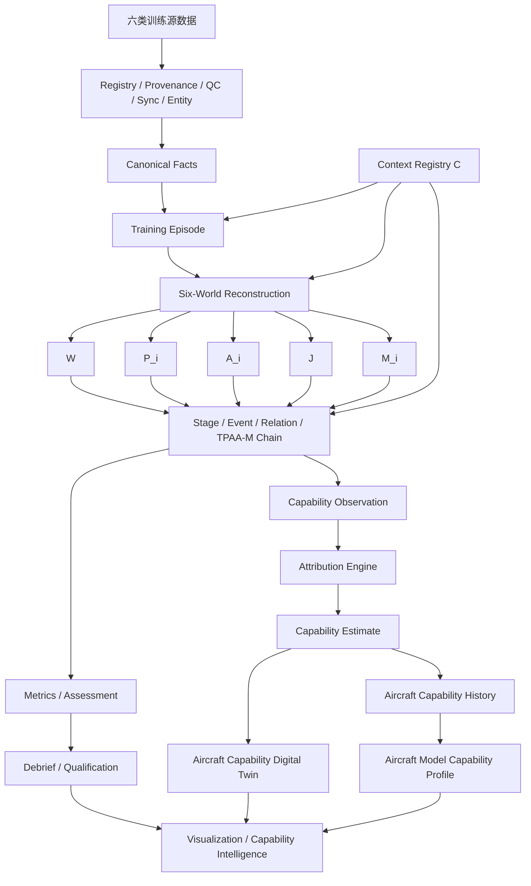

# 整体训练效果评估方案 TPAA V8.0

**文档角色：训练评价方法论与业务设计权威（Methodology Authority）**  
**工程基线：ED-2.0 / Core Baseline CB-1.4.0**  
**知识来源：R39 前版《整体训练效果评估方案》经冲突消解后的完整方法重构**

> **定义权声明：** 本文负责解释“为什么这样评、如何从事实与证据形成评价、如何处理缺失/不确定性/责任/长期趋势以及训练业务如何使用结果”。本文不拥有数据库字段、REST/DTO 字段、Stage code、116 项 P1 Metric Definition 或 661 项输入绑定的字段级定义权。字段/类型/nullability/枚举/版本及机器执行合同分别以 `canonical/CORE_LOGICAL_MODEL.json`、`canonical/CROSS_LAYER_DTO_CONTRACTS.json`、`canonical/STAGE_REGISTRY.json`、`canonical/P1_METRIC_CATALOG.json`、`canonical/METRIC_INPUT_AUTHORITY_MATRIX.json` 为唯一权威。
>
> 本文恢复 R39 中原先被 R1/R2 过度压缩的**评价方法层**。如果本文中的解释性示例与 Canonical artifact 在字段级存在差异，以 Canonical 为准；但不得据此删除本文所表达的评价意图、证据链、边界和训练业务逻辑，应通过修改解释性投影恢复一致。

## 0. V8.0 重构定位与阅读路径

**适用对象：** 战斗机/高性能军用飞机机载数据训练评估；**训练类型：** Basic Flight、WVR、BVR、Strike；**层级：** Individual、Team/Flight、Package/Mission、Joint/LVC；**输入边界：** 假定源文件已解码进入统一规范数据层。

**安全边界：** 系统只评价训练事实、规则符合性、过程能力、协同、系统可用性和经批准的训练/靶场裁决；不自行建立现实武器性能包线、最佳攻击/发射/投放参数、Pk 或战术优化建议。

训练评估系统必须连续回答五个问题：**结果如何、过程如何、问题在哪里、证据是什么、能力是否在变化**。V8.0 将文档职责分为三层：

1. `03_TPAA_V8.0_总体方案.md`：系统级边界、成熟度、总体架构；
2. **本文 03A**：评价方法论、训练业务逻辑和训练效果产品设计；
3. `04 + 05A~05J + canonical/*`：工程实现与机器合同。

因此，“去重”不再意味着删掉评价方法，而是**只去掉重复字段定义**。评价推理、典型训练场景、公式模板、证据解释、异常/缺失策略和复盘使用方式应在本文完整保留。

## 第一编：完整训练评估方法基线
## 1. 方案目标

训练评估系统不应只回答"这次得了多少分"，而应同时回答五个问题：

1.  **结果如何**：训练目标是否完成，模拟/靶场裁决结果如何；
2.  **过程如何**：飞行员、编队和任务群是怎样完成任务的；
3.  **问题在哪里**：偏差发生于飞行控制、态势感知、系统管理、决策、协同还是训练系统/数据质量；
4.  **证据是什么**：每个评价结果都能回到时间点、事件、轨迹、曲线、通信和教员标注；
5.  **能力是否在变化**：跨架次、跨场景、跨训练周期的能力趋势、稳定性和训练收益如何。

因此，推荐统一采用：

\[ `\text{原始统一数据}`{=tex} `\rightarrow`{=tex}
`\text{事实重构}`{=tex} `\rightarrow`{=tex} `\text{Stage/事件识别}`{=tex}
`\rightarrow`{=tex} `\text{指标}`{=tex} `\rightarrow`{=tex}
`\text{能力}`{=tex} `\rightarrow`{=tex}
`\text{资格判定 + 诊断评分}`{=tex} `\rightarrow`{=tex}
`\text{长期能力趋势}`{=tex} \]

------------------------------------------------------------------------

## 2. 方法依据与设计原则

本方案借鉴的不是某一军种的具体战术评分表，而是公开可获得的训练、飞行数据监控和能力评估方法论：

-   USAF `AFMAN 11-202V2`
    将标准化/评估作为验证机组资格、飞行风险管理和单位训练有效性的工具，并采用关键领域与资格判定思想。
-   FAA AQP
    强调**基于岗位任务分析、场景训练、个人与团队能力、绩效数据驱动训练改进**。
-   EASA EBT 强调**能力框架、Observable
    Behaviours（可观察行为）、数据驱动训练、教员一致性和反馈闭环**。
-   FAA FOQA / EASA FDM
    强调三类互补分析：**超限/事件检测、全架次测量、统计分布与长期趋势**。
-   NAVAIR MFOQA
    体现了利用已有数字飞行/任务记录进行**回放、趋势、训练、安全和维护分析**的工程路径。
-   P5 CTS / TCTS II 体现了训练环境中使用
    **TSPI、多平台数据、模拟武器事件、地面监控、任务后复盘和 LVC**
    的方式。
-   TENA
    体现了面向多靶场、多系统和联合/LVC环境时，通过**公共对象模型、接口和语义互操作**实现扩展的架构思想。

据此，本方案采用以下原则：

### 2.1 结果不等于能力

一次模拟命中或任务成功只是证据之一：

\[ `\text{Outcome}`{=tex} `\neq `{=tex}`\text{Skill}`{=tex} \]

系统必须同时保存过程能力和结果能力，禁止用结果完全覆盖过程。

### 2.2 安全是门槛，不是可被平均抵消的普通分项

严重安全、飞行限制或训练规则违规应采用 Gate：

\[
G\_{`\text{safety}`{=tex}}`\in`{=tex}{`\text{PASS}`{=tex},`\text{FAIL}`{=tex}}
\]

不能通过其他高分"平均掉"。

### 2.3 数据缺失不等于能力为零

如果某项评价所需数据不存在：

\[ `\text{score}`{=tex} = `\text{N/A}`{=tex} \]

而不是 0 分。每个评价必须包含数据充分度和置信度。

### 2.4 C + TPAA-M：统一评估语义模型

V8.0 将训练评价统一建模为：

\[ `\boxed{Assessment = F(C;\,W(t),\,P_i(t),\,A_i(t),\,J(t),\,M_i(t))}`{=tex} \]

其中：

1.  **Evaluation Context，记为
    C**：训练要求与评价标准，不属于事实世界。包括
    Scenario、Objective、Syllabus、Reference/Profile、训练/安全规则、角色要求、允许的替代动作和
    Assessment Profile；
2.  **GroundTruthWorld，记为 (W(t))**：由权威 truth source
    确认的"实际发生了什么"；
3.  **CrewAvailableWorld，记为 (P_i(t))**：成员 (i)
    当时客观可获得的信息，是工程上对 Perception 的可观测代理；
4.  **ActionWorld，记为
    (A_i(t))**：成员/系统实际执行的操纵、模式、通信、任务与团队动作；
5.  **AdjudicationWorld，记为
    (J(t))**：经批准的外部训练/模拟/靶场裁决，例如
    valid/invalid、官方命中偏差、官方模拟结果或外部 objective result。

强制边界：

\[
\boxed{C \notin W}
\]

训练标准、参考轨迹、容差和"应该怎样"不能写入 GroundTruthWorld；W
只保存实际事实。

\[
\boxed{Assessment \notin J},\qquad
\boxed{M \neq W},\qquad
\boxed{M \neq A}
\]

本评估系统自己计算的 Q/Q-/U、能力分、诊断分、趋势等属于 Assessment
Output，不能回填到 AdjudicationWorld，否则会形成循环评价。

完整关系为：

``` text
                 Evaluation Context C
        ┌─────────────┼──────────────┐
        │             │              │
        ▼             ▼              ▼
GroundTruth W ──→ CrewAvailable P ──→ Action A ──→ Adjudication J
        │             │              │              │
        ├─────────────┴──────┼───────┴──────────────┤
        │       Machine Capability M_i(t)           │
        └────────────────────┬───────────────────────┘
                             ▼
                       Assessment Engine
```

P 不等同于人的内心认知。自动系统只能判断信息是否进入
CrewAvailableWorld、是否出现可观察响应，并据此形成 SA
Evidence；更高层的理解、预测和判断必须由经过验证的代理指标或教员评价支持。

### 2.5 三类 Gap 与一类标准偏差

TPAA 产生三类过程 Gap：

-   **T--P Gap**：真实世界与成员可获得信息之间的差异；
-   **P--A Gap**：已有可用信息与实际行动之间的差异；
-   **A--J
    Link**：把实际行动与权威外部裁决建立可追溯关联；它不是天然的"距离"。只有在
    Profile 明确定义可比较结果时，才进一步计算 Process--Outcome
    Divergence。

此外，训练评价还需要 **C--W/A/J
Comparison**：把实际状态、实际行动或官方结果与训练标准比较。它不是第四种
TPAA Gap，因为 C 不是 World，而是评价上下文。

### 2.6 评价标准来自 C，而非算法自行创造

阈值、允许动作、时限、任务规则、目标区、参考轨迹、容差和角色要求必须版本化地来自
C：

-   训练大纲/Syllabus；
-   SOP/飞行手册/限制；
-   Scenario/Objective；
-   Reference Profile；
-   教员批准的评价规则；
-   Assessment Profile；
-   经历史数据校准的统计基线。

核心算法只执行版本化规则，不把规范性标准混进 W/P/A/J/M。

### 2.7 单架次评价与长期评价并行

单架次用于复盘；长期评价同时跟踪 competency、TP/PA Gap、AJ Link、team
relation、Context cohort、稳定性和训练收益。跨架次比较必须保证 C
的可比性或进行场景/难度归一化。

## 3. 六类输入数据及其评价角色

### 3.1 Flight Data

典型内容：

-   时间、经纬度、高度；
-   IAS/TAS/Mach/GS；
-   Pitch/Roll/Heading、航迹角、航迹倾角；
-   AOA、Nz、p/q/r；
-   操纵杆、脚蹬、油门；
-   发动机、燃油；
-   起落架、襟翼、减速板；
-   飞控模式、关键告警。

主要支撑：

-   基本飞行训练；
-   所有训练类型的飞行安全；
-   任务航迹执行；
-   操纵稳定性；
-   飞行状态/能量状态；
-   多机相对运动的本机部分。

### 3.2 Mission/Avionics Data

典型内容：

-   机载传感器航迹；
-   track ID、valid/quality；
-   sensor mode、track mode；
-   目标/航迹选择、指定、取消；
-   classification/association；
-   HOTAS/任务系统逻辑动作；
-   training weapon selection/event；
-   cue、warning、system state。

主要支撑：

-   WVR/BVR 信息管理；
-   目标关联和识别；
-   态势证据；
-   系统操作/任务管理；
-   空对面目标获取与指定；
-   训练武器事件。

### 3.3 TDL Data

典型内容：

-   数据链航迹；
-   source、track ID；
-   update time；
-   status/quality；
-   共享身份/分类；
-   任务/协同消息的结构化事件。

主要支撑：

-   BVR 共享态势；
-   多机信息一致性；
-   团队协同；
-   联合训练扩展。

### 3.4 Range/ACMI Data

典型内容：

-   全体参与者 TSPI；
-   唯一参与者 ID；
-   靶标/虚拟实体位置；
-   官方训练事件；
-   模拟武器 fly-out 或其结果；
-   hit/miss/kill/invalid 等训练裁决；
-   靶场评分或命中偏差；
-   LVC参与者真值。

主要支撑：

-   多机 truth picture；
-   WVR/BVR 相对几何；
-   官方模拟裁决；
-   空对面靶场结果；
-   多机/联合训练事实重构。

### 3.5 Scenario Data

典型内容：

-   scenario_id/version；
-   训练目标；
-   角色；
-   任务 Stage；
-   训练区域；
-   评价规则；
-   target/truth identity；
-   planned route / assigned profile；
-   rule windows；
-   instructor-defined objectives。

主要支撑：

-   "什么才算正确"的上下文；
-   任务 Stage 识别；
-   资格判定；
-   场景难度归一化；
-   多角色团队评价。

### 3.6 Audio/Video Data

原始数据可能是非结构化的，但应至少产生统一时间索引和可选派生结构化事件：

-   发送/接收/讲话时间；
-   speaker/channel；
-   transcript；
-   人工标注；
-   HUD/MFD/头盔显示录像时间轴；
-   关键截图/片段索引。

主要支撑：

-   通信及时性和完整性；
-   教员证据；
-   对自动事件的人工核验；
-   无法从结构化总线获取的信息补充。

------------------------------------------------------------------------

### 3.7 六类源数据、Evaluation Context 与 TPAA 产品的映射

六类输入是"来源域"；C 与 TPAA 是"评价语义域"。两者不可一一等同。

  -------------------------------------------------------------------------------------------------------------------------------
  语义产品                   主要输入                                                        核心问题
  -------------------------- --------------------------------------------------------------- ------------------------------------
  `EvaluationContext C`      Scenario、Syllabus/Reference、Assessment Profile、经批准规则    这次训练要求什么、按什么标准评价？

  `GroundTruthWorld W`       Range/ACMI、经验证的 Flight truth、Scenario truth/LVC truth     实际发生了什么？

  `CrewAvailableWorld P_i`   Mission/Avionics、TDL、显示/cue、经证实可被成员获得的通信信息   成员 i 当时客观上能获得什么信息？

  `ActionWorld A_i`          Flight controls、Mission/Avionics logical                       成员/系统实际做了什么？
                             action、Audio/Video/通信事件、TDL task action                   

  `AdjudicationWorld J`      approved Range/ACMI、Simulator、Range scoring、外部正式         权威外部系统正式如何裁决？
                             evaluator                                                       
  -------------------------------------------------------------------------------------------------------------------------------

一个源可以进入多个产品，但必须由 Policy 决定。例如 Flight Data
的实际飞机状态可进入 W，操纵杆/HOTAS 可进入 A。Scenario 文件中的 **truth
entity** 可进入 W，但 Scenario 中的 **reference profile/规则** 必须进入
C，不能混入 W。

**强制规则**：复杂指标以及能够采用世界产品的基础指标，应优先消费
C/W/P/A/J/M，而不是各自重新融合六类源数据。源数据只在 Canonical/World
Reconstruction 步骤被解释。

## 4. 统一评估对象模型

系统不直接"对文件评分"，而对以下对象评分。

### 4.0 Evaluation Context / 评价上下文

每个进入 Context-dependent 计算的 Session 必须通过 `ContextResolver(session_id, requested_context_version, at_session_time_us?)` 解析**一个或多个按时间区间生效的 revisioned Evaluation Context**；`training_session` 本身不得保存可变的 `current/default context` 指针。一次已发布 SESSION Release 必须冻结实际使用的 `context_id + context_version + revision_no + [start_session_time_us,end_session_time_us)` binding，历史重放按冻结 `context_id` 精确读取，不重新选择“最新 Context”。

``` text
EvaluationContext C
├── context_id / context_version / revision_no
├── scenario_id / version?                 # P1-AOP 可为空
├── objective / syllabus / SOP refs?
├── role requirements / role_model_version?
├── reference_set_version?
├── rule_set_version
├── assessment_profile_id / version?       # 可为空
├── metric_profile_version
├── longitudinal_profile_version?
└── valid Session-Time interval + status
```

C 是评估输入，但不是事实 World。任何对“偏差、合规、响应是否及时、是否完成”的判断，都必须引用**该结果/Release 冻结的精确 Context revision**与对应 W/P/A/J/M 证据；不得仅凭 `context_version`、最大 revision 或当前配置重新解释历史结果。

### 4.0A World Product / TPAA Snapshot

对任意时刻/窗口，系统可以访问：

``` text
GroundTruthWorld        W(t)
CrewAvailableWorld_i    P_i(t), i=1...N
ActionWorld_i           A_i(t), i=1...N
AdjudicationWorld       J(t)
```

多机任务的关键结构是：**共享/可并存的 Truth 上下文 + 每个 observer
独立的 P_i + 每个 actor 独立的 A_i + 可关联的外部 J**。

团队层还可派生 `TeamAvailableWorld(t)`、`TeamActionState(t)` 和
`TPAAChain`，但这些都是派生产品，不替代个体 P_i/A_i。

### 4.1 Session / Sortie

一次完整训练架次或仿真会话。

### 4.2 Stage

例如：

-   Ground/Takeoff；
-   Transit；
-   Basic Maneuver；
-   Mission Setup；
-   Engagement；
-   Reset；
-   Recovery/Landing。

不同训练课目可配置自己的 Stage 状态机；Stage 的 current code set 由 `STAGE_REGISTRY.json` 唯一控制。

### 4.3 Event

事件是自动评价的基本单位：

-   SAFETY_EVENT；
-   STAGE_TRANSITION；
-   TRACK_ACQUIRE/DROP；
-   IDENTIFICATION_CHANGE；
-   TASK_ASSIGN/COMPLETE；
-   CUE/ACK；
-   TRAINING_WEAPON_EVENT；
-   ADJUDICATION；
-   COMMUNICATION；
-   FORMATION_DEVIATION；
-   TARGET_DESIGNATION 等。

### 4.4 Entity

可扩展实体：

-   aircraft；
-   crew/pilot；
-   sensor track；
-   truth target；
-   virtual/constructive participant；
-   surface target；
-   formation/team；
-   mission package；
-   instructor station。

### 4.5 Objective

训练目标必须可机器引用，例如：

-   `OBJ_BASIC_ALTITUDE_CONTROL`
-   `OBJ_WVR_SITUATION_MAINTENANCE`
-   `OBJ_BVR_SHARED_PICTURE`
-   `OBJ_SURFACE_TARGET_ASSOCIATION`

### 4.6 Metric

由事件/时间序列计算的客观量。

### 4.7 Competency

由多个 Metric + 教员证据构成的能力维度。

### 4.8 Assessment

最终形成：

-   Qualification；
-   Diagnostic Score；
-   Confidence；
-   Evidence；
-   Instructor Grade/Comment。

------------------------------------------------------------------------

## 5. 通用评价框架

推荐所有课目统一使用以下九个一级能力域，再按课目启用子集。

  --------------------------------------------------------------------------------
  一级能力域                          含义
  ----------------------------------- --------------------------------------------
  Safety & Discipline                 飞行安全、限制、训练规则、空域/间隔

  Aircraft Control                    姿态、速度、过载、操纵品质

  Flight/Task Execution               航迹、Stage、程序、任务剖面执行

  Information & System Management     传感器、航迹、模式、信息获得和保持

  Situational Awareness Evidence      可由数据观察到的态势感知证据

  Decision & Task Management          对训练事件的程序性决策、响应、并发任务管理

  Communication & Team Coordination   个人通信、共享态势、角色与团队任务

  Training Engagement Execution       模拟交战/攻击事件的训练规则符合性

  Mission Outcome                     官方训练/靶场/场景结果
  --------------------------------------------------------------------------------

不是每一类训练都需要全部九项。

------------------------------------------------------------------------

## 6. 数据质量、充分度与置信度

任何评分前必须先产生 `Data Quality Report`。

### 6.1 基本质量项

-   时间单调性；
-   采样间隔；
-   丢帧/重复记录；
-   单位与坐标系；
-   角度 wrap；
-   valid flag；
-   GPS/位置跳变；
-   速度与位置导数一致性；
-   多源时间偏移；
-   多机时间同步；
-   mission/TDL/range 数据延迟；
-   event timestamp 精度；
-   entity ID 冲突；
-   scenario version 缺失。

### 6.2 数据覆盖率

对评价窗口 (T)：

\[ C\_{`\text{coverage}`{=tex}} =
`\frac{T_{\text{valid data}}}{T}`{=tex} \]

### 6.3 指标置信度

建议每个指标附：

\[ C_i=f(C\_{`\text{coverage}`{=tex}}, C\_{`\text{sync}`{=tex}},
C\_{`\text{source}`{=tex}}, C\_{`\text{truth}`{=tex}}) \]

采用 HIGH/MEDIUM/LOW 或 0\~1 表示。

### 6.4 可控性标签

每个指标还应记录：

-   `pilot_controllable`
-   `team_controllable`
-   `system_dependent`
-   `environment_dependent`

例如数据链中断首先属于系统证据，只有在存在明确可观察的操作责任时才影响飞行员评分。

### 6.5 Context Capability 与 World Capability

Source availability 只回答"有没有输入"，不能直接推出"能评价什么"。每次
Session 必须先声明 Context 与 World Capability：

  ------------------------------------------------------------------------------------------------------------
  Capability           C           W           P           A           J      允许的评价
  --------------- ----------- ----------- ----------- ----------- ----------- --------------------------------
  `LEGACY_BASIC-CORE`         ✓           ✓       optional        ✓       optional   基本飞行精度、控制、程序、安全

  `LEGACY_WVR-CORE`           ✓           ✓                       ✓       optional   几何、飞行控制、能量、动作

  `LEGACY_WVR-INFO`           ✓           ✓           ✓           ✓       optional   在 CORE 上增加信息/Track/SA
                                                                              Evidence/响应

  `LEGACY_WVR-FULL`           ✓           ✓           ✓           ✓           ✓      在 INFO 上增加官方训练结果关联

  `LEGACY_BVR-PROCESS`        ✓           ✓           ✓           ✓       optional   信息链、任务/响应、团队过程

  `LEGACY_BVR-FULL`           ✓           ✓           ✓           ✓           ✓      完整过程---官方裁决关联

  `LEGACY_SURF-CORE`          ✓           ✓       optional        ✓       optional   航迹、程序、训练攻击动作

  `LEGACY_SURF-INFO`          ✓           ✓           ✓           ✓       optional   在 CORE 上增加目标信息/指定/协同

  `LEGACY_SURF-FULL`          ✓           ✓           ✓           ✓           ✓      在 INFO 上增加官方靶场/模拟裁决
  ------------------------------------------------------------------------------------------------------------

基本飞行的 P/J 是两个独立可选 flag，不强行构造成线性等级。缺 mandatory
World 时，相关评价必须为
`N/A/INSUFFICIENT_DATA`，不得用某个源文件"存在"来替代。

------------------------------------------------------------------------

## 7. 通用指标数学模板

### 7.1 偏差指标

目标值 (x\^\*(t))，实际值 (x(t))：

\[ e(t)=x(t)-x\^\*(t) \]

建议至少同时保留：

\[ MAE=`\frac{1}{N}`{=tex}`\sum `{=tex}\|e_i\| \]

\[ RMSE=`\sqrt{\frac{1}{N}\sum e_i^2}`{=tex} \]

以及：

-   P95 absolute error；
-   maximum error；
-   dwell-within-tolerance；
-   overshoot；
-   settling time。

### 7.2 驻留率

\[ R\_{`\text{within}`{=tex}} =
`\frac{T(|e| \leq L)}{T_{\text{stage}}}`{=tex} \]

其中 (L) 来自训练标准，而不是算法默认值。

### 7.3 事件响应时间

\[ T\_{`\text{response}`{=tex}} =
t\_{`\text{action}`{=tex}}-t\_{`\text{cue}`{=tex}} \]

只在场景规则明确规定"应响应"时才评分。

### 7.4 可用率

\[ A= `\frac{T_{\text{available}}}{T_{\text{relevant}}}`{=tex} \]

适用于 sensor track、datalink、shared picture 等。

### 7.5 连续性

\[ C= 1-`\frac{\sum T_{\text{gap}}}{T_{\text{relevant}}}`{=tex} \]

### 7.6 团队一致率

对 (N) 名成员，时刻 (t) 对同一实体形成一致且正确关联的成员数为 (n(t))：

\[ A\_{`\text{team}`{=tex}}(t)=`\frac{n(t)}{N}`{=tex} \]

再计算 Stage 平均或分位数。

------------------------------------------------------------------------

## 8. 评分与资格判定

### 8.1 三层评价输出

#### 层 1：Qualification

建议：

-   Q：满足资格/训练标准；
-   Q-：完成但存在需改进项目；
-   U：未达到最低标准。

也可映射为"优秀/合格/需改进/不合格"。

#### 层 2：Competency Diagnostic Score

0\~100，仅用于诊断和趋势，不替代资格门槛。

#### 层 3：Evidence

必须可回溯到：

-   时间；
-   Stage；
-   事件；
-   原始/派生参数；
-   轨迹；
-   录像/通信片段；
-   教员标注。

### 8.2 指标缺失时不补零

能力 (c) 的可用指标集合为 (I_c)：

\[ S_c= `\frac{\sum_{i\in I_c} w_i q_i S_i}`{=tex}
{`\sum`{=tex}\_{i`\in `{=tex}I_c} w_i q_i} \]

其中 (q_i) 为质量/置信度权重。

如果关键指标覆盖不足，则能力评分直接为
`N/A`，而不是用剩余指标制造虚假精确性。

### 8.3 Critical Gate

例如：

-   严重飞行限制违规；
-   重大训练安全间隔违规；
-   关键训练规则违规。

一旦触发，可限制总体资格：

``` text
Safety Gate = FAIL
=> Overall Qualification cannot be Q
```

具体规则必须来自训练标准。

------------------------------------------------------------------------

## 9. 基本飞行训练评估方案

基本飞行以 **C + W + A + M** 为最小闭环，P/J 按数据能力增强。TPAA
在基本飞行中的价值不是强行凑齐四层，而是确保"标准、实际状态、可用提示、动作、外部裁决、本系统评价"不混淆。

### 9.0 基本飞行的 C + TPAA-M 模型

-   **C**：训练动作定义、目标高度/速度/航向/姿态、参考轨迹、容差、程序顺序、安全/限制规则；
-   **W**：飞机实际状态和环境/空域事实；
-   **P**：成员当时可见的仪表、告警、模式/cue（只有有数据时才建立）；
-   **A**：操纵输入、构型操作、模式操作和程序动作；
-   **J**：只有存在独立权威训练/模拟系统的正式 rule/objective result
    时才使用；普通基本飞行可以没有 J。

本系统计算出的 `Qualification / Competency / Diagnostic Score` 永远属于
Assessment，不属于 J。

最常见的基本飞行评价关系是：

\[ C\_{reference};`\leftrightarrow`{=tex};W\_{actual},`\qquad `{=tex}A
ightarrow W \]

用于回答"是否按标准飞到目标状态"和"动作如何影响实际状态"。若存在
P，则增加：

\[ P ightarrow A \]

用于评价告警/模式/指令到行动的可观察响应。

### 9.1 训练 Stage

推荐拆分：起飞、爬升、平飞/航路、基础转弯、指定状态保持、机动进入、稳定保持、退出/恢复、编队课目（如有）、进近、着陆。Stage 定义来自
C。

### 9.2 一级能力

-   Safety & Discipline；
-   Aircraft Control；
-   Flight Path Precision；
-   Maneuver Quality；
-   Control Smoothness；
-   Configuration/Systems Management；
-   Procedure Execution；
-   Formation Discipline（多机）；
-   Cue/Mode Response Evidence（P存在时）。

### 9.3 典型指标及世界产品依赖

  指标族                        Context C   W    P     A         J
  ---------------------------- ----------- ---- --- -------- ----------
  高度/速度/航向/姿态精度           ✓       ✓                
  Capture/Settling/Overshoot        ✓       ✓                
  操纵平滑/反向修正                 ✓       ✓          ✓     
  程序/构型执行                     ✓       ✓?         ✓     
  Warning/Mode Response             ✓            ✓     ✓     
  安全限制                          ✓       ✓          ✓?     optional
  多机编队位置                      ✓       ✓          ✓     
  外部正式课目裁决                  ✓                linked      ✓

高度/速度等误差统一按：

\[ e(t)=W\_{actual}(t)-C\_{reference}(t) \]

再计算 MAE、RMSE、P95、最大偏差、容差驻留率。**Reference 不进入 W。**

操纵品质指标由 A（杆/舵/油门/模式动作）与
W（姿态/角速度/状态响应）联合形成；例如输入变化率、反向修正、姿态振荡、恢复时间。

多机基础编队由 C 提供目标相对位置/安全规则，W 提供多机实际 truth
state，A 提供动作证据。不得把目标编队位置写入 GroundTruthWorld。

### 9.4 基本飞行输出

输出至少包括：

-   Context version；
-   Safety Gate；
-   C--W 精度/稳定性；
-   A--W 控制效果证据；
-   P--A 响应证据（若可用）；
-   外部 J（若可用）；
-   本系统 Assessment（Qualification + Diagnostic）；
-   数据/世界产品置信度；
-   关键复盘片段。

## 10. WVR 训练评估方案

WVR 的评估能力首先按 World Capability
判定：`LEGACY_WVR-CORE = C + W + A + M`，`LEGACY_WVR-INFO = C + W + P + A + M`，`LEGACY_WVR-FULL = C + W + P + A + J + M`。Flight、Mission、Range/ACMI、Audio/Video
只作为这些 World 的上游候选来源，不能直接决定业务指标是否可计算。

### 10.1 评价目标

WVR 不以"模拟击落数"作为唯一结果，重点评价：

-   高动态条件下飞行控制；
-   训练安全；
-   双方/多方相对态势维持；
-   状态与能量管理；
-   可观察的态势建立/恢复；
-   多机协同；
-   训练系统模拟武器事件与官方裁决。

### 10.1A WVR 的 C + TPAA-M 使用方式

WVR 以 **C + W + A + M** 支撑几何/飞行控制型评价，以 P/J 逐层增强：

-   **C**：课目目标、角色、engagement
    Stage、训练几何状态定义、安全/间隔规则、允许动作/时限；
-   **W**：多机 truth TSPI 和实际飞行/环境状态；
-   **P_i**：成员 i 客观可见的 track、cue、告警和其他批准的信息源；
-   **A_i**：高动态操纵、通信、模式/训练武器动作；
-   **J**：ACMI/P5/TCTS/模拟器等被批准 authority 的正式训练裁决。

能力降级规则：

``` text
C + W + A + M            → 飞行控制 / 相对几何 / 能量 / 程序
C + W + P + A + M        → 增加 Track / SA Evidence / Cue-Response
C + W + P + A + J + M    → 增加完整过程—官方结果关联
```

缺 P 时不得把 W 的全知 truth picture 当成 cockpit picture；缺 J
时只记录动作/attempt，不生成官方有效性或结果。

### 10.2 相对状态派生

对 ownship (i) 和对手/训练实体 (j)：

\[
`\mathbf `{=tex}r\_{ij}(t)=`\mathbf `{=tex}r_j(t)-`\mathbf `{=tex}r_i(t)
\]

可派生：

-   range；
-   vertical separation；
-   relative bearing；
-   relative heading；
-   closure rate；
-   LOS rate；
-   ownship/other energy state；
-   relative energy difference。

这些量用于复盘和训练标准符合性，不由系统自行搜索现实"最佳攻击几何"。

### 10.3 事件状态机

建议抽象为训练评价状态：

``` text
SETUP
→ CONTACT/RELEVANT
→ MANEUVERING
→ ADVANTAGE / DISADVANTAGE / NEUTRAL（按训练规则定义）
→ TRAINING_ENGAGEMENT_EVENT
→ ADJUDICATION
→ RESET
```

状态边界必须由课目规则配置。

### 10.4 WVR 指标

#### Safety & Flight Control

-   空域/高度/间隔；
-   IAS/Mach/AOA/Nz 限制；
-   warning；
-   姿态与控制异常；
-   恢复稳定时间。

#### Geometry Evidence

-   各训练几何状态持续时间；
-   状态转换次数；
-   不稳定区间；
-   从训练定义的不利状态恢复的时间；
-   几何保持稳定性。

#### Energy/State Evidence

-   (E_s)；
-   (`\dot `{=tex}E_s)；
-   相对能量变化；
-   机动前后状态重复性。

不使用算法自行定义现实空战的"最佳能量"。

#### Information/SA Evidence

当 `CrewAvailableWorld P_i` 可用时：

-   cue-to-track；
-   track continuity；
-   track loss/reacquisition；
-   cue response；
-   目标/航迹选择稳定性。

#### Team Coordination

多机时：

-   role/task acknowledgment；
-   shared entity agreement；
-   team event timing；
-   spacing/separation compliance；
-   communication completeness。

#### Training Engagement / Official Outcome

若 `AdjudicationWorld J` 可用，使用其中经 authority policy
批准的正式结果：

-   attempt；
-   valid/invalid；
-   hit/miss/kill/no-kill；
-   adjudication reason。

如果只有 trigger/release 物理动作，而没有官方裁决，则：

``` text
Training Engagement Action = observed
Adjudication = unavailable
Outcome = N/A
```

### 10.5 WVR 能力示例

  能力                      建议用途
  ------------------------- ----------
  Safety                    Gate
  Aircraft Control          诊断
  Geometry Management       诊断
  State/Energy Management   诊断
  SA Evidence               诊断
  Team Coordination         诊断
  Engagement Execution      诊断
  Official Outcome          结果证据

------------------------------------------------------------------------

## 11. BVR 训练评估方案

BVR 的核心不是单纯轨迹，而是信息链、共享态势、程序性决策与协同。

### 11.1 C + TPAA-M 六世界模型：BVR 的核心架构

BVR 是四产品最完整的应用场景，但所有判断仍受独立 C 约束。

#### 11.1.0 Evaluation Context：C

C 包含：scenario/objective、角色、relevance rule、Stage
definition、训练/安全规则、required response、允许替代动作、Assessment
Profile。**C 决定如何解释和评价 W/P/A/J/M，但不进入任何 World。**

#### 11.1.1 GroundTruthWorld：(W(t))

由 Range/ACMI、Scenario truth 和其他经 TruthAuthorityPolicy 批准的 truth
source 建立，仅保存事实：

-   truth entity / 唯一 ID；
-   position/state；
-   actual active/inactive state；
-   已确认的环境/系统事实。

`relevant`、角色要求、训练规则若属于规范性定义，应保存在 C；W 可以保留由
C 投影得到的 `context_relevance_ref` 作为索引，但不能把规则本身当
truth。

#### 11.1.2 CrewAvailableWorld：(P_i(t))

每个 observer 单独建立，包含：sensor track、TDL
track、classification/identity、track quality/age、displayed
cue、经证实对该 observer 可获得的通信/其他信息。Ground Truth
不得因后台可见而自动进入 P。

#### 11.1.3 ActionWorld：(A_i(t))

每个 actor 单独建立，包含：flight-control
action、mode/select/designate、acknowledgment、communication、task
lifecycle、training weapon/attack action、team action contribution。

#### 11.1.4 AdjudicationWorld：(J(t))

只接收经 AdjudicationAuthorityPolicy
批准的外部正式结果：valid/invalid、官方模拟
hit/miss/kill（若存在）、range score/miss distance、外部 objective
result、reason code。

**本系统的 Qualification/Score/Competency 不是 J。**

#### 11.1.5 TPAA Relation / Gap 与 Context Comparison

BVR 的过程分析包括：

\[
G\_{TP}=D(W,P_i),`\quad `{=tex}G\_{PA}=D(P_i,A_i),`\quad `{=tex}Link\_{AJ}=R(A_i,J)
\]

以及由 C 驱动的：

-   C--W：实际态势/飞行状态是否满足场景/安全要求；
-   C--P：训练要求的信息条件是否满足/可用；
-   C--A：required action/role/task 是否完成；
-   C--J：官方结果是否满足 objective criterion。

Assessment Engine 综合这些证据，而不是把 C 或 Assessment 混入 World。

### 11.2 BVR 评价 Stage

``` text
MISSION_SETUP
→ INFORMATION_BUILD
→ TRACK_ESTABLISHMENT
→ CORRELATION/IDENTIFICATION
→ SITUATION_DEVELOPMENT
→ DECISION/COORDINATION
→ TRAINING_ENGAGEMENT
→ ADJUDICATION
→ POST_EVENT/RESET
```

### 11.3 Track Availability

目标/实体在训练上相关的时间为 (T_R)，有效航迹存在时间为 (T_V)：

\[ A\_{`\text{track}`{=tex}}=`\frac{T_V}{T_R}`{=tex} \]

分别计算：

-   onboard sensor availability；
-   TDL availability；
-   fused availability。

### 11.4 Track Continuity

\[ C\_{`\text{track}`{=tex}} = 1-`\frac{\sum T_{\text{gap}}}{T_R}`{=tex}
\]

同时报告：

-   drop count；
-   mean gap；
-   max gap；
-   reacquisition time；
-   fragmentation count。

### 11.5 Track Age / 信息时效

若存在 source/update timestamp：

\[ Age\_{`\text{track}`{=tex}}(t) = t-t\_{`\text{last update}`{=tex}} \]

统计：

-   median；
-   P95；
-   maximum；
-   stale dwell ratio。

该指标首先反映信息环境/系统质量，是否计入个人评分取决于可控性。

### 11.6 Truth-to-Track Association

建立：

\[ TrackID `\leftrightarrow `{=tex}TruthID \]

优先采用训练系统已有 correlation；算法推断结果必须带 `inferred=true`
和置信度。

可评价：

-   correct association ratio；
-   duplicate track ratio；
-   merge/split events；
-   association churn。

### 11.7 Classification / Identification

根据 `GroundTruthWorld W` 中的 truth identity/class 与
`CrewAvailableWorld P_i` 中成员可获得的 classification/identity：

-   correct；
-   incorrect；
-   unknown；
-   transition count；
-   incorrect dwell；
-   unknown dwell；
-   stable-correct dwell。

`Unknown` 是否错误由训练规则决定，不能由系统默认。

### 11.8 Cue-to-Response

\[ T\_{`\text{response}`{=tex}} =
t\_{`\text{observed action}`{=tex}}-t\_{`\text{cue}`{=tex}} \]

只在 syllabus/scenario 明确存在 required response 时判分。

### 11.9 SA Evidence

不要输出"绝对 SA = 87.42"而缺少解释。

建议拆分：

-   SA-L1：信息获得证据；
-   SA-L2：关联/理解的一致性证据；
-   SA-L3：预测/前瞻通常需要教员评价或间接证据。

可形成：

\[ S\_{`\text{SA-evidence}`{=tex}} = `\sum `{=tex}w_k S_k \]

名称必须明确为 **SA Evidence Score**。

### 11.10 团队共有态势

对多个成员的 perceived world (P_i(t))：

-   team track agreement；
-   identity agreement；
-   shared-picture coverage；
-   convergence time；
-   divergence duration。

例如：

\[
A\_{`\text{team}`{=tex}}(t)=`\frac{n_{\text{consistent}}(t)}{N}`{=tex}
\]

### 11.11 Task / Role Coordination

Scenario 为每个成员配置 role/task：

``` text
TASK_ASSIGNED
→ ACKNOWLEDGED
→ STARTED
→ COMPLETED
```

评价：

-   acknowledgment completion；
-   response time；
-   completion rate；
-   handoff consistency；
-   team sequencing compliance。

系统不评价现实作战最优战术，只评价训练脚本/教员定义的任务过程。

### 11.12 Communication

若有结构化通信事件：

-   transmit occupancy；
-   required call completion；
-   acknowledgment latency；
-   missing acknowledgment；
-   conflicting/duplicate tasking 标注；
-   communication density。

若有 transcript，可增加人工/模型辅助分类，但关键资格判定应允许教员复核。

### 11.13 Training Weapon / Adjudication

只读取训练系统裁决：

-   attempt；
-   valid/invalid；
-   simulated outcome；
-   official reason code。

评估引擎不得自行重建真实武器包线。

### 11.14 Post-event

事件之后继续评价：

-   shared picture recovery；
-   track availability；
-   role/task completion；
-   communication；
-   flight stabilization；
-   reset completion。

### 11.15 BVR 一级能力

  能力                         C/World 依赖             主要证据关系
  ---------------------------- ------------------------ ---------------------
  Safety & Discipline          C + W + A + M                C--W / C--A
  Flight/Task Execution        C + W + A + M                C--W / A--W
  Information Acquisition      C + W + P                T--P
  Track Management             C + W + P                T--P / P 内部连续性
  Identification/Correlation   C + W + P                W--P association
  SA Evidence                  C + W + P + A + M            T--P / P--A
  Decision/Response            C + P + A                P--A / C--A
  Communication                C + P + A                P--A / team A--A
  Team Coordination            C + W + P×N + A×N        P--P / A--A / C--A
  Engagement Execution         C + P + A + optional J   P--A / A--J Link
  Mission Outcome              C + J（必要时关联 A）    C--J / A--J Link

上游 Flight/Mission/TDL/Range/Audio 数据只负责重构这些语义产品；BVR
业务指标不得再次按源文件自行融合。

------------------------------------------------------------------------

## 12. 空对面攻击训练评估方案

本文将"对面攻击训练"按**空对面攻击训练**理解，包括对地/对海面训练的一般评价框架。不同武器/平台的具体参数、真实投放包线和战术动作不固化在系统中。

### 12.1 World Capability 与上游来源

空对面不再用"文件组合"直接定义评价能力，而采用：

-   `LEGACY_SURF-CORE = C + W + A + M`：可评价任务航迹、程序、安全、训练攻击动作；
-   `LEGACY_SURF-INFO = C + W + P + A + M`：增加目标信息、关联、指定与团队信息过程；
-   `LEGACY_SURF-FULL = C + W + P + A + J + M`：增加官方靶场/模拟裁决和过程---结果关联。

可能的上游来源仍包括
Flight、Scenario、Range/ACMI、Mission/Avionics、TDL、Audio/Video，但它们只在
Canonical/World Reconstruction 步骤解释。课目指标只消费 C/W/P/A/J/M。

### 12.1A 空对面任务的 C + TPAA-M 使用方式

空对面训练同样采用统一模型：

-   **C**：planned route/profile、assigned target、target relevance
    rule、任务 Stage、训练攻击规则、安全/靶场规则、Objective、Assessment
    Profile；
-   **W**：truth target、平台实际状态、靶区/环境实际事实；
-   **P_i**：成员 i 当时可见的 target/track、TDL、cue、designation
    information；
-   **A_i**：目标选择/关联、指定、模式变化、通信、training
    release/trigger、post-event task；
-   **J**：靶场/模拟器权威
    valid/invalid、官方命中偏差/score、正式任务结果。

因此完整链为：

``` text
C defines what is required
      ↓
W actual target/state
      ↓ T–P
P_i available target information
      ↓ P–A
A_i association/designation/training action
      ↓ A–J
J official range/simulator adjudication
      ↓
Assessment compares C with W/P/A/J/M
```

这使"飞错/目标信息不足/动作问题/官方结果不佳"能够被分别归因。

### 12.2 评价 Stage

采用与具体战术无关的抽象 Stage：

``` text
MISSION_SETUP
→ ROUTE/TASK_EXECUTION
→ TARGET_INFORMATION_AVAILABLE
→ TARGET_ASSOCIATION
→ DESIGNATION/TRACK
→ TRAINING_ATTACK_EVENT
→ RANGE/SIM_ADJUDICATION
→ POST_EVENT_TASK_TRANSITION
→ RECOVERY
```

### 12.3 Safety & Rule Compliance

-   空域/高度/速度/飞行限制；
-   与友机/靶场的规定安全间隔；
-   training ROE/range rule；
-   target-zone rule；
-   warning；
-   training event invalid reason。

### 12.4 任务航迹执行

对 scenario-defined planned profile：

-   cross-track error；
-   altitude error；
-   speed error；
-   timing error；
-   waypoint/Stage completion；
-   dwell within assigned corridor。

这些评价针对训练任务计划，不由系统生成"最优攻击航线"。

### 12.5 目标信息与关联

目标评价统一在 Context + World Product 上进行：

-   **C**：assigned/eligible target、relevance window、role/task
    requirement；
-   **W**：truth target 的实际状态；
-   **P_i**：成员 (i) 的 crew-available target representation；
-   **A_i**：目标选择、关联、指定等动作。

核心关系：

\[ W\_{`\text{truth target}`{=tex}} `\leftrightarrow`{=tex}
P\_{i,`\text{available target}`{=tex}} \]

并由 C 决定 eligible/relevant window。评价包括：

-   target information availability；
-   truth--perception association accuracy；
-   association churn / target switch evidence；
-   designation continuity；
-   designation drop/reacquisition；
-   classification/ID evidence。

Metric 不直接读取 Mission/TDL/Range 来重新构造 target picture。

### 12.6 指定稳定性

可计算：

-   valid designation dwell；
-   drop count；
-   reacquisition time；
-   target-ID consistency；
-   sensor/TDL source consistency。

### 12.7 Training Attack Event 与 Official Adjudication

必须严格拆分 Action 与 Adjudication：

**A_i（ActionWorld）** - training release/trigger/attempt； -
target/designation at action time； - mode/communication/post-event
action。

**J（AdjudicationWorld）** - official valid/invalid； - reason code； -
official scoring point / miss distance / score； - approved
simulator/range objective result。

**A--J Link** - 将某次 training action 与相应 official adjudication
建立可追溯关系； - 不能把 trigger/release 自动视为 valid； - 没有 J
时只报告 attempt/action，不推断官方命中或任务结果。

若 J 提供官方命中点/偏差，可计算 radial miss distance、along/cross
error、repetition dispersion
等训练统计；这些值不用于倒推出真实武器性能。

### 12.8 多机空对面训练

评价对象从单机扩展为：

-   target assignment consistency；
-   task acknowledgment；
-   duplicate/conflicting assignment；
-   sequencing compliance；
-   separation/deconfliction；
-   shared target picture；
-   team completion rate；
-   official package outcome。

### 12.9 结果与过程分离

典型情况：

``` text
Target association: correct
Task execution: good
Training release: valid
Official score: poor
```

系统应指出"过程良好但训练结果较差"，而不是把全部能力判低。

------------------------------------------------------------------------

## 12A. 四类训练的统一 C + TPAA-M 适用矩阵

  -----------------------------------------------------------------------------------------------------
  训练能力        最低闭环       P 的作用                  J 的作用            强制边界
  --------------- -------------- ------------------------- ------------------- ------------------------
  `LEGACY_BASIC-CORE`    C + W + A + M      optional；告警/模式/cue   optional；仅        reference 不进
                                 响应                      approved external   W；Qualification 不进 J
                                                           result              

  `LEGACY_WVR-CORE`      C + W + A + M      不需要                    optional            无 P 不产生 SA/Track
                                                                               结论

  `LEGACY_WVR-INFO`      C + W + P + A + M  Track / cue / SA Evidence optional            Truth 不得代替 P

  `LEGACY_WVR-FULL`      C + W + P +    同 INFO                   官方交战训练结果    Metric 不重融源数据
                  A + J                                                        

  `LEGACY_BVR-PROCESS`   C + W + P + A + M  核心，多 observer         optional            系统缺失不默认归因人员

  `LEGACY_BVR-FULL`      C + W + P +    核心                      官方结果层          Assessment 不回填 J
                  A + J                                                        

  `LEGACY_SURF-CORE`     C + W + A + M      optional                  optional            planned route/target
                                                                               assignment 属于 C

  `LEGACY_SURF-INFO`     C + W + P + A + M  target info / designation optional            target picture 不在
                                 / team picture                                Metric 内重构

  `LEGACY_SURF-FULL`     C + W + P +    同 INFO                   官方靶场/模拟结果   只通过 A--J Link
                  A + J                                                        关联过程与结果
  -----------------------------------------------------------------------------------------------------

其中 Basic 的 `P_AVAILABLE`、`J_AVAILABLE` 作为独立能力 flag
报告。所有报告同时显示
`Context Version + World Capability + World Confidence`。

## 13. 单机、多机与联合扩展的统一层级

### 13.1 Level A：Individual

对象：

-   pilot/crew；
-   aircraft。

评价：

-   飞行控制；
-   系统操作；
-   可观察行为；
-   个体任务；
-   个体结果。

### 13.2 Level B：Element/Flight/Team

对象：

-   2机、4机或更大编队。

评价：

-   共享态势；
-   角色执行；
-   信息收敛；
-   通信；
-   spacing/separation；
-   team task completion。

### 13.3 Level C：Package / Mission Group

对象可以包含：

-   多编队；
-   指挥控制节点；
-   虚拟参与者；
-   无人系统；
-   地面/海上训练实体。

评价：

-   package objective；
-   cross-team information consistency；
-   task handoff；
-   cross-domain timing；
-   overall mission result。

### 13.4 Level D：Joint / LVC

核心评估模型不变化，只增加：

-   新 EntityType；
-   新 RelationType；
-   新 DataSource；
-   新 Metric Plugin；
-   新 Scenario Objective；
-   新 Assessment Profile。

这比为每一种联合训练单独建一套数据库更可持续。

------------------------------------------------------------------------

## 14. 多机评价中的归因原则

### 14.1 个人成绩与团队成绩分开

不采用：

``` text
Team = 85
=> Pilot A = 85
=> Pilot B = 85
```

而是：

  能力                  Pilot A   Pilot B   Team
  ------------------- --------- --------- ------
  Aircraft Control           90        86    ---
  Track Management           82        75    ---
  Communication              80        88     84
  Shared Picture            ---       ---     78
  Task Coordination         ---       ---     83

### 14.2 事件责任模型

每个事件可记录：

-   actor；
-   owner；
-   affected entity；
-   team；
-   controllability；
-   contribution confidence。

这样可支持后续更复杂的归因分析。

### 14.3 系统因素不归因给个人

例如：

-   TDL 大范围中断；
-   range truth 缺失；
-   sensor log 断流；
-   clock sync 问题。

应首先进入 `System/Data Issue`，不能自动扣个人分。

------------------------------------------------------------------------

## 15. 训练事件链与证据图

所有复杂任务都应从散乱的时间序列转换为 Event Graph。

以 BVR 为例：

``` text
ENTITY_RELEVANT
  ↓
CUE_AVAILABLE
  ↓
TRACK_ACQUIRED
  ↓
TRACK_STABLE
  ↓
CORRELATED / IDENTIFIED
  ↓
DECISION_POINT
  ↓
OBSERVED_ACTION
  ↓
TEAM_COORDINATION
  ↓
TRAINING_ENGAGEMENT_EVENT
  ↓
ADJUDICATION
  ↓
POST_EVENT
```

对空对面攻击：

``` text
TARGET_RELEVANT
  ↓
TARGET_INFORMATION
  ↓
TARGET_ASSOCIATION
  ↓
DESIGNATION
  ↓
TRAINING_ATTACK_EVENT
  ↓
OFFICIAL_SCORING
  ↓
POST_EVENT_TASK
```

事件链用于：

-   计算时间；
-   定位断点；
-   建立根因候选；
-   自动选取复盘片段；
-   解释评分。

------------------------------------------------------------------------

## 16. 根因分析采用"候选原因"，不做过度断言

自动系统应输出：

``` text
Mission Objective Not Achieved
└── Training event unsuccessful
    ├── Information unavailable
    │   ├── sensor source unavailable
    │   └── TDL gap
    └── Observable response late
```

但最终"为什么"应允许教员确认。

推荐根因类别：

-   Flight Control；
-   Information Availability；
-   Track/Association；
-   Procedure；
-   Decision/Task Management；
-   Communication；
-   Team Coordination；
-   Training System；
-   Data Quality；
-   External/Scenario；
-   Instructor Determination。

------------------------------------------------------------------------

## 17. 长期训练评价

这是系统必须从第一版就保留数据结构、后期逐步增强的模块。

### 17.1 纵向能力向量

对飞行员 (p)：

\[ `\mathbf `{=tex}S_p(t) = \[ S\_{`\text{control}`{=tex}},
S\_{`\text{task}`{=tex}}, S\_{`\text{SA}`{=tex}},
S\_{`\text{team}`{=tex}}, ...\] \]

每架次都形成新的带置信度观测。

### 17.2 不只存总分

长期库应至少保存：

-   metric distribution；
-   competency score；
-   qualification；
-   scenario；
-   role；
-   team composition；
-   data confidence；
-   instructor；
-   training standard / context version；
-   world capability code / optional capability flags；
-   world product versions 与 world confidence；
-   objective completion；
-   TPAA chain coverage；
-   T--P Gap / P--A response / A--J Link / team divergence 的长期观测；
-   significant events。

### 17.3 移动平均 / EWMA

\[ EWMA_n=`\lambda `{=tex}S_n+(1-`\lambda`{=tex})EWMA\_{n-1} \]

用于发现趋势，不用于替代资格判定。

### 17.4 能力波动

除了均值还应评价：

-   variance；
-   P10/P50/P90；
-   worst-case frequency；
-   stability；
-   recovery after poor performance。

训练能力的稳定性往往比单次峰值更重要。

### 17.5 场景难度归一化

不同场景不能直接比较 raw score。

建议建立同类场景基线：

-   scenario family；
-   complexity tags；
-   team size；
-   information availability；
-   task density；
-   historical completion distribution。

输出：

``` text
Raw Diagnostic Score = 82
Comparable-Scenario Percentile = 76th
```

后续可采用分层统计模型；M8 的首个受控 P4/P5 实现可先使用“同课目/同角色/同难度分桶的百分位”。

### 17.6 观察到的训练前后差（历史名称：训练收益）

下列前后差是描述性差异，不能仅据其符号归因为训练干预效果；须同时说明基线、口径、样本及参照条件变化。

对训练前后：

\[ `\Delta `{=tex}S=S\_{`\text{post}`{=tex}}-S\_{`\text{pre}`{=tex}} \]

并结合重复架次判断：

-   improving；
-   stable；
-   declining；
-   insufficient evidence。

### 17.7 能力衰减/复训提示

不简单按日历时间判定，可同时参考：

-   距离上次同类训练时间；
-   最近 (n) 次表现；
-   波动性；
-   任务暴露量；
-   关键能力近期证据。

------------------------------------------------------------------------

### 17A. C + TPAA-M 的长期能力趋势

长期库除 competency 外，还应保存：

-   Context cohort：training type、scenario
    family、role、difficulty、profile version；
-   T--P Gap：信息覆盖、关联/识别差异、团队 perception divergence；
-   P--A Gap：响应完成率、响应时延、无响应事件；
-   A--J Link：动作到官方裁决的可关联率；另以
    `Process–Outcome Divergence`
    记录"过程证据与外部结果不一致"，两者不混为一个 Gap；
-   C--W/A/J compliance：标准与实际状态/动作/官方结果的长期趋势；
-   world/context confidence 与版本。

不同 C cohort 的数据不得直接比较 raw score；先筛选可比 cohort
或进行难度归一化。

## 18. 教员评价与算法评价融合

完全自动化并不科学。

### 18.1 数据更擅长回答

-   发生了什么；
-   什么时候发生；
-   持续多久；
-   偏差多大；
-   谁在何时拥有何种信息；
-   是否符合已配置规则。

### 18.2 教员更擅长回答

-   为什么采取该行动；
-   某替代动作是否在情境中合理；
-   高层认知与判断质量；
-   战术教学重点；
-   隐含环境条件。

### 18.3 推荐结构

``` text
Objective Evidence
+
Instructor Observation
+
Scenario Context
=
Assessment
```

### 18.4 教员一致性

对类别判定可使用：

-   Cohen/Fleiss Kappa；

对连续评分可使用：

-   ICC；

并按能力域监控 inter-rater reliability。

如果某能力域教员一致性长期较低，应先改评分 rubric，而不是盲目调算法。

------------------------------------------------------------------------

## 19. 评价标准与版本控制

必须把规则外置为 `Assessment Profile`。

每个 Profile 至少包含：

-   aircraft/platform family；
-   training type；
-   syllabus version；
-   scenario family；
-   Stage definitions；
-   event rules；
-   required data；
-   metric formula/version；
-   thresholds；
-   critical gates；
-   competency weights；
-   minimum confidence；
-   instructor overrides；
-   validity period。

因此：

``` text
同一份历史数据
+ Profile V1
→ Assessment V1

同一份历史数据
+ Profile V2
→ Assessment V2
```

历史结果可追溯、可重算。

------------------------------------------------------------------------

## 20. 复盘报告结构

推荐每架次输出以下内容。

### 20.1 Overview

-   session；
-   aircraft/crew；
-   scenario；
-   role；
-   objectives；
-   data coverage；
-   overall qualification；
-   safety gate；
-   confidence。

### 20.2 Competency Profile

雷达图/条形图只是展示形式，底层必须保留可解释指标。

### 20.3 Mission/Flight Timeline

将：

-   Stage；
-   safety；
-   track；
-   communication；
-   training event；
-   adjudication；

叠加到统一时间轴。

### 20.4 Event Cards

例如：

``` text
EVENT 017
Track Continuity Issue

Time: 12:44:31–12:44:38
Entity: E-07
Sensor: track lost
TDL: track available
Observed action: ...
Reacquisition: ...
Impact: information continuity reduced
Confidence: HIGH
Evidence: trajectory + track state + comm marker
```

### 20.5 Key Strengths / Improvement Areas

必须由证据支持，不直接生成空泛评价。

### 20.6 Longitudinal Context

显示：

-   本次 vs 最近 5 次；
-   本次 vs 同类场景；
-   本次 vs 本人长期基线；
-   趋势；
-   证据充分度。

------------------------------------------------------------------------

## 21. 自动选择复盘片段

长架次不应要求教员从头播放。

构造：

\[ ReviewPriority = f( Safety, ObjectiveImpact, Anomaly,
TeamDisagreement, Adjudication, Confidence ) \]

输出：

``` text
1. HIGH    Event 17
2. HIGH    Event 08
3. MEDIUM  Event 21
```

点击事件直接跳转到：

-   3D轨迹；
-   飞参曲线；
-   sensor/TDL；
-   audio/video；
-   scenario；
-   scoring evidence。

------------------------------------------------------------------------

## 22. 评估体系验证

在正式用于资格评估前必须完成验证。

### 22.1 技术验证

-   时间同步误差；
-   event detector precision/recall；
-   entity matching accuracy；
-   metric reproducibility；
-   scoring determinism。

### 22.2 内容效度

由教员专家组确认：

-   指标是否真正代表课目能力；
-   是否遗漏关键行为；
-   是否把系统问题误归因给人员。

### 22.3 评分一致性

比较：

-   algorithm vs instructor；
-   instructor vs instructor；
-   不同单位/教员组。

### 22.4 稳定性

同一数据、同一 profile 在相同受控运行条件下必须得到可重现结果；Windows/Linux 等价规则见 `PLATFORM_COMPATIBILITY_REGISTRY.json`。

### 22.5 漂移监控

当：

-   aircraft software 更新；
-   syllabus 更新；
-   sensor/TDL 改版；
-   scenario 难度改变；

应触发重新校准。

------------------------------------------------------------------------

## 23. P 能力成熟度路线（V8.0 权威）

### P1：Aircraft & Mission-System Observed Performance / Aircraft CAP-L1 / System Observed Performance / Longitudinal Trend

P1 同时回答两个工程问题：

1. **飞机本体**：在本次可验证训练条件下，飞机实际表现出了怎样的速度/加减速/爬升/转弯/滚转/过载/AoA/能量/恢复/燃油与操纵响应性能；
2. **机载任务系统**：在本机+目标机参考导航状态及可审计时钟/坐标转换下，Radar/IRST/EO/RWR/ESM/TDL/Fusion 实际探测、测量、跟踪、关联、识别和融合得怎样。

P1 不进行人员训练评分，不把 Observed Performance 表述为飞机固有能力，也不把任务系统结果变成战术效能/武器运用结论。飞机指标可形成 Aircraft CAP-L1 Observation；任务系统指标形成独立 `SYSTEM_OBSERVED_PERFORMANCE` Observation/Trend，**不得混入 Aircraft CAP-L1 综合分**。

实现 Registry、Canonical、QC/Sync/Entity、飞机/构型与 Mission System Instance 主数据、Reference Relative State、P1 World 最小投影、Performance/Evaluation Opportunity Window、116 项 P1 Metric、Evidence、Immutable Release 与飞机/任务系统长期观察趋势。完整指标、公式、输入、N/A、Evidence 与 Golden 以 `canonical/P1_METRIC_CATALOG.json` 为唯一机器权威。


## 23A. P1 Observed Performance 指标范围冻结（V8.0）

P1 family authority = `Aircraft Observed Performance` + `Mission-System Observed Performance` + `Reference Truth/Timing Quality`。

P1 指标范围由 `canonical/P1_METRIC_CATALOG.json` 冻结为 **116 项**。覆盖：

- 飞机：速度/Mach、加减速、爬升/俯冲、瞬时/持续过载、转弯率/半径、滚转、机头指向、AoA、比机械能、Specific Energy Rate、Specific Excess Power Observed、能量保持/恢复、控制响应、燃油/持续性；
- 参考真值/质量：双机 Reference Relative State、Ownship/Target INS 时间不确定度、Sensor Time Offset、Sensor-to-INS Latency、Interpolation Age、Reference Truth Uncertainty 与 Measurement Error Decomposition；
- 主动/通用传感器：Detection Opportunity、Detection Rate、Time-to-First-Detection、First Detection Range、Range/Azimuth/Elevation/3D/Radial/Cross-range/Vertical Accuracy；
- Track/ID：Track Initiation、Position/Velocity Accuracy、Continuity、Drop、Reacquisition、Age、Association、Wrong Association、Swap/Split/Merge/Duplicate、Identity Continuity、Identification Accuracy/False/Unknown/Latency/Stability；
- 被动传感器：LOS/LOS-rate/Range Estimate Accuracy、Detection、Continuity、Reacquisition、False Track；
- RWR/ESM：Emitter Detection、Bearing Accuracy、Latency、Association、Classification、Continuity；
- TDL：Latency、Jitter、Loss、Out-of-order、Remote Track Age/Accuracy/Continuity；
- Fusion：Fused Position/Velocity Accuracy、Latency、Continuity、Duplicate Suppression、Association、Handover Continuity/Jump。

上述范围仅作训练与工程 Observed Performance。**不定义真实武器性能包线、最佳发射/投放条件、Pk、交战优势区、目标优先级、战术动作推荐或攻击决策自动化。**

### P2：Context Attribution & Normalization / CAP-L2

> V8.0 状态：`DESIGN_CONTRACT_FROZEN`。本节冻结方法、输入输出、证据与可辨识性边界，不表示已经形成与 P1 同级的可执行 Metric Catalog。

在 P1 可重复 Observation 上增加环境、构型、载荷、初始状态、人员/任务标签等因素视图和可比性约束；执行受控归因/条件调整，发布带适用域和不确定性的 CAP-L2 Context-adjusted Observation。**P2 仍不发布人员训练资格。**

### P3：Aircraft Intrinsic Capability & Digital Twin / CAP-L3

> V8.0 状态：`DESIGN_CONTRACT_FROZEN`。Twin/Model Profile 是版本化估计产品，不能被显示为 Ground Truth 或无条件“飞机真实能力”。

在 P2 的条件调整结果上建立版本化 Capability Model/Surface、单架飞机 Twin revision、生命周期/构型/软件变更关联、validity domain 和 as-of 查询。只有满足可识别性与验证门槛的结果才能发布为 CAP-L3/Twin；不得把模型估计写回 W 或历史 Observation。

### P4：Human–Machine / Individual Training Assessment

> V8.0 状态：`DESIGN_CONTRACT_FROZEN`。P1 的飞机/任务系统观测证据不能自动升级成人员认知或能力结论。

从“飞机平台”转入“人员+飞机”的训练评价。按以下顺序渐进启用：

1. Basic/基础飞行：操纵、安全、程序、基础任务执行、Safety/Qualification Gate、教员 Annotation、单架次复盘与报告；
2. 个体 Human–Machine 链：C→W/P→A→J/M，区分人员动作、平台限制与数据不足；
3. 可在数据成熟后加入个体 WVR 等课目中的个人过程评价，但团队/任务聚合仍留到 P5。

Aircraft Twin 只作为解释条件和平台约束输入，不直接替代人员 Assessment。

### P5：Team / Mission Training Assessment

> V8.0 状态：`DESIGN_CONTRACT_FROZEN`。团队/任务群结果不得直接复制为个体评分。

按训练业务复杂度逐级扩展：

1. **多机 WVR**：multi-aircraft truth/relative state、团队协同、角色/任务、官方训练裁决；
2. **BVR**：Mission/Avionics/TDL、W/P/A/J/M 链、track/association/classification、communication、shared picture、task coordination；
3. **空对面训练**：surface target、route/designation、官方靶场/模拟评分、多机目标/任务协同；
4. 形成 Individual→Team→Package/Mission 的分层 Assessment、长期人员/团队趋势和课程/单位分析。

个人成绩、团队成绩、平台限制和系统/外部因素必须保持独立证据链。

### P6：Joint/LVC + Predictive/Counterfactual Closed Loop

> V8.0 状态：`DESIGN_CONTRACT_FROZEN`。预测、反事实和建议必须与历史事实、观测值和已发布评价视觉与数据隔离。

P6 包含两个受控产品范围：

- **Joint/LVC & Mission Group scope**：扩展实体/关系、TENA/HLA/DIS 等网关（按项目实际需要启用）、跨平台/跨域 Context、任务群/联合评价和来源权威治理；
- **Predictive/Counterfactual/Training Planning scope**：在 P3～P5 已发布结果上进行 forecast、what-if/counterfactual、训练建议和模型监控；所有 Projection 与事实 W/J 严格隔离，建议必须经过人工审批，先 shadow-mode 再有限发布。

### P 能力准入门禁

```text
P1  Evidence/Golden + Observation/Trend stable
  → P2 Attribution/Normalization validated
  → P3 Twin + validity domain stable
  → P4 Basic/Individual human-machine chain stable
  → P5 WVR→BVR→Strike team/mission chain stable
  → P6 Joint/LVC interoperability stable → Forecast/Counterfactual shadow/approved
```

------------------------------------------------------------------------

## 24. 最终总体评价框架

``` text
六类统一数据                         训练标准/规则
     │                                  │
     ▼                                  ▼
Canonical Facts               Evaluation Context C
     │                                  │
     └──────────┬───────────────────────┘
                ▼
        TPAA World Reconstruction
       ┌────────┼─────────┬─────────┐
       ▼        ▼         ▼         ▼
       W       P_i       A_i        J
       │        │         │         │
       └────────┴────┬────┴─────────┘
                    ▼
       Context Projection + World Relations
                    ▼
          TP/PA/AJ/Team + TPAA Chain
                    ▼
        Stage / Event / Compliance
                    ▼
                 Metrics
                    ▼
        Competencies + Critical Gates
                    ▼
                Assessment
          ┌─────────┼──────────┐
          ▼         ▼          ▼
   Qualification  Diagnostic  Confidence
          │         │          │
          └─────────┼──────────┘
                    ▼
             Evidence Debrief
                    ▼
      Context-aware Longitudinal Profile
```

强制不变量：

1.  `C` 不属于任何 World；
2.  Reference/Rule/Role/Objective/Relevance definition 不写入 W；
3.  Truth 不自动进入 P；
4.  A 与 J 分离，只通过可审计 A--J Link 关联；
5.  Assessment 不回填 J；
6.  业务 Metric 只消费 C/W/P/A/J/M 与标准 Relation/Event，不直接访问
    source-specific records；
7.  多机必须保留每个成员独立 P_i/A_i；
8.  长期评价同时保存 Context cohort、World version、TP/PA Gap、AJ Link
    与 chain coverage；
9.  缺失 mandatory World 时输出 N/A/INSUFFICIENT_DATA，不补零。

## 25. 核心结论

V8.0 的统一评估骨架不是简单的 `W→P→A→J`，而是：

\[ `\boxed{Assessment=F(C;W,P_i,A_i,J,M_i)}`{=tex} \]

TPAA 描述训练事实链，C 描述训练要求，Assessment
是本系统的解释和判定。基本飞行允许以 C + W + A + M 形成最小闭环；WVR 采用
CORE→INFO→FULL 的 World Capability；BVR 采用 PROCESS→FULL 并完整保留每个
observer/actor 的 P_i/A_i；空对面采用 CORE→INFO→FULL，以 target
truth---available information---designation/action---official
adjudication
构造链路。四类训练因此可以共享同一底层架构，而不会为了"形式统一"而制造不存在的
Perception 或 Adjudication。

# 第二编：Training-driven Human-Machine-Platform Capability Intelligence 扩展方法

## 0. 版本定位与总体结论

<a id="v7-evidence-boundary"></a>
**V8.0 结论与证据边界（审查04—07、15—17）**

本系统保存来源可追溯的观察及条件化估计。六类数据的存在、字段齐全、流程完成或结果已发布，都不能单独证明相关结论真实或适用于全部对象。

| 结论层次 | 本版允许的解释 | 不得自动推出 |
|---|---|---|
| 观察描述 | 在明确时间窗和条件中记录到的共同表现 | 未观察到等于没有能力 |
| 条件调整/关联解释 | 在明确假设和证据支持范围内的估计 | 标签齐全即完成因果分离 |
| 预测 | 指定时间范围、数据环境及模型条件下的预测 | 已发生事实或现实性能认证 |
| 因果解释/固有性主张 | 只有附有独立论证和验证材料时才可另行声称 | 拟合良好、长期积累或审批通过即成立 |

每次记录应有状态，但不保证每次均有可识别数值。利用历史样本更新的估计必须说明历史证据范围，不冒充仅由当次数据得到的测量。NOT_IDENTIFIABLE、INSUFFICIENT_DATA 和不可比均为正常结论。

实测事实、配置/状态声明、推断值、未观察项应在证据解释中分别标明。来源权威说明来源地位；可追溯说明出处可查；两者均不保证零误差。来自同一测量或模型的多份记录不自动构成独立证据。

V8.0 沿用前版由 V5/V6.2 演进的 Episode、观察、分析、估计及长期画像结构，并修订通用方法与证据解释。下式是组织概念的设计表达，不是已经验证的效能或因果模型：

\[
\boxed{Assessment = F(C,W,P,A,J,M)}
\]

其中：

- `C`：Context World，训练目标、条件、规则、参考与评价口径；
- `W`：Ground Truth World，权威来源确认的实际事实；
- `P_i`：Perception World，成员 i 当时客观可获得的信息；
- `A_i`：Action World，成员或系统实际执行的动作；
- `J`：Adjudication World，批准的外部系统给出的正式训练裁决；
- `M_i`：Machine Capability World，当前证据支持的平台状态、能力声明或条件化估计；证据类别及限制必须显式解释。

全系统必须保持以下不变量：

```text
C ∉ W                         标准和参考不冒充事实
M ≠ W                         平台情境能力不冒充全局真值
M ≠ A                         平台可提供能力不等于已执行动作
Truth ≠ Perception            后台真值不替代座舱可用信息
Assessment ∉ J                本系统评分不冒充外部裁决
Business Metric ↛ Raw Source  业务指标不绕过标准数据产品重融源数据
Missing Data ≠ Zero           缺失不等于能力为零
Episode Estimate ↛ Same Episode Observation
                              当次反演结果不回流污染同一观察
```

最终形成两条相互关联但不混同的产出链：

```text
训练评估链：Episode → TPAA-M Evidence → Metrics → Competency / Qualification → Debrief
能力智能链：Episode → Observation → Attribution → Estimate → Twin / History / Model Profile
```

---

## 1. 评估目标

系统必须同时回答七类问题：

1. **结果如何**：训练目标、任务结果和外部裁决如何；
2. **过程如何**：人员、团队和平台如何完成各训练 Stage；
3. **信息是否可用**：成员当时获得了什么，缺了什么；
4. **动作是否合理可见**：在已具备信息的条件下发生了何种可观察响应；
5. **平台提供了什么能力**：飞机在该构型、状态和环境中提供了何种飞行、传感器、EW/防御和攻击支持能力；
6. **表现由什么共同造成**：人员、平台、环境各自贡献如何，不可解释部分多大；
7. **能力是否变化**：单架飞机、型号、人员、团队及人机组合在可比场景中的长期趋势如何。

因此评估输出不是一个总分，而是：

```text
Qualification + Critical Gates
Competency Diagnostics
Observed Performance
Context-adjusted Performance
Reference-condition Longitudinal Performance Estimate
Human / Platform / Environment Attribution
Confidence / Data Sufficiency
Evidence / Provenance
Longitudinal Trend
Instructor Review
```

---

## 2. 设计原则

### 2.1 结果不等于能力

一次成功或失败只是证据之一：

\[
Outcome \neq Human\ Capability \neq Platform\ Capability
\]

必须同时保存过程、结果、能力观察和归因结果。

### 2.2 安全是门槛

严重安全、飞行限制或训练规则违规采用 Critical Gate，不得被其他高分平均抵消。

### 2.3 证据优先

任一结论必须能沿以下路径追溯：

```text
Assessment / Capability Estimate
→ Metric / Attribution Result
→ Observation / Event / Relation
→ Episode Stage / TPAA-M Chain
→ World Product / Context
→ Canonical Fact / Source Provenance
```

### 2.4 数据缺失显式化

**审查11修订**：缺失状态处理不等于消除选择偏差。分析说明同时交代全部记录、进入分析的记录及排除情况，并讨论排除是否与结果或条件有关。未完成、未观察到、断流和不适用保持不同解释；不能把合格样本自动代表全部使用状态。

缺失或不足输出 `N/A`、`INSUFFICIENT_DATA`、`NOT_ADJUDICATED` 或 `NOT_IDENTIFIABLE`，不得补零，不得用 W 偷补 P，不得把 J 缺失解释为任务失败。

### 2.5 规范、事实、能力和评价分离

- C 规定“应该怎样”；
- W 记录“实际怎样”；
- P 记录“成员能看到什么”；
- A 记录“做了什么”；
- J 记录“外部如何裁决”；
- M 记录“现有证据支持的平台状态、声明或条件化估计”；
- Assessment 和 Capability Estimate 是后续分析结果。

### 2.6 单机、团队和任务群分层

团队成绩不复制给个人；型号画像不等于单架飞机；人机组合能力不直接等于飞机固有能力。

### 2.7 版本化和可重算

事实不可静默覆盖；World、Episode、Event、Metric、Attribution、Estimate、Assessment 和 Twin Release 均带版本。规则变化后允许重算并保留旧版本。

### 2.8 训练标准外置

阈值、限制、允许动作、角色要求、参考剖面、权重和发布门槛来自版本化 Context/Assessment/Attribution Profile，不硬编码在通用算法中。

---

## 3. 六类输入与评价角色

<a id="v7-input-assumptions"></a>
**输入依赖声明（审查05）**

统一格式只解决表达边界，不证明测量语义、校准、来源或标签有效性已经一致。

| 信息 | 可能的来源边界 | 未确认时的结论限制 |
|---|---|---|
| 六类训练记录及其来源、时间和单位 | 既有六类输入；实际内容逐批确认 | 不以文件存在代替有效观察 |
| 设备身份、构型及软件历史 | 输入中明确记录的内容或额外主数据 | 不默认今天的主数据解释历史 |
| 维护、换件、校准与累计使用记录 | 额外生命周期记录；六类输入不保证齐备 | 不宣称已经解释维护或使用变化 |
| 人员经验、等级及历史标签 | 经授权人员主数据或经复核资料 | 不宣称已经剥离未观测的人因影响 |
| 人工补充资料 | 注明提供者、依据、适用时段和可得时间 | 不冒充机载实测或当时已知信息 |

每项依赖注明已提供、待确认或不可得；这里只声明依赖，不新增源文件解析规范。

| 输入域 | 典型内容 | 主要贡献 |
|---|---|---|
| Flight Data | 时间、位置、姿态、速度、AoA、Nz、操纵、发动机、燃油、构型、告警 | W/A/M；飞行、安全、操纵、能量与平台状态 |
| Mission/Avionics | 传感器航迹、模式、质量、选择/指定、分类、告警、训练武器动作 | P/A/M；信息、系统管理、任务动作和平台传感能力 |
| TDL | 航迹、来源、更新时间、质量、共享身份、任务消息 | P/A；共享态势、协同和网络可用性 |
| Range/ACMI | 多机 TSPI、目标真值、训练事件、模拟/靶场结果 | W/J；相对几何、官方训练裁决 |
| Scenario | 目标、角色、课目、区域、威胁、参考、规则、目标实体 | C；部分经权威确认的静态 truth 可进入 W |
| Audio/Video | 通信、显示录像、转写、教员标注、媒体索引 | P/A/Evidence；通信和人工核验 |

一个源可以贡献多个世界，但必须由权威/可达/动作规范化/裁决准入策略决定。源数据只在 Canonical→World Reconstruction 步骤解释。

---

## 4. 六世界统一语义模型

### 4.1 Context World（C）

C 是版本化评价上下文，包括：

- scenario、mission type、training objective；
- syllabus、SOP、限制、规则；
- role/task、允许替代动作；
- reference profile、目标区域与容差；
- 计划天气、威胁、EW 环境和难度标签；
- assessment profile、attribution specification、发布策略。

C 不是实际事实。Context Projection 负责把规则、角色、目标和参考投影到实体与时间窗。

### 4.2 Ground Truth World（W）

W 保存权威实际事实：飞机/目标状态、空间关系、真实环境、实际系统状态和训练事件。训练角色、参考航迹、目标适用性、评分和能力估计禁止作为 W 固有字段。

### 4.3 Perception World（P_i）

P_i 对每个 observer 独立存在，保存雷达、数据链、告警、显示和经证实可达的通信信息。`available=true` 仅表示客观可获得，不证明已理解。融合必须保留 source lineage、质量和信息龄期。

### 4.4 Action World（A_i）

A_i 对每个 actor 独立存在，保存操纵、模式、选择/指定、通信、任务、训练攻击和团队动作。意图若无可观察证据不得写入 A。

### 4.5 Adjudication World（J）

J 只接收批准 authority 的合法性、模拟结果、靶场评分和官方目标结果。内部算法推断属于 derived evidence，资格/能力分属于 Assessment。

### 4.6 Machine Capability World（M_i）

M_i 汇集飞机 i 在时刻或窗口内、给定构型和任务条件下的状态证据、能力声明或条件化估计；下列内容应按证据类别解释，不能一概称为实测能力：

- Flight：飞控、动力、气动、机动、能量和操纵响应；
- Sensor：探测、航迹建立、连续性、精度、多目标与模式可用性；
- EW/Defensive：威胁发现、告警、干扰/防御支持和可用性；
- Weapon/Offensive Support：火控、武器接口、训练包线资格、攻击机会支持；
- Availability/Limitations：故障、降级、构型限制和数据质量。

M 的证据来自标准化平台状态和 C/W 条件。M 是 episode-time capability，不是长期固有能力估计。

### 4.7 世界关系

通用关系包括：

- `TP_GAP`：W 与 P 的差异；
- `PA_GAP`：满足信息资格后的 P 与 A 响应差异；
- `AJ_LINK`：A 与 J 的可审计关联，不天然是距离；
- `WM_RELATION`：W 条件与 M 能力状态的关联；
- `MA_RELATION`：M 能力供给与 A 能力使用的关联；
- `MJ_RELATION`：M 支持与 J 结果的关联；
- `C*_COMPARISON`：C 与 W/P/A/J/M 的适用、合规或参考比较；
- `PP_DIVERGENCE`、`AA_SYNCHRONIZATION`：团队信息/动作关系；
- `TPAA_M_CHAIN`：端到端可解释证据链。

只有 Profile 明确定义可比较量时，才计算 Process–Outcome Divergence。

---

## 5. 统一 Training Episode 模型

### 5.1 层级

```text
Training Session / Sortie
└── Training Episode [1..N]
    ├── Episode Participant [1..N]
    ├── Human-Machine Episode Link [1..N]
    ├── Episode Stage [1..N]
    ├── TPAA-M Event / Relation / Chain [0..N]
    ├── Capability Observation [0..N]
    └── Episode Result [1]
```

Session 是数据采集/训练会话；Episode 是可独立评价的课目、交战或任务单元。一个 Session 可以包含多个 Episode。

### 5.2 Episode 核心语义与 Canonical 引用

Training Episode 是训练评价的业务容器，而不是另一套字段定义。V8.0 只在方法层规定其必须能够表达：所属 Session、Episode 类型、有效时间范围、参与者/角色、Stage 序列、Context 绑定、World/Relation/Evidence 引用、评价范围、数据充分度/置信度以及生命周期状态。

字段名、类型、可空性、ID 与关系基数由 `canonical/CORE_LOGICAL_MODEL.json`、`canonical/CROSS_LAYER_DTO_CONTRACTS.json` 和 `canonical/STAGE_REGISTRY.json` 唯一规定。本方案不复制 persisted schema；任何页面、算法或分册只能消费 Canonical 投影。这样保留原方案的 Episode 方法语义，同时避免再次形成第二套 current-looking schema。

### 5.3 Human-Machine Episode

它是 Episode 内 `Pilot—Aircraft—Configuration—Role—Time Window` 的关联对象，用于：

- 明确某个观察属于哪一人机组合；
- 支持换人、换机、多人/多机和角色变化；
- 区分人员长期能力、飞机长期能力和组合效能；
- 防止把团队或平台结果错误复制给个人。

### 5.4 Episode 生命周期

```text
DETECTED → VALIDATED → WORLD_RECONSTRUCTED → METRICS_READY
→ ASSESSED → ATTRIBUTED → PUBLISHED
```

任一 Episode 生命周期处理步骤可进入 `PARTIAL`、`REVIEW_REQUIRED` 或 `INVALID`，且必须保存原因。

---

## 6. 通用评估处理链

```text
Unified Sources
→ Registry / Provenance
→ Quality / Time Sync / Entity Resolution
→ Canonical Facts
→ Context Resolution
→ Episode Detection / Validation
→ C/W/P_i/A_i/J/M_i Reconstruction
→ Context Projection / Stage / Event / Relation / TPAA-M Chain
→ Metrics / Capability Observation
→ Assessment + Attribution
→ Evidence Debrief
→ Human / Team / Aircraft / Model Longitudinal Products
```

业务 Metric 只消费 Context、World、Episode、Event、Relation 和标准 Derived Product。只有质量、World Reconstruction 和审计模块可直接读取 source-specific canonical records。

---

## 7. 基本飞行训练

### 7.1 Episode 与目标

对象为 `Basic Flight Episode`。同时评价：

- Human Handling Capability；
- Aircraft Handling Quality；
- Human-Machine Control Effectiveness；
- Safety / Procedure / Task Execution。

### 7.2 Stage 与六世界映射

| Stage | C | W | P | A | J | M |
|---|---|---|---|---|---|---|
| Setup/Entry | 科目、参考、进入条件 | 实际构型/状态 | 显示/告警 | 构型与操纵动作 | 外部课目状态可选 | 飞控/动力/构型可用性 |
| Execution | 目标姿态/高度/速度/动作规则 | 高度、速度、姿态、AoA、Nz、能量 | 驾驶舱可用信息 | 杆舵油门、模式 | 可选 | 响应、推力、气动、能量能力 |
| Stabilization/Recovery | 稳定带、恢复标准 | 实际响应与恢复 | 告警/提示 | 修正动作 | 可选 | 稳定性、余度、降级状态 |
| Completion | 完成与安全规则 | 最终状态 | 信息覆盖 | 程序动作 | 外部结果可选 | 全段能力摘要 |

### 7.3 关键指标与分离

保留 V5 的误差 MAE/RMSE/P95、容差驻留、捕获时间、超调、稳定时间、控制输入速率、反转次数、振荡、jerk、安全超限、程序完成和重复性。新增平台侧观察：控制响应、能量保持、加速、动力/飞控降级、相同输入与相似条件下的响应稳定性。

人员侧使用 A、P 与程序证据；平台侧使用 M、W 的输入—响应证据；环境侧由 C/W 标签提供。无足够变化或样本时不得强行分离人员与平台。

### 7.4 输出

- 人员操纵、程序、安全与任务能力；
- 飞机操纵品质和飞行能力 L1 观察；
- 人机控制转换效率；
- Capability Observation；
- 资格、证据、置信度及长期可比标记。

---

## 8. WVR 训练

### 8.1 Episode 链

`WVR Engagement Episode` 的标准链为：

```text
Merge → Position Advantage → Maneuver → Weapon Envelope
→ Launch → Kill Assessment
```

Reset 后的新一轮交战应生成新 Episode 或明确的 child episode，不与前一轮混算。

### 8.2 各 Stage 的 TPAA-M 重点

| Stage | 主要 W/P/A/J/M | 主要 M | 主要评价 |
|---|---|---|---|
| Merge | 双方真实几何、可用信息、进入动作 | 信息/飞行可用性 | 进入条件、安全、态势证据 |
| Position Advantage | 相对方位、距离、能量与认知代理 | 机动/能量能力 | 占位过程与机会形成 |
| Maneuver | 实际轨迹、操纵、团队动作 | 瞬态/持续机动、响应和限制 | 控制、几何、能量、团队 |
| Weapon Envelope | 训练规则、实际几何、可用提示 | 传感/火控/武器支持 | 机会是否可用、是否被利用 |
| Launch | 训练攻击动作 | 接口与支持状态 | 动作合规、响应与可用性 |
| Kill Assessment | A—J Link、官方结果 | 相关平台状态 | 过程—结果分离 |

### 8.3 指标

保留 V5 的相对距离、高差、闭合率、方位、几何状态驻留/转移、恢复时间、相对能量、高动态控制稳定性、信息可用性、重获、团队角色、间隔、训练动作、官方裁决和链完整度。平台观察覆盖机动、能量、传感与攻击支持。

### 8.4 失败归因

输出 Human、Platform、Environment、Team/System/Data 候选原因及置信度；不得以结果反推唯一原因。缺 P 时不评价 SA，缺 J 时只评价过程和动作。

---

## 9. BVR 训练

### 9.1 Kill Chain Episode

`BVR Kill Chain Episode` 的标准链为：

```text
Detection → Track → Identification → Decision
→ Weapon Employment → Assessment
```

每个 Stage 绑定 C/W/P_i/A_i/J/M_i、Context Projection、事件、关系和证据。

### 9.2 Stage 目标

| Stage | 人员/团队重点 | 平台重点 | 核心关系 |
|---|---|---|---|
| Detection | 信息关注与响应证据 | 探测/告警能力 | W–P、W–M、C–M |
| Track | 模式/航迹管理 | 建航时间、连续性、多目标 | P–A、M–P、W–P |
| Identification | 关联、分类、协同 | 识别支持与信息质量 | W–P、P–P |
| Decision | 任务响应、角色、协同 | 信息呈现/可用支持 | P–A、A–A、M–A |
| Weapon Employment | 动作合规与机会利用 | 火控/武器接口与攻击支持 | C–A、M–A、A–J |
| Assessment | 复位、画面恢复、复盘 | 系统恢复与持续可用性 | A–J、P–A、M–J |

### 9.3 BVR Attribution Matrix

| 断点 | 必查世界 | 主要候选类别 |
|---|---|---|
| 未发现目标 | C/W/P/M | 环境/相关性、信息不可达、传感能力、数据质量 |
| 航迹未建立或不稳定 | C/W/P/A/M | 模式/操作、平台传感器、干扰、目标条件 |
| 识别失败 | W/P/A/M | 关联/信息质量、人员处置、系统支持 |
| 决策迟缓 | C/P/A | 在 P 已满足资格条件后评价人员/团队响应 |
| 攻击动作无效 | C/W/A/M/J | 动作合规、平台支持、环境、外部裁决 |
| 无结果 | A/J | J 缺失或关联失败，不等于任务失败 |

矩阵是版本化规则产品，输出 `attribution_candidate`，教员可确认、修改或拒绝。

### 9.4 指标

保留 V5 的信息建立时间、Sensor/TDL/Fused availability、连续性、重获、信息龄期、关联质量、识别稳定性、SA L1/L2/L3 证据、团队画面一致/收敛/分歧、任务确认与完成、角色合规、通信、决策响应、训练动作、官方有效性、A–J Link、外部结果和事件后恢复。新增传感器、EW/防御和攻击支持的 L1/L2/L3 平台指标。

---

## 10. 空对面攻击训练

### 10.1 Episode 链

`Strike Mission Episode`：

```text
Planning → Navigation → Target Detection
→ Weapon Delivery → Damage Assessment
```

### 10.2 Stage 映射

| Stage | 人员因素 | 平台因素 | 环境因素 |
|---|---|---|---|
| Planning | 计划、角色、任务理解 | 航电/任务数据可用性 | 场景、目标、空域、威胁 |
| Navigation | 航迹与剖面执行 | INS/GPS/航电与飞行能力 | 天气、地形、导航环境 |
| Target Detection | 信息管理、关联和指定 | 雷达/SAR/EO 等传感支持 | 能见度、目标条件、干扰 |
| Weapon Delivery | 模式、程序、动作、协同 | 火控、武器接口、指定稳定性 | 威胁、规则和窗口条件 |
| Damage Assessment | 结果理解、后续任务 | 信息恢复/结果支持 | 外部裁决可用性 |

### 10.3 指标与输出

保留 V5 的横航向误差、剖面高度/速度、任务时序、目标信息可用性、真值关联、指定连续性/丢失/重获、目标切换、训练攻击动作、官方有效性与评分、重复离散度、目标分配一致性、团队任务完成和事件后转换。新增导航、传感器、火控/接口的平台能力观察。

---

## 11. Aircraft Capability Intelligence 体系

### 11.1 完整链路

```text
Training Data
→ Episode / TPAA-M Evidence
→ Capability Observation Record
→ Capability Attribution Engine
→ Capability Estimate
→ Aircraft Capability Digital Twin
→ Aircraft Capability History
→ Aircraft Model Capability Profile
```

### 11.2 Capability Observation Record

每条 Observation 至少绑定：

- Episode、Stage、Human-Machine Episode；
- Aircraft ID、Type、Block、Software、Configuration Snapshot；
- Pilot ID、经验、训练等级、近期暴露；
- Scenario、天气、威胁、EW 环境、Mission Type；
- Capability Dimension/Type、L1 Metric、Observed Value/Unit；
- 高度、速度、距离、载荷、威胁等 Context Tags；
- C/W/P/A/J/M 链和 Evidence；
- coverage、confidence、eligibility、correlation group、版本。

Observation 不可原地覆盖，修正通过 revision/supersedes 表达。

### 11.3 Performance/Capability Attribution Engine

输入：Observation batch、人因向量、平台状态/构型向量、环境/上下文向量、cohort、质量与归因规格。输出：

1. Human Contribution；
2. Platform Contribution；
3. Environment Contribution；
4. Unexplained Component；
5. Context-adjusted Value；
6. Reference-condition Performance Candidate；
7. Uncertainty、Identifiability、Quality、Evidence 和 Version。

V8.0 沿用接口与治理说明，不增加具体归因算法。因素贡献默认解释为模型条件下的关联说明；可加不等于占比，百分比表达须符合03的通用统计解释。

### 11.4 Capability Estimate

Estimate 必须声明：subject（单机/构型/型号）、能力类型、参考上下文、有效时间、样本数、飞机数、中心值、区间、稳定性、方法版本、数据截止时间和发布状态。

### 11.5 Aircraft Capability Digital Twin

数字能力孪生是单架飞机的已发布能力读模型：

```text
Identity + Configuration Timeline + Flight Hours
+ Maintenance/Fault/Calibration Events
+ Published Flight/Sensor/EW/Weapon Capability
+ Trend/Change Point/Forecast
+ Confidence/Evidence
```

它不是实时飞参镜像，不等于单次分数，不作为当次 World Truth。

### 11.6 Aircraft Model Capability Profile

**审查12修订**：原始记录数、观察数、独立对象数和有效证据量分别解释。去重成功不等于统计独立；相关但不同的观察不等于重复记录，也不能简单按“同组只留一条”解释。样本数量不能替代代表性和独立性论证。

按 Aircraft Type、Block、Configuration、Mission/Context Cohort 聚合，输出 aircraft_count、episode_count、mean、median、dispersion、percentile、trend、confidence 和版本。必须保留单机差异，禁止以 Episode 数冒充飞机数。

---

## 12. 三级平台能力指标体系

### 12.1 L1 Observed Performance

训练中直接测得的人机共同表现，如发现距离、建航时间、告警延迟、转弯/加速响应、指定连续性。L1 不能直接解释为飞机固有能力。

### 12.2 L2 Context Adjusted

在明确假设和数据支持范围内讨论条件调整或因素关联，形成参考上下文下的估计。标签存在不保证影响可唯一分离；L2 必须说明不确定性、可识别性及尚不能排除的解释，不默认具有因果含义。

### 12.3 L3 Reference-condition Longitudinal Estimate

对已有合格估计进行长期解释时，默认名称为“参考条件下的长期性能估计”。L1/L2/L3不是自动升级关系；积累不能自行消除系统偏差。仅在测量对象、识别条件及独立验证依据充分时，才可另行作出固有性主张。兼容代码 CAP_L3_INTRINSIC 的字面不构成这种证明。

### 12.4 五个能力域

| 域 | 典型能力 |
|---|---|
| Flight | 响应、机动、加速、能量保持、操纵品质 |
| Sensor | 发现、建航、连续性、精度、多目标、模式可用性 |
| EW/Defensive | 威胁发现、告警、连续性、干扰/防御支持 |
| Weapon/Offensive | 火控、接口、可用性、训练机会支持、A–J 关联 |
| Human-Machine | 信息利用、能力转换、适配、组合稳定性 |

Human-Machine 指标不得直接汇总进飞机固有能力，除非明确分离人员与平台贡献。

---

## 13. 人员、团队与综合效能评价

### 13.1 通用人员能力域

- Safety & Discipline；
- Aircraft Control；
- Flight/Task Execution；
- Information & System Management；
- Situational Awareness Evidence；
- Decision & Task Management；
- Communication；
- Team Coordination；
- Training Engagement Execution；
- Mission Outcome（结果证据，不替代能力）。

### 13.2 SA 的边界

P 只证明信息可获得。自动系统可评价关联、信息覆盖、响应和可观察行为；更高层理解、预测与判断需要经验证的代理指标或教员 rubric。

### 13.3 团队评价

团队能力不是成员平均值，独立评价共享画面、角色、任务交接、通信、动作同步、间隔和目标完成。必须保存 team composition。

### 13.4 综合效能

```text
Operational Effectiveness
= f(Human Capability,
    Machine Capability,
    Environment/Scenario Adaptation,
    Human-Machine Integration,
    Team Coordination)
```

该函数由 Profile 定义，不固定采用乘法或加法；Critical Gate 先于聚合。

---

## 14. 数据质量、充分度与置信度

**审查09修订**：既有 `confidence` 默认指经验质量指数或等级，不是“结论正确的概率”。完整性、测量不确定性、模型不确定性和可识别性分别说明；质量分不得替代区间或识别论证。共同误差来源不能按独立分量重复计为新证据。

每个 Session/Episode 先生成 Data Quality Report：

- 时间单调、采样、gap、duplicate；
- 单位/坐标/角度 wrap；
- valid flag、位置跳变、状态一致性；
- 多源偏移、漂移、残差和多机同步；
- entity ID 冲突与关联置信度；
- scenario/context/profile/version 完整性；
- Aircraft/Configuration/Pilot 标签完整性；
- Observation 独立性和重复计权风险。

指标置信度由 coverage、sync、source、truth、entity、context、machine-state、attribution-identifiability 等分量传播。Mandatory 输入缺失时状态优先于分数。

### 14.1 World Capability

```text
BASIC-CORE = C+W+A+M；P/J 为独立可用 flag
WVR-CORE   = C+W+A+M
WVR-INFO   = C+W+P+A+M
WVR-FULL   = C+W+P+A+J+M
BVR-PROCESS= C+W+P+A+M
BVR-FULL   = C+W+P+A+J+M
SURF-CORE  = C+W+A+M
SURF-INFO  = C+W+P+A+M
SURF-FULL  = C+W+P+A+J+M
```

缺 M 时仍可运行 V5 人员/任务指标子集，但不得生成平台能力 Observation 或声称形成完整 V8.0 能力闭环。

---

## 15. 评分、资格和 Profile

每个 Assessment Profile 至少包含：训练类型、平台族、场景族、Syllabus、Stage、事件规则、World 要求、Metric 版本、阈值、Critical Gates、能力权重、最低置信度、缺失策略、教员 override、有效期和发布规则。

输出分三层：

1. **Qualification**：Q/Q-/U/N/A，受 Gate 和 mandatory evidence 控制；
2. **Diagnostic Competency**：物理指标映射后的能力诊断；
3. **Evidence**：事件、关系、时间窗、曲线、轨迹、媒体和版本。

指标算法产生物理/统计值，Profile 负责映射；阈值更新通常升级 Profile，公式/eligibility/filter 变化升级 Metric Version。

---

## 16. 事件图、根因候选与教员评价

复杂任务均生成 Event Graph。边包括 `PRECEDES`、`RESPONDS_TO`、`AFFECTS`、`EVIDENCE_FOR`、`CAUSED_BY_CANDIDATE`。自动系统输出候选原因和证据，不输出未经确认的唯一因果断言。

教员评价与自动结果分开保存：

- Instructor Competency Grade；
- Event Tag、正确替代动作、root cause、false positive；
- annotation、review status、revision；
- 评分者一致性 Kappa/ICC。

Instructor override 必须保留原结果、修改人、时间、理由和 rubric 版本。

---

## 17. 长期能力体系

**长期解释限制（审查13—15）**：时间轴须注明按观察次数、日历时间或使用量解释；三者不能混同。百分位说明参照群体和版本，群体进入/退出与个体变化分别说明。比较缺少支持时保留空缺及原因，不用连线暗示持续有效。

报告区分“按当时信息重现”与“按最新信息回溯修订”；后补标签不冒充当时已知信息。LIVE、SIM、LVC 的数据环境和支持范围随结论呈现；仿真内部一致不自动证明现实有效性。

### 17.1 人员与团队

保留 V5 的 competency distribution、EWMA、trend slope、MAD/variance、P10/P50/P90、可比场景百分位、训练收益、近期有效暴露、距上次有效训练时间和衰减证据。团队趋势必须绑定成员构成。

### 17.2 单架飞机

按 aircraft_id、configuration、capability、context cohort 保存 Observation、Estimate、发布值、样本量和区间；关联飞行小时、维护、故障、换件、校准和软件变更。

### 17.3 型号飞机

按 aircraft_type/block/configuration/cohort 聚合单机 Estimate，而不是直接把全部 Episode 混为独立样本。显示总体分布、批次差异、长期变化和单机异常。

### 17.4 场景可比性

Cohort 至少包含：平台/型号/构型、training type、scenario family、role、team size、difficulty、threat/EW/weather bucket、profile/metric/attribution version。不可比数据只做描述，不直接画同一趋势。

### 17.5 变更点

维护、构型、软件、传感器校准、训练口径变化必须成为趋势分段标记。预测趋势应与观察历史视觉和数据对象分开，并显示预测区间。

---

## 18. 复盘与数据产品

每个 Episode 输出：

- Header：Session/Episode、参与者、构型、Context/World Capability/Version；
- Qualification、Safety、Objective、Data Confidence；
- Competency 与平台 L1 Observation；
- Key Review Events；
- TPAA-M Chain 与 Attribution Candidate；
- Evidence Package；
- Instructor Review；
- Longitudinal Context。

自动复盘优先级综合 Safety、Objective Impact、Anomaly、Team Disagreement、Adjudication、Capability Change、Confidence，点击后跳转统一时间轴、轨迹、曲线、信息、动作、M 状态和媒体。

---

## 19. 单机、多机、任务群与联合/LVC

- Individual：人员、飞机和 Human-Machine link；
- Team：共享画面、角色、任务、通信和动作关系；
- Package：跨团队目标、交接和总体任务；
- Joint/LVC：通过扩展 EntityType、RelationType、Source Adapter 和 Plugin 实现。

外部 TENA/HLA/DIS 等协议只能通过 Gateway→Canonical Model 接入，核心评估逻辑不依赖具体协议。多机始终保留 P_i/A_i/M_i，不提前融合成唯一座舱世界。

---

## 20. 治理、安全与审计

角色至少包括 Trainee、Instructor、Evaluator、Unit Analyst、Training Manager、Data Engineer、Administrator。按 Flight、Mission、TDL、Range、Scenario、Media、Assessment、Capability、Longitudinal 分域授权，并执行最小权限、传输/存储保护、保留策略和导出控制。

审计范围包括实体修正、时间同步、Stage 修正、教员 override、Profile/Metric/Attribution 变更、Estimate 发布/撤回、Twin Release 和型号画像发布。

---

## 21. 验证与验收

<a id="v7-validation-status"></a>
**证据成熟度声明（审查15—17）**

| 状态 | 可声明的事实 | 本版情况 |
|---|---|---|
| 需求已写明 | 文档已表达目标及边界 | 已有描述 |
| 规格已定义 | 指定条款的名称、语义及限制已定义 | 通用条款已修订；完整工程规格仍需核对 |
| 实现已验证 | 有对应实现、数据和验证结果 | 本版未附此类证据，待验证 |
| 预期用途已验证 | 有独立依据支持具体使用环境和外推范围 | 本版未附此类证据，待验证 |

后续验证材料应注明对象、主张、依据、数据独立性、实际结果、误差与局限；不能将流程示例、专家一致性或发布审批单独作为真实性证明。本节既有测试条目为验证计划，不表示已执行或已通过。

### 21.1 技术验证

- 时间同步残差、实体匹配准确度；
- World Reconstruction 与 Episode detector precision/recall；
- Metric 可复现、评分确定性；
- Observation 去重、归因数据泄漏与可识别性；
- Estimate/Twin 发布一致性。

### 21.2 内容效度

由训练、机务、航电、数据和教员专家确认能力维度、观察资格、因素标签和归因边界。

### 21.3 Golden Dataset

每类训练建立 Golden Session/Episode，并覆盖正常、边界、gap、时钟偏移、实体混淆、缺 P/J/M、构型切换、维护前后、重复观察和归因不可识别用例。

### 21.4 漂移监控

飞机软件、硬件/构型、传感器、Syllabus、Scenario 难度、数据源和归因模型变化触发重新校准或新版本发布。

---

## 22. 实施路线

<a id="v7-review-matrix"></a>
**V8.0 审查意见修订对照**

“已修订”仅指文字或文档一致性修改，不表示实测问题已解决。每项的位置均以本版编/节定位；原审查行号不作为V8.0行号。

| 审查项 | 内容 | 修改位置 | 状态及边界 |
|---|---|---|---|
| 01 | 两编适用关系 | 共同前言、第一编阅读说明；02第二编第16节 | 文档歧义修订；未认定领域条件有效 |
| 02 | 术语与枚举 | 02共用术语；02/03现行枚举及逻辑示例说明 | 名称对齐；完整契约验证待完成 |
| 03 | 页面编号 | 04第一编第53节、第二编第3.2节 | 目录与历史编号映射已修订 |
| 04 | 状态与能力证据 | 01结论边界与M定义；02第8.6节；04第13.3节 | 证据表述已修订；测量真实性待验证 |
| 05 | 输入及额外主数据 | 01输入依赖；02第6节；04第8.4节 | 依赖说明已补充；实际资料待确认 |
| 06 | 标签与因果解释 | 01第11.3/12.2节；02第12.5节；03第15节；04第15.2节 | 收窄承诺；不新增因素分离算法 |
| 07 | L3与固有性 | 01第12.3节；02术语/第13.1节；03第16节；04第13.3节 | 默认名称及解释已修订；固有性待独立证明 |
| 08 | 可加与占比 | 01第11.3节；02第12.5节；03通用解释；04第15.2节 | 删除可加即100%的默认表述 |
| 09 | 质量与不确定性 | 01第14节；02第21节；03通用解释/第3.2节；04第7.4节 | 解释分离；具体质量校准待验证 |
| 10 | 质量加权分数 | 03第一编第21.3节、第二编第18.2节；04第7.4节 | 保留原式并限定含义；未新增评分算法 |
| 11 | 缺失与选择偏差 | 01第2.4节；02第11.3节；03第3.1节；04第8.4节 | 报告边界修订；样本偏差待实证分析 |
| 12 | 去重与独立性 | 01第11.6节；02第11.3节；03第17.3/20节；04第14.2节 | 数量含义修订；独立性待论证 |
| 13 | 长期变化解释 | 01前后差及长期章节；03长期章节；04分布/可比性章节 | 收窄趋势及收益解释；未新增长期算法 |
| 14 | 历史信息可得性 | 02第4.2/20节；01/03长期与验证；04第20.1节 | 查询/报告口径说明；实际无泄漏待验证 |
| 15 | SIM/LIVE外推 | 01第17/21节；02/03测试说明；04第13.6节 | 数据环境限制已明示；外部效度待验证 |
| 16 | 验证成熟度 | 共同前言；01/02/03/04验证章节 | 计划与结果分离；无测试通过声明 |
| 17 | 追溯与真实性 | 01证据边界；02第20节；04证据面板 | 证据解释修订；来源质量待核查 |
| 18 | 区间含义 | 02第13.1节；03通用统计解释；04第7.4/14.2/22节 | 区间表述修订；实际区间方法待验证 |
| 19 | 可读性及交互 | 04颜色规范、第59.1节及第二编第27节 | 视觉与计数说明已修订；界面验收待完成 |
| 20 | 主张与资料支持 | 01主张—依据对照；02/03/04参考资料注释 | 支持范围已限定；原领域资料未全面复核 |

| P 能力层 | 交付重点 |
|---|---|
| P1 Aircraft & Mission-System Observed Performance | Aircraft CAP-L1 + System Observed Performance、Reference Truth/Uncertainty、Evidence/Release、Aircraft/System Trend |
| P2 Context Attribution & Normalization | 因素视图、可比性、归因/条件调整、CAP-L2 |
| P3 Aircraft Intrinsic Capability & Digital Twin | Capability Model/Surface、CAP-L3、Aircraft Twin、Lifecycle/Validity |
| P4 Human–Machine / Individual | Basic→个体 Human–Machine、Safety/Qualification、Annotation、Debrief/Report |
| P5 Team / Mission | 多机 WVR→BVR→空对面、Team/Package/Mission Assessment、长期人员/团队 |
| P6 Joint/LVC + Predictive Closed Loop | Joint/LVC Gateway/任务群 → Forecast/Counterfactual/Recommendation/Monitoring |

M0～M1 可采用模块化单体与批处理；逻辑边界先稳定，再按负载拆分服务。最终资格和能力发布应在完整数据校验后执行。

---

## 22A. 方法与工程参考

<a id="v7-reference-scope"></a>
**V8.0 通用主张—依据对照（审查20）**

本表承接审查报告于2026-09-13核查的公开资料；不是新增军事领域方法依据。旧参考列表保留为历史设计参考，不因本次修订自动确认所有版本仍有效。

| 主张 | 依据与支持范围 | 项目自定义及待验证部分 |
|---|---|---|
| 标签/相关性不自动支持因果解释 | [Hernán，Beyond exchangeability（2012）](https://journals.sagepub.com/doi/10.1177/0962280211398037)：因果识别条件的方法论讨论 | 本项目因素分离及任何固有性结论没有因此获得验证 |
| 质量指数不能代替不确定性论证，共同影响不可忽略 | [JCGM 100:2008，第5.2节](https://www.bipm.org/documents/20126/2071204/JCGM_100_2008_E.pdf)：计量不确定性及相关输入 | 本项目质量指数、误差与区间方法仍须各自说明和验证 |
| 来源追溯与真实性区分 | [W3C PROV-Overview（2013），第1—2节](https://www.w3.org/TR/prov-overview/)：来源、活动和责任关系 | 本项目具体来源准确性与独立性另行核查 |
| 实现一致性与预期用途验证区分 | [NIST，Verification and Validation Process of a Fire Model](https://tsapps.nist.gov/publication/get_pdf.cfm?pub_id=910622)：通用模型验证区分 | 该资料不验证本项目领域模型，也不证明SIM结果可外推LIVE |
| 数据监测思想可作方法参考 | [FAA AC 120-82，官方说明](https://www.faa.gov/regulations_policies/advisory_circulars/index.cfm/go/document.information/documentid/23227)：FOQA项目指导 | 不支持本项目具体归因算法或平台性能认证 |
| 不只依靠颜色表达，保持对比度及可操作性 | [WCAG 2.2](https://www.w3.org/TR/WCAG22/)：适用的无障碍条款 | 本项目界面符合性和用户理解仍须实际验证 |

六世界划分、领域指标组合、各类Profile、归因输出及数字画像均属于项目设计；引用一般方法不等于这些设计已得到资料直接证明。后续实证主张须引用实际验证材料及具体范围。

V8.0 延续 V5 采用的公开方法论边界：

- USAF AFMAN 11-202V2：标准化、资格与关键领域思想；
- FAA AQP / AC 120-54A：岗位任务、场景、个人/团队能力和数据闭环；
- FAA FOQA / AC 120-82、EASA FDM：事件、全架次测量、分布与趋势；
- EASA EBT：能力框架、可观察行为、数据驱动训练与教员一致性；
- NAVAIR MFOQA：飞行/任务记录复盘、趋势、安全和维护分析路径；
- P5 CTS / TCTS II：TSPI、多平台数据、训练武器事件、任务后复盘和 LVC；
- TENA：公共对象模型、接口、网关和跨系统互操作。

以上资料提供方法与工程启发，不构成本方案中的具体机型训练标准。正式门槛由用户组织的训练大纲、飞行手册、规则、专家评审和历史数据校准确定。

---

## 23. 最终架构总图



---

## 24. 最终原则

```text
Context before comparison.
World before metric.
Episode before assessment.
Evidence before interpretation.
Observation before attribution.
Attribution does not by itself establish intrinsic capability.
Estimate before digital-twin publication.
Aircraft before model aggregation.
Confidence and provenance always visible.
Human, platform, environment and team remain separable.
```

TPAA V8.0 提供经通用审查修订的设计文档。它描述观察、解释、估计和长期报告的组织方式；实际准确性、因素分离与适用范围仍须由相应证据验证，不能由版本号或结构完整性推定。

<!-- IR-HARDENING-OVERALL-GOV -->

# 第三编：V8.0 知识保真与工程闭合规则

## 25. 方法完整性等级

本次重构采用知识保真等级，而不再只使用“是否出现过”作为覆盖标准：

- **L0 Missing**：无承接；
- **L1 Referenced**：仅有名称/引用；
- **L2 Contract Covered**：工程边界/对象合同存在，但方法链不足；
- **L3 Method Fully Reconstructed**：目标、依据、输入、推理链、输出、边界、异常/缺失、证据与使用方式完整；
- **L4 Engineering Closed**：在 L3 基础上，存在机器合同、追踪关系和自动 Gate。

本方案的训练评价核心知识目标为 **L3**；P1 已冻结执行合同及其直接依赖目标为 **L4（设计/合同层）**。P2~P6 目前是 `DESIGN_CONTRACT_FROZEN`，不得把 L3 方法完整性误写为“算法已经实现/验证”。

## 26. 从评价问题到工程证据的闭环

每个正式 Assessment 至少应能够沿如下链条回钻：

`Training Objective → Evaluation Context → Session/Episode/Stage → W/P/A/J/M Evidence → Metric/Relation → Qualification/Competency → Evidence Set → Instructor Annotation/Revision → Longitudinal/Cohort Context → Debrief/Report`。

缺少其中任一关键环节时，不应通过填零、默认 current/latest 配置、团队结果复制到个人、预测替代事实等方式“补齐”。应明确返回 N/A、INSUFFICIENT_DATA、REVIEW_REQUIRED、NOT_EVALUABLE 或相应设计状态。

## 27. 与专业分册的职责关系

- `05I`：把本文 P4/P5/Human/Team/Mission/Joint 方法落为工程对象、工作流与验证合同；
- `05J`：把本文 P2/P3 Capability Intelligence 方法落为 Attribution/Twin/Model Profile 工程合同；
- `05G`：把本文的证据优先、时间轴、世界分层、不确定性和训练专项复盘转化为 GUI；
- `05C`：只执行冻结的 Metric Catalog，不从本文重新解析指标字段；
- `05D/05E/05F`：分别负责 Assessment/Longitudinal、历史发布重放、Application/API 投影。

## 28. 评价方法变更治理

任何影响以下内容的修改必须首先进入方法审查，再进入 Canonical/工程变更：评价对象、训练 scope、Qualification Gate、Competency 聚合逻辑、可控性/责任边界、World 语义、缺失数据策略、场景可比性、Instructor revision、归因可辨识性、Forecast/Counterfactual 与事实隔离规则。单纯字段改名不得改变这些方法语义。
