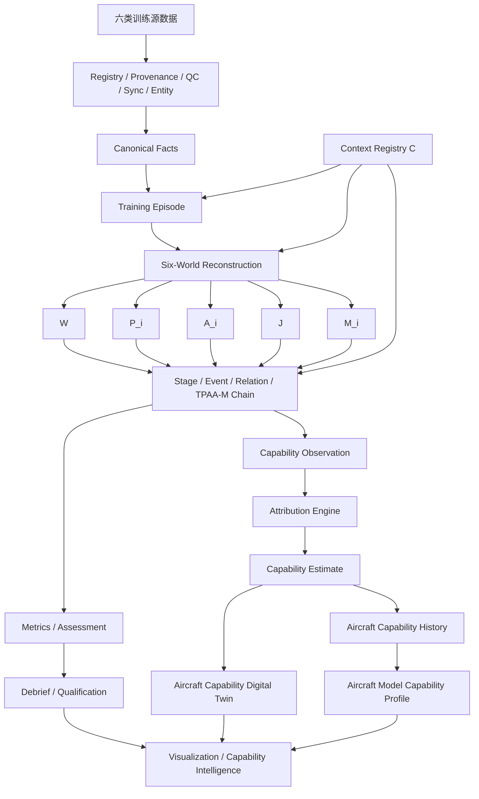

# ED-2.0 合订本（只读审阅版）

> **本文件只是连续阅读投影，不拥有定义权。** 所有定义权仍归 Core/Canonical artifacts 与对应专业文档。

> R3.3 延续 P/M/WS/Stage 统一术语，并增加 116 指标设计意图/适用边界说明；05C1 是解释性投影，不拥有可执行公式定义权。

<!-- BEGIN READ-ONLY PROJECTION: 02_Core_Baseline_CB-1.4.0.md -->

# Core Baseline CB-1.4.0

**适用：** TPAA V8.0 / ED-2.0  
**状态：** FROZEN FOR REBASELINE R3.3 — METRIC DESIGN INTENT & APPLICABILITY  
**数据库目标：** schema 1.6.0  
**日期：** 2026-09-19

## 1. 基线定位

Core Baseline 是总体方案与全部工程设计分册共同的唯一事实源。CB-1.4.0 在不改变 P1 116 项指标算法语义与 661 项输入绑定的前提下，补齐 R39 中 P2～P6、四类训练、人员/团队/任务与能力智能的扩展语义合同。任何文档冲突时，不以“哪份 Word/Markdown 更新”判断，而以 `canonical/SCHEMA_AUTHORITY_REGISTRY.json` 指向的权威 artifact 为准。

## 2. 定义权分配

| 领域 | 唯一权威 artifact |
|---|---|
| logical persistence objects | CORE_LOGICAL_MODEL.json |
| cross-layer DTO field contracts | CROSS_LAYER_DTO_CONTRACTS.json |
| Episode Stage taxonomy/method | STAGE_REGISTRY.json |
| P capability maturity semantics (P1～P6) | CAPABILITY_PHASE_REGISTRY.json |
| M development milestone semantics (M0～M9) | DEVELOPMENT_MILESTONE_REGISTRY.json |
| WS engineering workstream semantics | ENGINEERING_WORKSTREAM_REGISTRY.json |
| P/M/WS/Stage terminology separation | TERMINOLOGY_REGISTRY.json |
| P1 metric algorithms/semantic identities/structured schemas | P1_METRIC_CATALOG.json |
| P1 metric input binding authority | METRIC_INPUT_AUTHORITY_MATRIX.json |
| cross-cutting invariants | CORE_RULES.json |
| training/evaluation taxonomy | TRAINING_EVALUATION_TAXONOMY.json |
| world-capability / conclusion eligibility | WORLD_CAPABILITY_REGISTRY.json |
| P2～P6 extension semantic contracts | EXTENSION_CONTRACT_REGISTRY.json |
| extension metric-family reservations | EXTENSION_METRIC_FAMILY_REGISTRY.json |
| Windows/Linux runtime compatibility | PLATFORM_COMPATIBILITY_REGISTRY.json |

## 3. 强制不变量

| ID | 规则 | 约束 |
|---|---|---|
| CR-001 | Single Definition Authority | Every field-level fact has exactly one machine-readable authority artifact. Human documents may not create a second current-looking schema. |
| CR-002 | Identifier Stability | Published subject, context, metric definition, release, episode and stage identities are immutable; correction is by supersession/versioning. |
| CR-003 | Session Time | Computation uses authoritative Session Time; source clocks require explicit TimeTransform; JS-visible int64 time transports as decimal string. |
| CR-004 | Half-open Interval | All windows use [start,end); gaps, validity, source/clock/configuration boundaries split windows. |
| CR-005 | Missing Is Not Zero | Missing prerequisite data yields N_A or INSUFFICIENT_DATA with reason code; never fabricate zero. |
| CR-006 | Context Immutability | Historical computation/read uses exact immutable context_id and exact bound artifacts; no current/latest fallback. |
| CR-007 | Release Immutability | Published result is release-bound; historical replay resolves immutable definition/catalog/context/world/evidence provenance. |
| CR-008 | Typed Metric Value | value_kind determines one legal value slot; STRUCTURED is object and binds exactly one executable structured schema. |
| CR-009 | Stable Subjects | P1 primary subjects are AIRCRAFT and MISSION_SYSTEM_INSTANCE; TARGET_PAIR is reference/evaluation quality only and never a longitudinal subject. |
| CR-010 | Observation Lanes | AIRCRAFT_CAP_L1_OBSERVATION, SYSTEM_PERFORMANCE_OBSERVATION and QUALITY_EVIDENCE_ONLY are mutually governed publication lanes. |
| CR-011 | Longitudinal Compatibility | Only trend-eligible NUMERIC metrics enter numeric longitudinal_sample; comparison keys segment semantic/configuration/profile changes. |
| CR-012 | No Future Leakage | As-of joins are causal; state/config uses backward validity, command-response uses forward causal windows, and nearest is only explicit-policy. |
| CR-013 | Evidence First | Every metric/observation/assessment must retain evidence and provenance anchors sufficient for deterministic drill-down. |
| CR-014 | Safety Boundary | System does not derive weapon performance envelopes, best launch/release geometry, probability-of-kill models, tactical optimization or combat recommendations. |
| CR-015 | Change Closure | Authority artifact + dependent contracts + migrations + fixtures + traceability + validators change atomically; otherwise baseline build fails. |
| CR-016 | Semantic Product Separation | Fact/World/Metric/Observation/Assessment/Estimate/Forecast are distinct product classes; downstream interpretation never rewrites upstream fact. |
| CR-017 | Scope Separation | Individual、Team、Package/Mission、Joint-LVC scopes remain explicit; team result is not copied to individuals and member scores are not averaged to manufacture team capability. |
| CR-018 | World Capability Gate | Conclusions are gated by C/W/P/A/J/M availability; W never substitutes P and missing J never becomes inferred official outcome. |
| CR-019 | Instructor Revision Integrity | Instructor override is revisioned and preserves the original automatic product, reviewer, reason and rubric/Profile version. |
| CR-020 | Attribution Identifiability | Attribution may legitimately return NOT_IDENTIFIABLE; factor effects are model-conditioned and not default causal/blame statements. |
| CR-021 | Cohort Comparability | Longitudinal comparison requires explicit material cohort/comparison keys; incompatible observations are segmented. |
| CR-022 | Knowledge-Time Integrity | As-known replay and retrospective revision are distinct; later labels/configuration do not masquerade as contemporaneous knowledge. |
| CR-023 | Evidence Independence | Record count、Observation count、independent subject count、effective evidence volume are distinct; dedup/source multiplicity does not prove independence. |
| CR-024 | Dormant Future Contracts | P2～P6 design contracts may be frozen before implementation, but unimplemented/unvalidated capability must remain feature-gated. |
| CR-025 | External Interoperability Boundary | External simulation/interoperability protocols enter via governed adapters; core logic remains protocol-independent. |
| CR-026 | Training Plugin Composition | New training types compose the C+TPAA-M spine; no source-specific business-score bypass is allowed. |
| CR-027 | Platform-Neutral Business Core | Windows/Linux 平台差异不得改变 Domain/Application/World/Stage/Metric/Assessment/Release 业务语义。 |
| CR-028 | Cross-Platform Logical Equivalence | 同一冻结输入在 Windows/Linux 上产生等价逻辑产品。 |
| CR-029 | Controlled Progress/Layer Vocabulary | 进度/层级语言只允许 P、M、WS 与 Episode Stage 四类受控命名。 |
| CR-030 | P/M/WS/Stage Orthogonality | P=能力成熟度，M=项目里程碑，WS=工程工作流，Stage=训练过程；四者不得互相替代。 |


## 4. P / M / WS / Stage 统一语言

### 4.1 P — Capability Phase / 能力成熟度

P1～P6 只描述系统能够发布哪一层级的评价/能力产品，不描述项目开发进度。

| P | 名称 | 基线状态 | 边界 |
|---|---|---|---|
| P1 | Observed Performance | CURRENT_BASELINE | Aircraft/Mission-System Observation + Evidence + numeric trend；不做条件归因或固有能力主张。 |
| P2 | Context Attribution & Normalization | DESIGN_CONTRACT_FROZEN | Factor View / reference condition / identifiability / adjusted estimate；不得覆盖 P1。 |
| P3 | Reference-condition Capability / Aircraft Twin | DESIGN_CONTRACT_FROZEN | Capability model/surface、Twin revision、model profile；固有性措辞需独立证据。 |
| P4 | Human-Machine / Individual Assessment | DESIGN_CONTRACT_FROZEN | Qualification + Diagnostic Competency + Evidence；教员修订和 SA 边界显式。 |
| P5 | Team / Package / Mission Assessment | DESIGN_CONTRACT_FROZEN | Team/package objectives、shared picture、handoff、communication、composition-aware longitudinal。 |
| P6 | Joint/LVC + Forecast / Counterfactual / Closed Loop | DESIGN_CONTRACT_FROZEN | 联合/LVC、Forecast/Counterfactual/Recommendation 与事实物理和视觉隔离。 |

机器权威：`CAPABILITY_PHASE_REGISTRY.json`。P 代码一旦用于产品语义，不因 M 里程碑推进而重命名。

### 4.2 M — Development Milestone / 项目里程碑

M0～M9 只描述项目交付与验收进度。一个 P 能力通常跨越多个 M 才能完成。

| M | 里程碑 | 主要 P 关系 |
|---|---|---|
| M0 | Engineering Bootstrap | 建立工程底座，不单独准入任何 P 能力 |
| M1 | P1 Minimum Vertical Slice | P1 最小端到端闭环 |
| M2 | P1 Basic Flight Complete | P1 Basic + foundation metric batch |
| M3 | P1 Four-Training-Type Complete | P1 Basic/WVR/BVR/Strike + 116 metrics |
| M4 | P1 Longitudinal & Debrief Closure | P1 trend/replay/debrief 闭环，不启用 P4 |
| M5 | P1 Product Qualification & Release | P1 Windows/Linux、性能、安全、发布资格 |
| M6 | P2 Attribution Activation | P2 准入 |
| M7 | P3 Capability/Twin Activation | P3 准入 |
| M8 | P4/P5 Training Assessment Activation | P4/P5 分别通过门禁后准入 |
| M9 | P6 Joint/LVC & Predictive Activation | P6 准入 |

机器权威：`DEVELOPMENT_MILESTONE_REGISTRY.json`。旧 1A～1G 不再是当前开发语言。

### 4.3 WS — Engineering Workstream / 工程工作流

WS 是横向工程组织，例如 `WS-DATA`、`WS-WORLD`、`WS-METRIC`、`WS-GUI`、`WS-TEST`、`WS-PLATFORM`。WS 可跨多个 M 和 P，不具有顺序含义。机器权威：`ENGINEERING_WORKSTREAM_REGISTRY.json`。

### 4.4 Stage — 训练过程内部 Stage

Stage 仅表示 Training Episode 内的正式、版本化子区间/状态，例如 WVR 的 MERGE、MANEUVER 或 BVR 的 TRACK。Stage 不用于项目进度，也不用于 P 能力成熟度。机器权威：`STAGE_REGISTRY.json`。

### 4.5 Legacy 进度标签迁移

旧 1A～1G、1C/1D/1E 只保留在迁移追踪中：1A/1B→M0；1C 的 32 项 foundation batch→M2/WS-METRIC；1D 的 84 项 remainder batch→M3/WS-METRIC；1E longitudinal→M4/WS-LONGITUDINAL；1F/1G→M5。当前文档、计划、Issue、验收和发布记录不得再使用旧标签作为现行进度编号。

## 5. Episode Stage 唯一方法

Stage 不是由各 Metric 自己切片，而是一个正式、版本化、可修订、可回放的 Episode 子对象。Stage 候选按以下优先级解析：

1. Context official definition / approved marker；
2. 已标准化 authority event；
3. Context-defined rule + World 派生；
4. Model inference（必须保留 confidence）；
5. Manual review/correction。

发布对象固定使用 `episode.episode_stage` 的字段定义；Stage 时间为 `[start,end)`，必须完全落在所属 Episode 内。四套当前参考 profile 为 BASIC_FLIGHT_V1、WVR_ENGAGEMENT_V1、BVR_KILL_CHAIN_V1、STRIKE_MISSION_V1。旧 WVR/BVR 状态机词汇只能作为 event/analysis vocabulary，不能再形成第二套 current stage code。

### 5.1 当前 Stage Profiles

| Profile | Episode | Ordered stages |
|---|---|---|
| BASIC_FLIGHT_V1 | BASIC_FLIGHT | SETUP_ENTRY → EXECUTION → STABILIZATION_RECOVERY → COMPLETION |
| WVR_ENGAGEMENT_V1 | WVR_ENGAGEMENT | MERGE → POSITION_ADVANTAGE → MANEUVER → WEAPON_ENVELOPE → LAUNCH → KILL_ASSESSMENT |
| BVR_KILL_CHAIN_V1 | BVR_KILL_CHAIN | DETECTION → TRACK → IDENTIFICATION → DECISION → WEAPON_EMPLOYMENT → ASSESSMENT |
| STRIKE_MISSION_V1 | STRIKE_MISSION | MISSION_SETUP → ROUTE_TASK_EXECUTION → TARGET_INFORMATION_AVAILABLE → TARGET_ASSOCIATION → DESIGNATION_TRACK → TRAINING_ATTACK_EVENT → RANGE_SIM_ADJUDICATION → POST_EVENT_TASK_TRANSITION → RECOVERY |

## 6. 116 项指标冻结

指标算法权威仍是精确携带的 `P1_METRIC_CATALOG.json`。文档重构不改变算法 identity、公式、输入、structured schema 或 trend eligibility。

| 统计项 | 冻结值 |
|---|---|
| Metric count | 116 |
| Input bindings | 661 |
| M2 / P1_FOUNDATION_32 | 32 |
| M3 / P1_REMAINDER_84 | 84 |
| AIRCRAFT | 40 |
| MISSION_SYSTEM_INSTANCE | 72 |
| TARGET_PAIR | 4 |
| NUMERIC | 107 |
| STRUCTURED | 9 |
| M4 P1 longitudinal eligible | 104 |

### 6.1 Metric Family

| Family | 数量 | Subject 分布 |
|---|---|---|
| AIRCRAFT_FLIGHT | 20 | AIRCRAFT:20 |
| SENSOR_ACCURACY | 17 | MISSION_SYSTEM_INSTANCE:17 |
| ASSOCIATION_IDENTIFICATION | 12 | MISSION_SYSTEM_INSTANCE:12 |
| AIRCRAFT_ENERGY | 8 | AIRCRAFT:8 |
| DATALINK | 8 | MISSION_SYSTEM_INSTANCE:8 |
| SENSOR_FUSION | 8 | MISSION_SYSTEM_INSTANCE:8 |
| PASSIVE_SENSOR | 7 | MISSION_SYSTEM_INSTANCE:7 |
| TRACK_PERFORMANCE | 7 | MISSION_SYSTEM_INSTANCE:7 |
| RWR_ESM | 6 | MISSION_SYSTEM_INSTANCE:6 |
| TIME_ALIGNMENT | 5 | MISSION_SYSTEM_INSTANCE:2, TARGET_PAIR:2, AIRCRAFT:1 |
| AIRCRAFT_CONTROL_RESPONSE | 4 | AIRCRAFT:4 |
| AIRCRAFT_HANDLING | 4 | AIRCRAFT:4 |
| SENSOR_DETECTION | 4 | MISSION_SYSTEM_INSTANCE:4 |
| AIRCRAFT_PERSISTENCE | 3 | AIRCRAFT:3 |
| REFERENCE_TRUTH | 3 | TARGET_PAIR:2, MISSION_SYSTEM_INSTANCE:1 |

## 7. Core Logical Model 规则

`canonical/CORE_LOGICAL_MODEL.json` 是字段名、类型、nullability 的唯一 current persistence authority。任何工程文档只能引用对象名和业务用途；若需要显示字段表，只能由该 JSON 生成并标注 GENERATED PROJECTION。

优先级最高的对象包括：`registry.training_session`、`context.evaluation_context`、`registry.context_artifact`、`context.context_artifact_binding`、`episode.training_episode`、`episode.episode_stage`、`master.mission_system_instance`、`metric.metric_definition`、`metric.metric_instance`、Aircraft/System Observation、Longitudinal Scope/Sample/Trend、`registry.analysis_release`。

## 8. Context 与 Release

- Context 可 revision，但历史读取按 exact `context_id`。
- Session 不持有业务意义上的“当前 Context”指针。
- Context 所使用的 Scenario/Profile/Rule/Reference 等配置必须绑定 immutable artifact + sealed object/hash。
- SESSION Release 冻结其实际 Context bindings；LONGITUDINAL Release 引用 immutable SESSION Releases，不回头重新 resolve Context。
- 任何 historical read 的 artifact 缺失或 schema 不支持必须 fail-closed。

## 9. DTO 与传输

Critical DTO 字段权威为 `canonical/CROSS_LAYER_DTO_CONTRACTS.json`。Session Time 对 JS-visible API 必须使用 decimal-string；STRUCTURED Metric 使用 object；API DTO 和 UI View Projection 不得互相充当定义权。


## 10. P2～P6 与训练评价扩展权威

CB-1.4.0 继承并继续冻结四个**语义级** machine authority，不与 `CORE_LOGICAL_MODEL.json` 争夺字段定义权：

- `TRAINING_EVALUATION_TAXONOMY.json`：四类训练、Individual/Team/Package/Joint-LVC scope、人员 competency domains、Qualification/Diagnostic/Evidence 三层输出、候选根因、教员 review 与 Training Plugin composition；
- `WORLD_CAPABILITY_REGISTRY.json`：BASIC/WVR/BVR/STRIKE 的 C/W/P/A/J/M capability 与降级规则；
- `EXTENSION_CONTRACT_REGISTRY.json`：P2 Attribution、P3 Capability/Twin、P4 Human-Machine、P5 Team/Mission、P6 Forecast/Counterfactual 的稳定输入/输出/边界与纵向可比规则。
- `EXTENSION_METRIC_FAMILY_REGISTRY.json`：保留 R39 中非 P1 指标/指标族知识的语义命名与用途边界，但明确标记为不可执行的 future family reservation，不与 116 项 Catalog 竞争。

这些 registry 的目的不是宣称 P2～P6 已实现，而是**冻结未来扩展的语义尺寸**：后续实现可以新增 schema migration、DTO 与算法，但不能重新定义“Observation 是什么、Attribution 是否能覆盖 observed value、Team 是否等于成员均值、Twin 是否是实时 W、Forecast 是否能当历史事实”等根边界。

Core Logical Model 中已经存在 P2～P6 的部分 reserved product tables；进入具体 P 能力实施前，若需要新增 participant/team/package/media/profile 等持久化对象，应通过新 schema migration + Core model version 完成，而不是在分册中先写第二套字段表。

## 11. R39 全量知识承接原则

R39 中有效知识按四类处理：

1. **algorithm-semantic carry-forward**：116 Metric 的公式/语义/输入和 661 binding tuple 保持不变；R3.2 迁移旧进度元数据；R3.3 在不改公式/输入的前提下补充 family applicability 与完整设计解释；
2. **machine-semantic refreeze**：Stage、P Capability、Training/Assessment taxonomy、World Capability、P2～P6 extension contracts、Core Rules；
3. **explanatory redesign**：总体方案与专业分册中的 Basic/WVR/BVR/Strike、Instructor、Longitudinal、Twin、Debrief、Course/Unit、Joint/LVC 等；
4. **historical-only**：重复 current-looking schema、legacy code、审查补丁正文，不再作为 current authority。

任何“原方案有、新方案没写”的内容，只有在确认仍符合当前安全/语义边界后才承接；承接后必须能在 `TRACEABILITY_MATRIX.json` 中找到总体方案、machine authority、工程分册与验证 Gate。

## 12. 变更控制

任何 Core 变更必须同时更新：authority artifact、依赖契约、迁移/兼容策略、Golden/contract fixture、traceability、validator、Baseline Lock。缺一即不得发布新基线。


## Knowledge Fidelity Authority（R3）

`03A_整体训练效果评估方案_TPAA_V8.0.md` 是训练评价方法论权威；`05G_可视化_GUI设计分册.md` 是可视化工作流权威；`canonical/KNOWLEDGE_FIDELITY_MATRIX.json` 是 R39 方法/可视化知识迁移的验证证据。三者均不得覆盖 Canonical schema/DTO/Metric/Stage 的字段级定义权。


## 13. 跨平台运行与逻辑一致性权威

`canonical/PLATFORM_COMPATIBILITY_REGISTRY.json` 是 Windows/Linux 运行支持、平台适配边界、CI 认证矩阵与跨平台逻辑等价规则的唯一机器权威。Windows 与 Linux 是强制支持的 OS family；未来可增加其他 OS/CPU profile，但不得因此改写 Canonical、Stage、Metric、Assessment、Release 或训练评价语义。

跨平台设计遵循两个 Core 不变量：

- **CR-027 Platform-Neutral Business Core**：Domain/Application/World/Stage/Event/Metric/Assessment/Longitudinal/Capability/Release 核心不得按操作系统分叉；OS 差异只存在于 FileSystem、Process、Lock、Packaging、Credential、Hardware/Codec 等显式 Platform Adapter。
- **CR-028 Cross-Platform Logical Equivalence**：同一冻结输入、同一 Core/Catalog/Profile/Model/Context/World policy 在 Windows 与 Linux 上必须形成等价逻辑产品。ID、Stage/Event、状态、N/A/Qualification 等离散语义精确一致；数值结果遵守同一 Golden tolerance/确定性 rounding 规则。native package bytes、临时路径、PID 等物理差异不得进入业务 logical hash。

强制认证至少覆盖 Windows Desktop、Linux Desktop、Windows Service、Linux Service 四类 profile。PySide6 GUI、Local Backend、Worker、CLI 和业务投影必须共享代码基线；允许 vendor driver/GPU/codec 等 OS-specific adapter，但其不支持状态必须显式、可审计且不得污染业务核心。

## 14. P1 指标设计意图与 Family Applicability 权威

P1 116 项指标的可执行公式仍由 `canonical/P1_METRIC_CATALOG.json` 唯一拥有。R3.3 新增 `05C1_116指标设计意图_适用边界_区别联系与计算方法说明.md` 作为**解释性设计权威**：它回答每项指标“评什么、为什么设计、适用什么系统/产品层、怎样与相邻指标区分、结果怎样解释”，但不拥有可执行字段/公式定义权。

CB-1.4.0 新增 **CR-031 Metric Family Applicability and Product-Layer Separation**。其中：

- `P1-SNS-*` = **RADAR sensor detection/measurement**，`system_type=RADAR`；
- `P1-PSV-*` = IRST/EO 被动传感器；
- `P1-ESM-*` = RWR/ESM emitter sensing；
- `P1-DL-*` = DATALINK transport/remote-track delivery；
- `P1-FUS-*` = FUSION product；
- `P1-TRK-*` / `P1-ID-*` 按受治理的 Track / Association-Identification product capability 适用，不把原始 sensor measurement、remote track 或 fused track 混为同一层。

上述适用性由 `P1_METRIC_CATALOG.json` 的 `family_applicability_contracts` 与 common rules 机器冻结。R3.3 不改变 116 项 metric code、semantic/algorithm identity、formula、input_fields，也不改变 661 个 `(metric_code,input_field)` 绑定。

<!-- END READ-ONLY PROJECTION: 02_Core_Baseline_CB-1.4.0.md -->

<!-- BEGIN READ-ONLY PROJECTION: 03_TPAA_V8.0_总体方案.md -->

# 飞机机载数据评估系统总体方案 TPAA V8.0

**基线：** CB-1.4.0  
**工程实现基线：** ED-2.0  
**重构轮次：** Rebaseline R3.1 — Knowledge Fidelity + Cross-Platform Contract  
**日期：** 2026-09-19

## 1. 文档定位

本总体方案定义系统目标、业务语义、评价边界、总体架构、训练评价框架、能力演进路线和系统级约束。它**不定义数据库字段、DTO nullability、REST payload 字段或物理表结构**；字段级事实由 Core Baseline 指向的 machine-readable authority 唯一控制。

本版与 R1 的根本差异是：总体方案不再只把 P1 Observed Performance 写深，而是把 R39 中已经形成且仍有效的 **Basic / WVR / BVR / Strike、Individual / Team / Package / Joint-LVC、P2/P3 Capability Intelligence、P4/P5 Training Assessment、Instructor Review、Longitudinal、Debrief、Course/Unit Analytics 与 P6 扩展边界**全部纳入统一路线，以便后续按成熟度激活而不重新定义体系。

## 1A. 文档体系与方法权威

系统级总体边界由本文定义；完整训练效果评价方法、四类训练业务逻辑、Qualification/Competency/Evidence、教员融合、长期训练与 P2~P6 方法边界由 `03A_整体训练效果评估方案_TPAA_V8.0.md` 作为方法论权威。字段级定义仍由 Core Baseline 的 Canonical artifacts 唯一拥有。

因此总体方案不再用“压缩方法内容”来换取一致性：本文给出总体框架，03A 给出完整方法链，05A~05J 给出工程实现。三者职责不同，不是三套互相竞争的定义。

## 2. 建设目标

系统面向训练、试验和工程数据的可追溯评估，形成从原始数据到 Canonical Facts、Context、Episode/Stage、C+TPAA-M World、Event/Relation/Chain、Metric、Observation、Assessment、Capability Estimate、Longitudinal Product 与 Debrief/Analytics 的确定性链路。

系统必须同时满足：

- **证据可追溯**：任何评价、估计和趋势能回到 World/Metric/原始 lineage；
- **语义可分离**：事实、成员可见信息、动作、官方裁决、机器状态、评价、估计和预测不互相冒充；
- **版本可重放**：历史产品按原 Context/Catalog/Profile/Release/Model 重放，不依赖 current/latest；
- **单机到联合可扩展**：核心对象不因人数、机数、任务群或 LVC 扩展而重建数据库；
- **长期可比较**：比较显式受构型、场景、角色、团队构成、World Capability 和算法/Profile 版本约束；
- **P 能力分层成熟**：P1～P6 有明确 admission boundary，设计合同冻结不等于实现或适用用途已验证。

## 3. 评价边界与成熟度

### 3.1 P1 — Observed Performance

形成 **Aircraft** 与 **Mission-System Instance** 两条工程观测性能主体链，包括 Metric、Observation、Evidence 与数值长期趋势。P1 不把人员、环境、任务难度等因素剥离后宣称为 intrinsic capability。

### 3.2 P2 — Context Attribution & Normalization

在冻结的 P1 Observation、Factor View、Reference Condition 与 Cohort 上进行条件调整/因素关联。允许输出 `NOT_IDENTIFIABLE`；不得为了获得一个数值而强制调参。因素贡献默认是模型条件下的关联解释，不自动具有因果或责任含义。

### 3.3 P3 — Reference-condition Capability / Aircraft Twin

形成受治理的能力模型、能力曲面、单架飞机 Twin Revision、参考条件下的长期性能估计与型号画像。默认术语是“参考条件下长期性能估计”；只有在测量对象、可识别性和独立验证充分时，才可另行主张 intrinsic capability。

### 3.4 P4 — Human-Machine / Individual Training Assessment

基于 C/W/P_i/A_i/J/M_i、Metric/Event/Evidence 和 Assessment Profile 形成 Qualification、Diagnostic Competency 与 Evidence 三层输出。更高层的理解、预测和判断不得仅因 P_i 可获得而自动认定，需要经验证代理指标或教员 rubric。

### 3.5 P5 — Team / Package / Mission Assessment

面向多成员、多机、团队、任务群和总体任务目标进行共享态势、角色、信息收敛、通信、任务交接、动作同步、间隔/解冲突与 Objective 评价。团队能力不是成员平均值；团队结果也不复制为个人结果。

### 3.6 P6 — Forecast / Counterfactual / Closed Loop

形成 Forecast、Counterfactual、Training Recommendation 与 Intervention Outcome 等产品。此类产品必须在存储、API、UI 和审计上与事实/历史回放物理隔离，并显式展示假设、模型、验证状态和批准状态。

### 3.7 安全边界

系统不得自动推导现实武器性能包线、最佳发射/释放几何、命中概率模型、战术优化或作战建议。WVR/BVR/Strike 中涉及的 weapon/engagement 仅表达训练规则、训练动作和经批准外部裁决证据。

## 4. 核心语义对象

系统级对象包括：Training Session、Evaluation Context、Episode、Episode Stage、Entity/Aircraft/Aircraft Instance、Mission-System Instance、World Product、Event/Relation/TPAA-M Chain、Metric Definition/Published Metric、Observation、Assessment、Evidence、Annotation、Analysis Release、Longitudinal Product，以及 P2～P6 的 Attribution、Capability Estimate/Model/Twin/Profile、Forecast/Counterfactual/Recommendation 等受治理产品。

对象字段、枚举和 nullability 不在本文件重复定义；训练类型、评价域和 World Capability 的语义权威分别由 Core Baseline registry 控制。

## 5. 总体处理链

```text
Source Artifacts
→ Registry / Provenance
→ Quality + Time Alignment + Entity Resolution
→ Canonical Facts
→ Immutable Evaluation Context
→ Episode Detection / Validation
→ Episode Stage Projection
→ C + W/P/A/J/M Reconstruction
→ Event / Relation / TPAA-M Chain
→ Metric Engine
→ P1 Observation
→ P2 Attribution / Context Adjustment
→ P3 Capability Model / Twin / Model Profile
→ P4 Individual / Human-Machine Assessment
→ P5 Team / Package / Mission Assessment
→ Debrief / Longitudinal / Course-Unit Analytics
→ P6 Forecast / Counterfactual / Recommendation (when admitted)
→ Versioned Release / Historical Replay
```

业务 Metric 不直接读取 source-specific raw records。只有 Data Quality、Canonicalization、World Reconstruction 和 Audit 边界可以解释 source-specific facts。P2～P6 只能消费已发布的上游产品，不能回写上游事实。

## 6. C + TPAA-M 统一语义

- **C / Context**：Scenario、Objective、Role、Rule、Reference、Training Standard、Assessment Profile 等规范与解释条件；
- **W / Ground Truth or Reference World**：在声明 authority 下的事实/参考状态；
- **P_i / Perception**：对 observer i 客观可获得的信息，不等于主观理解；
- **A_i / Action**：actor i 的控制、模式、任务、通信或训练动作；
- **J / Adjudication**：经批准 authority 的正式训练裁决；
- **M_i / Machine Capability/State Evidence**：机器/平台状态与能力供给证据，不等于长期能力估计。

C 不混入 W/P/A/J/M；Assessment 不写回 World；P2/P3 Estimate 不写回 M；P6 Prediction 不写回历史事实。

## 7. World Capability 与可评价性

“有文件”不等于“能评价”。系统同时报告 Source availability、World Capability、Data Sufficiency、Coverage 与质量/不确定性证据。

受控 World Capability 至少包括：BASIC_CORE、WVR_CORE、WVR_INFO、WVR_FULL、BVR_PROCESS、BVR_FULL、STRIKE_CORE、STRIKE_INFO、STRIKE_FULL。具体 required/optional worlds 由 `WORLD_CAPABILITY_REGISTRY` 唯一控制。

共同降级规则：

- 缺 P：不得用后台 W 代替成员当时可见信息；
- 缺 J：可以评价过程/动作，但官方结果为 N/A/NOT_ADJUDICATED；
- 缺 M：可保留适用的人/任务子集，但不得生成平台能力 Observation；
- 缺版本化 C：依赖规范判断的指标/Assessment 降为 DESCRIPTIVE 或 fail-closed；
- mandatory world/data 缺失：相关结论为 N_A/INSUFFICIENT_DATA，而不是 0 分。

## 8. Episode 与 Stage

Episode 是可解释的训练/评估语义单元；Stage 是 Episode 内正式、版本化、可修订、可回放的子对象。Stage 只由 Stage Registry 定义，Metric、UI 和训练插件不得维护另一套“当前 Stage”。

当前参考 profile：

| Training type | Reference profile | Stage chain |
|---|---|---|
| Basic Flight | BASIC_FLIGHT_V1 | SETUP_ENTRY → EXECUTION → STABILIZATION_RECOVERY → COMPLETION |
| WVR | WVR_ENGAGEMENT_V1 | MERGE → POSITION_ADVANTAGE → MANEUVER → WEAPON_ENVELOPE → LAUNCH → KILL_ASSESSMENT |
| BVR | BVR_KILL_CHAIN_V1 | DETECTION → TRACK → IDENTIFICATION → DECISION → WEAPON_EMPLOYMENT → ASSESSMENT |
| Strike | STRIKE_MISSION_V1 | MISSION_SETUP → ROUTE_TASK_EXECUTION → TARGET_INFORMATION_AVAILABLE → TARGET_ASSOCIATION → DESIGNATION_TRACK → TRAINING_ATTACK_EVENT → RANGE_SIM_ADJUDICATION → POST_EVENT_TASK_TRANSITION → RECOVERY |

Stage 规则由 immutable Context artifact 选择。模型推断和人工修正必须保留来源、confidence、revision/supersession。

## 9. P1 指标体系

P1 冻结 116 项指标；R3.2 保持其公式、semantic/algorithm identity、input fields 与 661 binding tuples 不变，仅将旧进度元数据迁移为 M/WS 语言。R3.3 进一步增加 `05C1_116指标设计意图_适用边界_区别联系与计算方法说明.md`，用于解释每项指标的设计原因、适用产品层和相邻指标关系；可执行公式仍只由 Catalog 定义。系统级分布：

**指标族适用性说明：** SNS 在当前基线中特指 RADAR 探测/测量层；PSV=IRST/EO，ESM=RWR/ESM，DL=DATALINK，FUS=FUSION；TRK/ID 是产品处理层而不是物理传感器类型。

| 维度 | 数量 |
|---|---:|
| REFERENCE_TRUTH | 3 |
| TIME_ALIGNMENT | 5 |
| AIRCRAFT_FLIGHT | 20 |
| AIRCRAFT_ENERGY | 8 |
| AIRCRAFT_CONTROL_RESPONSE | 4 |
| AIRCRAFT_HANDLING | 4 |
| AIRCRAFT_PERSISTENCE | 3 |
| SENSOR_DETECTION | 4 |
| SENSOR_ACCURACY | 17 |
| TRACK_PERFORMANCE | 7 |
| ASSOCIATION_IDENTIFICATION | 12 |
| PASSIVE_SENSOR | 7 |
| RWR_ESM | 6 |
| DATALINK | 8 |
| SENSOR_FUSION | 8 |

P1 指标开发采用受控 M/WS 交付映射：M2 / `P1_FOUNDATION_32` 完成 32 项 foundation batch，M3 / `P1_REMAINDER_84` 完成其余 84 项；M4 / `WS-LONGITUDINAL` 仅把 104 个 trend-eligible NUMERIC 指标送入长期数值趋势。P4/P5 的训练评价指标和 P2/P3 的能力估计指标**不复用或改写这 116 项定义权**，而是在其上建立独立版本化合同。

## 10. P1 双主体与长期基础

### 10.1 Aircraft Lane

Aircraft master/instance/configuration → aircraft metric → CAP-L1 observation → longitudinal sample/trend。

### 10.2 Mission-System Lane

Stable mission_system_instance → system metric → system performance observation → longitudinal sample/trend。

两条 lane 不混合成一个“平台总能力分”；TARGET_PAIR 只作为 reference/evaluation quality evidence。P2/P3 可以消费这些 Observation，但不改变其值和历史语义。

## 11. 评价输出三层结构

训练评价统一分为三层：

1. **Qualification**：由 Critical Gate、mandatory evidence 和 Profile 规则控制；
2. **Diagnostic Competency**：按受治理的能力域、Metric/Event Evidence 与 Profile 聚合；
3. **Evidence**：事件、关系、时间窗、轨迹、曲线、World、媒体、版本与 provenance。

缺 mandatory evidence 时不是简单降低置信度；Qualification/Competency 必须明确进入 INSUFFICIENT_DATA/N_A 等状态。安全 gate 先于普通加权聚合。

## 12. 人员能力域

P4 通用 competency 域为：Safety & Discipline、Aircraft Control、Flight/Task Execution、Information & System Management、Situational Awareness Evidence、Decision & Task Management、Communication、Team Coordination、Training Engagement Execution、Mission Outcome Evidence。

Mission Outcome 是结果证据，不替代能力。SA 自动评价只覆盖可观察的信息可达、关联、响应和经验证行为代理；更高层理解、预测、判断需独立验证或教员 rubric。

## 13. 多层级评价对象

- **Level A / Individual**：pilot/crew、aircraft、human-machine link；
- **Level B / Team**：element/flight/team；
- **Level C / Package/Mission Group**：多个团队、C2、UAS、地面/海上或 virtual/constructive entities；
- **Level D / Joint/LVC**：通过 Entity/Relation/Source/Plugin 扩展接入，不重建核心评价语义。

个人、团队、任务群、联合/LVC 始终保留独立 scope 和 identity。

## 14. Event Graph、Relation 与责任边界

复杂任务把散乱时序转换成 Event Graph；边可表达 PRECEDES、RESPONDS_TO、AFFECTS、EVIDENCE_FOR、候选原因等受控关系。Event/Relation 用于测量时间、定位断点、建立 TPAA-M chain、自动复盘和解释评分。

多机事件应保留 actor、owner、affected entity、team、controllability 与 contribution confidence。TDL 中断、range truth 缺失、sensor log gap、clock/sync 等系统或数据问题不得自动归因给个人。

## 15. 根因候选而非过度因果断言

自动系统输出 Root-cause Candidate，不输出未经确认的唯一因果结论。候选类别包括 Flight Control、Information Availability、Track/Association、Procedure、Decision/Task Management、Communication、Team Coordination、Training System、Data Quality、External/Scenario、Instructor Determination。

P2 Attribution 也遵守同一原则：模型因素效应默认不是人员责任判决、故障诊断或因果证明。

## 16. 数据质量、充分度与置信度

每个 Session/Episode 需要 Data Quality / Sufficiency 证据，包括时间单调/采样/gap/duplicate、单位/坐标、valid flag、同步/漂移/残差、entity matching、Context/Profile 完整性、构型/主体身份、World coverage、重复观察与独立性风险。

`confidence` 默认是经验质量指数/等级，不自动表示“结论正确概率”。Coverage、测量不确定性、模型不确定性、identifiability 和 evidence independence 分开表达。

## 17. Basic Flight 总体评价（扩充）

Basic Flight 的目标不是单一飞行总分，而是把 **C 定义的课目要求、W 中的实际飞行状态、A 中的控制/任务动作、M 中的平台状态与可选 P/J 证据**组织为可回放的 Episode/Stage 评价。

### 17.1 主要评价域

- Safety & Discipline：空域/高度/速度/程序限制、告警和 Critical Gate；
- Aircraft Control：姿态、航向、高度、速度、载荷/过载、操纵响应；
- Flight/Task Execution：课目轨迹、Stage、任务完成与 reference comparison；
- Handling & Stability：capture、settling、oscillation、control reversal、jerk 等证据；
- Energy/Performance：能量、加减速、爬升、恢复、燃油等 P1 Observation；
- Human-Machine（P4）：信息/模式利用、动作时序、程序符合性与可观察行为；
- Longitudinal：同构型/同课目/cohort 下的重复性、稳定性、趋势与近期有效暴露。

### 17.2 C+TPAA-M 使用方式

BASIC_CORE 要求 C+W+A+M；P/J 是独立可用能力。P 不存在时不能产生依赖 cockpit information 的结论；J 不存在时不能产生官方 outcome。平台 P1 指标和 P4 人员训练评价保持两条解释链，避免把人员操纵差异直接写成飞机固有能力，也避免把平台/数据问题直接扣给人员。

### 17.3 Stage 与 Evidence

Reference stage 为 `SETUP_ENTRY → EXECUTION → STABILIZATION_RECOVERY → COMPLETION`。每个 Stage 可关联 objective、metric window、quality gap、event、annotation、trajectory/series evidence。具体课目扩展必须形成新的版本化 Stage Profile/Context artifact。

### 17.4 输出

单架次输出至少包含 Qualification、关键 competency/evidence、P1 Aircraft/Mission-System Observation、Data/World Capability、关键事件、教员标注和长期可比性状态；不得只输出一个总分。


### 17.5 评价逻辑链

Basic Flight 不以单次结果代替飞行控制能力。评价从 C 中的 maneuver objective/reference/tolerance 出发，以 W 中实际状态、A 中操纵/模式、M 中系统可用能力为证据，先识别 maneuver/stage，再计算偏差、稳定性、驻留、capture/settling、限制接近和重复性。Safety/limitation 作为 Gate；数据缺失产生 N/A/INSUFFICIENT_DATA，而非 0 分。P4 人员评价只有在具备人员可控性和行为证据时才从飞机表现证据向 Human-Machine Competency 推进。

### 17.6 复盘使用

复盘必须同时显示 Context reference band、实际轨迹/参数、Stage、关键 Event、Metric/Evidence 和数据质量，使教员能够区分“飞机未达到参考”“参考/场景改变”“系统能力受限”和“人员动作差异”。详细方法见 03A §9 与第二编 Basic Flight。

## 18. WVR 总体评价（扩充）

WVR 评价围绕相对几何、控制/能量、成员可见信息、训练动作、团队过程和批准裁决构成证据链，不搜索或推荐现实作战最优机动。

### 18.1 World Capability 层级

- WVR_CORE = C+W+A+M：几何、控制、能量与动作；
- WVR_INFO = C+W+P+A+M：增加 Track/Cue/SA Evidence/Response/Team information process；
- WVR_FULL = C+W+P+A+J+M：增加 approved training outcome linkage。

无 P 不产生 SA/Track 类结论；Truth 不得代替 P。

### 18.2 相对状态与 Episode 链

WVR 由 W/Reference World 派生训练需要的相对状态与几何 evidence；Stage reference 为 `MERGE → POSITION_ADVANTAGE → MANEUVER → WEAPON_ENVELOPE → LAUNCH → KILL_ASSESSMENT`。WEAPON_ENVELOPE 只代表训练规则定义的 opportunity/condition window。

### 18.3 评价内容

- Safety & Flight Control；
- Geometry Evidence 与状态驻留；
- Energy/State Evidence；
- Information/SA Evidence（仅 WVR_INFO/FULL）；
- Cue-to-Response 与 Mode/Task evidence；
- Team coordination/communication（P5）；
- Training Engagement Action 与 Official J 分离；
- Process–Outcome divergence：过程良好但结果较差，或过程不足但外部结果偶然良好，均需分别呈现。

### 18.4 长期评价

长期比较至少受 aircraft/configuration、training type、role、scenario/difficulty、team composition、World Capability、Profile/Metric version 控制；几何/信息/响应/团队趋势不应被一个 WVR 总分掩盖。


### 18.5 评价逻辑链

WVR 评价采用“相对状态 → Engagement Stage/Event → Geometry/Energy/Information/Action → Outcome”的过程链。几何优势、能量管理、信息可获得性、反应时延、团队协同与官方训练结果分别保留，禁止用最终胜负覆盖过程表现。信息/SA 结论只能基于可证实 `P_i` 与行为证据，不能从 W 的全知真值反推人员当时必然知道什么。

### 18.6 复盘使用

3D/2D relative replay、Geometry State Ribbon、Energy/State、Cue–Response、Team coordination 和 J markers 应在同一 Master Timeline 上联动。详细方法见 03A §10/第二编 WVR 与 05G。

## 19. BVR 总体评价（扩充）

BVR 是 C+TPAA-M 语义最完整的训练类型之一，重点评价 **信息建立 → 关联/识别 → 任务响应 → 团队协同 → 训练动作 → approved adjudication** 的证据链。

### 19.1 六世界边界

C 定义 relevant entities、任务、角色、规则与标准；W 表示 authority truth/reference；P_i 表示每个 observer 当时可获得的信息；A_i 表示任务、模式、通信和 engagement action；J 表示批准裁决；M_i 表示传感器/数据链/融合/任务系统状态与能力供给证据。

后台已知 Truth 不等于成员当时知道；系统状态异常不自动归因人员。

### 19.2 Kill Chain Stage

Reference profile 为 `DETECTION → TRACK → IDENTIFICATION → DECISION → WEAPON_EMPLOYMENT → ASSESSMENT`。Stage 下可以保留更细的 event-state vocabulary，但不得形成第二套 current Stage authority。

### 19.3 评价内容

- Track availability、continuity、age 与 reacquisition；
- Truth–Perception association 与 identification evidence；
- Cue-to-response、task lifecycle 与 role compliance；
- Team shared picture、perception divergence、communication、task handoff；
- P–A response 与 process bottleneck；
- A–J Link：training action 与 official result 的可追溯关联；
- M evidence：Radar/IRST/EO/RWR/ESM/TDL/Fusion 等系统供给与 degradation；
- Root-cause candidates 与 instructor confirmation；
- Team/Package objective 和 Process–Outcome divergence。

### 19.4 输出与长期

输出不仅包含 Qualification/Competency，还保留 TP gap、PA response、AJ link、team divergence、chain completeness 与 World Capability。长期趋势按 actor/team/mission-system/aircraft 等不同 subject lane 分开，不能将 BVR mission outcome 直接变成人员或平台能力。


### 19.5 BVR 证据推理链

BVR 的核心不是单一命中结果，而是 `C → W → P_i → A_i → J (+M)` 的信息—动作—裁决链。Track Availability、Continuity、Age、Truth-to-Track Association、Classification/Identification、Cue-to-Response、Team Shared Picture、Task/Role、Communication 和 Post-event 必须分别形成证据，并通过 Relation/Gap 解释偏差发生在哪一环。

### 19.6 评价边界

Truth 不等于 Crew Available；共享链路存在不等于某成员已获得信息；动作发生不等于动作合理；J 的官方结果不等于过程能力；M 的可用能力不等于人员实际使用。详细方法见 03A §11/第二编 BVR 和 05G BVR 工作台。

## 20. 空对面/Strike 训练总体评价

Strike 采用与真实武器性能无关的训练评价框架，包括对地/对海面等场景。系统不生成最优攻击航线、真实释放包线或武器性能结论。

### 20.1 C+TPAA-M 使用方式

C：planned route/profile、assigned/eligible target、task/role、training/range/safety rules、Objective/Profile；W：truth target、平台和环境事实；P_i：target/track/TDL/cue/designation information；A_i：target selection/association/designation/mode/communication/training trigger/release/post-event task；J：approved range/simulator valid/invalid、official miss/score/result；M_i：平台/传感器/任务系统状态。

### 20.2 Stage

`MISSION_SETUP → ROUTE_TASK_EXECUTION → TARGET_INFORMATION_AVAILABLE → TARGET_ASSOCIATION → DESIGNATION_TRACK → TRAINING_ATTACK_EVENT → RANGE_SIM_ADJUDICATION → POST_EVENT_TASK_TRANSITION → RECOVERY`。

### 20.3 主要评价域

- Safety & Rule Compliance；
- Mission Route/Profile Execution；
- Target Information & Association；
- Designation Continuity/Stability；
- Training Attack Action 与 J 官方裁决严格分离；
- Multi-aircraft assignment、sequencing、deconfliction、shared target picture；
- Process–Outcome separation。

若无 J，只报告 action/attempt，不推断 official hit/result。approved J 提供的训练命中偏差只用于训练统计，不反推真实武器性能。

## 21. 四类训练统一适用框架

Basic/WVR/BVR/Strike 共享同一 C+TPAA-M spine、Episode/Stage、Event/Relation、Metric、Assessment、Evidence、Release 与 longitudinal 机制；差异由版本化 Context/World policy/Stage profile/Metric set/Assessment profile 表达。

新增训练类型遵循 Training Plugin composition：Context Applicability → World Policy → Stage/Objective Projector → TPAA-M Chain → Event/Relation/Compliance → Metric Set → Assessment Profile。禁止绕开 World 主干直接从源文件计算业务评分。

## 22. Team / Package / Joint-LVC 评价

### 22.1 Team

独立评价 shared picture、information convergence、role/task execution、handoff、communication、action synchronization、spacing/separation 与 team objective。成员构成必须进入长期解释。

### 22.2 Package / Mission Group

支持多个团队、C2、UAS、virtual/constructive entities 和跨域参与者；评价 cross-team information consistency、task handoff、cross-domain timing 与 package objective，而不是强行把全部对象压成一个 cockpit world。

### 22.3 Joint / LVC

通过新 EntityType、RelationType、Data Source Adapter、Training Plugin、Scenario Objective 和 Assessment Profile 扩展。TENA/HLA/DIS 等协议必须经 Gateway→Canonical/World 接入；核心逻辑不依赖具体协议。

## 23. Assessment Profile、Qualification 与聚合

Profile 至少声明 training type、platform/scenario family、syllabus/standard、stage/event rules、World requirements、Metric versions、thresholds、critical gates、competency weights、minimum quality/confidence、missing policy、instructor policy、validity 和 publication rule。

Metric algorithm 产生物理/统计值；Profile 负责业务映射。阈值/Profile 变化通常升级 Profile；公式、eligibility、filter 或 measurement semantics 改变必须升级 Metric/Algorithm semantic contract。

Optional evidence 是否允许重归一化必须显式配置；mandatory 缺失不能被“权重重归一化”掩盖。

## 24. 教员评价、Annotation 与一致性

自动系统擅长时间、轨迹、状态、事件、数据一致性和可观察行为；教员更适合高阶意图、战术背景、不可观测判断、正确替代动作和根因确认。

Instructor Grade/Event Tag/Root-cause confirmation 与自动结果分开保存。Override 是 revision：保留原结果、修改人、时间、理由、rubric/Profile version。教员一致性可以使用 Cohen/Fleiss Kappa、固定类型 ICC、grade distribution 和 concordance trend，用于 rubric 标准化；不得把一致性指标简单变为教员排名。

## 25. 长期训练与能力体系

长期库不能只保存总分。至少保留 metric/competency/qualification、scenario/role/team composition、data/world capability、Context/Profile/Metric versions、objective result、TPAA chain coverage、TP/PA/AJ/team/chain process trends、significant events、instructor review，以及飞机/任务系统主体链。

### 25.1 人员与团队

支持 competency distribution、EWMA、trend slope、MAD/variance、P10/P50/P90、comparable cohort percentile、recent valid exposure、time since last valid training 和 decline/retraining evidence。团队趋势必须绑定成员构成。

### 25.2 飞机与任务系统

P1 observed trend 与 P2/P3 adjusted/estimate product 分层显示；维护、构型、软件、换件、校准等 lifecycle marker 可以分段趋势，但不自动构成因果证据。

### 25.3 场景可比性

Cohort 至少覆盖 model/block/configuration、training/episode/stage、scenario/mission/role/team size、difficulty/altitude/speed/range/load、weather/threat/EW、World Capability、Assessment/Metric/Attribution version。不可比较点不画成同一连续趋势。

### 25.4 知识时间与独立性

纵向解释区分按观察次数、日历时间或使用量；区分 event/valid time、record/revision time 和 information-available/as-of time。后补标签可以形成 retrospective revision，但不能冒充当时已知。记录数、Observation 数、独立 subject 数和有效证据量必须分别解释。

## 26. P2/P3 Aircraft Capability Intelligence

完整演进链为：

```text
P1 Observation
→ Factor Feature Set
→ Attribution Run
→ Context-adjusted Estimate
→ Capability Model / Surface
→ Aircraft Twin Revision
→ Reference-condition Longitudinal Estimate
→ Aircraft / Model Capability Profile
```

### 26.1 Attribution

输入包括 Observation、Human/Platform/Environment feature、reference condition、cohort、质量和独立性信息。输出允许 Human/Platform/Environment candidate effects、unexplained component、adjusted value、uncertainty 和 identifiability。不能把可加性或兼容代码直接画成 100% 因果占比。

### 26.2 Twin

Aircraft Twin 是单架飞机的已发布能力 read model：Identity + Configuration Timeline + Lifecycle/Maintenance/Calibration + Published Capability + Trend/Change Point + Confidence/Evidence。它不是实时飞参镜像，不是单次分数，也不作为同 Episode 的 W/M truth。

### 26.3 Model Profile

按 aircraft type/block/configuration/cohort 聚合 aircraft-level estimates，并同时报告 aircraft_count、episode/evidence counts、中心值、分布、percentile、trend、batch/config differences 和异常。禁止用大量 Episode 冒充大量独立飞机。

## 27. Debrief、Evidence 与数据产品

每个 Episode 的复盘产品应包含 Header、Context/World Capability/Version、Qualification/Safety/Objective、Competency/P1 Observations、Key Review Events、TPAA-M Chain、Attribution Candidate（若成熟度允许）、Evidence Package、Instructor Review 和 Longitudinal Context。

自动 Debrief Priority 综合 Safety、Objective Impact、Anomaly、Team Disagreement、Adjudication、Machine Degradation、Capability Change 与 Confidence；同时保留 Positive Event。点击事件应能同步 Timeline、轨迹、曲线、World/Action、Metric、媒体和 provenance。

Audio/Video/Transcript 与 Session Time 同步；Bookmark/Debrief Point 只保存可重放视图状态，不复制事实数据。

## 28. Course / Unit / Training-System Feedback

长期数据还用于评价训练体系本身，例如：某 competency 在多数人员中长期偏低、某 scenario failure 异常、某数据源持续退化、不同 rubric/instructor group 的系统性差异、训练前后观察变化等。

此类分析是组织/课程层反馈，不自动构成个人责任判断，也不把“观察到的训练前后差”称为因果训练收益，除非另有合格研究设计。

## 29. 总体架构与服务边界

逻辑层次：

1. Unified Input / Registry / Provenance；
2. Quality / Time / Entity；
3. Canonical Fact Store；
4. Context / Master Data；
5. Episode / Stage；
6. C+TPAA-M World Reconstruction；
7. Projection / Relation / Chain / Event；
8. Metric / P1 Observation；
9. Assessment / Longitudinal；
10. P2 Attribution / P3 Capability Intelligence；
11. P4/P5 Training Assessment；
12. Application/API / Debrief / Analytics / Visualization；
13. P6 Intelligence products（受 feature/maturity gate）；
14. Storage / Release / Audit / Governance。

禁止 Raw/Canonical 旁路到业务 Metric、Reference/Rule 写入 W、Truth 无证据替代 P、Internal Assessment 写入 J、Estimate 回流同 Episode M/Observation、Frontend 自行融合源数据或重算业务算法。

## 30. 用户界面总体要求

UI 以 Session/Episode/Stage/Scope/Subject/Time/Evidence 为骨架，而非以总分为唯一中心。P1 Aircraft/Mission-System、P4 Individual、P5 Team/Package、P2/P3 Capability Intelligence 和 P6 Forecast/Counterfactual 必须使用明确不同的页面语义与 maturity badge。

关键视图包括 Timeline、2D/3D trajectory、World/Action curves、Data Quality、Metric/Observation Detail、BVR Truth–Perception/Track、Team Shared Picture、Strike Route/Target/Designation、Evidence/Root-cause Candidate、Human/Team longitudinal、Capability Separation/Twin/Model Profile、Course/Unit analytics、Governance/Release。未实现/未验证 P 能力 不得在 UI 上看起来已经可用。

## 31. 外部接口、插件与集成边界

外部集成分为数据导入、Context/标准配置、外部裁决、媒体、互操作和结果导出。所有源格式由 Source Adapter 解释；Context Provider、World Reconstruction、Stage/Objectives、Event/Relation/Compliance、Metric、Assessment 等插件拥有明确语义边界。

新增课目通过 Training Plugin 组合现有 spine；不得让插件直接读取未登记文件路径、让 GUI 直接写数据库，或以外部协议对象绕过 Canonical/World identity。

## 32. 版本、历史重放与治理

Published Product 必须可回答所用 Catalog、Metric/Assessment/Attribution/Model Definition、Context revision/artifact、World products、Evidence、subject identity、configuration、build/compute version、input/logical hash 和 Release。

系统区分产品版本、DB schema、Core Baseline、Catalog、Metric/Stage/Profile、Context artifact、World policy、Attribution/Capability model、API、Build/SBOM。历史读取按 exact ID/version/hash；current/latest 只可用于用户导航，不得改变历史解释。

## 33. 验证与验收

验证分为：

- 技术正确性：时间同步、entity resolution、World/Stage/Event detector、Metric determinism、replay；
- 内容效度：训练/平台/航电/数据/教员专家确认能力域、观察资格、归因边界；
- Golden Dataset：四类训练及正常/边界/gap/clock/entity/P/J/M 缺失、构型切换、重复观察、不可识别等；
- 评分/教员一致性：algorithm-vs-instructor、instructor-vs-instructor、rubric version；
- 能力估计：data leakage、independence、identifiability、model validation、as-of lifecycle；
- UI：semantic separation、missing-data、traceability、multi-aircraft、instructor workflow；
- 运维/安全/性能：目标硬件 workload、安全策略、备份恢复、manifest/cold-start。

“设计合同冻结”“实现已验证”“预期用途已验证”是不同状态，任何文档通过不得冒充实现/适用用途已验证。

## 34. P 能力成熟度路线与总体验收

P1 当前拥有完整算法机器权威和工程合同；P2～P6 在 CB-1.4.0 中冻结扩展语义合同，后续实施不得重新发明对象边界。

P 能力成熟度顺序为：P1 observed-performance → P2 attribution/normalization → P3 capability model/twin → P4 individual/human-machine → P5 team/package/mission → P6 Joint/LVC + forecast/counterfactual。该顺序表达能力依赖，不表达项目日程；项目进度只使用 M0～M9。每个 P 能力层必须按 `CAPABILITY_PHASE_REGISTRY` 的 admission order 消费已发布上游产品，不通过回写上游“补齐”结果。

总体验收分为设计合同、实现合同、算法/Golden、数据治理、历史 replay、模型验证、工作负载/性能、发布配置和预期用途验证。只有相应证据闭合后，某一成熟度能力才可从 `DESIGN_CONTRACT_FROZEN` 升级为可部署/可使用状态。


## 35. Windows/Linux 跨平台运行与可移植性

TPAA 软件采用**一套源码/一套业务语义、多平台运行制品**。Windows 与 Linux 是当前强制支持的操作系统 family；Desktop、Local Backend、Worker、CLI 与 Service/API 的公共业务能力不得依赖单一 OS。生产环境可以指定推荐部署平台，但推荐平台不得演变为业务核心的平台绑定。

### 35.1 系统级跨平台原则

1. Canonical/Domain、C+TPAA-M reconstruction、Episode/Stage/Event/Relation、Metric Engine、Observation/Assessment、Longitudinal、P2~P6 产品逻辑和 Release/Replay 为 OS-neutral core；
2. 文件系统、进程/服务生命周期、文件锁与原子替换、临时目录、本地凭据、安装包、GPU/驱动/媒体编解码等差异通过 Platform Adapter 隔离；
3. PySide6 Desktop GUI 在 Windows/Linux 共享同一界面和业务投影代码，不建立长期并行的 Windows GUI 与 Linux GUI 产品线；
4. Source/Hardware Adapter 可因第三方驱动形成平台限制，但必须在 manifest 中声明支持 profile，并在不可用时显式降级/禁用；不得让该限制改变核心评价语义；
5. 路径、大小写、编码、locale/timezone、文件锁、process spawn、native dependency 等平台差异必须作为工程验收项，不得依靠开发者环境偶然成立。

### 35.2 跨平台逻辑等价

相同冻结 Input Artifact、Core Baseline、Catalog/Profile/Stage/Model、Context/World Policy 和依赖锁在 Windows 与 Linux 上执行时，应产生等价业务结果：

- stable ID、Episode/Stage 边界、Event/Relation 状态、reason code、Metric 状态/value kind、N_A/INSUFFICIENT_DATA、Qualification/Assessment 状态和 Release 逻辑成员必须精确一致；
- 数值结果使用同一算法版本和 Golden acceptance tolerance；若算法定义规定 quantization/rounding，则发布值在该规则后应精确一致；
- native package bytes、绝对本地路径、临时文件名、PID、非业务日志时间戳等允许不同，但不得进入业务 logical content hash。

### 35.3 支持与验收矩阵

正式基线至少认证 Windows Desktop、Linux Desktop、Windows Service 和 Linux Service 四类运行 profile。每次发布必须在 Windows/Linux CI 上执行 unit、contract、Golden、Replay、跨平台 logical-equivalence 比较，并对 Desktop GUI 与 Service/API 完成 clean-install/start/stop/upgrade/rollback smoke。

具体平台 profile、适配边界、CI/Packaging 规则和验收证据由 `canonical/PLATFORM_COMPATIBILITY_REGISTRY.json` 唯一控制，工程细节见 04 与 05H。


## 36. P / M / WS / Stage 项目语言治理

为避免“Phase/阶段”同时表示能力、开发进度和训练过程，本项目自 R3.2 起只保留以下四类受控语言：

- **P — Capability Phase / 能力成熟度**：P1～P6，只回答“系统可以发布/主张到什么能力层”。
- **M — Development Milestone / 项目里程碑**：M0～M9，只回答“软件项目开发到哪个可验收节点”。
- **WS — Engineering Workstream / 工程工作流**：`WS-*`，只回答“哪条横向工程工作流负责完成任务”。
- **Stage — Episode Stage / 训练过程 Stage**：只回答“一次 Training Episode 内当前处于哪个训练过程子区间/状态”。

四者正交。**M3 不等于 P3；P3 也不表示第三个开发里程碑。** 一个 P 能力可以跨多个 M 完成，一个 M 也可以同时推进多个 WS；Stage 与项目进度完全无关。

### 36.1 M0～M9 总体项目路线

```text
M0 Engineering Bootstrap
 → M1 P1 Minimum Vertical Slice
 → M2 P1 Basic Flight Complete
 → M3 P1 Four-Training-Type Complete
 → M4 P1 Longitudinal & Debrief Closure
 → M5 P1 Product Qualification & Release
 → M6 P2 Attribution Activation
 → M7 P3 Capability/Twin Activation
 → M8 P4/P5 Training Assessment Activation
 → M9 P6 Joint/LVC & Predictive Activation
```

M0～M5 主要用于把 P1 从工程骨架逐步做成正式产品；因此“开发到了 M3”绝不等于“系统进入 P3”。M6～M9 才分别对 P2～P6 执行受控准入。

### 36.2 WS 横向组织

工程任务必须标识所属 M 和 WS，例如 `M3 / WS-METRIC / BVR / TrackContinuity`。当前受控 WS 由 `ENGINEERING_WORKSTREAM_REGISTRY.json` 定义，涵盖 Core、Data、World、Metric、Observation、Longitudinal、Assessment、Capability、Storage、API、GUI、Test、Platform、Security、Performance、DevOps、Interop 与 Governance。

### 36.3 术语权威与迁移

`TERMINOLOGY_REGISTRY.json` 是术语唯一权威；`DEVELOPMENT_MILESTONE_REGISTRY.json` 定义 M；`ENGINEERING_WORKSTREAM_REGISTRY.json` 定义 WS；`CAPABILITY_PHASE_REGISTRY.json` 定义 P；`STAGE_REGISTRY.json` 定义 Stage。旧 1A～1G/1C/1D/1E 仅作为历史迁移标签保留，不再用于当前计划、Issue、文档章节或验收状态。

<!-- END READ-ONLY PROJECTION: 03_TPAA_V8.0_总体方案.md -->

<!-- BEGIN READ-ONLY PROJECTION: 03A_整体训练效果评估方案_TPAA_V8.0.md -->

# 整体训练效果评估方案 TPAA V8.0

**文档角色：训练评价方法论与业务设计权威（Methodology Authority）**  
**工程基线：ED-2.0 / Core Baseline CB-1.4.0**  
**知识来源：R39 前版《整体训练效果评估方案》经冲突消解后的完整方法重构**

> **定义权声明：** 本文负责解释“为什么这样评、如何从事实与证据形成评价、如何处理缺失/不确定性/责任/长期趋势以及训练业务如何使用结果”。本文不拥有数据库字段、REST/DTO 字段、Stage code、116 项 P1 Metric Definition 或 661 项输入绑定的字段级定义权。字段/类型/nullability/枚举/版本及机器执行合同分别以 `canonical/CORE_LOGICAL_MODEL.json`、`canonical/CROSS_LAYER_DTO_CONTRACTS.json`、`canonical/STAGE_REGISTRY.json`、`canonical/P1_METRIC_CATALOG.json`、`canonical/METRIC_INPUT_AUTHORITY_MATRIX.json` 为唯一权威。
>
> 本文恢复 R39 中原先被 R1/R2 过度压缩的**评价方法层**。如果本文中的解释性示例与 Canonical artifact 在字段级存在差异，以 Canonical 为准；但不得据此删除本文所表达的评价意图、证据链、边界和训练业务逻辑，应通过修改解释性投影恢复一致。

## 0. V8.0 重构定位与阅读路径

**适用对象：** 战斗机/高性能军用飞机机载数据训练评估；**训练类型：** Basic Flight、WVR、BVR、Strike；**层级：** Individual、Team/Flight、Package/Mission、Joint/LVC；**输入边界：** 假定源文件已解码进入统一规范数据层。

**安全边界：** 系统只评价训练事实、规则符合性、过程能力、协同、系统可用性和经批准的训练/靶场裁决；不自行建立现实武器性能包线、最佳攻击/发射/投放参数、Pk 或战术优化建议。

训练评估系统必须连续回答五个问题：**结果如何、过程如何、问题在哪里、证据是什么、能力是否在变化**。V8.0 将文档职责分为三层：

1. `03_TPAA_V8.0_总体方案.md`：系统级边界、成熟度、总体架构；
2. **本文 03A**：评价方法论、训练业务逻辑和训练效果产品设计；
3. `04 + 05A~05J + canonical/*`：工程实现与机器合同。

因此，“去重”不再意味着删掉评价方法，而是**只去掉重复字段定义**。评价推理、典型训练场景、公式模板、证据解释、异常/缺失策略和复盘使用方式应在本文完整保留。

## 第一编：完整训练评估方法基线
## 1. 方案目标

训练评估系统不应只回答"这次得了多少分"，而应同时回答五个问题：

1.  **结果如何**：训练目标是否完成，模拟/靶场裁决结果如何；
2.  **过程如何**：飞行员、编队和任务群是怎样完成任务的；
3.  **问题在哪里**：偏差发生于飞行控制、态势感知、系统管理、决策、协同还是训练系统/数据质量；
4.  **证据是什么**：每个评价结果都能回到时间点、事件、轨迹、曲线、通信和教员标注；
5.  **能力是否在变化**：跨架次、跨场景、跨训练周期的能力趋势、稳定性和训练收益如何。

因此，推荐统一采用：

\[ `\text{原始统一数据}`{=tex} `\rightarrow`{=tex}
`\text{事实重构}`{=tex} `\rightarrow`{=tex} `\text{Stage/事件识别}`{=tex}
`\rightarrow`{=tex} `\text{指标}`{=tex} `\rightarrow`{=tex}
`\text{能力}`{=tex} `\rightarrow`{=tex}
`\text{资格判定 + 诊断评分}`{=tex} `\rightarrow`{=tex}
`\text{长期能力趋势}`{=tex} \]

------------------------------------------------------------------------

## 2. 方法依据与设计原则

本方案借鉴的不是某一军种的具体战术评分表，而是公开可获得的训练、飞行数据监控和能力评估方法论：

-   USAF `AFMAN 11-202V2`
    将标准化/评估作为验证机组资格、飞行风险管理和单位训练有效性的工具，并采用关键领域与资格判定思想。
-   FAA AQP
    强调**基于岗位任务分析、场景训练、个人与团队能力、绩效数据驱动训练改进**。
-   EASA EBT 强调**能力框架、Observable
    Behaviours（可观察行为）、数据驱动训练、教员一致性和反馈闭环**。
-   FAA FOQA / EASA FDM
    强调三类互补分析：**超限/事件检测、全架次测量、统计分布与长期趋势**。
-   NAVAIR MFOQA
    体现了利用已有数字飞行/任务记录进行**回放、趋势、训练、安全和维护分析**的工程路径。
-   P5 CTS / TCTS II 体现了训练环境中使用
    **TSPI、多平台数据、模拟武器事件、地面监控、任务后复盘和 LVC**
    的方式。
-   TENA
    体现了面向多靶场、多系统和联合/LVC环境时，通过**公共对象模型、接口和语义互操作**实现扩展的架构思想。

据此，本方案采用以下原则：

### 2.1 结果不等于能力

一次模拟命中或任务成功只是证据之一：

\[ `\text{Outcome}`{=tex} `\neq `{=tex}`\text{Skill}`{=tex} \]

系统必须同时保存过程能力和结果能力，禁止用结果完全覆盖过程。

### 2.2 安全是门槛，不是可被平均抵消的普通分项

严重安全、飞行限制或训练规则违规应采用 Gate：

\[
G\_{`\text{safety}`{=tex}}`\in`{=tex}{`\text{PASS}`{=tex},`\text{FAIL}`{=tex}}
\]

不能通过其他高分"平均掉"。

### 2.3 数据缺失不等于能力为零

如果某项评价所需数据不存在：

\[ `\text{score}`{=tex} = `\text{N/A}`{=tex} \]

而不是 0 分。每个评价必须包含数据充分度和置信度。

### 2.4 C + TPAA-M：统一评估语义模型

V8.0 将训练评价统一建模为：

\[ `\boxed{Assessment = F(C;\,W(t),\,P_i(t),\,A_i(t),\,J(t),\,M_i(t))}`{=tex} \]

其中：

1.  **Evaluation Context，记为
    C**：训练要求与评价标准，不属于事实世界。包括
    Scenario、Objective、Syllabus、Reference/Profile、训练/安全规则、角色要求、允许的替代动作和
    Assessment Profile；
2.  **GroundTruthWorld，记为 (W(t))**：由权威 truth source
    确认的"实际发生了什么"；
3.  **CrewAvailableWorld，记为 (P_i(t))**：成员 (i)
    当时客观可获得的信息，是工程上对 Perception 的可观测代理；
4.  **ActionWorld，记为
    (A_i(t))**：成员/系统实际执行的操纵、模式、通信、任务与团队动作；
5.  **AdjudicationWorld，记为
    (J(t))**：经批准的外部训练/模拟/靶场裁决，例如
    valid/invalid、官方命中偏差、官方模拟结果或外部 objective result。

强制边界：

\[
\boxed{C \notin W}
\]

训练标准、参考轨迹、容差和"应该怎样"不能写入 GroundTruthWorld；W
只保存实际事实。

\[
\boxed{Assessment \notin J},\qquad
\boxed{M \neq W},\qquad
\boxed{M \neq A}
\]

本评估系统自己计算的 Q/Q-/U、能力分、诊断分、趋势等属于 Assessment
Output，不能回填到 AdjudicationWorld，否则会形成循环评价。

完整关系为：

``` text
                 Evaluation Context C
        ┌─────────────┼──────────────┐
        │             │              │
        ▼             ▼              ▼
GroundTruth W ──→ CrewAvailable P ──→ Action A ──→ Adjudication J
        │             │              │              │
        ├─────────────┴──────┼───────┴──────────────┤
        │       Machine Capability M_i(t)           │
        └────────────────────┬───────────────────────┘
                             ▼
                       Assessment Engine
```

P 不等同于人的内心认知。自动系统只能判断信息是否进入
CrewAvailableWorld、是否出现可观察响应，并据此形成 SA
Evidence；更高层的理解、预测和判断必须由经过验证的代理指标或教员评价支持。

### 2.5 三类 Gap 与一类标准偏差

TPAA 产生三类过程 Gap：

-   **T--P Gap**：真实世界与成员可获得信息之间的差异；
-   **P--A Gap**：已有可用信息与实际行动之间的差异；
-   **A--J
    Link**：把实际行动与权威外部裁决建立可追溯关联；它不是天然的"距离"。只有在
    Profile 明确定义可比较结果时，才进一步计算 Process--Outcome
    Divergence。

此外，训练评价还需要 **C--W/A/J
Comparison**：把实际状态、实际行动或官方结果与训练标准比较。它不是第四种
TPAA Gap，因为 C 不是 World，而是评价上下文。

### 2.6 评价标准来自 C，而非算法自行创造

阈值、允许动作、时限、任务规则、目标区、参考轨迹、容差和角色要求必须版本化地来自
C：

-   训练大纲/Syllabus；
-   SOP/飞行手册/限制；
-   Scenario/Objective；
-   Reference Profile；
-   教员批准的评价规则；
-   Assessment Profile；
-   经历史数据校准的统计基线。

核心算法只执行版本化规则，不把规范性标准混进 W/P/A/J/M。

### 2.7 单架次评价与长期评价并行

单架次用于复盘；长期评价同时跟踪 competency、TP/PA Gap、AJ Link、team
relation、Context cohort、稳定性和训练收益。跨架次比较必须保证 C
的可比性或进行场景/难度归一化。

## 3. 六类输入数据及其评价角色

### 3.1 Flight Data

典型内容：

-   时间、经纬度、高度；
-   IAS/TAS/Mach/GS；
-   Pitch/Roll/Heading、航迹角、航迹倾角；
-   AOA、Nz、p/q/r；
-   操纵杆、脚蹬、油门；
-   发动机、燃油；
-   起落架、襟翼、减速板；
-   飞控模式、关键告警。

主要支撑：

-   基本飞行训练；
-   所有训练类型的飞行安全；
-   任务航迹执行；
-   操纵稳定性；
-   飞行状态/能量状态；
-   多机相对运动的本机部分。

### 3.2 Mission/Avionics Data

典型内容：

-   机载传感器航迹；
-   track ID、valid/quality；
-   sensor mode、track mode；
-   目标/航迹选择、指定、取消；
-   classification/association；
-   HOTAS/任务系统逻辑动作；
-   training weapon selection/event；
-   cue、warning、system state。

主要支撑：

-   WVR/BVR 信息管理；
-   目标关联和识别；
-   态势证据；
-   系统操作/任务管理；
-   空对面目标获取与指定；
-   训练武器事件。

### 3.3 TDL Data

典型内容：

-   数据链航迹；
-   source、track ID；
-   update time；
-   status/quality；
-   共享身份/分类；
-   任务/协同消息的结构化事件。

主要支撑：

-   BVR 共享态势；
-   多机信息一致性；
-   团队协同；
-   联合训练扩展。

### 3.4 Range/ACMI Data

典型内容：

-   全体参与者 TSPI；
-   唯一参与者 ID；
-   靶标/虚拟实体位置；
-   官方训练事件；
-   模拟武器 fly-out 或其结果；
-   hit/miss/kill/invalid 等训练裁决；
-   靶场评分或命中偏差；
-   LVC参与者真值。

主要支撑：

-   多机 truth picture；
-   WVR/BVR 相对几何；
-   官方模拟裁决；
-   空对面靶场结果；
-   多机/联合训练事实重构。

### 3.5 Scenario Data

典型内容：

-   scenario_id/version；
-   训练目标；
-   角色；
-   任务 Stage；
-   训练区域；
-   评价规则；
-   target/truth identity；
-   planned route / assigned profile；
-   rule windows；
-   instructor-defined objectives。

主要支撑：

-   "什么才算正确"的上下文；
-   任务 Stage 识别；
-   资格判定；
-   场景难度归一化；
-   多角色团队评价。

### 3.6 Audio/Video Data

原始数据可能是非结构化的，但应至少产生统一时间索引和可选派生结构化事件：

-   发送/接收/讲话时间；
-   speaker/channel；
-   transcript；
-   人工标注；
-   HUD/MFD/头盔显示录像时间轴；
-   关键截图/片段索引。

主要支撑：

-   通信及时性和完整性；
-   教员证据；
-   对自动事件的人工核验；
-   无法从结构化总线获取的信息补充。

------------------------------------------------------------------------

### 3.7 六类源数据、Evaluation Context 与 TPAA 产品的映射

六类输入是"来源域"；C 与 TPAA 是"评价语义域"。两者不可一一等同。

  -------------------------------------------------------------------------------------------------------------------------------
  语义产品                   主要输入                                                        核心问题
  -------------------------- --------------------------------------------------------------- ------------------------------------
  `EvaluationContext C`      Scenario、Syllabus/Reference、Assessment Profile、经批准规则    这次训练要求什么、按什么标准评价？

  `GroundTruthWorld W`       Range/ACMI、经验证的 Flight truth、Scenario truth/LVC truth     实际发生了什么？

  `CrewAvailableWorld P_i`   Mission/Avionics、TDL、显示/cue、经证实可被成员获得的通信信息   成员 i 当时客观上能获得什么信息？

  `ActionWorld A_i`          Flight controls、Mission/Avionics logical                       成员/系统实际做了什么？
                             action、Audio/Video/通信事件、TDL task action                   

  `AdjudicationWorld J`      approved Range/ACMI、Simulator、Range scoring、外部正式         权威外部系统正式如何裁决？
                             evaluator                                                       
  -------------------------------------------------------------------------------------------------------------------------------

一个源可以进入多个产品，但必须由 Policy 决定。例如 Flight Data
的实际飞机状态可进入 W，操纵杆/HOTAS 可进入 A。Scenario 文件中的 **truth
entity** 可进入 W，但 Scenario 中的 **reference profile/规则** 必须进入
C，不能混入 W。

**强制规则**：复杂指标以及能够采用世界产品的基础指标，应优先消费
C/W/P/A/J/M，而不是各自重新融合六类源数据。源数据只在 Canonical/World
Reconstruction 步骤被解释。

## 4. 统一评估对象模型

系统不直接"对文件评分"，而对以下对象评分。

### 4.0 Evaluation Context / 评价上下文

每个进入 Context-dependent 计算的 Session 必须通过 `ContextResolver(session_id, requested_context_version, at_session_time_us?)` 解析**一个或多个按时间区间生效的 revisioned Evaluation Context**；`training_session` 本身不得保存可变的 `current/default context` 指针。一次已发布 SESSION Release 必须冻结实际使用的 `context_id + context_version + revision_no + [start_session_time_us,end_session_time_us)` binding，历史重放按冻结 `context_id` 精确读取，不重新选择“最新 Context”。

``` text
EvaluationContext C
├── context_id / context_version / revision_no
├── scenario_id / version?                 # P1-AOP 可为空
├── objective / syllabus / SOP refs?
├── role requirements / role_model_version?
├── reference_set_version?
├── rule_set_version
├── assessment_profile_id / version?       # 可为空
├── metric_profile_version
├── longitudinal_profile_version?
└── valid Session-Time interval + status
```

C 是评估输入，但不是事实 World。任何对“偏差、合规、响应是否及时、是否完成”的判断，都必须引用**该结果/Release 冻结的精确 Context revision**与对应 W/P/A/J/M 证据；不得仅凭 `context_version`、最大 revision 或当前配置重新解释历史结果。

### 4.0A World Product / TPAA Snapshot

对任意时刻/窗口，系统可以访问：

``` text
GroundTruthWorld        W(t)
CrewAvailableWorld_i    P_i(t), i=1...N
ActionWorld_i           A_i(t), i=1...N
AdjudicationWorld       J(t)
```

多机任务的关键结构是：**共享/可并存的 Truth 上下文 + 每个 observer
独立的 P_i + 每个 actor 独立的 A_i + 可关联的外部 J**。

团队层还可派生 `TeamAvailableWorld(t)`、`TeamActionState(t)` 和
`TPAAChain`，但这些都是派生产品，不替代个体 P_i/A_i。

### 4.1 Session / Sortie

一次完整训练架次或仿真会话。

### 4.2 Stage

例如：

-   Ground/Takeoff；
-   Transit；
-   Basic Maneuver；
-   Mission Setup；
-   Engagement；
-   Reset；
-   Recovery/Landing。

不同训练课目可配置自己的 Stage 状态机；Stage 的 current code set 由 `STAGE_REGISTRY.json` 唯一控制。

### 4.3 Event

事件是自动评价的基本单位：

-   SAFETY_EVENT；
-   STAGE_TRANSITION；
-   TRACK_ACQUIRE/DROP；
-   IDENTIFICATION_CHANGE；
-   TASK_ASSIGN/COMPLETE；
-   CUE/ACK；
-   TRAINING_WEAPON_EVENT；
-   ADJUDICATION；
-   COMMUNICATION；
-   FORMATION_DEVIATION；
-   TARGET_DESIGNATION 等。

### 4.4 Entity

可扩展实体：

-   aircraft；
-   crew/pilot；
-   sensor track；
-   truth target；
-   virtual/constructive participant；
-   surface target；
-   formation/team；
-   mission package；
-   instructor station。

### 4.5 Objective

训练目标必须可机器引用，例如：

-   `OBJ_BASIC_ALTITUDE_CONTROL`
-   `OBJ_WVR_SITUATION_MAINTENANCE`
-   `OBJ_BVR_SHARED_PICTURE`
-   `OBJ_SURFACE_TARGET_ASSOCIATION`

### 4.6 Metric

由事件/时间序列计算的客观量。

### 4.7 Competency

由多个 Metric + 教员证据构成的能力维度。

### 4.8 Assessment

最终形成：

-   Qualification；
-   Diagnostic Score；
-   Confidence；
-   Evidence；
-   Instructor Grade/Comment。

------------------------------------------------------------------------

## 5. 通用评价框架

推荐所有课目统一使用以下九个一级能力域，再按课目启用子集。

  --------------------------------------------------------------------------------
  一级能力域                          含义
  ----------------------------------- --------------------------------------------
  Safety & Discipline                 飞行安全、限制、训练规则、空域/间隔

  Aircraft Control                    姿态、速度、过载、操纵品质

  Flight/Task Execution               航迹、Stage、程序、任务剖面执行

  Information & System Management     传感器、航迹、模式、信息获得和保持

  Situational Awareness Evidence      可由数据观察到的态势感知证据

  Decision & Task Management          对训练事件的程序性决策、响应、并发任务管理

  Communication & Team Coordination   个人通信、共享态势、角色与团队任务

  Training Engagement Execution       模拟交战/攻击事件的训练规则符合性

  Mission Outcome                     官方训练/靶场/场景结果
  --------------------------------------------------------------------------------

不是每一类训练都需要全部九项。

------------------------------------------------------------------------

## 6. 数据质量、充分度与置信度

任何评分前必须先产生 `Data Quality Report`。

### 6.1 基本质量项

-   时间单调性；
-   采样间隔；
-   丢帧/重复记录；
-   单位与坐标系；
-   角度 wrap；
-   valid flag；
-   GPS/位置跳变；
-   速度与位置导数一致性；
-   多源时间偏移；
-   多机时间同步；
-   mission/TDL/range 数据延迟；
-   event timestamp 精度；
-   entity ID 冲突；
-   scenario version 缺失。

### 6.2 数据覆盖率

对评价窗口 (T)：

\[ C\_{`\text{coverage}`{=tex}} =
`\frac{T_{\text{valid data}}}{T}`{=tex} \]

### 6.3 指标置信度

建议每个指标附：

\[ C_i=f(C\_{`\text{coverage}`{=tex}}, C\_{`\text{sync}`{=tex}},
C\_{`\text{source}`{=tex}}, C\_{`\text{truth}`{=tex}}) \]

采用 HIGH/MEDIUM/LOW 或 0\~1 表示。

### 6.4 可控性标签

每个指标还应记录：

-   `pilot_controllable`
-   `team_controllable`
-   `system_dependent`
-   `environment_dependent`

例如数据链中断首先属于系统证据，只有在存在明确可观察的操作责任时才影响飞行员评分。

### 6.5 Context Capability 与 World Capability

Source availability 只回答"有没有输入"，不能直接推出"能评价什么"。每次
Session 必须先声明 Context 与 World Capability：

  ------------------------------------------------------------------------------------------------------------
  Capability           C           W           P           A           J      允许的评价
  --------------- ----------- ----------- ----------- ----------- ----------- --------------------------------
  `LEGACY_BASIC-CORE`         ✓           ✓       optional        ✓       optional   基本飞行精度、控制、程序、安全

  `LEGACY_WVR-CORE`           ✓           ✓                       ✓       optional   几何、飞行控制、能量、动作

  `LEGACY_WVR-INFO`           ✓           ✓           ✓           ✓       optional   在 CORE 上增加信息/Track/SA
                                                                              Evidence/响应

  `LEGACY_WVR-FULL`           ✓           ✓           ✓           ✓           ✓      在 INFO 上增加官方训练结果关联

  `LEGACY_BVR-PROCESS`        ✓           ✓           ✓           ✓       optional   信息链、任务/响应、团队过程

  `LEGACY_BVR-FULL`           ✓           ✓           ✓           ✓           ✓      完整过程---官方裁决关联

  `LEGACY_SURF-CORE`          ✓           ✓       optional        ✓       optional   航迹、程序、训练攻击动作

  `LEGACY_SURF-INFO`          ✓           ✓           ✓           ✓       optional   在 CORE 上增加目标信息/指定/协同

  `LEGACY_SURF-FULL`          ✓           ✓           ✓           ✓           ✓      在 INFO 上增加官方靶场/模拟裁决
  ------------------------------------------------------------------------------------------------------------

基本飞行的 P/J 是两个独立可选 flag，不强行构造成线性等级。缺 mandatory
World 时，相关评价必须为
`N/A/INSUFFICIENT_DATA`，不得用某个源文件"存在"来替代。

------------------------------------------------------------------------

## 7. 通用指标数学模板

### 7.1 偏差指标

目标值 (x\^\*(t))，实际值 (x(t))：

\[ e(t)=x(t)-x\^\*(t) \]

建议至少同时保留：

\[ MAE=`\frac{1}{N}`{=tex}`\sum `{=tex}\|e_i\| \]

\[ RMSE=`\sqrt{\frac{1}{N}\sum e_i^2}`{=tex} \]

以及：

-   P95 absolute error；
-   maximum error；
-   dwell-within-tolerance；
-   overshoot；
-   settling time。

### 7.2 驻留率

\[ R\_{`\text{within}`{=tex}} =
`\frac{T(|e| \leq L)}{T_{\text{stage}}}`{=tex} \]

其中 (L) 来自训练标准，而不是算法默认值。

### 7.3 事件响应时间

\[ T\_{`\text{response}`{=tex}} =
t\_{`\text{action}`{=tex}}-t\_{`\text{cue}`{=tex}} \]

只在场景规则明确规定"应响应"时才评分。

### 7.4 可用率

\[ A= `\frac{T_{\text{available}}}{T_{\text{relevant}}}`{=tex} \]

适用于 sensor track、datalink、shared picture 等。

### 7.5 连续性

\[ C= 1-`\frac{\sum T_{\text{gap}}}{T_{\text{relevant}}}`{=tex} \]

### 7.6 团队一致率

对 (N) 名成员，时刻 (t) 对同一实体形成一致且正确关联的成员数为 (n(t))：

\[ A\_{`\text{team}`{=tex}}(t)=`\frac{n(t)}{N}`{=tex} \]

再计算 Stage 平均或分位数。

------------------------------------------------------------------------

## 8. 评分与资格判定

### 8.1 三层评价输出

#### 层 1：Qualification

建议：

-   Q：满足资格/训练标准；
-   Q-：完成但存在需改进项目；
-   U：未达到最低标准。

也可映射为"优秀/合格/需改进/不合格"。

#### 层 2：Competency Diagnostic Score

0\~100，仅用于诊断和趋势，不替代资格门槛。

#### 层 3：Evidence

必须可回溯到：

-   时间；
-   Stage；
-   事件；
-   原始/派生参数；
-   轨迹；
-   录像/通信片段；
-   教员标注。

### 8.2 指标缺失时不补零

能力 (c) 的可用指标集合为 (I_c)：

\[ S_c= `\frac{\sum_{i\in I_c} w_i q_i S_i}`{=tex}
{`\sum`{=tex}\_{i`\in `{=tex}I_c} w_i q_i} \]

其中 (q_i) 为质量/置信度权重。

如果关键指标覆盖不足，则能力评分直接为
`N/A`，而不是用剩余指标制造虚假精确性。

### 8.3 Critical Gate

例如：

-   严重飞行限制违规；
-   重大训练安全间隔违规；
-   关键训练规则违规。

一旦触发，可限制总体资格：

``` text
Safety Gate = FAIL
=> Overall Qualification cannot be Q
```

具体规则必须来自训练标准。

------------------------------------------------------------------------

## 9. 基本飞行训练评估方案

基本飞行以 **C + W + A + M** 为最小闭环，P/J 按数据能力增强。TPAA
在基本飞行中的价值不是强行凑齐四层，而是确保"标准、实际状态、可用提示、动作、外部裁决、本系统评价"不混淆。

### 9.0 基本飞行的 C + TPAA-M 模型

-   **C**：训练动作定义、目标高度/速度/航向/姿态、参考轨迹、容差、程序顺序、安全/限制规则；
-   **W**：飞机实际状态和环境/空域事实；
-   **P**：成员当时可见的仪表、告警、模式/cue（只有有数据时才建立）；
-   **A**：操纵输入、构型操作、模式操作和程序动作；
-   **J**：只有存在独立权威训练/模拟系统的正式 rule/objective result
    时才使用；普通基本飞行可以没有 J。

本系统计算出的 `Qualification / Competency / Diagnostic Score` 永远属于
Assessment，不属于 J。

最常见的基本飞行评价关系是：

\[ C\_{reference};`\leftrightarrow`{=tex};W\_{actual},`\qquad `{=tex}A
ightarrow W \]

用于回答"是否按标准飞到目标状态"和"动作如何影响实际状态"。若存在
P，则增加：

\[ P ightarrow A \]

用于评价告警/模式/指令到行动的可观察响应。

### 9.1 训练 Stage

推荐拆分：起飞、爬升、平飞/航路、基础转弯、指定状态保持、机动进入、稳定保持、退出/恢复、编队课目（如有）、进近、着陆。Stage 定义来自
C。

### 9.2 一级能力

-   Safety & Discipline；
-   Aircraft Control；
-   Flight Path Precision；
-   Maneuver Quality；
-   Control Smoothness；
-   Configuration/Systems Management；
-   Procedure Execution；
-   Formation Discipline（多机）；
-   Cue/Mode Response Evidence（P存在时）。

### 9.3 典型指标及世界产品依赖

  指标族                        Context C   W    P     A         J
  ---------------------------- ----------- ---- --- -------- ----------
  高度/速度/航向/姿态精度           ✓       ✓                
  Capture/Settling/Overshoot        ✓       ✓                
  操纵平滑/反向修正                 ✓       ✓          ✓     
  程序/构型执行                     ✓       ✓?         ✓     
  Warning/Mode Response             ✓            ✓     ✓     
  安全限制                          ✓       ✓          ✓?     optional
  多机编队位置                      ✓       ✓          ✓     
  外部正式课目裁决                  ✓                linked      ✓

高度/速度等误差统一按：

\[ e(t)=W\_{actual}(t)-C\_{reference}(t) \]

再计算 MAE、RMSE、P95、最大偏差、容差驻留率。**Reference 不进入 W。**

操纵品质指标由 A（杆/舵/油门/模式动作）与
W（姿态/角速度/状态响应）联合形成；例如输入变化率、反向修正、姿态振荡、恢复时间。

多机基础编队由 C 提供目标相对位置/安全规则，W 提供多机实际 truth
state，A 提供动作证据。不得把目标编队位置写入 GroundTruthWorld。

### 9.4 基本飞行输出

输出至少包括：

-   Context version；
-   Safety Gate；
-   C--W 精度/稳定性；
-   A--W 控制效果证据；
-   P--A 响应证据（若可用）；
-   外部 J（若可用）；
-   本系统 Assessment（Qualification + Diagnostic）；
-   数据/世界产品置信度；
-   关键复盘片段。

## 10. WVR 训练评估方案

WVR 的评估能力首先按 World Capability
判定：`LEGACY_WVR-CORE = C + W + A + M`，`LEGACY_WVR-INFO = C + W + P + A + M`，`LEGACY_WVR-FULL = C + W + P + A + J + M`。Flight、Mission、Range/ACMI、Audio/Video
只作为这些 World 的上游候选来源，不能直接决定业务指标是否可计算。

### 10.1 评价目标

WVR 不以"模拟击落数"作为唯一结果，重点评价：

-   高动态条件下飞行控制；
-   训练安全；
-   双方/多方相对态势维持；
-   状态与能量管理；
-   可观察的态势建立/恢复；
-   多机协同；
-   训练系统模拟武器事件与官方裁决。

### 10.1A WVR 的 C + TPAA-M 使用方式

WVR 以 **C + W + A + M** 支撑几何/飞行控制型评价，以 P/J 逐层增强：

-   **C**：课目目标、角色、engagement
    Stage、训练几何状态定义、安全/间隔规则、允许动作/时限；
-   **W**：多机 truth TSPI 和实际飞行/环境状态；
-   **P_i**：成员 i 客观可见的 track、cue、告警和其他批准的信息源；
-   **A_i**：高动态操纵、通信、模式/训练武器动作；
-   **J**：ACMI/P5/TCTS/模拟器等被批准 authority 的正式训练裁决。

能力降级规则：

``` text
C + W + A + M            → 飞行控制 / 相对几何 / 能量 / 程序
C + W + P + A + M        → 增加 Track / SA Evidence / Cue-Response
C + W + P + A + J + M    → 增加完整过程—官方结果关联
```

缺 P 时不得把 W 的全知 truth picture 当成 cockpit picture；缺 J
时只记录动作/attempt，不生成官方有效性或结果。

### 10.2 相对状态派生

对 ownship (i) 和对手/训练实体 (j)：

\[
`\mathbf `{=tex}r\_{ij}(t)=`\mathbf `{=tex}r_j(t)-`\mathbf `{=tex}r_i(t)
\]

可派生：

-   range；
-   vertical separation；
-   relative bearing；
-   relative heading；
-   closure rate；
-   LOS rate；
-   ownship/other energy state；
-   relative energy difference。

这些量用于复盘和训练标准符合性，不由系统自行搜索现实"最佳攻击几何"。

### 10.3 事件状态机

建议抽象为训练评价状态：

``` text
SETUP
→ CONTACT/RELEVANT
→ MANEUVERING
→ ADVANTAGE / DISADVANTAGE / NEUTRAL（按训练规则定义）
→ TRAINING_ENGAGEMENT_EVENT
→ ADJUDICATION
→ RESET
```

状态边界必须由课目规则配置。

### 10.4 WVR 指标

#### Safety & Flight Control

-   空域/高度/间隔；
-   IAS/Mach/AOA/Nz 限制；
-   warning；
-   姿态与控制异常；
-   恢复稳定时间。

#### Geometry Evidence

-   各训练几何状态持续时间；
-   状态转换次数；
-   不稳定区间；
-   从训练定义的不利状态恢复的时间；
-   几何保持稳定性。

#### Energy/State Evidence

-   (E_s)；
-   (`\dot `{=tex}E_s)；
-   相对能量变化；
-   机动前后状态重复性。

不使用算法自行定义现实空战的"最佳能量"。

#### Information/SA Evidence

当 `CrewAvailableWorld P_i` 可用时：

-   cue-to-track；
-   track continuity；
-   track loss/reacquisition；
-   cue response；
-   目标/航迹选择稳定性。

#### Team Coordination

多机时：

-   role/task acknowledgment；
-   shared entity agreement；
-   team event timing；
-   spacing/separation compliance；
-   communication completeness。

#### Training Engagement / Official Outcome

若 `AdjudicationWorld J` 可用，使用其中经 authority policy
批准的正式结果：

-   attempt；
-   valid/invalid；
-   hit/miss/kill/no-kill；
-   adjudication reason。

如果只有 trigger/release 物理动作，而没有官方裁决，则：

``` text
Training Engagement Action = observed
Adjudication = unavailable
Outcome = N/A
```

### 10.5 WVR 能力示例

  能力                      建议用途
  ------------------------- ----------
  Safety                    Gate
  Aircraft Control          诊断
  Geometry Management       诊断
  State/Energy Management   诊断
  SA Evidence               诊断
  Team Coordination         诊断
  Engagement Execution      诊断
  Official Outcome          结果证据

------------------------------------------------------------------------

## 11. BVR 训练评估方案

BVR 的核心不是单纯轨迹，而是信息链、共享态势、程序性决策与协同。

### 11.1 C + TPAA-M 六世界模型：BVR 的核心架构

BVR 是四产品最完整的应用场景，但所有判断仍受独立 C 约束。

#### 11.1.0 Evaluation Context：C

C 包含：scenario/objective、角色、relevance rule、Stage
definition、训练/安全规则、required response、允许替代动作、Assessment
Profile。**C 决定如何解释和评价 W/P/A/J/M，但不进入任何 World。**

#### 11.1.1 GroundTruthWorld：(W(t))

由 Range/ACMI、Scenario truth 和其他经 TruthAuthorityPolicy 批准的 truth
source 建立，仅保存事实：

-   truth entity / 唯一 ID；
-   position/state；
-   actual active/inactive state；
-   已确认的环境/系统事实。

`relevant`、角色要求、训练规则若属于规范性定义，应保存在 C；W 可以保留由
C 投影得到的 `context_relevance_ref` 作为索引，但不能把规则本身当
truth。

#### 11.1.2 CrewAvailableWorld：(P_i(t))

每个 observer 单独建立，包含：sensor track、TDL
track、classification/identity、track quality/age、displayed
cue、经证实对该 observer 可获得的通信/其他信息。Ground Truth
不得因后台可见而自动进入 P。

#### 11.1.3 ActionWorld：(A_i(t))

每个 actor 单独建立，包含：flight-control
action、mode/select/designate、acknowledgment、communication、task
lifecycle、training weapon/attack action、team action contribution。

#### 11.1.4 AdjudicationWorld：(J(t))

只接收经 AdjudicationAuthorityPolicy
批准的外部正式结果：valid/invalid、官方模拟
hit/miss/kill（若存在）、range score/miss distance、外部 objective
result、reason code。

**本系统的 Qualification/Score/Competency 不是 J。**

#### 11.1.5 TPAA Relation / Gap 与 Context Comparison

BVR 的过程分析包括：

\[
G\_{TP}=D(W,P_i),`\quad `{=tex}G\_{PA}=D(P_i,A_i),`\quad `{=tex}Link\_{AJ}=R(A_i,J)
\]

以及由 C 驱动的：

-   C--W：实际态势/飞行状态是否满足场景/安全要求；
-   C--P：训练要求的信息条件是否满足/可用；
-   C--A：required action/role/task 是否完成；
-   C--J：官方结果是否满足 objective criterion。

Assessment Engine 综合这些证据，而不是把 C 或 Assessment 混入 World。

### 11.2 BVR 评价 Stage

``` text
MISSION_SETUP
→ INFORMATION_BUILD
→ TRACK_ESTABLISHMENT
→ CORRELATION/IDENTIFICATION
→ SITUATION_DEVELOPMENT
→ DECISION/COORDINATION
→ TRAINING_ENGAGEMENT
→ ADJUDICATION
→ POST_EVENT/RESET
```

### 11.3 Track Availability

目标/实体在训练上相关的时间为 (T_R)，有效航迹存在时间为 (T_V)：

\[ A\_{`\text{track}`{=tex}}=`\frac{T_V}{T_R}`{=tex} \]

分别计算：

-   onboard sensor availability；
-   TDL availability；
-   fused availability。

### 11.4 Track Continuity

\[ C\_{`\text{track}`{=tex}} = 1-`\frac{\sum T_{\text{gap}}}{T_R}`{=tex}
\]

同时报告：

-   drop count；
-   mean gap；
-   max gap；
-   reacquisition time；
-   fragmentation count。

### 11.5 Track Age / 信息时效

若存在 source/update timestamp：

\[ Age\_{`\text{track}`{=tex}}(t) = t-t\_{`\text{last update}`{=tex}} \]

统计：

-   median；
-   P95；
-   maximum；
-   stale dwell ratio。

该指标首先反映信息环境/系统质量，是否计入个人评分取决于可控性。

### 11.6 Truth-to-Track Association

建立：

\[ TrackID `\leftrightarrow `{=tex}TruthID \]

优先采用训练系统已有 correlation；算法推断结果必须带 `inferred=true`
和置信度。

可评价：

-   correct association ratio；
-   duplicate track ratio；
-   merge/split events；
-   association churn。

### 11.7 Classification / Identification

根据 `GroundTruthWorld W` 中的 truth identity/class 与
`CrewAvailableWorld P_i` 中成员可获得的 classification/identity：

-   correct；
-   incorrect；
-   unknown；
-   transition count；
-   incorrect dwell；
-   unknown dwell；
-   stable-correct dwell。

`Unknown` 是否错误由训练规则决定，不能由系统默认。

### 11.8 Cue-to-Response

\[ T\_{`\text{response}`{=tex}} =
t\_{`\text{observed action}`{=tex}}-t\_{`\text{cue}`{=tex}} \]

只在 syllabus/scenario 明确存在 required response 时判分。

### 11.9 SA Evidence

不要输出"绝对 SA = 87.42"而缺少解释。

建议拆分：

-   SA-L1：信息获得证据；
-   SA-L2：关联/理解的一致性证据；
-   SA-L3：预测/前瞻通常需要教员评价或间接证据。

可形成：

\[ S\_{`\text{SA-evidence}`{=tex}} = `\sum `{=tex}w_k S_k \]

名称必须明确为 **SA Evidence Score**。

### 11.10 团队共有态势

对多个成员的 perceived world (P_i(t))：

-   team track agreement；
-   identity agreement；
-   shared-picture coverage；
-   convergence time；
-   divergence duration。

例如：

\[
A\_{`\text{team}`{=tex}}(t)=`\frac{n_{\text{consistent}}(t)}{N}`{=tex}
\]

### 11.11 Task / Role Coordination

Scenario 为每个成员配置 role/task：

``` text
TASK_ASSIGNED
→ ACKNOWLEDGED
→ STARTED
→ COMPLETED
```

评价：

-   acknowledgment completion；
-   response time；
-   completion rate；
-   handoff consistency；
-   team sequencing compliance。

系统不评价现实作战最优战术，只评价训练脚本/教员定义的任务过程。

### 11.12 Communication

若有结构化通信事件：

-   transmit occupancy；
-   required call completion；
-   acknowledgment latency；
-   missing acknowledgment；
-   conflicting/duplicate tasking 标注；
-   communication density。

若有 transcript，可增加人工/模型辅助分类，但关键资格判定应允许教员复核。

### 11.13 Training Weapon / Adjudication

只读取训练系统裁决：

-   attempt；
-   valid/invalid；
-   simulated outcome；
-   official reason code。

评估引擎不得自行重建真实武器包线。

### 11.14 Post-event

事件之后继续评价：

-   shared picture recovery；
-   track availability；
-   role/task completion；
-   communication；
-   flight stabilization；
-   reset completion。

### 11.15 BVR 一级能力

  能力                         C/World 依赖             主要证据关系
  ---------------------------- ------------------------ ---------------------
  Safety & Discipline          C + W + A + M                C--W / C--A
  Flight/Task Execution        C + W + A + M                C--W / A--W
  Information Acquisition      C + W + P                T--P
  Track Management             C + W + P                T--P / P 内部连续性
  Identification/Correlation   C + W + P                W--P association
  SA Evidence                  C + W + P + A + M            T--P / P--A
  Decision/Response            C + P + A                P--A / C--A
  Communication                C + P + A                P--A / team A--A
  Team Coordination            C + W + P×N + A×N        P--P / A--A / C--A
  Engagement Execution         C + P + A + optional J   P--A / A--J Link
  Mission Outcome              C + J（必要时关联 A）    C--J / A--J Link

上游 Flight/Mission/TDL/Range/Audio 数据只负责重构这些语义产品；BVR
业务指标不得再次按源文件自行融合。

------------------------------------------------------------------------

## 12. 空对面攻击训练评估方案

本文将"对面攻击训练"按**空对面攻击训练**理解，包括对地/对海面训练的一般评价框架。不同武器/平台的具体参数、真实投放包线和战术动作不固化在系统中。

### 12.1 World Capability 与上游来源

空对面不再用"文件组合"直接定义评价能力，而采用：

-   `LEGACY_SURF-CORE = C + W + A + M`：可评价任务航迹、程序、安全、训练攻击动作；
-   `LEGACY_SURF-INFO = C + W + P + A + M`：增加目标信息、关联、指定与团队信息过程；
-   `LEGACY_SURF-FULL = C + W + P + A + J + M`：增加官方靶场/模拟裁决和过程---结果关联。

可能的上游来源仍包括
Flight、Scenario、Range/ACMI、Mission/Avionics、TDL、Audio/Video，但它们只在
Canonical/World Reconstruction 步骤解释。课目指标只消费 C/W/P/A/J/M。

### 12.1A 空对面任务的 C + TPAA-M 使用方式

空对面训练同样采用统一模型：

-   **C**：planned route/profile、assigned target、target relevance
    rule、任务 Stage、训练攻击规则、安全/靶场规则、Objective、Assessment
    Profile；
-   **W**：truth target、平台实际状态、靶区/环境实际事实；
-   **P_i**：成员 i 当时可见的 target/track、TDL、cue、designation
    information；
-   **A_i**：目标选择/关联、指定、模式变化、通信、training
    release/trigger、post-event task；
-   **J**：靶场/模拟器权威
    valid/invalid、官方命中偏差/score、正式任务结果。

因此完整链为：

``` text
C defines what is required
      ↓
W actual target/state
      ↓ T–P
P_i available target information
      ↓ P–A
A_i association/designation/training action
      ↓ A–J
J official range/simulator adjudication
      ↓
Assessment compares C with W/P/A/J/M
```

这使"飞错/目标信息不足/动作问题/官方结果不佳"能够被分别归因。

### 12.2 评价 Stage

采用与具体战术无关的抽象 Stage：

``` text
MISSION_SETUP
→ ROUTE/TASK_EXECUTION
→ TARGET_INFORMATION_AVAILABLE
→ TARGET_ASSOCIATION
→ DESIGNATION/TRACK
→ TRAINING_ATTACK_EVENT
→ RANGE/SIM_ADJUDICATION
→ POST_EVENT_TASK_TRANSITION
→ RECOVERY
```

### 12.3 Safety & Rule Compliance

-   空域/高度/速度/飞行限制；
-   与友机/靶场的规定安全间隔；
-   training ROE/range rule；
-   target-zone rule；
-   warning；
-   training event invalid reason。

### 12.4 任务航迹执行

对 scenario-defined planned profile：

-   cross-track error；
-   altitude error；
-   speed error；
-   timing error；
-   waypoint/Stage completion；
-   dwell within assigned corridor。

这些评价针对训练任务计划，不由系统生成"最优攻击航线"。

### 12.5 目标信息与关联

目标评价统一在 Context + World Product 上进行：

-   **C**：assigned/eligible target、relevance window、role/task
    requirement；
-   **W**：truth target 的实际状态；
-   **P_i**：成员 (i) 的 crew-available target representation；
-   **A_i**：目标选择、关联、指定等动作。

核心关系：

\[ W\_{`\text{truth target}`{=tex}} `\leftrightarrow`{=tex}
P\_{i,`\text{available target}`{=tex}} \]

并由 C 决定 eligible/relevant window。评价包括：

-   target information availability；
-   truth--perception association accuracy；
-   association churn / target switch evidence；
-   designation continuity；
-   designation drop/reacquisition；
-   classification/ID evidence。

Metric 不直接读取 Mission/TDL/Range 来重新构造 target picture。

### 12.6 指定稳定性

可计算：

-   valid designation dwell；
-   drop count；
-   reacquisition time；
-   target-ID consistency；
-   sensor/TDL source consistency。

### 12.7 Training Attack Event 与 Official Adjudication

必须严格拆分 Action 与 Adjudication：

**A_i（ActionWorld）** - training release/trigger/attempt； -
target/designation at action time； - mode/communication/post-event
action。

**J（AdjudicationWorld）** - official valid/invalid； - reason code； -
official scoring point / miss distance / score； - approved
simulator/range objective result。

**A--J Link** - 将某次 training action 与相应 official adjudication
建立可追溯关系； - 不能把 trigger/release 自动视为 valid； - 没有 J
时只报告 attempt/action，不推断官方命中或任务结果。

若 J 提供官方命中点/偏差，可计算 radial miss distance、along/cross
error、repetition dispersion
等训练统计；这些值不用于倒推出真实武器性能。

### 12.8 多机空对面训练

评价对象从单机扩展为：

-   target assignment consistency；
-   task acknowledgment；
-   duplicate/conflicting assignment；
-   sequencing compliance；
-   separation/deconfliction；
-   shared target picture；
-   team completion rate；
-   official package outcome。

### 12.9 结果与过程分离

典型情况：

``` text
Target association: correct
Task execution: good
Training release: valid
Official score: poor
```

系统应指出"过程良好但训练结果较差"，而不是把全部能力判低。

------------------------------------------------------------------------

## 12A. 四类训练的统一 C + TPAA-M 适用矩阵

  -----------------------------------------------------------------------------------------------------
  训练能力        最低闭环       P 的作用                  J 的作用            强制边界
  --------------- -------------- ------------------------- ------------------- ------------------------
  `LEGACY_BASIC-CORE`    C + W + A + M      optional；告警/模式/cue   optional；仅        reference 不进
                                 响应                      approved external   W；Qualification 不进 J
                                                           result              

  `LEGACY_WVR-CORE`      C + W + A + M      不需要                    optional            无 P 不产生 SA/Track
                                                                               结论

  `LEGACY_WVR-INFO`      C + W + P + A + M  Track / cue / SA Evidence optional            Truth 不得代替 P

  `LEGACY_WVR-FULL`      C + W + P +    同 INFO                   官方交战训练结果    Metric 不重融源数据
                  A + J                                                        

  `LEGACY_BVR-PROCESS`   C + W + P + A + M  核心，多 observer         optional            系统缺失不默认归因人员

  `LEGACY_BVR-FULL`      C + W + P +    核心                      官方结果层          Assessment 不回填 J
                  A + J                                                        

  `LEGACY_SURF-CORE`     C + W + A + M      optional                  optional            planned route/target
                                                                               assignment 属于 C

  `LEGACY_SURF-INFO`     C + W + P + A + M  target info / designation optional            target picture 不在
                                 / team picture                                Metric 内重构

  `LEGACY_SURF-FULL`     C + W + P +    同 INFO                   官方靶场/模拟结果   只通过 A--J Link
                  A + J                                                        关联过程与结果
  -----------------------------------------------------------------------------------------------------

其中 Basic 的 `P_AVAILABLE`、`J_AVAILABLE` 作为独立能力 flag
报告。所有报告同时显示
`Context Version + World Capability + World Confidence`。

## 13. 单机、多机与联合扩展的统一层级

### 13.1 Level A：Individual

对象：

-   pilot/crew；
-   aircraft。

评价：

-   飞行控制；
-   系统操作；
-   可观察行为；
-   个体任务；
-   个体结果。

### 13.2 Level B：Element/Flight/Team

对象：

-   2机、4机或更大编队。

评价：

-   共享态势；
-   角色执行；
-   信息收敛；
-   通信；
-   spacing/separation；
-   team task completion。

### 13.3 Level C：Package / Mission Group

对象可以包含：

-   多编队；
-   指挥控制节点；
-   虚拟参与者；
-   无人系统；
-   地面/海上训练实体。

评价：

-   package objective；
-   cross-team information consistency；
-   task handoff；
-   cross-domain timing；
-   overall mission result。

### 13.4 Level D：Joint / LVC

核心评估模型不变化，只增加：

-   新 EntityType；
-   新 RelationType；
-   新 DataSource；
-   新 Metric Plugin；
-   新 Scenario Objective；
-   新 Assessment Profile。

这比为每一种联合训练单独建一套数据库更可持续。

------------------------------------------------------------------------

## 14. 多机评价中的归因原则

### 14.1 个人成绩与团队成绩分开

不采用：

``` text
Team = 85
=> Pilot A = 85
=> Pilot B = 85
```

而是：

  能力                  Pilot A   Pilot B   Team
  ------------------- --------- --------- ------
  Aircraft Control           90        86    ---
  Track Management           82        75    ---
  Communication              80        88     84
  Shared Picture            ---       ---     78
  Task Coordination         ---       ---     83

### 14.2 事件责任模型

每个事件可记录：

-   actor；
-   owner；
-   affected entity；
-   team；
-   controllability；
-   contribution confidence。

这样可支持后续更复杂的归因分析。

### 14.3 系统因素不归因给个人

例如：

-   TDL 大范围中断；
-   range truth 缺失；
-   sensor log 断流；
-   clock sync 问题。

应首先进入 `System/Data Issue`，不能自动扣个人分。

------------------------------------------------------------------------

## 15. 训练事件链与证据图

所有复杂任务都应从散乱的时间序列转换为 Event Graph。

以 BVR 为例：

``` text
ENTITY_RELEVANT
  ↓
CUE_AVAILABLE
  ↓
TRACK_ACQUIRED
  ↓
TRACK_STABLE
  ↓
CORRELATED / IDENTIFIED
  ↓
DECISION_POINT
  ↓
OBSERVED_ACTION
  ↓
TEAM_COORDINATION
  ↓
TRAINING_ENGAGEMENT_EVENT
  ↓
ADJUDICATION
  ↓
POST_EVENT
```

对空对面攻击：

``` text
TARGET_RELEVANT
  ↓
TARGET_INFORMATION
  ↓
TARGET_ASSOCIATION
  ↓
DESIGNATION
  ↓
TRAINING_ATTACK_EVENT
  ↓
OFFICIAL_SCORING
  ↓
POST_EVENT_TASK
```

事件链用于：

-   计算时间；
-   定位断点；
-   建立根因候选；
-   自动选取复盘片段；
-   解释评分。

------------------------------------------------------------------------

## 16. 根因分析采用"候选原因"，不做过度断言

自动系统应输出：

``` text
Mission Objective Not Achieved
└── Training event unsuccessful
    ├── Information unavailable
    │   ├── sensor source unavailable
    │   └── TDL gap
    └── Observable response late
```

但最终"为什么"应允许教员确认。

推荐根因类别：

-   Flight Control；
-   Information Availability；
-   Track/Association；
-   Procedure；
-   Decision/Task Management；
-   Communication；
-   Team Coordination；
-   Training System；
-   Data Quality；
-   External/Scenario；
-   Instructor Determination。

------------------------------------------------------------------------

## 17. 长期训练评价

这是系统必须从第一版就保留数据结构、后期逐步增强的模块。

### 17.1 纵向能力向量

对飞行员 (p)：

\[ `\mathbf `{=tex}S_p(t) = \[ S\_{`\text{control}`{=tex}},
S\_{`\text{task}`{=tex}}, S\_{`\text{SA}`{=tex}},
S\_{`\text{team}`{=tex}}, ...\] \]

每架次都形成新的带置信度观测。

### 17.2 不只存总分

长期库应至少保存：

-   metric distribution；
-   competency score；
-   qualification；
-   scenario；
-   role；
-   team composition；
-   data confidence；
-   instructor；
-   training standard / context version；
-   world capability code / optional capability flags；
-   world product versions 与 world confidence；
-   objective completion；
-   TPAA chain coverage；
-   T--P Gap / P--A response / A--J Link / team divergence 的长期观测；
-   significant events。

### 17.3 移动平均 / EWMA

\[ EWMA_n=`\lambda `{=tex}S_n+(1-`\lambda`{=tex})EWMA\_{n-1} \]

用于发现趋势，不用于替代资格判定。

### 17.4 能力波动

除了均值还应评价：

-   variance；
-   P10/P50/P90；
-   worst-case frequency；
-   stability；
-   recovery after poor performance。

训练能力的稳定性往往比单次峰值更重要。

### 17.5 场景难度归一化

不同场景不能直接比较 raw score。

建议建立同类场景基线：

-   scenario family；
-   complexity tags；
-   team size；
-   information availability；
-   task density；
-   historical completion distribution。

输出：

``` text
Raw Diagnostic Score = 82
Comparable-Scenario Percentile = 76th
```

后续可采用分层统计模型；M8 的首个受控 P4/P5 实现可先使用“同课目/同角色/同难度分桶的百分位”。

### 17.6 观察到的训练前后差（历史名称：训练收益）

下列前后差是描述性差异，不能仅据其符号归因为训练干预效果；须同时说明基线、口径、样本及参照条件变化。

对训练前后：

\[ `\Delta `{=tex}S=S\_{`\text{post}`{=tex}}-S\_{`\text{pre}`{=tex}} \]

并结合重复架次判断：

-   improving；
-   stable；
-   declining；
-   insufficient evidence。

### 17.7 能力衰减/复训提示

不简单按日历时间判定，可同时参考：

-   距离上次同类训练时间；
-   最近 (n) 次表现；
-   波动性；
-   任务暴露量；
-   关键能力近期证据。

------------------------------------------------------------------------

### 17A. C + TPAA-M 的长期能力趋势

长期库除 competency 外，还应保存：

-   Context cohort：training type、scenario
    family、role、difficulty、profile version；
-   T--P Gap：信息覆盖、关联/识别差异、团队 perception divergence；
-   P--A Gap：响应完成率、响应时延、无响应事件；
-   A--J Link：动作到官方裁决的可关联率；另以
    `Process–Outcome Divergence`
    记录"过程证据与外部结果不一致"，两者不混为一个 Gap；
-   C--W/A/J compliance：标准与实际状态/动作/官方结果的长期趋势；
-   world/context confidence 与版本。

不同 C cohort 的数据不得直接比较 raw score；先筛选可比 cohort
或进行难度归一化。

## 18. 教员评价与算法评价融合

完全自动化并不科学。

### 18.1 数据更擅长回答

-   发生了什么；
-   什么时候发生；
-   持续多久；
-   偏差多大；
-   谁在何时拥有何种信息；
-   是否符合已配置规则。

### 18.2 教员更擅长回答

-   为什么采取该行动；
-   某替代动作是否在情境中合理；
-   高层认知与判断质量；
-   战术教学重点；
-   隐含环境条件。

### 18.3 推荐结构

``` text
Objective Evidence
+
Instructor Observation
+
Scenario Context
=
Assessment
```

### 18.4 教员一致性

对类别判定可使用：

-   Cohen/Fleiss Kappa；

对连续评分可使用：

-   ICC；

并按能力域监控 inter-rater reliability。

如果某能力域教员一致性长期较低，应先改评分 rubric，而不是盲目调算法。

------------------------------------------------------------------------

## 19. 评价标准与版本控制

必须把规则外置为 `Assessment Profile`。

每个 Profile 至少包含：

-   aircraft/platform family；
-   training type；
-   syllabus version；
-   scenario family；
-   Stage definitions；
-   event rules；
-   required data；
-   metric formula/version；
-   thresholds；
-   critical gates；
-   competency weights；
-   minimum confidence；
-   instructor overrides；
-   validity period。

因此：

``` text
同一份历史数据
+ Profile V1
→ Assessment V1

同一份历史数据
+ Profile V2
→ Assessment V2
```

历史结果可追溯、可重算。

------------------------------------------------------------------------

## 20. 复盘报告结构

推荐每架次输出以下内容。

### 20.1 Overview

-   session；
-   aircraft/crew；
-   scenario；
-   role；
-   objectives；
-   data coverage；
-   overall qualification；
-   safety gate；
-   confidence。

### 20.2 Competency Profile

雷达图/条形图只是展示形式，底层必须保留可解释指标。

### 20.3 Mission/Flight Timeline

将：

-   Stage；
-   safety；
-   track；
-   communication；
-   training event；
-   adjudication；

叠加到统一时间轴。

### 20.4 Event Cards

例如：

``` text
EVENT 017
Track Continuity Issue

Time: 12:44:31–12:44:38
Entity: E-07
Sensor: track lost
TDL: track available
Observed action: ...
Reacquisition: ...
Impact: information continuity reduced
Confidence: HIGH
Evidence: trajectory + track state + comm marker
```

### 20.5 Key Strengths / Improvement Areas

必须由证据支持，不直接生成空泛评价。

### 20.6 Longitudinal Context

显示：

-   本次 vs 最近 5 次；
-   本次 vs 同类场景；
-   本次 vs 本人长期基线；
-   趋势；
-   证据充分度。

------------------------------------------------------------------------

## 21. 自动选择复盘片段

长架次不应要求教员从头播放。

构造：

\[ ReviewPriority = f( Safety, ObjectiveImpact, Anomaly,
TeamDisagreement, Adjudication, Confidence ) \]

输出：

``` text
1. HIGH    Event 17
2. HIGH    Event 08
3. MEDIUM  Event 21
```

点击事件直接跳转到：

-   3D轨迹；
-   飞参曲线；
-   sensor/TDL；
-   audio/video；
-   scenario；
-   scoring evidence。

------------------------------------------------------------------------

## 22. 评估体系验证

在正式用于资格评估前必须完成验证。

### 22.1 技术验证

-   时间同步误差；
-   event detector precision/recall；
-   entity matching accuracy；
-   metric reproducibility；
-   scoring determinism。

### 22.2 内容效度

由教员专家组确认：

-   指标是否真正代表课目能力；
-   是否遗漏关键行为；
-   是否把系统问题误归因给人员。

### 22.3 评分一致性

比较：

-   algorithm vs instructor；
-   instructor vs instructor；
-   不同单位/教员组。

### 22.4 稳定性

同一数据、同一 profile 在相同受控运行条件下必须得到可重现结果；Windows/Linux 等价规则见 `PLATFORM_COMPATIBILITY_REGISTRY.json`。

### 22.5 漂移监控

当：

-   aircraft software 更新；
-   syllabus 更新；
-   sensor/TDL 改版；
-   scenario 难度改变；

应触发重新校准。

------------------------------------------------------------------------

## 23. P 能力成熟度路线（V8.0 权威）

### P1：Aircraft & Mission-System Observed Performance / Aircraft CAP-L1 / System Observed Performance / Longitudinal Trend

P1 同时回答两个工程问题：

1. **飞机本体**：在本次可验证训练条件下，飞机实际表现出了怎样的速度/加减速/爬升/转弯/滚转/过载/AoA/能量/恢复/燃油与操纵响应性能；
2. **机载任务系统**：在本机+目标机参考导航状态及可审计时钟/坐标转换下，Radar/IRST/EO/RWR/ESM/TDL/Fusion 实际探测、测量、跟踪、关联、识别和融合得怎样。

P1 不进行人员训练评分，不把 Observed Performance 表述为飞机固有能力，也不把任务系统结果变成战术效能/武器运用结论。飞机指标可形成 Aircraft CAP-L1 Observation；任务系统指标形成独立 `SYSTEM_OBSERVED_PERFORMANCE` Observation/Trend，**不得混入 Aircraft CAP-L1 综合分**。

实现 Registry、Canonical、QC/Sync/Entity、飞机/构型与 Mission System Instance 主数据、Reference Relative State、P1 World 最小投影、Performance/Evaluation Opportunity Window、116 项 P1 Metric、Evidence、Immutable Release 与飞机/任务系统长期观察趋势。完整指标、公式、输入、N/A、Evidence 与 Golden 以 `canonical/P1_METRIC_CATALOG.json` 为唯一机器权威。


## 23A. P1 Observed Performance 指标范围冻结（V8.0）

P1 family authority = `Aircraft Observed Performance` + `Mission-System Observed Performance` + `Reference Truth/Timing Quality`。

P1 指标范围由 `canonical/P1_METRIC_CATALOG.json` 冻结为 **116 项**。覆盖：

- 飞机：速度/Mach、加减速、爬升/俯冲、瞬时/持续过载、转弯率/半径、滚转、机头指向、AoA、比机械能、Specific Energy Rate、Specific Excess Power Observed、能量保持/恢复、控制响应、燃油/持续性；
- 参考真值/质量：双机 Reference Relative State、Ownship/Target INS 时间不确定度、Sensor Time Offset、Sensor-to-INS Latency、Interpolation Age、Reference Truth Uncertainty 与 Measurement Error Decomposition；
- 主动/通用传感器：Detection Opportunity、Detection Rate、Time-to-First-Detection、First Detection Range、Range/Azimuth/Elevation/3D/Radial/Cross-range/Vertical Accuracy；
- Track/ID：Track Initiation、Position/Velocity Accuracy、Continuity、Drop、Reacquisition、Age、Association、Wrong Association、Swap/Split/Merge/Duplicate、Identity Continuity、Identification Accuracy/False/Unknown/Latency/Stability；
- 被动传感器：LOS/LOS-rate/Range Estimate Accuracy、Detection、Continuity、Reacquisition、False Track；
- RWR/ESM：Emitter Detection、Bearing Accuracy、Latency、Association、Classification、Continuity；
- TDL：Latency、Jitter、Loss、Out-of-order、Remote Track Age/Accuracy/Continuity；
- Fusion：Fused Position/Velocity Accuracy、Latency、Continuity、Duplicate Suppression、Association、Handover Continuity/Jump。

上述范围仅作训练与工程 Observed Performance。**不定义真实武器性能包线、最佳发射/投放条件、Pk、交战优势区、目标优先级、战术动作推荐或攻击决策自动化。**

### P2：Context Attribution & Normalization / CAP-L2

> V8.0 状态：`DESIGN_CONTRACT_FROZEN`。本节冻结方法、输入输出、证据与可辨识性边界，不表示已经形成与 P1 同级的可执行 Metric Catalog。

在 P1 可重复 Observation 上增加环境、构型、载荷、初始状态、人员/任务标签等因素视图和可比性约束；执行受控归因/条件调整，发布带适用域和不确定性的 CAP-L2 Context-adjusted Observation。**P2 仍不发布人员训练资格。**

### P3：Aircraft Intrinsic Capability & Digital Twin / CAP-L3

> V8.0 状态：`DESIGN_CONTRACT_FROZEN`。Twin/Model Profile 是版本化估计产品，不能被显示为 Ground Truth 或无条件“飞机真实能力”。

在 P2 的条件调整结果上建立版本化 Capability Model/Surface、单架飞机 Twin revision、生命周期/构型/软件变更关联、validity domain 和 as-of 查询。只有满足可识别性与验证门槛的结果才能发布为 CAP-L3/Twin；不得把模型估计写回 W 或历史 Observation。

### P4：Human–Machine / Individual Training Assessment

> V8.0 状态：`DESIGN_CONTRACT_FROZEN`。P1 的飞机/任务系统观测证据不能自动升级成人员认知或能力结论。

从“飞机平台”转入“人员+飞机”的训练评价。按以下顺序渐进启用：

1. Basic/基础飞行：操纵、安全、程序、基础任务执行、Safety/Qualification Gate、教员 Annotation、单架次复盘与报告；
2. 个体 Human–Machine 链：C→W/P→A→J/M，区分人员动作、平台限制与数据不足；
3. 可在数据成熟后加入个体 WVR 等课目中的个人过程评价，但团队/任务聚合仍留到 P5。

Aircraft Twin 只作为解释条件和平台约束输入，不直接替代人员 Assessment。

### P5：Team / Mission Training Assessment

> V8.0 状态：`DESIGN_CONTRACT_FROZEN`。团队/任务群结果不得直接复制为个体评分。

按训练业务复杂度逐级扩展：

1. **多机 WVR**：multi-aircraft truth/relative state、团队协同、角色/任务、官方训练裁决；
2. **BVR**：Mission/Avionics/TDL、W/P/A/J/M 链、track/association/classification、communication、shared picture、task coordination；
3. **空对面训练**：surface target、route/designation、官方靶场/模拟评分、多机目标/任务协同；
4. 形成 Individual→Team→Package/Mission 的分层 Assessment、长期人员/团队趋势和课程/单位分析。

个人成绩、团队成绩、平台限制和系统/外部因素必须保持独立证据链。

### P6：Joint/LVC + Predictive/Counterfactual Closed Loop

> V8.0 状态：`DESIGN_CONTRACT_FROZEN`。预测、反事实和建议必须与历史事实、观测值和已发布评价视觉与数据隔离。

P6 包含两个受控产品范围：

- **Joint/LVC & Mission Group scope**：扩展实体/关系、TENA/HLA/DIS 等网关（按项目实际需要启用）、跨平台/跨域 Context、任务群/联合评价和来源权威治理；
- **Predictive/Counterfactual/Training Planning scope**：在 P3～P5 已发布结果上进行 forecast、what-if/counterfactual、训练建议和模型监控；所有 Projection 与事实 W/J 严格隔离，建议必须经过人工审批，先 shadow-mode 再有限发布。

### P 能力准入门禁

```text
P1  Evidence/Golden + Observation/Trend stable
  → P2 Attribution/Normalization validated
  → P3 Twin + validity domain stable
  → P4 Basic/Individual human-machine chain stable
  → P5 WVR→BVR→Strike team/mission chain stable
  → P6 Joint/LVC interoperability stable → Forecast/Counterfactual shadow/approved
```

------------------------------------------------------------------------

## 24. 最终总体评价框架

``` text
六类统一数据                         训练标准/规则
     │                                  │
     ▼                                  ▼
Canonical Facts               Evaluation Context C
     │                                  │
     └──────────┬───────────────────────┘
                ▼
        TPAA World Reconstruction
       ┌────────┼─────────┬─────────┐
       ▼        ▼         ▼         ▼
       W       P_i       A_i        J
       │        │         │         │
       └────────┴────┬────┴─────────┘
                    ▼
       Context Projection + World Relations
                    ▼
          TP/PA/AJ/Team + TPAA Chain
                    ▼
        Stage / Event / Compliance
                    ▼
                 Metrics
                    ▼
        Competencies + Critical Gates
                    ▼
                Assessment
          ┌─────────┼──────────┐
          ▼         ▼          ▼
   Qualification  Diagnostic  Confidence
          │         │          │
          └─────────┼──────────┘
                    ▼
             Evidence Debrief
                    ▼
      Context-aware Longitudinal Profile
```

强制不变量：

1.  `C` 不属于任何 World；
2.  Reference/Rule/Role/Objective/Relevance definition 不写入 W；
3.  Truth 不自动进入 P；
4.  A 与 J 分离，只通过可审计 A--J Link 关联；
5.  Assessment 不回填 J；
6.  业务 Metric 只消费 C/W/P/A/J/M 与标准 Relation/Event，不直接访问
    source-specific records；
7.  多机必须保留每个成员独立 P_i/A_i；
8.  长期评价同时保存 Context cohort、World version、TP/PA Gap、AJ Link
    与 chain coverage；
9.  缺失 mandatory World 时输出 N/A/INSUFFICIENT_DATA，不补零。

## 25. 核心结论

V8.0 的统一评估骨架不是简单的 `W→P→A→J`，而是：

\[ `\boxed{Assessment=F(C;W,P_i,A_i,J,M_i)}`{=tex} \]

TPAA 描述训练事实链，C 描述训练要求，Assessment
是本系统的解释和判定。基本飞行允许以 C + W + A + M 形成最小闭环；WVR 采用
CORE→INFO→FULL 的 World Capability；BVR 采用 PROCESS→FULL 并完整保留每个
observer/actor 的 P_i/A_i；空对面采用 CORE→INFO→FULL，以 target
truth---available information---designation/action---official
adjudication
构造链路。四类训练因此可以共享同一底层架构，而不会为了"形式统一"而制造不存在的
Perception 或 Adjudication。

# 第二编：Training-driven Human-Machine-Platform Capability Intelligence 扩展方法

## 0. 版本定位与总体结论

<a id="v7-evidence-boundary"></a>
**V8.0 结论与证据边界（审查04—07、15—17）**

本系统保存来源可追溯的观察及条件化估计。六类数据的存在、字段齐全、流程完成或结果已发布，都不能单独证明相关结论真实或适用于全部对象。

| 结论层次 | 本版允许的解释 | 不得自动推出 |
|---|---|---|
| 观察描述 | 在明确时间窗和条件中记录到的共同表现 | 未观察到等于没有能力 |
| 条件调整/关联解释 | 在明确假设和证据支持范围内的估计 | 标签齐全即完成因果分离 |
| 预测 | 指定时间范围、数据环境及模型条件下的预测 | 已发生事实或现实性能认证 |
| 因果解释/固有性主张 | 只有附有独立论证和验证材料时才可另行声称 | 拟合良好、长期积累或审批通过即成立 |

每次记录应有状态，但不保证每次均有可识别数值。利用历史样本更新的估计必须说明历史证据范围，不冒充仅由当次数据得到的测量。NOT_IDENTIFIABLE、INSUFFICIENT_DATA 和不可比均为正常结论。

实测事实、配置/状态声明、推断值、未观察项应在证据解释中分别标明。来源权威说明来源地位；可追溯说明出处可查；两者均不保证零误差。来自同一测量或模型的多份记录不自动构成独立证据。

V8.0 沿用前版由 V5/V6.2 演进的 Episode、观察、分析、估计及长期画像结构，并修订通用方法与证据解释。下式是组织概念的设计表达，不是已经验证的效能或因果模型：

\[
\boxed{Assessment = F(C,W,P,A,J,M)}
\]

其中：

- `C`：Context World，训练目标、条件、规则、参考与评价口径；
- `W`：Ground Truth World，权威来源确认的实际事实；
- `P_i`：Perception World，成员 i 当时客观可获得的信息；
- `A_i`：Action World，成员或系统实际执行的动作；
- `J`：Adjudication World，批准的外部系统给出的正式训练裁决；
- `M_i`：Machine Capability World，当前证据支持的平台状态、能力声明或条件化估计；证据类别及限制必须显式解释。

全系统必须保持以下不变量：

```text
C ∉ W                         标准和参考不冒充事实
M ≠ W                         平台情境能力不冒充全局真值
M ≠ A                         平台可提供能力不等于已执行动作
Truth ≠ Perception            后台真值不替代座舱可用信息
Assessment ∉ J                本系统评分不冒充外部裁决
Business Metric ↛ Raw Source  业务指标不绕过标准数据产品重融源数据
Missing Data ≠ Zero           缺失不等于能力为零
Episode Estimate ↛ Same Episode Observation
                              当次反演结果不回流污染同一观察
```

最终形成两条相互关联但不混同的产出链：

```text
训练评估链：Episode → TPAA-M Evidence → Metrics → Competency / Qualification → Debrief
能力智能链：Episode → Observation → Attribution → Estimate → Twin / History / Model Profile
```

---

## 1. 评估目标

系统必须同时回答七类问题：

1. **结果如何**：训练目标、任务结果和外部裁决如何；
2. **过程如何**：人员、团队和平台如何完成各训练 Stage；
3. **信息是否可用**：成员当时获得了什么，缺了什么；
4. **动作是否合理可见**：在已具备信息的条件下发生了何种可观察响应；
5. **平台提供了什么能力**：飞机在该构型、状态和环境中提供了何种飞行、传感器、EW/防御和攻击支持能力；
6. **表现由什么共同造成**：人员、平台、环境各自贡献如何，不可解释部分多大；
7. **能力是否变化**：单架飞机、型号、人员、团队及人机组合在可比场景中的长期趋势如何。

因此评估输出不是一个总分，而是：

```text
Qualification + Critical Gates
Competency Diagnostics
Observed Performance
Context-adjusted Performance
Reference-condition Longitudinal Performance Estimate
Human / Platform / Environment Attribution
Confidence / Data Sufficiency
Evidence / Provenance
Longitudinal Trend
Instructor Review
```

---

## 2. 设计原则

### 2.1 结果不等于能力

一次成功或失败只是证据之一：

\[
Outcome \neq Human\ Capability \neq Platform\ Capability
\]

必须同时保存过程、结果、能力观察和归因结果。

### 2.2 安全是门槛

严重安全、飞行限制或训练规则违规采用 Critical Gate，不得被其他高分平均抵消。

### 2.3 证据优先

任一结论必须能沿以下路径追溯：

```text
Assessment / Capability Estimate
→ Metric / Attribution Result
→ Observation / Event / Relation
→ Episode Stage / TPAA-M Chain
→ World Product / Context
→ Canonical Fact / Source Provenance
```

### 2.4 数据缺失显式化

**审查11修订**：缺失状态处理不等于消除选择偏差。分析说明同时交代全部记录、进入分析的记录及排除情况，并讨论排除是否与结果或条件有关。未完成、未观察到、断流和不适用保持不同解释；不能把合格样本自动代表全部使用状态。

缺失或不足输出 `N/A`、`INSUFFICIENT_DATA`、`NOT_ADJUDICATED` 或 `NOT_IDENTIFIABLE`，不得补零，不得用 W 偷补 P，不得把 J 缺失解释为任务失败。

### 2.5 规范、事实、能力和评价分离

- C 规定“应该怎样”；
- W 记录“实际怎样”；
- P 记录“成员能看到什么”；
- A 记录“做了什么”；
- J 记录“外部如何裁决”；
- M 记录“现有证据支持的平台状态、声明或条件化估计”；
- Assessment 和 Capability Estimate 是后续分析结果。

### 2.6 单机、团队和任务群分层

团队成绩不复制给个人；型号画像不等于单架飞机；人机组合能力不直接等于飞机固有能力。

### 2.7 版本化和可重算

事实不可静默覆盖；World、Episode、Event、Metric、Attribution、Estimate、Assessment 和 Twin Release 均带版本。规则变化后允许重算并保留旧版本。

### 2.8 训练标准外置

阈值、限制、允许动作、角色要求、参考剖面、权重和发布门槛来自版本化 Context/Assessment/Attribution Profile，不硬编码在通用算法中。

---

## 3. 六类输入与评价角色

<a id="v7-input-assumptions"></a>
**输入依赖声明（审查05）**

统一格式只解决表达边界，不证明测量语义、校准、来源或标签有效性已经一致。

| 信息 | 可能的来源边界 | 未确认时的结论限制 |
|---|---|---|
| 六类训练记录及其来源、时间和单位 | 既有六类输入；实际内容逐批确认 | 不以文件存在代替有效观察 |
| 设备身份、构型及软件历史 | 输入中明确记录的内容或额外主数据 | 不默认今天的主数据解释历史 |
| 维护、换件、校准与累计使用记录 | 额外生命周期记录；六类输入不保证齐备 | 不宣称已经解释维护或使用变化 |
| 人员经验、等级及历史标签 | 经授权人员主数据或经复核资料 | 不宣称已经剥离未观测的人因影响 |
| 人工补充资料 | 注明提供者、依据、适用时段和可得时间 | 不冒充机载实测或当时已知信息 |

每项依赖注明已提供、待确认或不可得；这里只声明依赖，不新增源文件解析规范。

| 输入域 | 典型内容 | 主要贡献 |
|---|---|---|
| Flight Data | 时间、位置、姿态、速度、AoA、Nz、操纵、发动机、燃油、构型、告警 | W/A/M；飞行、安全、操纵、能量与平台状态 |
| Mission/Avionics | 传感器航迹、模式、质量、选择/指定、分类、告警、训练武器动作 | P/A/M；信息、系统管理、任务动作和平台传感能力 |
| TDL | 航迹、来源、更新时间、质量、共享身份、任务消息 | P/A；共享态势、协同和网络可用性 |
| Range/ACMI | 多机 TSPI、目标真值、训练事件、模拟/靶场结果 | W/J；相对几何、官方训练裁决 |
| Scenario | 目标、角色、课目、区域、威胁、参考、规则、目标实体 | C；部分经权威确认的静态 truth 可进入 W |
| Audio/Video | 通信、显示录像、转写、教员标注、媒体索引 | P/A/Evidence；通信和人工核验 |

一个源可以贡献多个世界，但必须由权威/可达/动作规范化/裁决准入策略决定。源数据只在 Canonical→World Reconstruction 步骤解释。

---

## 4. 六世界统一语义模型

### 4.1 Context World（C）

C 是版本化评价上下文，包括：

- scenario、mission type、training objective；
- syllabus、SOP、限制、规则；
- role/task、允许替代动作；
- reference profile、目标区域与容差；
- 计划天气、威胁、EW 环境和难度标签；
- assessment profile、attribution specification、发布策略。

C 不是实际事实。Context Projection 负责把规则、角色、目标和参考投影到实体与时间窗。

### 4.2 Ground Truth World（W）

W 保存权威实际事实：飞机/目标状态、空间关系、真实环境、实际系统状态和训练事件。训练角色、参考航迹、目标适用性、评分和能力估计禁止作为 W 固有字段。

### 4.3 Perception World（P_i）

P_i 对每个 observer 独立存在，保存雷达、数据链、告警、显示和经证实可达的通信信息。`available=true` 仅表示客观可获得，不证明已理解。融合必须保留 source lineage、质量和信息龄期。

### 4.4 Action World（A_i）

A_i 对每个 actor 独立存在，保存操纵、模式、选择/指定、通信、任务、训练攻击和团队动作。意图若无可观察证据不得写入 A。

### 4.5 Adjudication World（J）

J 只接收批准 authority 的合法性、模拟结果、靶场评分和官方目标结果。内部算法推断属于 derived evidence，资格/能力分属于 Assessment。

### 4.6 Machine Capability World（M_i）

M_i 汇集飞机 i 在时刻或窗口内、给定构型和任务条件下的状态证据、能力声明或条件化估计；下列内容应按证据类别解释，不能一概称为实测能力：

- Flight：飞控、动力、气动、机动、能量和操纵响应；
- Sensor：探测、航迹建立、连续性、精度、多目标与模式可用性；
- EW/Defensive：威胁发现、告警、干扰/防御支持和可用性；
- Weapon/Offensive Support：火控、武器接口、训练包线资格、攻击机会支持；
- Availability/Limitations：故障、降级、构型限制和数据质量。

M 的证据来自标准化平台状态和 C/W 条件。M 是 episode-time capability，不是长期固有能力估计。

### 4.7 世界关系

通用关系包括：

- `TP_GAP`：W 与 P 的差异；
- `PA_GAP`：满足信息资格后的 P 与 A 响应差异；
- `AJ_LINK`：A 与 J 的可审计关联，不天然是距离；
- `WM_RELATION`：W 条件与 M 能力状态的关联；
- `MA_RELATION`：M 能力供给与 A 能力使用的关联；
- `MJ_RELATION`：M 支持与 J 结果的关联；
- `C*_COMPARISON`：C 与 W/P/A/J/M 的适用、合规或参考比较；
- `PP_DIVERGENCE`、`AA_SYNCHRONIZATION`：团队信息/动作关系；
- `TPAA_M_CHAIN`：端到端可解释证据链。

只有 Profile 明确定义可比较量时，才计算 Process–Outcome Divergence。

---

## 5. 统一 Training Episode 模型

### 5.1 层级

```text
Training Session / Sortie
└── Training Episode [1..N]
    ├── Episode Participant [1..N]
    ├── Human-Machine Episode Link [1..N]
    ├── Episode Stage [1..N]
    ├── TPAA-M Event / Relation / Chain [0..N]
    ├── Capability Observation [0..N]
    └── Episode Result [1]
```

Session 是数据采集/训练会话；Episode 是可独立评价的课目、交战或任务单元。一个 Session 可以包含多个 Episode。

### 5.2 Episode 核心语义与 Canonical 引用

Training Episode 是训练评价的业务容器，而不是另一套字段定义。V8.0 只在方法层规定其必须能够表达：所属 Session、Episode 类型、有效时间范围、参与者/角色、Stage 序列、Context 绑定、World/Relation/Evidence 引用、评价范围、数据充分度/置信度以及生命周期状态。

字段名、类型、可空性、ID 与关系基数由 `canonical/CORE_LOGICAL_MODEL.json`、`canonical/CROSS_LAYER_DTO_CONTRACTS.json` 和 `canonical/STAGE_REGISTRY.json` 唯一规定。本方案不复制 persisted schema；任何页面、算法或分册只能消费 Canonical 投影。这样保留原方案的 Episode 方法语义，同时避免再次形成第二套 current-looking schema。

### 5.3 Human-Machine Episode

它是 Episode 内 `Pilot—Aircraft—Configuration—Role—Time Window` 的关联对象，用于：

- 明确某个观察属于哪一人机组合；
- 支持换人、换机、多人/多机和角色变化；
- 区分人员长期能力、飞机长期能力和组合效能；
- 防止把团队或平台结果错误复制给个人。

### 5.4 Episode 生命周期

```text
DETECTED → VALIDATED → WORLD_RECONSTRUCTED → METRICS_READY
→ ASSESSED → ATTRIBUTED → PUBLISHED
```

任一 Episode 生命周期处理步骤可进入 `PARTIAL`、`REVIEW_REQUIRED` 或 `INVALID`，且必须保存原因。

---

## 6. 通用评估处理链

```text
Unified Sources
→ Registry / Provenance
→ Quality / Time Sync / Entity Resolution
→ Canonical Facts
→ Context Resolution
→ Episode Detection / Validation
→ C/W/P_i/A_i/J/M_i Reconstruction
→ Context Projection / Stage / Event / Relation / TPAA-M Chain
→ Metrics / Capability Observation
→ Assessment + Attribution
→ Evidence Debrief
→ Human / Team / Aircraft / Model Longitudinal Products
```

业务 Metric 只消费 Context、World、Episode、Event、Relation 和标准 Derived Product。只有质量、World Reconstruction 和审计模块可直接读取 source-specific canonical records。

---

## 7. 基本飞行训练

### 7.1 Episode 与目标

对象为 `Basic Flight Episode`。同时评价：

- Human Handling Capability；
- Aircraft Handling Quality；
- Human-Machine Control Effectiveness；
- Safety / Procedure / Task Execution。

### 7.2 Stage 与六世界映射

| Stage | C | W | P | A | J | M |
|---|---|---|---|---|---|---|
| Setup/Entry | 科目、参考、进入条件 | 实际构型/状态 | 显示/告警 | 构型与操纵动作 | 外部课目状态可选 | 飞控/动力/构型可用性 |
| Execution | 目标姿态/高度/速度/动作规则 | 高度、速度、姿态、AoA、Nz、能量 | 驾驶舱可用信息 | 杆舵油门、模式 | 可选 | 响应、推力、气动、能量能力 |
| Stabilization/Recovery | 稳定带、恢复标准 | 实际响应与恢复 | 告警/提示 | 修正动作 | 可选 | 稳定性、余度、降级状态 |
| Completion | 完成与安全规则 | 最终状态 | 信息覆盖 | 程序动作 | 外部结果可选 | 全段能力摘要 |

### 7.3 关键指标与分离

保留 V5 的误差 MAE/RMSE/P95、容差驻留、捕获时间、超调、稳定时间、控制输入速率、反转次数、振荡、jerk、安全超限、程序完成和重复性。新增平台侧观察：控制响应、能量保持、加速、动力/飞控降级、相同输入与相似条件下的响应稳定性。

人员侧使用 A、P 与程序证据；平台侧使用 M、W 的输入—响应证据；环境侧由 C/W 标签提供。无足够变化或样本时不得强行分离人员与平台。

### 7.4 输出

- 人员操纵、程序、安全与任务能力；
- 飞机操纵品质和飞行能力 L1 观察；
- 人机控制转换效率；
- Capability Observation；
- 资格、证据、置信度及长期可比标记。

---

## 8. WVR 训练

### 8.1 Episode 链

`WVR Engagement Episode` 的标准链为：

```text
Merge → Position Advantage → Maneuver → Weapon Envelope
→ Launch → Kill Assessment
```

Reset 后的新一轮交战应生成新 Episode 或明确的 child episode，不与前一轮混算。

### 8.2 各 Stage 的 TPAA-M 重点

| Stage | 主要 W/P/A/J/M | 主要 M | 主要评价 |
|---|---|---|---|
| Merge | 双方真实几何、可用信息、进入动作 | 信息/飞行可用性 | 进入条件、安全、态势证据 |
| Position Advantage | 相对方位、距离、能量与认知代理 | 机动/能量能力 | 占位过程与机会形成 |
| Maneuver | 实际轨迹、操纵、团队动作 | 瞬态/持续机动、响应和限制 | 控制、几何、能量、团队 |
| Weapon Envelope | 训练规则、实际几何、可用提示 | 传感/火控/武器支持 | 机会是否可用、是否被利用 |
| Launch | 训练攻击动作 | 接口与支持状态 | 动作合规、响应与可用性 |
| Kill Assessment | A—J Link、官方结果 | 相关平台状态 | 过程—结果分离 |

### 8.3 指标

保留 V5 的相对距离、高差、闭合率、方位、几何状态驻留/转移、恢复时间、相对能量、高动态控制稳定性、信息可用性、重获、团队角色、间隔、训练动作、官方裁决和链完整度。平台观察覆盖机动、能量、传感与攻击支持。

### 8.4 失败归因

输出 Human、Platform、Environment、Team/System/Data 候选原因及置信度；不得以结果反推唯一原因。缺 P 时不评价 SA，缺 J 时只评价过程和动作。

---

## 9. BVR 训练

### 9.1 Kill Chain Episode

`BVR Kill Chain Episode` 的标准链为：

```text
Detection → Track → Identification → Decision
→ Weapon Employment → Assessment
```

每个 Stage 绑定 C/W/P_i/A_i/J/M_i、Context Projection、事件、关系和证据。

### 9.2 Stage 目标

| Stage | 人员/团队重点 | 平台重点 | 核心关系 |
|---|---|---|---|
| Detection | 信息关注与响应证据 | 探测/告警能力 | W–P、W–M、C–M |
| Track | 模式/航迹管理 | 建航时间、连续性、多目标 | P–A、M–P、W–P |
| Identification | 关联、分类、协同 | 识别支持与信息质量 | W–P、P–P |
| Decision | 任务响应、角色、协同 | 信息呈现/可用支持 | P–A、A–A、M–A |
| Weapon Employment | 动作合规与机会利用 | 火控/武器接口与攻击支持 | C–A、M–A、A–J |
| Assessment | 复位、画面恢复、复盘 | 系统恢复与持续可用性 | A–J、P–A、M–J |

### 9.3 BVR Attribution Matrix

| 断点 | 必查世界 | 主要候选类别 |
|---|---|---|
| 未发现目标 | C/W/P/M | 环境/相关性、信息不可达、传感能力、数据质量 |
| 航迹未建立或不稳定 | C/W/P/A/M | 模式/操作、平台传感器、干扰、目标条件 |
| 识别失败 | W/P/A/M | 关联/信息质量、人员处置、系统支持 |
| 决策迟缓 | C/P/A | 在 P 已满足资格条件后评价人员/团队响应 |
| 攻击动作无效 | C/W/A/M/J | 动作合规、平台支持、环境、外部裁决 |
| 无结果 | A/J | J 缺失或关联失败，不等于任务失败 |

矩阵是版本化规则产品，输出 `attribution_candidate`，教员可确认、修改或拒绝。

### 9.4 指标

保留 V5 的信息建立时间、Sensor/TDL/Fused availability、连续性、重获、信息龄期、关联质量、识别稳定性、SA L1/L2/L3 证据、团队画面一致/收敛/分歧、任务确认与完成、角色合规、通信、决策响应、训练动作、官方有效性、A–J Link、外部结果和事件后恢复。新增传感器、EW/防御和攻击支持的 L1/L2/L3 平台指标。

---

## 10. 空对面攻击训练

### 10.1 Episode 链

`Strike Mission Episode`：

```text
Planning → Navigation → Target Detection
→ Weapon Delivery → Damage Assessment
```

### 10.2 Stage 映射

| Stage | 人员因素 | 平台因素 | 环境因素 |
|---|---|---|---|
| Planning | 计划、角色、任务理解 | 航电/任务数据可用性 | 场景、目标、空域、威胁 |
| Navigation | 航迹与剖面执行 | INS/GPS/航电与飞行能力 | 天气、地形、导航环境 |
| Target Detection | 信息管理、关联和指定 | 雷达/SAR/EO 等传感支持 | 能见度、目标条件、干扰 |
| Weapon Delivery | 模式、程序、动作、协同 | 火控、武器接口、指定稳定性 | 威胁、规则和窗口条件 |
| Damage Assessment | 结果理解、后续任务 | 信息恢复/结果支持 | 外部裁决可用性 |

### 10.3 指标与输出

保留 V5 的横航向误差、剖面高度/速度、任务时序、目标信息可用性、真值关联、指定连续性/丢失/重获、目标切换、训练攻击动作、官方有效性与评分、重复离散度、目标分配一致性、团队任务完成和事件后转换。新增导航、传感器、火控/接口的平台能力观察。

---

## 11. Aircraft Capability Intelligence 体系

### 11.1 完整链路

```text
Training Data
→ Episode / TPAA-M Evidence
→ Capability Observation Record
→ Capability Attribution Engine
→ Capability Estimate
→ Aircraft Capability Digital Twin
→ Aircraft Capability History
→ Aircraft Model Capability Profile
```

### 11.2 Capability Observation Record

每条 Observation 至少绑定：

- Episode、Stage、Human-Machine Episode；
- Aircraft ID、Type、Block、Software、Configuration Snapshot；
- Pilot ID、经验、训练等级、近期暴露；
- Scenario、天气、威胁、EW 环境、Mission Type；
- Capability Dimension/Type、L1 Metric、Observed Value/Unit；
- 高度、速度、距离、载荷、威胁等 Context Tags；
- C/W/P/A/J/M 链和 Evidence；
- coverage、confidence、eligibility、correlation group、版本。

Observation 不可原地覆盖，修正通过 revision/supersedes 表达。

### 11.3 Performance/Capability Attribution Engine

输入：Observation batch、人因向量、平台状态/构型向量、环境/上下文向量、cohort、质量与归因规格。输出：

1. Human Contribution；
2. Platform Contribution；
3. Environment Contribution；
4. Unexplained Component；
5. Context-adjusted Value；
6. Reference-condition Performance Candidate；
7. Uncertainty、Identifiability、Quality、Evidence 和 Version。

V8.0 沿用接口与治理说明，不增加具体归因算法。因素贡献默认解释为模型条件下的关联说明；可加不等于占比，百分比表达须符合03的通用统计解释。

### 11.4 Capability Estimate

Estimate 必须声明：subject（单机/构型/型号）、能力类型、参考上下文、有效时间、样本数、飞机数、中心值、区间、稳定性、方法版本、数据截止时间和发布状态。

### 11.5 Aircraft Capability Digital Twin

数字能力孪生是单架飞机的已发布能力读模型：

```text
Identity + Configuration Timeline + Flight Hours
+ Maintenance/Fault/Calibration Events
+ Published Flight/Sensor/EW/Weapon Capability
+ Trend/Change Point/Forecast
+ Confidence/Evidence
```

它不是实时飞参镜像，不等于单次分数，不作为当次 World Truth。

### 11.6 Aircraft Model Capability Profile

**审查12修订**：原始记录数、观察数、独立对象数和有效证据量分别解释。去重成功不等于统计独立；相关但不同的观察不等于重复记录，也不能简单按“同组只留一条”解释。样本数量不能替代代表性和独立性论证。

按 Aircraft Type、Block、Configuration、Mission/Context Cohort 聚合，输出 aircraft_count、episode_count、mean、median、dispersion、percentile、trend、confidence 和版本。必须保留单机差异，禁止以 Episode 数冒充飞机数。

---

## 12. 三级平台能力指标体系

### 12.1 L1 Observed Performance

训练中直接测得的人机共同表现，如发现距离、建航时间、告警延迟、转弯/加速响应、指定连续性。L1 不能直接解释为飞机固有能力。

### 12.2 L2 Context Adjusted

在明确假设和数据支持范围内讨论条件调整或因素关联，形成参考上下文下的估计。标签存在不保证影响可唯一分离；L2 必须说明不确定性、可识别性及尚不能排除的解释，不默认具有因果含义。

### 12.3 L3 Reference-condition Longitudinal Estimate

对已有合格估计进行长期解释时，默认名称为“参考条件下的长期性能估计”。L1/L2/L3不是自动升级关系；积累不能自行消除系统偏差。仅在测量对象、识别条件及独立验证依据充分时，才可另行作出固有性主张。兼容代码 CAP_L3_INTRINSIC 的字面不构成这种证明。

### 12.4 五个能力域

| 域 | 典型能力 |
|---|---|
| Flight | 响应、机动、加速、能量保持、操纵品质 |
| Sensor | 发现、建航、连续性、精度、多目标、模式可用性 |
| EW/Defensive | 威胁发现、告警、连续性、干扰/防御支持 |
| Weapon/Offensive | 火控、接口、可用性、训练机会支持、A–J 关联 |
| Human-Machine | 信息利用、能力转换、适配、组合稳定性 |

Human-Machine 指标不得直接汇总进飞机固有能力，除非明确分离人员与平台贡献。

---

## 13. 人员、团队与综合效能评价

### 13.1 通用人员能力域

- Safety & Discipline；
- Aircraft Control；
- Flight/Task Execution；
- Information & System Management；
- Situational Awareness Evidence；
- Decision & Task Management；
- Communication；
- Team Coordination；
- Training Engagement Execution；
- Mission Outcome（结果证据，不替代能力）。

### 13.2 SA 的边界

P 只证明信息可获得。自动系统可评价关联、信息覆盖、响应和可观察行为；更高层理解、预测与判断需要经验证的代理指标或教员 rubric。

### 13.3 团队评价

团队能力不是成员平均值，独立评价共享画面、角色、任务交接、通信、动作同步、间隔和目标完成。必须保存 team composition。

### 13.4 综合效能

```text
Operational Effectiveness
= f(Human Capability,
    Machine Capability,
    Environment/Scenario Adaptation,
    Human-Machine Integration,
    Team Coordination)
```

该函数由 Profile 定义，不固定采用乘法或加法；Critical Gate 先于聚合。

---

## 14. 数据质量、充分度与置信度

**审查09修订**：既有 `confidence` 默认指经验质量指数或等级，不是“结论正确的概率”。完整性、测量不确定性、模型不确定性和可识别性分别说明；质量分不得替代区间或识别论证。共同误差来源不能按独立分量重复计为新证据。

每个 Session/Episode 先生成 Data Quality Report：

- 时间单调、采样、gap、duplicate；
- 单位/坐标/角度 wrap；
- valid flag、位置跳变、状态一致性；
- 多源偏移、漂移、残差和多机同步；
- entity ID 冲突与关联置信度；
- scenario/context/profile/version 完整性；
- Aircraft/Configuration/Pilot 标签完整性；
- Observation 独立性和重复计权风险。

指标置信度由 coverage、sync、source、truth、entity、context、machine-state、attribution-identifiability 等分量传播。Mandatory 输入缺失时状态优先于分数。

### 14.1 World Capability

```text
BASIC-CORE = C+W+A+M；P/J 为独立可用 flag
WVR-CORE   = C+W+A+M
WVR-INFO   = C+W+P+A+M
WVR-FULL   = C+W+P+A+J+M
BVR-PROCESS= C+W+P+A+M
BVR-FULL   = C+W+P+A+J+M
SURF-CORE  = C+W+A+M
SURF-INFO  = C+W+P+A+M
SURF-FULL  = C+W+P+A+J+M
```

缺 M 时仍可运行 V5 人员/任务指标子集，但不得生成平台能力 Observation 或声称形成完整 V8.0 能力闭环。

---

## 15. 评分、资格和 Profile

每个 Assessment Profile 至少包含：训练类型、平台族、场景族、Syllabus、Stage、事件规则、World 要求、Metric 版本、阈值、Critical Gates、能力权重、最低置信度、缺失策略、教员 override、有效期和发布规则。

输出分三层：

1. **Qualification**：Q/Q-/U/N/A，受 Gate 和 mandatory evidence 控制；
2. **Diagnostic Competency**：物理指标映射后的能力诊断；
3. **Evidence**：事件、关系、时间窗、曲线、轨迹、媒体和版本。

指标算法产生物理/统计值，Profile 负责映射；阈值更新通常升级 Profile，公式/eligibility/filter 变化升级 Metric Version。

---

## 16. 事件图、根因候选与教员评价

复杂任务均生成 Event Graph。边包括 `PRECEDES`、`RESPONDS_TO`、`AFFECTS`、`EVIDENCE_FOR`、`CAUSED_BY_CANDIDATE`。自动系统输出候选原因和证据，不输出未经确认的唯一因果断言。

教员评价与自动结果分开保存：

- Instructor Competency Grade；
- Event Tag、正确替代动作、root cause、false positive；
- annotation、review status、revision；
- 评分者一致性 Kappa/ICC。

Instructor override 必须保留原结果、修改人、时间、理由和 rubric 版本。

---

## 17. 长期能力体系

**长期解释限制（审查13—15）**：时间轴须注明按观察次数、日历时间或使用量解释；三者不能混同。百分位说明参照群体和版本，群体进入/退出与个体变化分别说明。比较缺少支持时保留空缺及原因，不用连线暗示持续有效。

报告区分“按当时信息重现”与“按最新信息回溯修订”；后补标签不冒充当时已知信息。LIVE、SIM、LVC 的数据环境和支持范围随结论呈现；仿真内部一致不自动证明现实有效性。

### 17.1 人员与团队

保留 V5 的 competency distribution、EWMA、trend slope、MAD/variance、P10/P50/P90、可比场景百分位、训练收益、近期有效暴露、距上次有效训练时间和衰减证据。团队趋势必须绑定成员构成。

### 17.2 单架飞机

按 aircraft_id、configuration、capability、context cohort 保存 Observation、Estimate、发布值、样本量和区间；关联飞行小时、维护、故障、换件、校准和软件变更。

### 17.3 型号飞机

按 aircraft_type/block/configuration/cohort 聚合单机 Estimate，而不是直接把全部 Episode 混为独立样本。显示总体分布、批次差异、长期变化和单机异常。

### 17.4 场景可比性

Cohort 至少包含：平台/型号/构型、training type、scenario family、role、team size、difficulty、threat/EW/weather bucket、profile/metric/attribution version。不可比数据只做描述，不直接画同一趋势。

### 17.5 变更点

维护、构型、软件、传感器校准、训练口径变化必须成为趋势分段标记。预测趋势应与观察历史视觉和数据对象分开，并显示预测区间。

---

## 18. 复盘与数据产品

每个 Episode 输出：

- Header：Session/Episode、参与者、构型、Context/World Capability/Version；
- Qualification、Safety、Objective、Data Confidence；
- Competency 与平台 L1 Observation；
- Key Review Events；
- TPAA-M Chain 与 Attribution Candidate；
- Evidence Package；
- Instructor Review；
- Longitudinal Context。

自动复盘优先级综合 Safety、Objective Impact、Anomaly、Team Disagreement、Adjudication、Capability Change、Confidence，点击后跳转统一时间轴、轨迹、曲线、信息、动作、M 状态和媒体。

---

## 19. 单机、多机、任务群与联合/LVC

- Individual：人员、飞机和 Human-Machine link；
- Team：共享画面、角色、任务、通信和动作关系；
- Package：跨团队目标、交接和总体任务；
- Joint/LVC：通过扩展 EntityType、RelationType、Source Adapter 和 Plugin 实现。

外部 TENA/HLA/DIS 等协议只能通过 Gateway→Canonical Model 接入，核心评估逻辑不依赖具体协议。多机始终保留 P_i/A_i/M_i，不提前融合成唯一座舱世界。

---

## 20. 治理、安全与审计

角色至少包括 Trainee、Instructor、Evaluator、Unit Analyst、Training Manager、Data Engineer、Administrator。按 Flight、Mission、TDL、Range、Scenario、Media、Assessment、Capability、Longitudinal 分域授权，并执行最小权限、传输/存储保护、保留策略和导出控制。

审计范围包括实体修正、时间同步、Stage 修正、教员 override、Profile/Metric/Attribution 变更、Estimate 发布/撤回、Twin Release 和型号画像发布。

---

## 21. 验证与验收

<a id="v7-validation-status"></a>
**证据成熟度声明（审查15—17）**

| 状态 | 可声明的事实 | 本版情况 |
|---|---|---|
| 需求已写明 | 文档已表达目标及边界 | 已有描述 |
| 规格已定义 | 指定条款的名称、语义及限制已定义 | 通用条款已修订；完整工程规格仍需核对 |
| 实现已验证 | 有对应实现、数据和验证结果 | 本版未附此类证据，待验证 |
| 预期用途已验证 | 有独立依据支持具体使用环境和外推范围 | 本版未附此类证据，待验证 |

后续验证材料应注明对象、主张、依据、数据独立性、实际结果、误差与局限；不能将流程示例、专家一致性或发布审批单独作为真实性证明。本节既有测试条目为验证计划，不表示已执行或已通过。

### 21.1 技术验证

- 时间同步残差、实体匹配准确度；
- World Reconstruction 与 Episode detector precision/recall；
- Metric 可复现、评分确定性；
- Observation 去重、归因数据泄漏与可识别性；
- Estimate/Twin 发布一致性。

### 21.2 内容效度

由训练、机务、航电、数据和教员专家确认能力维度、观察资格、因素标签和归因边界。

### 21.3 Golden Dataset

每类训练建立 Golden Session/Episode，并覆盖正常、边界、gap、时钟偏移、实体混淆、缺 P/J/M、构型切换、维护前后、重复观察和归因不可识别用例。

### 21.4 漂移监控

飞机软件、硬件/构型、传感器、Syllabus、Scenario 难度、数据源和归因模型变化触发重新校准或新版本发布。

---

## 22. 实施路线

<a id="v7-review-matrix"></a>
**V8.0 审查意见修订对照**

“已修订”仅指文字或文档一致性修改，不表示实测问题已解决。每项的位置均以本版编/节定位；原审查行号不作为V8.0行号。

| 审查项 | 内容 | 修改位置 | 状态及边界 |
|---|---|---|---|
| 01 | 两编适用关系 | 共同前言、第一编阅读说明；02第二编第16节 | 文档歧义修订；未认定领域条件有效 |
| 02 | 术语与枚举 | 02共用术语；02/03现行枚举及逻辑示例说明 | 名称对齐；完整契约验证待完成 |
| 03 | 页面编号 | 04第一编第53节、第二编第3.2节 | 目录与历史编号映射已修订 |
| 04 | 状态与能力证据 | 01结论边界与M定义；02第8.6节；04第13.3节 | 证据表述已修订；测量真实性待验证 |
| 05 | 输入及额外主数据 | 01输入依赖；02第6节；04第8.4节 | 依赖说明已补充；实际资料待确认 |
| 06 | 标签与因果解释 | 01第11.3/12.2节；02第12.5节；03第15节；04第15.2节 | 收窄承诺；不新增因素分离算法 |
| 07 | L3与固有性 | 01第12.3节；02术语/第13.1节；03第16节；04第13.3节 | 默认名称及解释已修订；固有性待独立证明 |
| 08 | 可加与占比 | 01第11.3节；02第12.5节；03通用解释；04第15.2节 | 删除可加即100%的默认表述 |
| 09 | 质量与不确定性 | 01第14节；02第21节；03通用解释/第3.2节；04第7.4节 | 解释分离；具体质量校准待验证 |
| 10 | 质量加权分数 | 03第一编第21.3节、第二编第18.2节；04第7.4节 | 保留原式并限定含义；未新增评分算法 |
| 11 | 缺失与选择偏差 | 01第2.4节；02第11.3节；03第3.1节；04第8.4节 | 报告边界修订；样本偏差待实证分析 |
| 12 | 去重与独立性 | 01第11.6节；02第11.3节；03第17.3/20节；04第14.2节 | 数量含义修订；独立性待论证 |
| 13 | 长期变化解释 | 01前后差及长期章节；03长期章节；04分布/可比性章节 | 收窄趋势及收益解释；未新增长期算法 |
| 14 | 历史信息可得性 | 02第4.2/20节；01/03长期与验证；04第20.1节 | 查询/报告口径说明；实际无泄漏待验证 |
| 15 | SIM/LIVE外推 | 01第17/21节；02/03测试说明；04第13.6节 | 数据环境限制已明示；外部效度待验证 |
| 16 | 验证成熟度 | 共同前言；01/02/03/04验证章节 | 计划与结果分离；无测试通过声明 |
| 17 | 追溯与真实性 | 01证据边界；02第20节；04证据面板 | 证据解释修订；来源质量待核查 |
| 18 | 区间含义 | 02第13.1节；03通用统计解释；04第7.4/14.2/22节 | 区间表述修订；实际区间方法待验证 |
| 19 | 可读性及交互 | 04颜色规范、第59.1节及第二编第27节 | 视觉与计数说明已修订；界面验收待完成 |
| 20 | 主张与资料支持 | 01主张—依据对照；02/03/04参考资料注释 | 支持范围已限定；原领域资料未全面复核 |

| P 能力层 | 交付重点 |
|---|---|
| P1 Aircraft & Mission-System Observed Performance | Aircraft CAP-L1 + System Observed Performance、Reference Truth/Uncertainty、Evidence/Release、Aircraft/System Trend |
| P2 Context Attribution & Normalization | 因素视图、可比性、归因/条件调整、CAP-L2 |
| P3 Aircraft Intrinsic Capability & Digital Twin | Capability Model/Surface、CAP-L3、Aircraft Twin、Lifecycle/Validity |
| P4 Human–Machine / Individual | Basic→个体 Human–Machine、Safety/Qualification、Annotation、Debrief/Report |
| P5 Team / Mission | 多机 WVR→BVR→空对面、Team/Package/Mission Assessment、长期人员/团队 |
| P6 Joint/LVC + Predictive Closed Loop | Joint/LVC Gateway/任务群 → Forecast/Counterfactual/Recommendation/Monitoring |

M0～M1 可采用模块化单体与批处理；逻辑边界先稳定，再按负载拆分服务。最终资格和能力发布应在完整数据校验后执行。

---

## 22A. 方法与工程参考

<a id="v7-reference-scope"></a>
**V8.0 通用主张—依据对照（审查20）**

本表承接审查报告于2026-09-13核查的公开资料；不是新增军事领域方法依据。旧参考列表保留为历史设计参考，不因本次修订自动确认所有版本仍有效。

| 主张 | 依据与支持范围 | 项目自定义及待验证部分 |
|---|---|---|
| 标签/相关性不自动支持因果解释 | [Hernán，Beyond exchangeability（2012）](https://journals.sagepub.com/doi/10.1177/0962280211398037)：因果识别条件的方法论讨论 | 本项目因素分离及任何固有性结论没有因此获得验证 |
| 质量指数不能代替不确定性论证，共同影响不可忽略 | [JCGM 100:2008，第5.2节](https://www.bipm.org/documents/20126/2071204/JCGM_100_2008_E.pdf)：计量不确定性及相关输入 | 本项目质量指数、误差与区间方法仍须各自说明和验证 |
| 来源追溯与真实性区分 | [W3C PROV-Overview（2013），第1—2节](https://www.w3.org/TR/prov-overview/)：来源、活动和责任关系 | 本项目具体来源准确性与独立性另行核查 |
| 实现一致性与预期用途验证区分 | [NIST，Verification and Validation Process of a Fire Model](https://tsapps.nist.gov/publication/get_pdf.cfm?pub_id=910622)：通用模型验证区分 | 该资料不验证本项目领域模型，也不证明SIM结果可外推LIVE |
| 数据监测思想可作方法参考 | [FAA AC 120-82，官方说明](https://www.faa.gov/regulations_policies/advisory_circulars/index.cfm/go/document.information/documentid/23227)：FOQA项目指导 | 不支持本项目具体归因算法或平台性能认证 |
| 不只依靠颜色表达，保持对比度及可操作性 | [WCAG 2.2](https://www.w3.org/TR/WCAG22/)：适用的无障碍条款 | 本项目界面符合性和用户理解仍须实际验证 |

六世界划分、领域指标组合、各类Profile、归因输出及数字画像均属于项目设计；引用一般方法不等于这些设计已得到资料直接证明。后续实证主张须引用实际验证材料及具体范围。

V8.0 延续 V5 采用的公开方法论边界：

- USAF AFMAN 11-202V2：标准化、资格与关键领域思想；
- FAA AQP / AC 120-54A：岗位任务、场景、个人/团队能力和数据闭环；
- FAA FOQA / AC 120-82、EASA FDM：事件、全架次测量、分布与趋势；
- EASA EBT：能力框架、可观察行为、数据驱动训练与教员一致性；
- NAVAIR MFOQA：飞行/任务记录复盘、趋势、安全和维护分析路径；
- P5 CTS / TCTS II：TSPI、多平台数据、训练武器事件、任务后复盘和 LVC；
- TENA：公共对象模型、接口、网关和跨系统互操作。

以上资料提供方法与工程启发，不构成本方案中的具体机型训练标准。正式门槛由用户组织的训练大纲、飞行手册、规则、专家评审和历史数据校准确定。

---

## 23. 最终架构总图



---

## 24. 最终原则

```text
Context before comparison.
World before metric.
Episode before assessment.
Evidence before interpretation.
Observation before attribution.
Attribution does not by itself establish intrinsic capability.
Estimate before digital-twin publication.
Aircraft before model aggregation.
Confidence and provenance always visible.
Human, platform, environment and team remain separable.
```

TPAA V8.0 提供经通用审查修订的设计文档。它描述观察、解释、估计和长期报告的组织方式；实际准确性、因素分离与适用范围仍须由相应证据验证，不能由版本号或结构完整性推定。

<!-- IR-HARDENING-OVERALL-GOV -->

# 第三编：V8.0 知识保真与工程闭合规则

## 25. 方法完整性等级

本次重构采用知识保真等级，而不再只使用“是否出现过”作为覆盖标准：

- **L0 Missing**：无承接；
- **L1 Referenced**：仅有名称/引用；
- **L2 Contract Covered**：工程边界/对象合同存在，但方法链不足；
- **L3 Method Fully Reconstructed**：目标、依据、输入、推理链、输出、边界、异常/缺失、证据与使用方式完整；
- **L4 Engineering Closed**：在 L3 基础上，存在机器合同、追踪关系和自动 Gate。

本方案的训练评价核心知识目标为 **L3**；P1 已冻结执行合同及其直接依赖目标为 **L4（设计/合同层）**。P2~P6 目前是 `DESIGN_CONTRACT_FROZEN`，不得把 L3 方法完整性误写为“算法已经实现/验证”。

## 26. 从评价问题到工程证据的闭环

每个正式 Assessment 至少应能够沿如下链条回钻：

`Training Objective → Evaluation Context → Session/Episode/Stage → W/P/A/J/M Evidence → Metric/Relation → Qualification/Competency → Evidence Set → Instructor Annotation/Revision → Longitudinal/Cohort Context → Debrief/Report`。

缺少其中任一关键环节时，不应通过填零、默认 current/latest 配置、团队结果复制到个人、预测替代事实等方式“补齐”。应明确返回 N/A、INSUFFICIENT_DATA、REVIEW_REQUIRED、NOT_EVALUABLE 或相应设计状态。

## 27. 与专业分册的职责关系

- `05I`：把本文 P4/P5/Human/Team/Mission/Joint 方法落为工程对象、工作流与验证合同；
- `05J`：把本文 P2/P3 Capability Intelligence 方法落为 Attribution/Twin/Model Profile 工程合同；
- `05G`：把本文的证据优先、时间轴、世界分层、不确定性和训练专项复盘转化为 GUI；
- `05C`：只执行冻结的 Metric Catalog，不从本文重新解析指标字段；
- `05D/05E/05F`：分别负责 Assessment/Longitudinal、历史发布重放、Application/API 投影。

## 28. 评价方法变更治理

任何影响以下内容的修改必须首先进入方法审查，再进入 Canonical/工程变更：评价对象、训练 scope、Qualification Gate、Competency 聚合逻辑、可控性/责任边界、World 语义、缺失数据策略、场景可比性、Instructor revision、归因可辨识性、Forecast/Counterfactual 与事实隔离规则。单纯字段改名不得改变这些方法语义。

<!-- END READ-ONLY PROJECTION: 03A_整体训练效果评估方案_TPAA_V8.0.md -->

<!-- BEGIN READ-ONLY PROJECTION: 04_ED-2.0_工程设计公共基线.md -->

# 飞机机载数据评估系统工程设计公共基线 ED-2.0

**上位方案：** TPAA V8.0  
**唯一事实源：** CB-1.4.0  
**DB schema target：** 1.6.0

## 1. 设计原则

工程设计采用“逻辑一体、物理分册”。所有分册共享同一个 Core Baseline，不再拥有独立 schema/DTO/Metric/Stage 定义权。

## 2. 分层与依赖方向

```text
GUI / Visualization
        ↓
Application Service / REST / DTO
        ↓
Assessment / Longitudinal
        ↓
Metric / Observation
        ↓
World / Event / Relation / Stage
        ↓
Context / Canonical / Time / Entity
        ↓
Registry / Storage / Source Artifacts
```

上层可以引用下层 immutable identity；下层不得依赖 UI/Assessment 反向解释事实。

## 3. 共用标识、时间、单位、缺失与质量

- ID：UUID/stable identity；published identity 不原地改写。
- 时间：Session Time int64 microseconds；JS transport decimal-string。
- 区间：`[start,end)`。
- 单位：Metric Catalog/Canonical contract 指定，显示层不得改变业务单位语义。
- 缺失：N_A/INSUFFICIENT_DATA + reason code；零值是合法数据而非缺失。
- 质量：coverage/confidence/status 不是 UI 附件，而是产品契约组成部分。

## 4. Core Logical Model 使用规则

当前逻辑字段定义只从 `canonical/CORE_LOGICAL_MODEL.json` 生成。分册中若出现字段名，只用于说明流程/约束；实现和审查以 JSON 为准。

## 5. ContextResolver

输入 Session Time/Session identity 与已注册 Context revisions，输出 exact `context_id`。Published Release 保存实际 Context bindings。历史读取只按 release-bound context IDs 解释。

## 6. Episode / Stage Resolver

Episode detector 先确定 Episode；Stage projector 再在 Episode 内按 Stage Registry 的 precedence 产生 current Stage revision。MetricContext 只能消费已发布 Stage/Window，普通 Metric plugin 不自行重新切 Stage。

## 7. World Reconstruction

WRE 必须在 source clock reset detection、TimeTransform、alignment domain、series boundary 后工作；authority 按 field group 解析；as-of 关联禁止 future leak。World Product 与 Projection/Counterfactual 产品物理分离。

## 8. Metric Engine

`05C1_116指标设计意图_适用边界_区别联系与计算方法说明.md` 是 116 项指标的解释性设计说明：实现团队必须理解其适用对象、产品层边界和相邻指标关系，但可执行公式/输入仍以 Catalog 为准。Family applicability 在 MetricContext input resolution 之前执行，禁止把字段齐全但 system/product layer 不适用的对象强行计算。

每个 Metric 由 immutable `algorithm_id + algorithm_version + semantic identity + definition version` 定义。Profile 只能设置 Catalog 明确开放的参数，不得选择替代公式、估计器族、滤波器拓扑、event numerator/denominator 或 output schema。

## 9. Published Result 与 Observation

Metric compute 的 staging result 不对外；发布后生成 Release-bound Metric Instance。根据 `publication_route` 投向 Aircraft Capability Observation、Mission-System Performance Observation 或 Evidence-only。

## 10. Longitudinal

P1 longitudinal lane is numeric-only。`subject_type + subject_id` 为主主体；`configuration_key` 为主体相关 canonical key；Metric Definition/Semantic/Comparison Key 必须保持可比。

## 11. Cross-layer DTO

Critical DTO 由 `canonical/CROSS_LAYER_DTO_CONTRACTS.json` 控制。Database object、Domain entity、Application query result、REST DTO、UI View Projection 必须明确是 exact mapping 还是 projection，禁止同名但字段/nullable 各自演化。

## 12. Release / Replay / Hash

Published Release 是 immutable container。历史 replay 的可执行解释来自 frozen Metric Definition、Catalog provenance、Context artifacts、World/Evidence refs 和 input hashes。任何缺失必须 fail-closed，而不是补 current/latest。

## 13. 软件模块

建议包/服务边界：`tpaa_registry`, `tpaa_ingest`, `tpaa_canonical`, `tpaa_context`, `tpaa_episode`, `tpaa_world`, `tpaa_metric`, `tpaa_observation`, `tpaa_longitudinal`, `tpaa_assessment`, `tpaa_storage`, `tpaa_application`, `tpaa_api`, `tpaa_gui`, `tpaa_audit`.

## 14. Desktop / Service Profile

Desktop 采用 backend repository 单写者原则；Worker 只写 job-scoped staging。Service profile 可以并发 Worker，但 Release publish 仍通过 Repository/Release Service 保持 CAS/idempotency。

## 15. 变更与代码生成

建议从 Core artifacts 生成：DTO types/OpenAPI fragments、DB field-contract tests、Metric registry seed、Stage enums/reference profiles、UI model typing、traceability checks。手写代码不得复制一份隐性 schema。

## 16. Repository / Domain / Application / Transport 边界

Repository 只负责持久化与查询，不承载业务推理；Domain 实现时间、主体、Context、Stage、World、Metric、Observation 等核心不变量；Application Service 编排用例、授权、幂等、Release 事务；REST/GUI 是 transport/presentation。任何跨层字段映射都必须有明确来源，禁止 Controller 通过“补字段”形成隐式新模型。

## 17. Job 与幂等模型

计算类 Command 统一生成 canonical request hash，并与 idempotency key/job key 关联。同 key+同请求返回同一逻辑任务/结果；同 key+不同请求必须冲突；失败重试不得重复发布语义相同的 Release。计算过程和发布过程分离：Worker 计算 staging，Repository/Release Service 验证后原子/事务性发布。

## 18. 状态与原因码

跨模块业务状态使用受控枚举和 reason code，不以异常字符串替代。N_A、INSUFFICIENT_DATA、INVALID、REVIEW_REQUIRED 分别表达“不适用/数据不足/无效/需复核”，不得混用。系统异常与业务不足分离，业务不足不应被误报为 5xx。

## 19. 配置与算法依赖闭合

算法依赖分为 raw/canonical input、upstream contract、operator、constant、state machine、profile parameter。Metric Definition 必须显式声明所有非原始依赖，避免代码内存在未版本化的滤波器、epsilon、持续时间、reset 规则或 event state machine。

## 20. Event Authority

同一 Opportunity/Confirmation/Association/Handover 等事件只允许一个 owning builder/state machine。下游 Metric/Assessment 只能引用事件，不得“为了方便”再次推导。若需要不同语义，应建立新事件 contract/version，而不是复制实现。

## 21. 数据与逻辑 Hash

每个重要产品至少区分 request hash 与 logical content hash；存在独立 payload 时再增加 artifact byte hash。Logical hash 的规范化应固定 schema/column order/stable sort/null/NaN/canonical JSON/version inputs，从而支持跨平台确定性审查。

## 22. 并发与资源控制

所有批处理/Worker 都必须遵循工作负载 envelope；按 Session/Subject/Series/Metric family 切片时应避免小文件爆炸和进程×线程过度订阅。资源预算由 M0 / `WS-PERFORMANCE` 工作负载基线控制，不能由各模块自行采用不同假设。

## 23. 测试金字塔

- Unit：算子、状态机、Resolver、Mapper；
- Contract：DTO/DB/Registry/Stage/Metric exact parity；
- Golden：可手算/合成 Episode 与 116 指标代表集；
- Replay：旧 Release 在新软件中按旧 provenance 重放；
- Migration：bootstrap/up/down/forward-recovery；
- End-to-end：Source→Release→UI drill-down；
- Performance：按冻结硬件/工作负载 profile；
- Configuration-freeze：Manifest/hash/cold-start。

## 24. 文档与代码同步策略

Core artifact 是先行变更点。CI 应阻止以下提交进入主干：只改 DTO 代码不改 DTO authority；只改 DB migration 不改 Core Logical Model；只改 Metric formula 不升级 algorithm/definition；只改 Stage enum 不升级 Stage Registry；只改文档复制表而不改 authority。


## 25. P1～P6 统一产品分层

工程层统一把产品分成以下不可互相覆盖的层：

```text
Fact / Canonical
→ World / Event / Relation / Chain
→ Metric / P1 Observation
→ P2 Adjusted/Attribution Product
→ P3 Capability Model / Twin / Estimate
→ P4 Actor/Human-Machine Assessment
→ P5 Team/Package/Mission Assessment
→ P6 Forecast/Counterfactual/Recommendation
```

每层有独立 identity、version、status、evidence/provenance 和 Release。任何 mapper/repository/service 不得把下游字段“回填”到上游表以简化查询。

## 26. Training Assessment 公共合同

训练评价的训练类型、scope、competency、三层输出、教员 revision 与 Training Plugin composition 以 `TRAINING_EVALUATION_TAXONOMY.json` 为语义权威；World Capability 以 `WORLD_CAPABILITY_REGISTRY.json` 为权威；P2～P6 产品输入/输出边界以 `EXTENSION_CONTRACT_REGISTRY.json` 为权威。

Assessment pipeline 固定为：Sufficiency/World Gate → Critical Gate → Eligible Evidence → Competency → Qualification → Evidence Package → Instructor Review。Profile 只能解释/聚合下层产品，不能改变 Metric/World 值。

## 27. Capability Intelligence 公共合同

P2 Attribution 与 P3 Capability/Twin 使用独立的 data snapshot、spec/model version、as-of semantics 和 evidence。必须保留 `NOT_IDENTIFIABLE`、OOD、insufficient evidence 等正常状态。任何“贡献”默认不得表达为人员责任或因果占比。

Twin/Estimate 是读模型/估计产品，不能写回 Canonical/World。Model-level aggregation 必须分别维护 aircraft_count、episode/evidence_count 和独立性说明。

## 28. Scope 与 Entity 扩展

`INDIVIDUAL / TEAM / PACKAGE / JOINT_LVC` 是业务 scope，而不是四套数据库。核心继续使用 stable Entity/Relation/Episode/Release spine；进入 P4/P5 实现时如需 participant/team/package profile 等新 persistence 对象，必须通过 Core Logical Model + migration 增量引入。

多机/团队的 P_i/A_i/M_i 在 reconstruction 层按 observer/actor/machine 分开；Team/Package 聚合只发生在明确 P5 product builder 中。

## 29. Plugin Architecture

逻辑插件类型至少包括 Source Adapter、Context Provider/Resolver、World Reconstruction、Stage/Objective Projector、Event/Relation/Compliance Detector、Metric Plugin、Assessment Profile/Aggregator，以及 P2/P3 的 Factor/Attribution/Capability Model plugin。

Training Plugin 是上述插件的受控组合，不是绕过 Domain 的“大插件”。插件只能消费其层允许的 immutable refs；所有 plugin spec/version/hash 进入 Release/compute evidence。

## 30. External Interoperability

TENA/HLA/DIS 或其他仿真/外部协议由 Gateway/Adapter 映射到 Registry/Canonical/Entity/Time/World。协议字段不渗透到 Metric/Assessment Domain；协议升级只影响 adapter/mapping contract，除非测量语义发生变化并显式触发 semantic version/change closure。

## 31. Debrief / Analytics 公共合同

Debrief、媒体、课程/单位 analytics 只消费正式 Application DTO/Release products。Timeline 是统一交互时间轴；Bookmark/Playlist 保存 view/evidence refs，不复制事实。自动 review priority 只提供排序/候选，不改变 assessment/qualification。

Course/Unit 统计需要 cohort、scope、version 和 privacy/governance；群体统计不得回写 individual assessment。


## R3/R3.2 方法论与可视化设计输入

所有训练评价工程实现必须追踪到 `03A_整体训练效果评估方案_TPAA_V8.0.md` 的方法意图；所有 GUI/复盘实现必须追踪到重构后的 05G 工作流。工程分册不得以字段合同已闭合为理由省略方法/工作流要求，也不得反向在 03A/05G 建立第二套字段 schema。


## 32. 跨平台工程公共合同

### 32.1 代码分层

业务核心层必须 OS-neutral。禁止在 Domain/Application/Metric/Assessment 中使用 `os.name`、`sys.platform`、Windows Registry/COM、POSIX signal/symlink/`/tmp` 等条件分支改变业务行为。确有平台差异时必须通过可注入的 Platform Adapter/Port 暴露能力，并以 contract test 保证上层语义一致。

### 32.2 文件与路径

- 上层使用 `pathlib`/逻辑 URI，不拼接 `\`、`/` 或 drive letter；
- 受治理文本/JSON/Manifest 采用 UTF-8，发布包 hash 使用规范化内容；
- 逻辑 artifact 名称不得依赖大小写不敏感；禁止两个受治理文件仅大小写不同；
- absolute local path 不进入可重放业务语义或 logical hash；
- seal/rename 前必须关闭句柄并验证 Windows/Linux 原子替换语义。

### 32.3 进程、并发与时区

Worker 必须满足 `spawn` 可序列化模型，不依赖 `fork` 继承连接/锁/Qt 对象；所有业务时间使用 Session Time/显式 UTC，locale/timezone 不得影响解析、排序、数字格式或评价结果。

### 32.4 数值与逻辑确定性

同一 Golden fixture 在 Windows/Linux 上必须通过同一 tolerance。离散产品、状态机结果、Stage/Event、reason code 和 canonical non-floating serialization 要求 exact parity。随机算法若未来引入必须冻结 seed/algorithm/version；并行归约若可能产生非确定浮点差异，必须采用受控归约/排序或以算法级 tolerance 验收。

### 32.5 依赖与打包

Python/Qt/Polars/Numpy/数据库驱动等依赖使用同一 logical dependency baseline，并记录各平台 native wheel/library/SBOM。平台包可不同，但 semantic build version、Core/Catalog/Profile/Schema 必须相同。OS-specific hardware/GPU/codec dependency 只能存在于 adapter 包，并声明 capability/unsupported 状态。

### 32.6 CI/CD Gate

Merge Gate 至少包含 Windows+Linux unit/contract 和代表性 Golden/Replay；Release Gate 必须包含双平台完整 Golden/Replay、cross-platform logical-equivalence、Desktop GUI smoke、Service/API smoke、clean install/upgrade/rollback、package/SBOM/manifest。任一 mandatory profile 失败则不得发布。

本节的平台 machine authority 是 `PLATFORM_COMPATIBILITY_REGISTRY.json`；任何平台支持变更必须与 Registry、CI、Packaging、测试证据和 Baseline Lock 原子更新。


## 33. P / M / WS / Stage 工程语言合同

工程实现、代码仓、Issue、PR、CI、Release Note 与测试报告统一使用：P=能力成熟度，M=项目里程碑，WS=工程工作流，Stage=Training Episode 内部 Stage。禁止再使用旧式“开发 Phase”编号、未受控的序数“阶段”或旧 1A～1G 作为现行项目进度编号。

`TERMINOLOGY_REGISTRY.json` 为唯一术语权威；代码/配置如需要表达这些概念，字段应分别使用 `p_capability`、`milestone`、`workstream`、`stage_code/stage_id` 等不混淆命名。

## 34. M0～M9 开发里程碑合同

M0～M9 由 `DEVELOPMENT_MILESTONE_REGISTRY.json` 控制。M0～M5 主要构建并资格化 P1；M6 准入 P2；M7 准入 P3；M8 分别准入 P4/P5；M9 准入 P6。里程碑通过只说明项目交付节点闭合，不自动改变任何历史产品的 P 语义。

每个 Milestone 的 Definition of Done 必须由其 required WS 提供证据，并引用 Core/Golden/Replay/Platform/Release Gate；不得用“代码已存在”替代里程碑验收。

## 35. WS 工程工作流合同

WS 由 `ENGINEERING_WORKSTREAM_REGISTRY.json` 控制，是横向组织而非串行阶段。任务标识推荐格式：`<M>/<WS>/<Domain>/<Feature>`，例如 `M3/WS-METRIC/BVR/TrackContinuity`。同一 WS 可跨多个 M，同一 M 必须由多个 WS 协同完成。

## 36. Legacy 开发标签退出规则

旧 1A～1G 以及 Catalog 中历史 1C/1D/1E 交付标记已退出 current progress namespace。当前 P1 Catalog 使用 `delivery_milestone` 和 `delivery_batch`：原 1C→M2/P1_FOUNDATION_32，原 1D→M3/P1_REMAINDER_84，原 1E trend eligibility→M4/WS-LONGITUDINAL。迁移映射只存在于 `TERMINOLOGY_REGISTRY.json`，不得在新任务或状态机中重新启用旧编号。

<!-- END READ-ONLY PROJECTION: 04_ED-2.0_工程设计公共基线.md -->

<!-- BEGIN READ-ONLY PROJECTION: 05A_数据_Canonical_Context_Episode设计分册.md -->

# ED-2.0 分册 A：数据、Canonical Model、Context 与 Episode

**定义权声明：** 本分册只定义工程流程与实现约束；字段级事实由 `canonical/CORE_LOGICAL_MODEL.json`、Stage 语义由 `canonical/STAGE_REGISTRY.json` 唯一定义。

## 1. 职责

本分册定义 Source→Canonical→Context→Episode/Stage 的工程流程，不另建字段权威。所有 persistence 字段引用 `CORE_LOGICAL_MODEL.json`。

## 2. Source / Provenance

原始 artifact 不覆盖；Adapter 输出保留 source artifact、stream ordinal、row ordinal、mapping manifest、measurement semantics 等 lineage。Adapter 只做格式、单位、基础状态、来源保持型转换，不实现训练业务指标。

## 3. Time Alignment

固定顺序：physical artifact order → stream ordinal → clock reset/segment → validated TimeTransform → Session Time → Alignment Domain → Analysis Series。未解决的步骤不得“尽力拼接”。

Time status：RESOLVED 可用于正式产品；EXTRAPOLATED 仅 diagnostic/optional enrichment；UNRESOLVED 保留证据但不进入正式统一时间轴；INVALID 拒绝。

## 4. Entity / Aircraft / Mission-System Identity

Entity resolution 优先使用官方共同 ID，再使用已批准映射，最后才允许带 confidence 的时空推断。Aircraft instance 与 Mission-System Instance 是 stable subject chain 的基础。Mission-System identity-affecting configuration hash 改变时创建新 instance，而非在原主体上偷换配置。

## 5. Context

Context 是 Session 内按 Session Time 生效的 immutable-revision object。Scenario/Profile 可按 Core schema 合法为空；不得在 Session/Episode 上再复制一套可变 current Context。所有配置引用通过 context_artifact binding 固定 object/hash。

## 6. Episode

Episode detector 只使用 Canonical/Context/World 允许的数据与 approved markers。Episode correction 使用 supersession，不原地覆盖。Episode persisted core 不冗余 Scenario；Scenario 从 exact Context 解释。

## 7. Stage

Stage 由 `STAGE_REGISTRY.json` 管理。`stage_id` 是 World/Metric/API 的唯一 Stage identity；Stage 不能由各插件自由创造。

## 8. Performance Window

Performance Window 是 Stage 内或 Episode 内的观察窗口标签，可携带 maneuver/condition tags，但 P1 不以这些标签自动宣称完成因素剥离。

## 9. 数据质量与可计算性

Schema、数值范围、clock/time、entity、gap、coverage、configuration、measurement-semantics 均形成可计算性证据。缺 mandatory input 时 Metric 输出受控状态，不允许静默补值。

## 10. 测试

Golden 至少覆盖 clock rollback、respawn、source switch、configuration boundary、measurement semantics change、Context revision overlap、Stage precedence conflict、manual supersession、artifact missing fail-closed。

## 11. Canonical Domain 划分

Canonical 层按 Registry/Provenance、Master Identity、Time/Quality、Aircraft Kinematic/Dynamic/Control/Propulsion/Configuration/System、Environment、Episode/Stage/Series 等领域组织。高频事实与低频 master/config 分离，避免把版本/配置重复写入每一采样行，同时确保每个采样能通过 stable identity 与有效期追踪到配置。

## 12. Source Adapter 合同

Adapter 至少提供 inspect、normalize 和 lineage。normalize 输出必须是 schema-versioned Canonical Dataset，且包含稳定 source row 定位与 Mapping Manifest。单位换算、状态正规化、合法的基础字段派生可以在 Adapter 中完成；任何课目/训练评价逻辑、Stage 判定、Metric 计算必须留在上层。

Adapter 对时间回跳的处理必须保留物理行顺序证据，先标记 source clock segment，再做 segment-local sort/normalization。禁止全局按 timestamp 排序后才检测 reset。

## 13. TimeTransform 与 Alignment Domain

单源 TimeTransform 是从 source clock 到 Session Time 的显式映射，保存模型、参数、残差、状态与版本。多源 Alignment Domain 证明多个 source 在某一重构区间可以共同参与融合/比较。不同 source 不要求具有相同 clock segment ID；它们必须分别完成映射并共同属于可证明的 alignment domain。

## 14. Analysis Series

Series 是数值连续性的一级对象。Gap、clock reset、instance reset、authority switch、关键 configuration/measurement semantic change都会结束当前 Series。所有 derivative、rolling window、sustain/settling、interpolation 和 correlation 默认不得跨 Series。

## 15. Context Resolver 算法

Context Resolver 输入 Session ID + Session Time/interval，查询 ACTIVE/历史 Context revisions 的有效区间并按受控规则选择 exact context_id。发布时把实际解析结果写入 Release context binding；历史读取直接使用 binding，不重新运行 Resolver。

若同一 Session Time 有多个互相冲突的 ACTIVE candidate，Resolver 不按“最大 revision”静默选择，而返回冲突/复核状态。Context correction 产生新 revision/supersession，不覆盖旧 context row 或绑定 artifact。

## 16. Context Artifact Bundle

Scenario、Assessment Profile、Syllabus、Role Model、Reference Set、Rule Set、Metric Profile、Longitudinal Profile 等均以 immutable artifact 登记。Bundle projection 只能从 exact `context_id → binding → artifact → sealed object` 读取，并按受控顺序输出。历史 artifact 缺失或 reader 不支持旧 schema 时 fail-closed。

## 17. Episode Detector

Detector 输出 Episode candidate 的 type、time range、subject scope、context、quality、detector version 与 evidence。验证步骤检查时间完全处于 Session、Context 适用性、subject identity、必要 World capability 和 source sufficiency。修订以 supersession 表达。

Episode 生命周期在业务上可经历 DETECTED、VALIDATED、WORLD_RECONSTRUCTED、METRICS_READY、ASSESSED、ATTRIBUTED、PUBLISHED，并允许 PARTIAL/REVIEW_REQUIRED/INVALID；持久化字段以 Core Model 为准。

## 18. Stage Projector 详细流程

1. 读取 Episode 对应 exact Context 和选定 Stage Profile；
2. 收集 official marker / authority event / rule-derived / inference / manual candidates；
3. 规范化为 Session Time 半开区间；
4. 剔除越过 Episode 边界的 candidate；
5. 按 precedence 解决重叠，保留低优先级 candidate 作为 evidence；
6. 计算 coverage/confidence/status；
7. 稳定排序并赋 stage_order；
8. 发布新 Stage revision；
9. 生成 Stage manifest/hash，供 World/Metric/API 引用。

任何 Stage correction 都不得直接改已发布 Stage 的时间或 code。

## 19. Performance Window 与 Stage 的关系

Stage 是课目/过程语义步骤，Performance Window 是计算观察片段。一个 Stage 可以有多个窗口；一个窗口可附 maneuver/condition tags。窗口 detector version 与 comparison key 必须可追踪，避免 detector 变化后长期趋势仍被误认为完全可比。

## 20. 数据充分度

每个计算请求在进入 WRE/Metric 前形成 Data Sufficiency 检查：required fields、time alignment status、identity status、coverage、gap、configuration、Context、required World capability。检查结果以结构化 reason code 输出，避免插件自行决定不同的缺失策略。

## 21. A 分册验收

- 任一 Canonical value 可追到 source artifact/row/mapping；
- clock reset 不因排序被抹去；
- Context history 不发生 latest fallback；
- Episode/Stage correction 可 replay；
- Stage precedence 同输入同版本产生确定性结果；
- Mission-System stable identity 不从临时 track 猜测；
- 任何缺失输入均产生受控 sufficiency/status。

## 22. R39 全量来源与能力映射承接

Source 类型至少覆盖 Flight、Mission/Avionics、TDL、Range/ACMI、Scenario/Context、Audio/Video，以及后续经治理引入的仿真/互操作/人工审核来源。Source presence 只描述输入可用性，不能直接转换成业务评价资格；评价资格由 World Capability + Context Capability + Data Sufficiency 决定。

Source Adapter 必须输出 provenance、schema/parser/mapping version、time basis、source/entity references 和 quality evidence；只有 Canonical/World 层解释 source-specific semantics，上层训练插件不得依赖文件名或原字段。

## 23. Episode 类型与 Scope 扩展

当前语义至少包括 `BASIC_FLIGHT`、`WVR_ENGAGEMENT`、`BVR_KILL_CHAIN`、`STRIKE_MISSION` 四类 reference Episode。`subject_scope` 需要承载 Individual/Team/Package 等业务范围，但具体持久化枚举由 Core model/migration 在对应 M 里程碑中受控扩展。

P4/P5 进入实施时，应显式建立 participant/role/observer/actor/machine-subject 关系或等价投影，不能只依赖 `primary_*` 字段推断全部参与者。若新增 `episode_participant` / human-machine-link 等对象，必须先进入 Core Logical Model authority，而不是在本分册定义字段表。

## 24. Master Data 与未来扩展尺寸

Entity/aircraft/mission-system 主数据是 P1～P6 共用身份 spine。后续 Team、Package、C2、UAS、virtual/constructive participant、Instructor Station 等对象优先通过通用 Entity/Relation 语义扩展；需要稳定跨 Session 身份的对象再引入受治理 master identity。

Role、任务、side/assignment 等训练语义优先属于 Context/Projection，而不是写成 entity 永久固有属性。

## 25. Knowledge Time / Bitemporal 约束

除 Session Time 和业务 valid time 外，涉及后补构型、维护、人员/团队、Scenario 标签、官方裁决等资料时，要区分记录/修订时间与“何时可获得该信息”。

系统支持两种受控读取：

- as-known replay：只使用当时可获得资料；
- retrospective revision：明确使用后来补充/纠正资料并产生新 revision/release。

不能因为当前数据库已有完整标签，就把它冒充成历史时点已经已知。

## 26. Media / External Artifact 语义

Audio/Video/Transcript 等媒体首先作为 registered artifact + time alignment product 管理；业务复盘通过 Media/Evidence service 引用，不由 GUI 直接读取任意路径。媒体缺失不应使非媒体 mandatory 条件失效，但依赖通信/语音证据的指标或教员 workflow 应明确降级。

## 27. A 分册扩展验收

- 四类 training Episode 可以使用统一 Context/Episode/Stage spine；
- source availability 与 World Capability 不混为一类字段/状态；
- participant/team/package 扩展不会依赖 primary_* 猜测；
- retrospective labels 不污染 as-known replay；
- media/external artifacts 具备 registry/time/provenance 边界；
- 新对象进入实现前必须先修改 Core Logical Model authority。

<!-- END READ-ONLY PROJECTION: 05A_数据_Canonical_Context_Episode设计分册.md -->

<!-- BEGIN READ-ONLY PROJECTION: 05B_World_Stage_Event_Relation设计分册.md -->

# ED-2.0 分册 B：World Reconstruction、Stage Projection 与 Event/Relation

**定义权声明：** 本分册不创建第二套 Stage/schema；Stage 只引用 `canonical/STAGE_REGISTRY.json`，跨领域不变量只引用 Core Baseline。

## 1. 职责

构建 C+W/P/A/J/M 的可追溯产品，形成 Stage/Event/Relation/TPAA-M Chain，向 Metric Engine 提供 source-independent 语义产品。

## 2. WRE 输入

WorldBuildRequest 绑定 Session/Release candidate、exact Context refs、Canonical dataset refs、policy/profile versions、requested worlds 和 as-of boundaries。不得直接读取 UI state。

## 3. Authority Resolution

字段组（Position/Velocity/Attitude/Control/Propulsion 等）每一时刻只能有一个批准 authority source 或一个版本化 fusion product；输出保存 authority signature。

## 4. Series Boundary

Gap、clock reset、aircraft instance reset、authority switch、关键 configuration/measurement semantic change均切分 Series。任何 derivative/rolling/statistic 不跨 Series 边界。

## 5. Stage Projection

Stage projector 只消费 exact Context、World refs 和 approved authority events；优先级完全服从 `STAGE_REGISTRY.json`。Model inference 只能作为低优先级候选，并保存 confidence。

## 6. W/P/A/J/M

- W：批准 truth/reference authority；
- P：observer-specific available information；
- A：actor-specific observed action；
- J：批准 external adjudication；
- M：machine state/capability evidence；
- C：独立 Context，不混入上述事实世界。

## 7. Event / Relation

Event detector 不直接解释 source-specific records；它消费 World products。Relation 显式连接 W↔P、P↔A、A↔J、P↔P、A↔A、C↔World 的证据关系。

## 8. Canonical shared events

Opportunity、Detection Confirmation、Fusion Handover 等拥有唯一 upstream state/event authority；Metric plugin 只能消费冻结事件，不重复运行 owning state machine。

## 9. TPAA-M Chain

Chain 是 Episode/Stage 内可追踪的 process-evidence chain，API 使用受控 TPAAChainDTO。缺环节必须显示 break reason/coverage/confidence，不得为了“完整链”伪造节点。

## 10. 确定性与恢复

Job 采用 QUEUED→RUNNING→STAGING→VALIDATING→COMMITTING→SUCCEEDED；cancel/failure 不发布 current pointer。Retry 复用 request hash；跨平台比较 logical values/hash，不要求 Parquet 字节完全相同。

## 11. Golden

至少覆盖 clock rollback、future leakage、source switch、respawn、Context/Stage revision、W/P separation、J missing、shared-event single authority、crash at staging/commit。

## 12. 组件分解

WRE 建议由 Request Validator、Input Snapshot Builder、Time/Series Resolver、Context Resolver、Stage Projector、Authority Resolver、W/P/A/J/M Builders、Relation Linker、TPAA-M Chain Builder、Coverage/Confidence Evaluator、Publisher、Checkpoint/Recovery 组成。每个组件使用显式版本，形成 build manifest。

## 13. WorldBuildRequest / Result 语义

Request 必须冻结输入 Release/candidate、Session、subject scope、Context refs、requested world types、Stage/episode范围、policy/profile versions、input dataset/object hashes。Result 不只返回“成功文件”，还要返回 World manifests、series IDs、coverage/confidence、reason codes、lineage 和 logical hashes。

## 14. W Builder

W Builder 依据 approved truth/reference authority 生成事实/参考世界。若多个来源竞争同一 field group，先由 Authority Resolver 选择或使用版本化 fusion product；Builder 不做隐式 source preference。Reference truth 的不确定性必须与比较证据一起保留。

## 15. P Builder

P_i 只包含 observer i 在当时客观可获得的信息。后台 truth、事后数据、其他成员私有信息不得自动进入 P_i。多个 perception source 的融合必须由明确 policy/version 控制，并保留来源/age/quality。

## 16. A Builder

A_i 规范化 flight-control、mode/select/designate、task/ack、communication、training engagement 等动作。连续状态和离散事件分开建模；command→response 关系必须满足因果方向，response 不得早于 command。

## 17. J Builder

J 只接收批准的 external adjudication authority。系统内部 Qualification/Score/Competency 不属于 J。若 J 不可用，World/Metric 可以继续处理过程，但涉及 official outcome 的产品必须 N/A。

## 18. M Builder

M 表达 machine state/capability evidence，不把 P1 Observed Performance 直接提升为 intrinsic capability。P1 的 M 主要用于状态、可用性、构型、响应/限制等证据；后续 P3 通过受控 Twin/Capability projection 扩展。

## 19. Relation Linker

Relation 记录 source world refs、target world refs、relation type、时间范围、算法/policy identity、coverage/confidence 与 evidence。典型包括 truth-perception association/gap、perception-action response、action-adjudication link、team perception divergence、team action synchronization、Context compliance。

## 20. TPAA-M Chain Builder

Chain 以 Episode/Stage 为 scope，把 C/W/P/A/J/M 与关系节点组织为解释链。Chain 的 completeness 是证据质量，不是强制“补齐”缺失节点。Chain break reason 对 MetricDetail/UI 必须可见。

## 21. Coverage / Confidence

Coverage 应由有效时间/机会区间计算，不能用简单 record count 替代。Confidence 可以组合时间同步、reference quality、identity、association、coverage、source authority 等组件，但组合方法必须版本化并可解释。

## 22. Publisher

Publisher 先验证 staging manifests、logical hashes、foreign/stable IDs 和 Context/Stage refs，再 seal payload 和登记 Release 产品。只有验证通过的产品才能进入 current pointer；cancel/failed job 不得泄漏 staging row/object。

## 23. Replay 与 Projection 隔离

Replay 读取历史 fact/world product；Projection/Forecast/Counterfactual 必须使用独立 product type/namespace，不得覆盖 W，也不得在 UI 中以相同视觉编码伪装为事实轨迹。所有 projection 必须带 model/version/as-of provenance。

## 24. B 分册验收

W/P separation、authority switch、Series boundary、causal join、Stage version、shared event authority、J missing、chain break、checkpoint/crash recovery、cross-platform logical determinism 均须有 Golden fixture。

## 25. World Capability Registry 集成

B 分册不再通过“某数据源存在”推断业务能力，而直接消费 `WORLD_CAPABILITY_REGISTRY.json`。World builder/publisher 需要产生足够 evidence 证明 C/W/P/A/J/M 的 required/optional 状态、coverage/quality 和版本；Assessment/Metric 只按 declared capability 判断是否可计算。

必须保留以下边界：Truth 不代替 Perception；Action 不代替 Adjudication；Machine State 不代替 Capability Estimate；Assessment/Estimate/Forecast 不回写 World。

## 26. Strike World / Stage / Chain

`STRIKE_MISSION_V1` 是 Strike 当前 reference stage profile。对应 Chain 的典型节点：

```text
C assigned route/target/rule
→ W target/platform/environment fact
→ P_i target/track/cue/designation information
→ A_i association/designation/training action
→ J approved range/simulator adjudication
→ Assessment
```

M_i 贯穿系统/平台状态证据。无 J 时 chain 允许终止于 Action，但不得生成 official outcome link。

## 27. Event Graph

复杂任务使用正式 Event/Relation product 组织证据。至少支持以下语义类别：

- PRECEDES / FOLLOWS；
- RESPONDS_TO；
- AFFECTS；
- EVIDENCE_FOR；
- ASSOCIATED_WITH / HANDOFF；
- CANDIDATE_CAUSE（仅候选关系，不等于已证实因果）。

Event owner/state machine 必须唯一；Metric/Assessment 只能引用已有 event，不为便利重复检测同一语义。

## 28. 四类训练典型 Event Chain

### 28.1 Basic

Entry/Setup → Execution → Recovery/Stabilization → Completion，可叠加 Warning、Procedure/Compliance、Control/Response 等 event。

### 28.2 WVR

Contact/Merge → Geometry/Position evolution → Maneuver → Training opportunity/action → Approved adjudication → Reset/Recovery。旧状态词可以作为 event-state vocabulary，但不取代 Stage Registry。

### 28.3 BVR

Relevant Entity → Cue/Detection → Track → Correlation/Identification → Decision/Task → Action/Engagement → Team Coordination → Adjudication → Post-event。

### 28.4 Strike

Target Relevant → Target Information → Association → Designation → Training Attack Event → Official Scoring/Adjudication → Post-event Task → Recovery。

## 29. Compliance / Training Standard Rule

Training standard/rule 应通过 Context-bound immutable artifact/DSL 或等价版本化规则表达。规则可以定义 applicability、World requirement、event trigger、measurement window、reference/threshold source 和 output semantic，但不得把 source field name 直接写成业务真值。

示例语义：

```text
WHEN TrackDrop in applicable Stage
AND context relevance active
AND required worlds available
MEASURE until TrackReacquire
OUTPUT governed metric/event semantic
```

规则/阈值来自训练标准/Context；算法不自行创造规范。

## 30. Relation 与 Team/Package 扩展

P5 使用 participant-specific P_i/A_i/M_i 与 Entity/Relation 构建 Team/Package products。支持 role/task assignment、shared picture agreement/divergence、handoff、communication、separation/deconfliction、objective dependency 等关系。

Relation 的 subject/object、time window、source/method/evidence 必须明确；Team/Package 聚合不能抹掉 participant identity。

## 31. Root-cause Candidate Evidence Graph

B 分册只负责生成/连接可观察 evidence 与 candidate relation，不做最终责任判断。Candidate cause 可以引用 Information Availability、Data Quality、Machine Degradation、Procedure、Task/Communication 等类别；Instructor Review 在上层确认/修订。

## 32. External/LVC Reconstruction

Live/Virtual/Constructive 或 TENA/HLA/DIS 等参与者通过 Adapter/Gateway 进入统一 Time/Entity/Canonical/World。仿真状态和现实 authority 必须保留来源类型；virtual/constructive truth 不自动提升为现实验证证据。

## 33. B 分册扩展验收

- World Capability 由 registry 驱动；
- Strike profile/chain 可重放；
- Event semantic 只有一个 owner；
- rule/DSL 版本化并绑定 Context；
- Team/Package relation 不提前融合 participant worlds；
- Candidate cause 不升级为未经证实因果；
- LVC source 与现实 source/provenance 可区分。

<!-- END READ-ONLY PROJECTION: 05B_World_Stage_Event_Relation设计分册.md -->

<!-- BEGIN READ-ONLY PROJECTION: 05C_MetricEngine_116指标设计分册.md -->

# ED-2.0 分册 C：Metric Engine 与 116 项 P1 指标

**定义权声明：** 116 项指标与 661 个输入绑定分别只由 `canonical/P1_METRIC_CATALOG.json` 与 `canonical/METRIC_INPUT_AUTHORITY_MATRIX.json` 唯一定义；本分册为只读可审阅投影。
**配套解释说明：** `05C1_116指标设计意图_适用边界_区别联系与计算方法说明.md` 逐项解释“为什么有这个指标、适用于什么对象、与相邻指标怎样区分、结果如何解释”。其公式段为 Catalog 镜像，不拥有第二定义权。


## 1. 唯一权威

指标完整算法合同只存在于 `canonical/P1_METRIC_CATALOG.json`；输入绑定只存在于 `canonical/METRIC_INPUT_AUTHORITY_MATRIX.json`。本分册中的表格与逐项说明均由当前 Catalog 生成，不拥有独立定义权。

## 2. 统一执行合同

Metric Engine 输入为 exact Context refs、World/Event/Relation refs、Evidence refs、subject identity 和 frozen profile parameters。普通 Metric 不直接读 raw source。

算法 identity 由 `algorithm_id + algorithm_version` 固定；Profile 不能选择公式/估计器/滤波拓扑/坐标定义/event semantics/output schema。非 raw dependency 必须绑定 operator/constant/upstream contract/state machine registry。

## 3. Typed Result

NUMERIC/TEXT/BOOLEAN/STRUCTURED 映射唯一值槽；VALID 时恰好填充与 value_kind 对应的值。STRUCTURED 绑定单一 JSON Schema；Session Time 在 structured JSON 内使用 decimal-string。

## 4. Observation Routing

- Aircraft performance → AIRCRAFT_CAP_L1_OBSERVATION / CAPABILITY_OBSERVATION；
- Mission-system performance → SYSTEM_PERFORMANCE_OBSERVATION；
- Reference/alignment quality → QUALITY_EVIDENCE_ONLY / METRIC_INSTANCE_EVIDENCE_ONLY。

## 5. P1 Longitudinal Eligibility

只有 `value_kind=NUMERIC && p1_longitudinal_trend_eligibility=true` 的指标进入 numeric longitudinal。当前 104 项：Aircraft 33，Mission-System 71。该能力在项目里程碑 M4 / `WS-LONGITUDINAL` 中闭合；这不是新的 P 能力层。


## 5A. Metric Family Applicability

R3.3 由 Catalog 的 `family_applicability_contracts` 冻结产品层适用性：SNS=RADAR measurement；PSV=IRST/EO；ESM=RWR/ESM；DL=DATALINK；FUS=FUSION；TRK/ID 按 Track / Association-Identification 产品能力适用。Applicability Gate 必须先于 input resolution；不适用对象即使字段偶然齐全也不得强行计算。

## 6. 116 项总表

| Code | Name | Family | Subject | Value | Delivery M | Delivery Batch | P1 Trend | Route |
|---|---|---|---|---|---|---|---|---|
| P1-QA-001 | REFERENCE_RELATIVE_STATE | REFERENCE_TRUTH | TARGET_PAIR | STRUCTURED | M2 | P1_FOUNDATION_32 | NO | METRIC_INSTANCE_EVIDENCE_ONLY |
| P1-QA-002 | REFERENCE_TRUTH_UNCERTAINTY | REFERENCE_TRUTH | TARGET_PAIR | STRUCTURED | M2 | P1_FOUNDATION_32 | NO | METRIC_INSTANCE_EVIDENCE_ONLY |
| P1-QA-006 | MEASUREMENT_ERROR_DECOMPOSITION | REFERENCE_TRUTH | MISSION_SYSTEM_INSTANCE | STRUCTURED | M2 | P1_FOUNDATION_32 | NO | SYSTEM_PERFORMANCE_OBSERVATION |
| P1-QA-003 | SENSOR_TIME_OFFSET_OBSERVED | TIME_ALIGNMENT | MISSION_SYSTEM_INSTANCE | NUMERIC | M2 | P1_FOUNDATION_32 | YES | SYSTEM_PERFORMANCE_OBSERVATION |
| P1-QA-004 | SENSOR_TO_INS_LATENCY_OBSERVED | TIME_ALIGNMENT | MISSION_SYSTEM_INSTANCE | NUMERIC | M2 | P1_FOUNDATION_32 | YES | SYSTEM_PERFORMANCE_OBSERVATION |
| P1-QA-005 | INTERPOLATION_AGE_OBSERVED | TIME_ALIGNMENT | TARGET_PAIR | NUMERIC | M2 | P1_FOUNDATION_32 | NO | METRIC_INSTANCE_EVIDENCE_ONLY |
| P1-QA-007 | OWNSHIP_INS_TIME_UNCERTAINTY | TIME_ALIGNMENT | AIRCRAFT | NUMERIC | M2 | P1_FOUNDATION_32 | NO | METRIC_INSTANCE_EVIDENCE_ONLY |
| P1-QA-008 | TARGET_INS_TIME_UNCERTAINTY | TIME_ALIGNMENT | TARGET_PAIR | NUMERIC | M2 | P1_FOUNDATION_32 | NO | METRIC_INSTANCE_EVIDENCE_ONLY |
| P1-AIR-001 | MAX_ABS_BODY_ROLL_RATE_OBSERVED | AIRCRAFT_FLIGHT | AIRCRAFT | NUMERIC | M2 | P1_FOUNDATION_32 | YES | CAPABILITY_OBSERVATION |
| P1-AIR-002 | MAX_NZ_OBSERVED | AIRCRAFT_FLIGHT | AIRCRAFT | NUMERIC | M2 | P1_FOUNDATION_32 | YES | CAPABILITY_OBSERVATION |
| P1-AIR-003 | TRUE_HEADING_RATE_OBSERVED | AIRCRAFT_FLIGHT | AIRCRAFT | NUMERIC | M2 | P1_FOUNDATION_32 | YES | CAPABILITY_OBSERVATION |
| P1-AIR-004 | SUSTAINED_TRUE_HEADING_RATE_OBSERVED | AIRCRAFT_FLIGHT | AIRCRAFT | NUMERIC | M3 | P1_REMAINDER_84 | YES | CAPABILITY_OBSERVATION |
| P1-AIR-005 | HORIZONTAL_TURN_RADIUS_OBSERVED | AIRCRAFT_FLIGHT | AIRCRAFT | NUMERIC | M3 | P1_REMAINDER_84 | YES | CAPABILITY_OBSERVATION |
| P1-AIR-006 | SUSTAINED_NZ_OBSERVED | AIRCRAFT_FLIGHT | AIRCRAFT | NUMERIC | M3 | P1_REMAINDER_84 | YES | CAPABILITY_OBSERVATION |
| P1-AIR-007 | TAS_MACH_ENVELOPE_OBSERVED | AIRCRAFT_FLIGHT | AIRCRAFT | STRUCTURED | M3 | P1_REMAINDER_84 | NO | CAPABILITY_OBSERVATION |
| P1-AIR-008 | MAX_ACCELERATION_OBSERVED | AIRCRAFT_FLIGHT | AIRCRAFT | NUMERIC | M3 | P1_REMAINDER_84 | YES | CAPABILITY_OBSERVATION |
| P1-AIR-009 | SUSTAINED_ACCELERATION_OBSERVED | AIRCRAFT_FLIGHT | AIRCRAFT | NUMERIC | M3 | P1_REMAINDER_84 | YES | CAPABILITY_OBSERVATION |
| P1-AIR-010 | ACCELERATION_TIME_BAND_OBSERVED | AIRCRAFT_FLIGHT | AIRCRAFT | NUMERIC | M3 | P1_REMAINDER_84 | YES | CAPABILITY_OBSERVATION |
| P1-AIR-011 | MAX_DECELERATION_OBSERVED | AIRCRAFT_FLIGHT | AIRCRAFT | NUMERIC | M3 | P1_REMAINDER_84 | YES | CAPABILITY_OBSERVATION |
| P1-AIR-012 | DECELERATION_TIME_BAND_OBSERVED | AIRCRAFT_FLIGHT | AIRCRAFT | NUMERIC | M3 | P1_REMAINDER_84 | YES | CAPABILITY_OBSERVATION |
| P1-AIR-013 | MAX_CLIMB_RATE_OBSERVED | AIRCRAFT_FLIGHT | AIRCRAFT | NUMERIC | M3 | P1_REMAINDER_84 | YES | CAPABILITY_OBSERVATION |
| P1-AIR-014 | SUSTAINED_CLIMB_RATE_OBSERVED | AIRCRAFT_FLIGHT | AIRCRAFT | NUMERIC | M3 | P1_REMAINDER_84 | YES | CAPABILITY_OBSERVATION |
| P1-AIR-015 | DIVE_ACCELERATION_OBSERVED | AIRCRAFT_FLIGHT | AIRCRAFT | NUMERIC | M3 | P1_REMAINDER_84 | YES | CAPABILITY_OBSERVATION |
| P1-AIR-022 | SUSTAINED_ROLL_RATE_OBSERVED | AIRCRAFT_FLIGHT | AIRCRAFT | NUMERIC | M3 | P1_REMAINDER_84 | YES | CAPABILITY_OBSERVATION |
| P1-AIR-023 | ROLL_TO_BANK_TIME_OBSERVED | AIRCRAFT_FLIGHT | AIRCRAFT | NUMERIC | M3 | P1_REMAINDER_84 | YES | CAPABILITY_OBSERVATION |
| P1-AIR-024 | NOSE_POINTING_RATE_OBSERVED | AIRCRAFT_FLIGHT | AIRCRAFT | NUMERIC | M3 | P1_REMAINDER_84 | YES | CAPABILITY_OBSERVATION |
| P1-AIR-025 | AOA_ENVELOPE_OBSERVED | AIRCRAFT_FLIGHT | AIRCRAFT | STRUCTURED | M3 | P1_REMAINDER_84 | NO | CAPABILITY_OBSERVATION |
| P1-AIR-026 | HIGH_AOA_DWELL_OBSERVED | AIRCRAFT_FLIGHT | AIRCRAFT | NUMERIC | M3 | P1_REMAINDER_84 | YES | CAPABILITY_OBSERVATION |
| P1-AIR-016 | SPECIFIC_MECHANICAL_ENERGY_OBSERVED | AIRCRAFT_ENERGY | AIRCRAFT | NUMERIC | M3 | P1_REMAINDER_84 | YES | CAPABILITY_OBSERVATION |
| P1-AIR-017 | SPECIFIC_ENERGY_RATE_OBSERVED | AIRCRAFT_ENERGY | AIRCRAFT | NUMERIC | M3 | P1_REMAINDER_84 | YES | CAPABILITY_OBSERVATION |
| P1-AIR-018 | SPECIFIC_EXCESS_POWER_OBSERVED | AIRCRAFT_ENERGY | AIRCRAFT | NUMERIC | M3 | P1_REMAINDER_84 | YES | CAPABILITY_OBSERVATION |
| P1-AIR-019 | ENERGY_RETENTION_OBSERVED | AIRCRAFT_ENERGY | AIRCRAFT | STRUCTURED | M3 | P1_REMAINDER_84 | NO | CAPABILITY_OBSERVATION |
| P1-AIR-020 | ENERGY_RECOVERY_TIME_OBSERVED | AIRCRAFT_ENERGY | AIRCRAFT | NUMERIC | M3 | P1_REMAINDER_84 | YES | CAPABILITY_OBSERVATION |
| P1-AIR-021 | ENERGY_RECOVERY_RATE_OBSERVED | AIRCRAFT_ENERGY | AIRCRAFT | NUMERIC | M3 | P1_REMAINDER_84 | YES | CAPABILITY_OBSERVATION |
| P1-AIR-038 | CLIMB_ENERGY_PARTITION_OBSERVED | AIRCRAFT_ENERGY | AIRCRAFT | NUMERIC | M3 | P1_REMAINDER_84 | YES | CAPABILITY_OBSERVATION |
| P1-AIR-039 | DIVE_ENERGY_GAIN_OBSERVED | AIRCRAFT_ENERGY | AIRCRAFT | STRUCTURED | M3 | P1_REMAINDER_84 | NO | CAPABILITY_OBSERVATION |
| P1-AIR-027 | CONTROL_RESPONSE_DELAY_OBSERVED | AIRCRAFT_CONTROL_RESPONSE | AIRCRAFT | NUMERIC | M3 | P1_REMAINDER_84 | YES | CAPABILITY_OBSERVATION |
| P1-AIR-035 | CONTROL_RESPONSE_GAIN_OBSERVED | AIRCRAFT_CONTROL_RESPONSE | AIRCRAFT | STRUCTURED | M3 | P1_REMAINDER_84 | NO | CAPABILITY_OBSERVATION |
| P1-AIR-036 | CONTROL_DEADBAND_OBSERVED | AIRCRAFT_CONTROL_RESPONSE | AIRCRAFT | NUMERIC | M3 | P1_REMAINDER_84 | YES | CAPABILITY_OBSERVATION |
| P1-AIR-037 | RESPONSE_PERSISTENCE_OBSERVED | AIRCRAFT_CONTROL_RESPONSE | AIRCRAFT | NUMERIC | M3 | P1_REMAINDER_84 | YES | CAPABILITY_OBSERVATION |
| P1-AIR-028 | CONTROL_INPUT_RATE_RMS | AIRCRAFT_HANDLING | AIRCRAFT | NUMERIC | M3 | P1_REMAINDER_84 | YES | CAPABILITY_OBSERVATION |
| P1-AIR-029 | CONTROL_REVERSAL_COUNT | AIRCRAFT_HANDLING | AIRCRAFT | NUMERIC | M3 | P1_REMAINDER_84 | YES | CAPABILITY_OBSERVATION |
| P1-AIR-030 | ATTITUDE_OSCILLATION_INDEX | AIRCRAFT_HANDLING | AIRCRAFT | STRUCTURED | M3 | P1_REMAINDER_84 | NO | CAPABILITY_OBSERVATION |
| P1-AIR-031 | JERK_RMS | AIRCRAFT_HANDLING | AIRCRAFT | NUMERIC | M3 | P1_REMAINDER_84 | YES | CAPABILITY_OBSERVATION |
| P1-AIR-032 | FUEL_FLOW_OBSERVED | AIRCRAFT_PERSISTENCE | AIRCRAFT | NUMERIC | M3 | P1_REMAINDER_84 | YES | CAPABILITY_OBSERVATION |
| P1-AIR-033 | FUEL_BURN_RATE_OBSERVED | AIRCRAFT_PERSISTENCE | AIRCRAFT | NUMERIC | M3 | P1_REMAINDER_84 | YES | CAPABILITY_OBSERVATION |
| P1-AIR-034 | ENDURANCE_PROXY_OBSERVED | AIRCRAFT_PERSISTENCE | AIRCRAFT | NUMERIC | M3 | P1_REMAINDER_84 | YES | CAPABILITY_OBSERVATION |
| P1-SNS-001 | DETECTION_OPPORTUNITY_COVERAGE | SENSOR_DETECTION | MISSION_SYSTEM_INSTANCE | NUMERIC | M2 | P1_FOUNDATION_32 | YES | SYSTEM_PERFORMANCE_OBSERVATION |
| P1-SNS-002 | DETECTION_RATE_OBSERVED | SENSOR_DETECTION | MISSION_SYSTEM_INSTANCE | NUMERIC | M2 | P1_FOUNDATION_32 | YES | SYSTEM_PERFORMANCE_OBSERVATION |
| P1-SNS-003 | TIME_TO_FIRST_DETECTION | SENSOR_DETECTION | MISSION_SYSTEM_INSTANCE | NUMERIC | M2 | P1_FOUNDATION_32 | YES | SYSTEM_PERFORMANCE_OBSERVATION |
| P1-SNS-004 | FIRST_DETECTION_RANGE_OBSERVED | SENSOR_DETECTION | MISSION_SYSTEM_INSTANCE | NUMERIC | M2 | P1_FOUNDATION_32 | YES | SYSTEM_PERFORMANCE_OBSERVATION |
| P1-SNS-005 | RANGE_ERROR_BIAS | SENSOR_ACCURACY | MISSION_SYSTEM_INSTANCE | NUMERIC | M2 | P1_FOUNDATION_32 | YES | SYSTEM_PERFORMANCE_OBSERVATION |
| P1-SNS-006 | RANGE_ERROR_RMSE | SENSOR_ACCURACY | MISSION_SYSTEM_INSTANCE | NUMERIC | M2 | P1_FOUNDATION_32 | YES | SYSTEM_PERFORMANCE_OBSERVATION |
| P1-SNS-007 | RANGE_ERROR_P95 | SENSOR_ACCURACY | MISSION_SYSTEM_INSTANCE | NUMERIC | M2 | P1_FOUNDATION_32 | YES | SYSTEM_PERFORMANCE_OBSERVATION |
| P1-SNS-008 | AZIMUTH_ERROR_BIAS | SENSOR_ACCURACY | MISSION_SYSTEM_INSTANCE | NUMERIC | M2 | P1_FOUNDATION_32 | YES | SYSTEM_PERFORMANCE_OBSERVATION |
| P1-SNS-009 | AZIMUTH_ERROR_RMSE | SENSOR_ACCURACY | MISSION_SYSTEM_INSTANCE | NUMERIC | M2 | P1_FOUNDATION_32 | YES | SYSTEM_PERFORMANCE_OBSERVATION |
| P1-SNS-010 | ELEVATION_ERROR_RMSE | SENSOR_ACCURACY | MISSION_SYSTEM_INSTANCE | NUMERIC | M2 | P1_FOUNDATION_32 | YES | SYSTEM_PERFORMANCE_OBSERVATION |
| P1-SNS-011 | POSITION_3D_ERROR_RMSE | SENSOR_ACCURACY | MISSION_SYSTEM_INSTANCE | NUMERIC | M2 | P1_FOUNDATION_32 | YES | SYSTEM_PERFORMANCE_OBSERVATION |
| P1-SNS-012 | RADIAL_VELOCITY_ERROR_RMSE | SENSOR_ACCURACY | MISSION_SYSTEM_INSTANCE | NUMERIC | M2 | P1_FOUNDATION_32 | YES | SYSTEM_PERFORMANCE_OBSERVATION |
| P1-SNS-013 | CROSS_RANGE_ERROR_RMSE | SENSOR_ACCURACY | MISSION_SYSTEM_INSTANCE | NUMERIC | M2 | P1_FOUNDATION_32 | YES | SYSTEM_PERFORMANCE_OBSERVATION |
| P1-SNS-014 | VERTICAL_ERROR_RMSE | SENSOR_ACCURACY | MISSION_SYSTEM_INSTANCE | NUMERIC | M2 | P1_FOUNDATION_32 | YES | SYSTEM_PERFORMANCE_OBSERVATION |
| P1-SNS-015 | RANGE_ERROR_MAE | SENSOR_ACCURACY | MISSION_SYSTEM_INSTANCE | NUMERIC | M2 | P1_FOUNDATION_32 | YES | SYSTEM_PERFORMANCE_OBSERVATION |
| P1-SNS-016 | RANGE_ERROR_P50 | SENSOR_ACCURACY | MISSION_SYSTEM_INSTANCE | NUMERIC | M2 | P1_FOUNDATION_32 | YES | SYSTEM_PERFORMANCE_OBSERVATION |
| P1-SNS-017 | RANGE_ERROR_MAX_ABS | SENSOR_ACCURACY | MISSION_SYSTEM_INSTANCE | NUMERIC | M2 | P1_FOUNDATION_32 | YES | SYSTEM_PERFORMANCE_OBSERVATION |
| P1-SNS-018 | AZIMUTH_ERROR_P95 | SENSOR_ACCURACY | MISSION_SYSTEM_INSTANCE | NUMERIC | M2 | P1_FOUNDATION_32 | YES | SYSTEM_PERFORMANCE_OBSERVATION |
| P1-SNS-019 | ELEVATION_ERROR_BIAS | SENSOR_ACCURACY | MISSION_SYSTEM_INSTANCE | NUMERIC | M2 | P1_FOUNDATION_32 | YES | SYSTEM_PERFORMANCE_OBSERVATION |
| P1-SNS-020 | ELEVATION_ERROR_P95 | SENSOR_ACCURACY | MISSION_SYSTEM_INSTANCE | NUMERIC | M2 | P1_FOUNDATION_32 | YES | SYSTEM_PERFORMANCE_OBSERVATION |
| P1-SNS-021 | RADIAL_POSITION_ERROR_RMSE | SENSOR_ACCURACY | MISSION_SYSTEM_INSTANCE | NUMERIC | M2 | P1_FOUNDATION_32 | YES | SYSTEM_PERFORMANCE_OBSERVATION |
| P1-TRK-001 | TRACK_INITIATION_TIME | TRACK_PERFORMANCE | MISSION_SYSTEM_INSTANCE | NUMERIC | M3 | P1_REMAINDER_84 | YES | SYSTEM_PERFORMANCE_OBSERVATION |
| P1-TRK-002 | TRACK_POSITION_ERROR_RMSE | TRACK_PERFORMANCE | MISSION_SYSTEM_INSTANCE | NUMERIC | M3 | P1_REMAINDER_84 | YES | SYSTEM_PERFORMANCE_OBSERVATION |
| P1-TRK-003 | TRACK_VELOCITY_ERROR_RMSE | TRACK_PERFORMANCE | MISSION_SYSTEM_INSTANCE | NUMERIC | M3 | P1_REMAINDER_84 | YES | SYSTEM_PERFORMANCE_OBSERVATION |
| P1-TRK-004 | TRACK_CONTINUITY | TRACK_PERFORMANCE | MISSION_SYSTEM_INSTANCE | NUMERIC | M3 | P1_REMAINDER_84 | YES | SYSTEM_PERFORMANCE_OBSERVATION |
| P1-TRK-005 | TRACK_DROP_COUNT | TRACK_PERFORMANCE | MISSION_SYSTEM_INSTANCE | NUMERIC | M3 | P1_REMAINDER_84 | YES | SYSTEM_PERFORMANCE_OBSERVATION |
| P1-TRK-006 | TRACK_REACQUISITION_TIME | TRACK_PERFORMANCE | MISSION_SYSTEM_INSTANCE | NUMERIC | M3 | P1_REMAINDER_84 | YES | SYSTEM_PERFORMANCE_OBSERVATION |
| P1-TRK-007 | TRACK_AGE | TRACK_PERFORMANCE | MISSION_SYSTEM_INSTANCE | NUMERIC | M3 | P1_REMAINDER_84 | YES | SYSTEM_PERFORMANCE_OBSERVATION |
| P1-ID-001 | ASSOCIATION_ACCURACY | ASSOCIATION_IDENTIFICATION | MISSION_SYSTEM_INSTANCE | NUMERIC | M3 | P1_REMAINDER_84 | YES | SYSTEM_PERFORMANCE_OBSERVATION |
| P1-ID-002 | WRONG_ASSOCIATION_COUNT | ASSOCIATION_IDENTIFICATION | MISSION_SYSTEM_INSTANCE | NUMERIC | M3 | P1_REMAINDER_84 | YES | SYSTEM_PERFORMANCE_OBSERVATION |
| P1-ID-003 | TRACK_SWAP_COUNT | ASSOCIATION_IDENTIFICATION | MISSION_SYSTEM_INSTANCE | NUMERIC | M3 | P1_REMAINDER_84 | YES | SYSTEM_PERFORMANCE_OBSERVATION |
| P1-ID-004 | TRACK_SPLIT_COUNT | ASSOCIATION_IDENTIFICATION | MISSION_SYSTEM_INSTANCE | NUMERIC | M3 | P1_REMAINDER_84 | YES | SYSTEM_PERFORMANCE_OBSERVATION |
| P1-ID-005 | TRACK_MERGE_COUNT | ASSOCIATION_IDENTIFICATION | MISSION_SYSTEM_INSTANCE | NUMERIC | M3 | P1_REMAINDER_84 | YES | SYSTEM_PERFORMANCE_OBSERVATION |
| P1-ID-006 | DUPLICATE_TRACK_RATIO | ASSOCIATION_IDENTIFICATION | MISSION_SYSTEM_INSTANCE | NUMERIC | M3 | P1_REMAINDER_84 | YES | SYSTEM_PERFORMANCE_OBSERVATION |
| P1-ID-007 | TRACK_IDENTITY_CONTINUITY | ASSOCIATION_IDENTIFICATION | MISSION_SYSTEM_INSTANCE | NUMERIC | M3 | P1_REMAINDER_84 | YES | SYSTEM_PERFORMANCE_OBSERVATION |
| P1-ID-008 | IDENTIFICATION_ACCURACY | ASSOCIATION_IDENTIFICATION | MISSION_SYSTEM_INSTANCE | NUMERIC | M3 | P1_REMAINDER_84 | YES | SYSTEM_PERFORMANCE_OBSERVATION |
| P1-ID-009 | FALSE_IDENTIFICATION_RATE | ASSOCIATION_IDENTIFICATION | MISSION_SYSTEM_INSTANCE | NUMERIC | M3 | P1_REMAINDER_84 | YES | SYSTEM_PERFORMANCE_OBSERVATION |
| P1-ID-010 | UNKNOWN_DWELL_RATIO | ASSOCIATION_IDENTIFICATION | MISSION_SYSTEM_INSTANCE | NUMERIC | M3 | P1_REMAINDER_84 | YES | SYSTEM_PERFORMANCE_OBSERVATION |
| P1-ID-011 | IDENTIFICATION_LATENCY | ASSOCIATION_IDENTIFICATION | MISSION_SYSTEM_INSTANCE | NUMERIC | M3 | P1_REMAINDER_84 | YES | SYSTEM_PERFORMANCE_OBSERVATION |
| P1-ID-012 | IDENTIFICATION_STABILITY | ASSOCIATION_IDENTIFICATION | MISSION_SYSTEM_INSTANCE | NUMERIC | M3 | P1_REMAINDER_84 | YES | SYSTEM_PERFORMANCE_OBSERVATION |
| P1-PSV-001 | PASSIVE_LOS_ANGULAR_ERROR_RMSE | PASSIVE_SENSOR | MISSION_SYSTEM_INSTANCE | NUMERIC | M3 | P1_REMAINDER_84 | YES | SYSTEM_PERFORMANCE_OBSERVATION |
| P1-PSV-002 | PASSIVE_LOS_RATE_ERROR_RMSE | PASSIVE_SENSOR | MISSION_SYSTEM_INSTANCE | NUMERIC | M3 | P1_REMAINDER_84 | YES | SYSTEM_PERFORMANCE_OBSERVATION |
| P1-PSV-003 | PASSIVE_RANGE_ESTIMATE_ERROR_RMSE | PASSIVE_SENSOR | MISSION_SYSTEM_INSTANCE | NUMERIC | M3 | P1_REMAINDER_84 | YES | SYSTEM_PERFORMANCE_OBSERVATION |
| P1-PSV-004 | PASSIVE_DETECTION_RATE | PASSIVE_SENSOR | MISSION_SYSTEM_INSTANCE | NUMERIC | M3 | P1_REMAINDER_84 | YES | SYSTEM_PERFORMANCE_OBSERVATION |
| P1-PSV-005 | PASSIVE_TRACK_CONTINUITY | PASSIVE_SENSOR | MISSION_SYSTEM_INSTANCE | NUMERIC | M3 | P1_REMAINDER_84 | YES | SYSTEM_PERFORMANCE_OBSERVATION |
| P1-PSV-006 | PASSIVE_REACQUISITION_TIME | PASSIVE_SENSOR | MISSION_SYSTEM_INSTANCE | NUMERIC | M3 | P1_REMAINDER_84 | YES | SYSTEM_PERFORMANCE_OBSERVATION |
| P1-PSV-007 | PASSIVE_FALSE_TRACK_RATE | PASSIVE_SENSOR | MISSION_SYSTEM_INSTANCE | NUMERIC | M3 | P1_REMAINDER_84 | YES | SYSTEM_PERFORMANCE_OBSERVATION |
| P1-ESM-001 | EMITTER_DETECTION_RATE | RWR_ESM | MISSION_SYSTEM_INSTANCE | NUMERIC | M3 | P1_REMAINDER_84 | YES | SYSTEM_PERFORMANCE_OBSERVATION |
| P1-ESM-002 | EMITTER_BEARING_ERROR_RMSE | RWR_ESM | MISSION_SYSTEM_INSTANCE | NUMERIC | M3 | P1_REMAINDER_84 | YES | SYSTEM_PERFORMANCE_OBSERVATION |
| P1-ESM-003 | EMITTER_DETECTION_LATENCY | RWR_ESM | MISSION_SYSTEM_INSTANCE | NUMERIC | M3 | P1_REMAINDER_84 | YES | SYSTEM_PERFORMANCE_OBSERVATION |
| P1-ESM-004 | EMITTER_ASSOCIATION_ACCURACY | RWR_ESM | MISSION_SYSTEM_INSTANCE | NUMERIC | M3 | P1_REMAINDER_84 | YES | SYSTEM_PERFORMANCE_OBSERVATION |
| P1-ESM-005 | EMITTER_CLASSIFICATION_ACCURACY | RWR_ESM | MISSION_SYSTEM_INSTANCE | NUMERIC | M3 | P1_REMAINDER_84 | YES | SYSTEM_PERFORMANCE_OBSERVATION |
| P1-ESM-006 | EMITTER_TRACK_CONTINUITY | RWR_ESM | MISSION_SYSTEM_INSTANCE | NUMERIC | M3 | P1_REMAINDER_84 | YES | SYSTEM_PERFORMANCE_OBSERVATION |
| P1-DL-001 | MESSAGE_LATENCY | DATALINK | MISSION_SYSTEM_INSTANCE | NUMERIC | M3 | P1_REMAINDER_84 | YES | SYSTEM_PERFORMANCE_OBSERVATION |
| P1-DL-002 | MESSAGE_JITTER | DATALINK | MISSION_SYSTEM_INSTANCE | NUMERIC | M3 | P1_REMAINDER_84 | YES | SYSTEM_PERFORMANCE_OBSERVATION |
| P1-DL-003 | MESSAGE_LOSS_RATE | DATALINK | MISSION_SYSTEM_INSTANCE | NUMERIC | M3 | P1_REMAINDER_84 | YES | SYSTEM_PERFORMANCE_OBSERVATION |
| P1-DL-004 | OUT_OF_ORDER_RATE | DATALINK | MISSION_SYSTEM_INSTANCE | NUMERIC | M3 | P1_REMAINDER_84 | YES | SYSTEM_PERFORMANCE_OBSERVATION |
| P1-DL-005 | REMOTE_TRACK_AGE | DATALINK | MISSION_SYSTEM_INSTANCE | NUMERIC | M3 | P1_REMAINDER_84 | YES | SYSTEM_PERFORMANCE_OBSERVATION |
| P1-DL-006 | REMOTE_TRACK_POSITION_ERROR_RMSE | DATALINK | MISSION_SYSTEM_INSTANCE | NUMERIC | M3 | P1_REMAINDER_84 | YES | SYSTEM_PERFORMANCE_OBSERVATION |
| P1-DL-007 | REMOTE_TRACK_VELOCITY_ERROR_RMSE | DATALINK | MISSION_SYSTEM_INSTANCE | NUMERIC | M3 | P1_REMAINDER_84 | YES | SYSTEM_PERFORMANCE_OBSERVATION |
| P1-DL-008 | REMOTE_TRACK_CONTINUITY | DATALINK | MISSION_SYSTEM_INSTANCE | NUMERIC | M3 | P1_REMAINDER_84 | YES | SYSTEM_PERFORMANCE_OBSERVATION |
| P1-FUS-001 | FUSED_POSITION_ERROR_RMSE | SENSOR_FUSION | MISSION_SYSTEM_INSTANCE | NUMERIC | M3 | P1_REMAINDER_84 | YES | SYSTEM_PERFORMANCE_OBSERVATION |
| P1-FUS-002 | FUSED_VELOCITY_ERROR_RMSE | SENSOR_FUSION | MISSION_SYSTEM_INSTANCE | NUMERIC | M3 | P1_REMAINDER_84 | YES | SYSTEM_PERFORMANCE_OBSERVATION |
| P1-FUS-003 | FUSION_LATENCY | SENSOR_FUSION | MISSION_SYSTEM_INSTANCE | NUMERIC | M3 | P1_REMAINDER_84 | YES | SYSTEM_PERFORMANCE_OBSERVATION |
| P1-FUS-004 | FUSED_TRACK_CONTINUITY | SENSOR_FUSION | MISSION_SYSTEM_INSTANCE | NUMERIC | M3 | P1_REMAINDER_84 | YES | SYSTEM_PERFORMANCE_OBSERVATION |
| P1-FUS-005 | DUPLICATE_SUPPRESSION_RATE | SENSOR_FUSION | MISSION_SYSTEM_INSTANCE | NUMERIC | M3 | P1_REMAINDER_84 | YES | SYSTEM_PERFORMANCE_OBSERVATION |
| P1-FUS-006 | FUSION_ASSOCIATION_ACCURACY | SENSOR_FUSION | MISSION_SYSTEM_INSTANCE | NUMERIC | M3 | P1_REMAINDER_84 | YES | SYSTEM_PERFORMANCE_OBSERVATION |
| P1-FUS-007 | TRACK_HANDOVER_CONTINUITY | SENSOR_FUSION | MISSION_SYSTEM_INSTANCE | NUMERIC | M3 | P1_REMAINDER_84 | YES | SYSTEM_PERFORMANCE_OBSERVATION |
| P1-FUS-008 | TRACK_HANDOVER_JUMP | SENSOR_FUSION | MISSION_SYSTEM_INSTANCE | NUMERIC | M3 | P1_REMAINDER_84 | YES | SYSTEM_PERFORMANCE_OBSERVATION |

## 7. 自动生成逐项合同镜像

### P1-QA-001 REFERENCE_RELATIVE_STATE

- Family: `REFERENCE_TRUTH`
- Subject: `TARGET_PAIR`
- Algorithm: `alg.tpaa.p1.qa.reference_relative_state@1.0.2`
- Semantic: `tpaa.p1.qa.reference_relative_state@1`
- Value kind/unit: `STRUCTURED` / `STRUCTURED`
- Delivery: `M2` / `P1_FOUNDATION_32`; P1 longitudinal: `NO`
- Inputs: `own.position_ecef_m`, `target.position_ecef_m`, `own.velocity_ecef_mps`, `target.velocity_ecef_mps`, `own.attitude_quat`, `sensor_boresight_quat?`, `session_time_us`
- Window: pairwise aligned truth intervals
- Formula/contract: Publish exactly STRUCT_P1_QA_001_V1. Compute r_rel_ecef_m=p_target-p_own and v_rel_ecef_mps=v_target-v_own; range_m=||r_rel|| and range_rate_mps=(r_rel·v_rel)/||r_rel||. Transform r_rel into own-body to publish own_body_az_rad/own_body_el_rad. If sensor_boresight_quat is present and valid, also publish sensor_az_rad/sensor_el_rad and sensor_frame_status=AVAILABLE; otherwise both sensor angles are null and sensor_frame_status=NOT_CONFIGURED. The field set never changes.
- Validity: own/target identity resolved; aligned timestamps; positions finite; frame transform valid; range>0
- N/A: target/own truth unavailable or time alignment unresolved
- Evidence: own/target source artifact, time transforms, identity links, reference-relative-state series
- Golden: Synthetic two-aircraft ECEF trajectories with hand-computable range/az/el/range-rate including wrap and frame rotation.

> GENERATED MIRROR from `canonical/P1_METRIC_CATALOG.json`; not an independent definition authority.

### P1-QA-002 REFERENCE_TRUTH_UNCERTAINTY

- Family: `REFERENCE_TRUTH`
- Subject: `TARGET_PAIR`
- Algorithm: `alg.tpaa.p1.qa.reference_truth_uncertainty@1.0.3`
- Semantic: `tpaa.p1.qa.reference_truth_uncertainty@1`
- Value kind/unit: `STRUCTURED` / `STRUCTURED`
- Delivery: `M2` / `P1_FOUNDATION_32`; P1 longitudinal: `NO`
- Inputs: `own_position_uncertainty_ref`, `target_position_uncertainty_ref`, `own_attitude_uncertainty_ref`, `target_attitude_uncertainty_ref`, `time_alignment_uncertainty_ref`, `relative_state_jacobian`
- Window: same windows as P1-QA-001
- Formula/contract: Publish exactly STRUCT_P1_QA_002_V1. For every uncertainty_ref, consume CONTRACT_NAV_UNCERTAINTY_REPRESENTATION_V1. Convert COVARIANCE directly; convert SIGMA_1D to variance sigma^2; convert TWO_SIDED_HARD_BOUND ±b to variance b^2/3. Build P_inputs, propagate P_rel=J P_inputs J^T, then publish sigma_range_m, sigma_az_rad, sigma_el_rad and sigma_position_3d_m. No Evaluation Profile or manual fallback selects a representation or output field.
- Validity: all required uncertainty refs resolve to valid CONTRACT_NAV_UNCERTAINTY_REPRESENTATION_V1 records for the evaluation interval; units/frames compatible; relative_state_jacobian finite
- N/A: a required uncertainty representation/provenance is absent, invalid, unit/frame incompatible, or Jacobian unresolved
- Evidence: navigation quality metadata, alignment residuals, uncertainty profile, propagation trace
- Golden: Monte-Carlo/analytic covariance propagation fixture with known diagonal covariance and numeric tolerance.

> GENERATED MIRROR from `canonical/P1_METRIC_CATALOG.json`; not an independent definition authority.

### P1-QA-006 MEASUREMENT_ERROR_DECOMPOSITION

- Family: `REFERENCE_TRUTH`
- Subject: `MISSION_SYSTEM_INSTANCE`
- Algorithm: `alg.tpaa.p1.qa.measurement_error_decomposition@1.0.3`
- Semantic: `tpaa.p1.qa.measurement_error_decomposition@1`
- Value kind/unit: `STRUCTURED` / `STRUCTURED`
- Delivery: `M2` / `P1_FOUNDATION_32`; P1 longitudinal: `NO`
- Inputs: `residual_unit`, `error_domain`, `measurement_error`, `reference_uncertainty`, `alignment_uncertainty`, `sensor_measurement_uncertainty?`
- Window: all sensor/reference comparison windows
- Formula/contract: Publish exactly STRUCT_P1_QA_006_V1 with error_domain, residual_unit, raw_residual, reference_uncertainty, alignment_uncertainty, sensor_reported_uncertainty, normalized_residual and normalized_residual_status. raw_residual and uncertainty components are never algebraically subtracted. When sigma_ref, sigma_align and sigma_sensor are all finite and the combined denominator is >0, normalized_residual=raw_residual/sqrt(sigma_ref^2+sigma_align^2+sigma_sensor^2) and status=VALID; otherwise normalized_residual=null and status=INSUFFICIENT_UNCERTAINTY. Missing sensor uncertainty is represented as null, not by removing the field.
- Validity: residual and at least reference/alignment quality available
- N/A: reference quality invalid
- Evidence: residual sample, P1-QA-002, P1-QA-003/004/005, sensor quality flags
- Golden: Fixture where same residual under different truth uncertainty retains equal raw error but different normalized residual.

> GENERATED MIRROR from `canonical/P1_METRIC_CATALOG.json`; not an independent definition authority.

### P1-QA-003 SENSOR_TIME_OFFSET_OBSERVED

- Family: `TIME_ALIGNMENT`
- Subject: `MISSION_SYSTEM_INSTANCE`
- Algorithm: `alg.tpaa.p1.qa.sensor_time_offset@1.0.4`
- Semantic: `tpaa.p1.qa.sensor_time_offset@2`
- Value kind/unit: `NUMERIC` / `us`
- Delivery: `M2` / `P1_FOUNDATION_32`; P1 longitudinal: `YES`
- Inputs: `sensor_timestamp_mapped_to_session_time_us`, `aligned_session_time_us`, `time_transform_id`
- Window: stable source-clock segment
- Formula/contract: Within each SM_CLOCK_SEGMENT_V1 stable clock segment, offset_us=aligned_session_time_us-sensor_timestamp_mapped_to_session_time_us. Primary Metric value=MEAN_V1(offset_us) arithmetic bias for that segment. RMS_V1(offset_us) RMSE and QUANTILE_HF7_V1(offset_us,0.95) P95 are mandatory diagnostic Evidence fields, not additional Metric values. One segment produces one MetricInstance/Observation with its exact time range; never aggregate samples across a clock-segment boundary before publication.
- Validity: sensor clock segment resolved; transform valid
- N/A: sensor has no timestamp or transform unresolved
- Evidence: source clock segment, time transform, matched sensor records
- Golden: Clock fixture with fixed +2000 us offset and reset segment; verify per-segment bias and no cross-reset mixing.

> GENERATED MIRROR from `canonical/P1_METRIC_CATALOG.json`; not an independent definition authority.

### P1-QA-004 SENSOR_TO_INS_LATENCY_OBSERVED

- Family: `TIME_ALIGNMENT`
- Subject: `MISSION_SYSTEM_INSTANCE`
- Algorithm: `alg.tpaa.p1.qa.sensor_to_ins_latency@1.0.3`
- Semantic: `tpaa.p1.qa.sensor_to_ins_latency@2`
- Value kind/unit: `NUMERIC` / `us`
- Delivery: `M2` / `P1_FOUNDATION_32`; P1 longitudinal: `YES`
- Inputs: `sensor_measurement_effective_time_us`, `referenced_ownship_state_effective_time_us`
- Window: sensor measurement windows
- Formula/contract: latency_us=sensor_measurement_effective_time_us-referenced_ownship_state_effective_time_us. Primary Metric value=MEDIAN_V1(latency_us) over eligible samples; QUANTILE_HF7_V1 P95 latency is mandatory diagnostic Evidence. Never infer latency when timestamps have unresolved time bases.
- Validity: both effective times resolved to Session Time
- N/A: one or both effective times unresolved
- Evidence: sensor record, ownship canonical state, time transforms
- Golden: Fixture with known 40 ms producer delay and irregular samples; verify median/P95.

> GENERATED MIRROR from `canonical/P1_METRIC_CATALOG.json`; not an independent definition authority.

### P1-QA-005 INTERPOLATION_AGE_OBSERVED

- Family: `TIME_ALIGNMENT`
- Subject: `TARGET_PAIR`
- Algorithm: `alg.tpaa.p1.qa.interpolation_age@1.0.2`
- Semantic: `tpaa.p1.qa.interpolation_age@2`
- Value kind/unit: `NUMERIC` / `us`
- Delivery: `M2` / `P1_FOUNDATION_32`; P1 longitudinal: `NO`
- Inputs: `measurement_time_us`, `left_truth_time_us`, `right_truth_time_us`, `profile.max_gap_us`
- Window: measurement-to-reference matching
- Formula/contract: For every measurement, age_us=max(measurement_time_us-left_truth_time_us, right_truth_time_us-measurement_time_us). Samples with age_us>max_gap_us are ineligible. Primary Metric value=MEDIAN_V1(age_us); QUANTILE_HF7_V1(age_us,0.95) and max(age_us) are mandatory diagnostic Evidence. max_gap_us is the only metric-profile eligibility parameter.
- Validity: bracketing truth points exist and gap <= profile max_gap
- N/A: no valid bracketing points
- Evidence: measurement row, truth rows, interpolation profile
- Golden: Irregular truth samples with known bracketing ages and an over-gap case that must become N/A.

> GENERATED MIRROR from `canonical/P1_METRIC_CATALOG.json`; not an independent definition authority.

### P1-QA-007 OWNSHIP_INS_TIME_UNCERTAINTY

- Family: `TIME_ALIGNMENT`
- Subject: `AIRCRAFT`
- Algorithm: `alg.tpaa.p1.qa.ownship_ins_time_uncertainty@1.0.2`
- Semantic: `tpaa.p1.qa.ownship_ins_time_uncertainty@1`
- Value kind/unit: `NUMERIC` / `us`
- Delivery: `M2` / `P1_FOUNDATION_32`; P1 longitudinal: `NO`
- Inputs: `ownship_nav_time_uncertainty_ref`, `ownship_clock_transform_residual_sigma_us`
- Window: reference-truth windows
- Formula/contract: Resolve ownship_nav_time_uncertainty_ref under CONTRACT_NAV_UNCERTAINTY_REPRESENTATION_V1. Use SIGMA_1D directly or convert TWO_SIDED_HARD_BOUND ±b to sigma=b/sqrt(3); COVARIANCE is permitted only as a 1x1 time-variance record. Combine independent source-clock and TimeTransform residual uncertainty as sigma_time_us=sqrt(sigma_source_us^2+sigma_transform_us^2).
- Validity: ownship time uncertainty ref and TimeTransform residual sigma resolve for the same interval with compatible units
- N/A: ownship uncertainty representation/provenance or TimeTransform residual uncertainty unavailable/invalid
- Evidence: ownship INS clock metadata + TimeTransform residuals
- Golden: Known ±500 us bound and transform residual fixture.

> GENERATED MIRROR from `canonical/P1_METRIC_CATALOG.json`; not an independent definition authority.

### P1-QA-008 TARGET_INS_TIME_UNCERTAINTY

- Family: `TIME_ALIGNMENT`
- Subject: `TARGET_PAIR`
- Algorithm: `alg.tpaa.p1.qa.target_ins_time_uncertainty@1.0.2`
- Semantic: `tpaa.p1.qa.target_ins_time_uncertainty@1`
- Value kind/unit: `NUMERIC` / `us`
- Delivery: `M2` / `P1_FOUNDATION_32`; P1 longitudinal: `NO`
- Inputs: `target_nav_time_uncertainty_ref`, `target_clock_transform_residual_sigma_us`
- Window: reference-truth windows
- Formula/contract: Resolve target_nav_time_uncertainty_ref under CONTRACT_NAV_UNCERTAINTY_REPRESENTATION_V1. Use SIGMA_1D directly or convert TWO_SIDED_HARD_BOUND ±b to sigma=b/sqrt(3); COVARIANCE is permitted only as a 1x1 time-variance record. Combine independent source-clock and TimeTransform residual uncertainty as sigma_time_us=sqrt(sigma_source_us^2+sigma_transform_us^2).
- Validity: target time uncertainty ref and TimeTransform residual sigma resolve for the same interval with compatible units
- N/A: target uncertainty representation/provenance or TimeTransform residual uncertainty unavailable/invalid
- Evidence: target INS clock metadata + TimeTransform residuals
- Golden: Known ±800 us bound and transform residual fixture.

> GENERATED MIRROR from `canonical/P1_METRIC_CATALOG.json`; not an independent definition authority.

### P1-AIR-001 MAX_ABS_BODY_ROLL_RATE_OBSERVED

- Family: `AIRCRAFT_FLIGHT`
- Subject: `AIRCRAFT`
- Algorithm: `alg.tpaa.p1.air.max_abs_body_roll_rate@1.0.1`
- Semantic: `tpaa.p1.air.max_abs_body_roll_rate@1`
- Value kind/unit: `NUMERIC` / `rad/s`
- Delivery: `M2` / `P1_FOUNDATION_32`; P1 longitudinal: `YES`
- Inputs: `body_p_rad_s`, `session_time_us`, `quality_mask`, `profile.min_coverage`, `profile.max_gap_us`
- Window: approved maneuver/performance windows
- Formula/contract: max(abs(body_p_rad_s)) over validity-piece samples in the eligible window. The window is eligible only when valid covered duration/window duration >= min_coverage and no internal gap exceeds max_gap_us.
- Validity: body_p valid; eligible-window coverage >= min_coverage; no internal gap > max_gap_us; unit/frame known
- N/A: body angular-rate channel unavailable; coverage < min_coverage; or gap > max_gap_us
- Evidence: canonical body-rate rows, window definition, quality/validity events, evaluation profile id/version/hash with min_coverage/max_gap_us
- Golden: Synthetic constant/peak p series including high-pitch case; must not substitute Euler roll derivative.

> GENERATED MIRROR from `canonical/P1_METRIC_CATALOG.json`; not an independent definition authority.

### P1-AIR-002 MAX_NZ_OBSERVED

- Family: `AIRCRAFT_FLIGHT`
- Subject: `AIRCRAFT`
- Algorithm: `alg.tpaa.p1.air.max_nz@1.0.1`
- Semantic: `tpaa.p1.air.max_nz@1`
- Value kind/unit: `NUMERIC` / `g`
- Delivery: `M2` / `P1_FOUNDATION_32`; P1 longitudinal: `YES`
- Inputs: `nz_g`, `session_time_us`, `quality_mask`
- Window: approved maneuver/performance windows
- Formula/contract: Primary Metric value = max(valid nz_g) over the eligible window. Diagnostic Evidence records min(valid nz_g); that diagnostic value is not part of the Metric value/output schema.
- Validity: Nz calibrated and valid
- N/A: Nz channel unavailable/invalid
- Evidence: canonical Nz rows + quality + eligible window + diagnostic min_nz_g
- Golden: Fixture with known peaks, gaps and invalid samples; invalid peak excluded.

> GENERATED MIRROR from `canonical/P1_METRIC_CATALOG.json`; not an independent definition authority.

### P1-AIR-003 TRUE_HEADING_RATE_OBSERVED

- Family: `AIRCRAFT_FLIGHT`
- Subject: `AIRCRAFT`
- Algorithm: `alg.tpaa.p1.air.true_heading_rate@1.0.0`
- Semantic: `tpaa.p1.air.true_heading_rate@1`
- Value kind/unit: `NUMERIC` / `rad/s`
- Delivery: `M2` / `P1_FOUNDATION_32`; P1 longitudinal: `YES`
- Inputs: `heading_true_rad`, `session_time_us`, `profile.derivative_window_s`, `profile.max_gap_us`
- Window: turn-capable windows
- Formula/contract: Unwrap heading_true_rad, then compute angular rate with DERIVATIVE_LLS_V1: local first-order least-squares slope over the declared derivative_window_s using only same-validity-piece samples and never bridging max_gap_us. Metric value is abs(rate).
- Validity: true heading valid; gap control; unwrap valid
- N/A: heading unavailable or eligible duration too short
- Evidence: heading series + derivative profile + window
- Golden: 359°→1° wrap fixture and constant-rate turn; verify no 358° spike.

> GENERATED MIRROR from `canonical/P1_METRIC_CATALOG.json`; not an independent definition authority.

### P1-AIR-004 SUSTAINED_TRUE_HEADING_RATE_OBSERVED

- Family: `AIRCRAFT_FLIGHT`
- Subject: `AIRCRAFT`
- Algorithm: `alg.tpaa.p1.air.sustained_true_heading_rate@1.0.2`
- Semantic: `tpaa.p1.air.sustained_true_heading_rate@1`
- Value kind/unit: `NUMERIC` / `rad/s`
- Delivery: `M3` / `P1_REMAINDER_84`; P1 longitudinal: `YES`
- Inputs: `heading_true_rad`, `session_time_us`, `profile.sustain_duration_s`, `profile.min_coverage`, `profile.max_gap_us`
- Window: turn windows with minimum sustained duration
- Formula/contract: Use the P1-AIR-003 instantaneous absolute heading-rate series. Inside SM_VALIDITY_PIECE_V1 compute ROLLING_MEDIAN_V1 over sustain_duration_s; a window is eligible only when min_coverage is met and no internal gap exceeds max_gap_us. Primary Metric value=maximum eligible rolling-median heading rate; the exact supporting dwell interval is mandatory Evidence, not an additional result value.
- Validity: P1-AIR-003 valid; enough continuous duration
- N/A: insufficient continuous duration
- Evidence: heading series + sustained window + quality
- Golden: Constant-rate turn plus short spike; sustained result must reject transient spike.

> GENERATED MIRROR from `canonical/P1_METRIC_CATALOG.json`; not an independent definition authority.

### P1-AIR-005 HORIZONTAL_TURN_RADIUS_OBSERVED

- Family: `AIRCRAFT_FLIGHT`
- Subject: `AIRCRAFT`
- Algorithm: `alg.tpaa.p1.air.horizontal_turn_radius@1.0.2`
- Semantic: `tpaa.p1.air.horizontal_turn_radius@2`
- Value kind/unit: `NUMERIC` / `m`
- Delivery: `M3` / `P1_REMAINDER_84`; P1 longitudinal: `YES`
- Inputs: `ground_speed_mps`, `track_true_rad`, `session_time_us`, `profile.derivative_window_s`, `profile.max_gap_us`, `profile.min_turn_rate_rad_s`
- Window: turn windows
- Formula/contract: Compute horizontal speed V_horizontal and unwrap track_true_rad. Compute track-rate omega with DERIVATIVE_LLS_V1 using derivative_window_s without bridging max_gap_us. For samples with abs(omega)>=min_turn_rate_rad_s, R=V_horizontal/abs(omega). Primary Metric value=MEDIAN_V1(R) over the eligible turn interval; min(R) is mandatory diagnostic Evidence, not an additional Metric value.
- Validity: ground speed and track valid; |track_rate|>epsilon
- N/A: track/ground speed absent or no valid turn interval
- Evidence: velocity/track rows + derivative/window profile
- Golden: Circular horizontal trajectory with known radius; verify recovered radius within tolerance.

> GENERATED MIRROR from `canonical/P1_METRIC_CATALOG.json`; not an independent definition authority.

### P1-AIR-006 SUSTAINED_NZ_OBSERVED

- Family: `AIRCRAFT_FLIGHT`
- Subject: `AIRCRAFT`
- Algorithm: `alg.tpaa.p1.air.sustained_nz@1.0.2`
- Semantic: `tpaa.p1.air.sustained_nz@1`
- Value kind/unit: `NUMERIC` / `g`
- Delivery: `M3` / `P1_REMAINDER_84`; P1 longitudinal: `YES`
- Inputs: `nz_g`, `session_time_us`, `profile.sustain_duration_s`, `profile.min_coverage`, `profile.max_gap_us`
- Window: maneuver windows
- Formula/contract: Within each SM_VALIDITY_PIECE_V1 interval compute ROLLING_MEDIAN_V1(nz_g) over sustain_duration_s. A rolling window is eligible only when min_coverage is met and no internal gap exceeds max_gap_us. Primary Metric value=maximum eligible rolling-median Nz; the exact supporting dwell interval is mandatory Evidence.
- Validity: Nz valid and continuous for sustain duration
- N/A: insufficient valid dwell
- Evidence: Nz rows + sustain window
- Golden: Short spike vs sustained plateau fixture; plateau selected.

> GENERATED MIRROR from `canonical/P1_METRIC_CATALOG.json`; not an independent definition authority.

### P1-AIR-007 TAS_MACH_ENVELOPE_OBSERVED

- Family: `AIRCRAFT_FLIGHT`
- Subject: `AIRCRAFT`
- Algorithm: `alg.tpaa.p1.air.tas_mach_envelope@1.0.2`
- Semantic: `tpaa.p1.air.tas_mach_envelope@1`
- Value kind/unit: `STRUCTURED` / `STRUCTURED`
- Delivery: `M3` / `P1_REMAINDER_84`; P1 longitudinal: `NO`
- Inputs: `tas_mps`, `mach`, `session_time_us`
- Window: eligible flight windows
- Formula/contract: Publish exactly STRUCT_P1_AIR_007_V1 with fixed tas and mach subrecords. For each channel independently after validity filtering: N>=1 publishes status=VALID, n=N, min/max and QUANTILE_HF7_V1 P05/P50/P95; N=0 publishes status=INSUFFICIENT_DATA, n=0 and all numeric fields null. The Metric is N_A only when both subrecords are INSUFFICIENT_DATA. Altitude/context tags remain Observation/Evidence context and are not additional result fields.
- Validity: at least one finite validity-filtered TAS or Mach sample in the eligible flight window; units/context known
- N/A: both TAS and Mach have zero finite validity-filtered samples in the eligible window
- Evidence: validity-filtered TAS/Mach rows, per-channel finite sample counts, quantile outputs, altitude/context tags
- Golden: Known sequence with invalid extreme; verify invalid sample excluded and quantiles stable.

> GENERATED MIRROR from `canonical/P1_METRIC_CATALOG.json`; not an independent definition authority.

### P1-AIR-008 MAX_ACCELERATION_OBSERVED

- Family: `AIRCRAFT_FLIGHT`
- Subject: `AIRCRAFT`
- Algorithm: `alg.tpaa.p1.air.max_tas_acceleration@1.0.1`
- Semantic: `tpaa.p1.air.max_tas_acceleration@1`
- Value kind/unit: `NUMERIC` / `m/s^2`
- Delivery: `M3` / `P1_REMAINDER_84`; P1 longitudinal: `YES`
- Inputs: `tas_mps`, `session_time_us`, `profile.derivative_window_s`, `profile.max_gap_us`
- Window: acceleration windows
- Formula/contract: Compute a_TAS = d(TAS)/dt with DERIVATIVE_LLS_V1 over derivative_window_s without bridging max_gap_us; publish the maximum eligible a_TAS.
- Validity: DERIVATIVE_LLS_V1 returns at least one finite a_TAS estimate from >=3 distinct timestamps inside one validity piece under derivative_window_s/max_gap_us
- N/A: TAS unavailable or DERIVATIVE_LLS_V1 returns no finite eligible estimate
- Evidence: TAS series + derivative/filter profile
- Golden: Linear TAS ramp with injected noise/gap; recover slope within tolerance.

> GENERATED MIRROR from `canonical/P1_METRIC_CATALOG.json`; not an independent definition authority.

### P1-AIR-009 SUSTAINED_ACCELERATION_OBSERVED

- Family: `AIRCRAFT_FLIGHT`
- Subject: `AIRCRAFT`
- Algorithm: `alg.tpaa.p1.air.sustained_tas_acceleration@1.0.2`
- Semantic: `tpaa.p1.air.sustained_tas_acceleration@1`
- Value kind/unit: `NUMERIC` / `m/s^2`
- Delivery: `M3` / `P1_REMAINDER_84`; P1 longitudinal: `YES`
- Inputs: `tas_mps`, `session_time_us`, `profile.derivative_window_s`, `profile.sustain_duration_s`, `profile.min_coverage`, `profile.max_gap_us`
- Window: acceleration windows
- Formula/contract: Compute a_TAS=d(TAS)/dt with DERIVATIVE_LLS_V1 using derivative_window_s/max_gap_us inside SM_VALIDITY_PIECE_V1. Apply ROLLING_MEDIAN_V1 over sustain_duration_s and require min_coverage. Primary Metric value=maximum eligible rolling-median acceleration; the supporting dwell interval is mandatory Evidence.
- Validity: P1-AIR-008 derivative valid and sustain duration met
- N/A: no sustained valid interval
- Evidence: TAS derivative + sustain profile
- Golden: Transient spike plus steady acceleration fixture; steady interval must dominate.

> GENERATED MIRROR from `canonical/P1_METRIC_CATALOG.json`; not an independent definition authority.

### P1-AIR-010 ACCELERATION_TIME_BAND_OBSERVED

- Family: `AIRCRAFT_FLIGHT`
- Subject: `AIRCRAFT`
- Algorithm: `alg.tpaa.p1.air.acceleration_time_band@1.0.3`
- Semantic: `tpaa.p1.air.acceleration_time_band@1`
- Value kind/unit: `NUMERIC` / `s`
- Delivery: `M3` / `P1_REMAINDER_84`; P1 longitudinal: `YES`
- Inputs: `tas_mps`, `mach`, `session_time_us`, `profile.lower_speed_bound_mps`, `profile.upper_speed_bound_mps`, `profile.max_gap_us`
- Window: profile-defined speed/Mach band windows
- Formula/contract: Within one SM_VALIDITY_PIECE_V1, elapsed time runs from the first valid upward crossing of lower_speed_bound_mps to the first subsequent valid upward crossing of upper_speed_bound_mps. A validity-piece boundary or gap > max_gap_us invalidates the candidate; crossings may not span a reset/discontinuity. Bounds are Evaluation Profile data.
- Validity: both declared speed-bound crossings occur in order inside the same SM_VALIDITY_PIECE_V1 and no gap between supporting samples exceeds max_gap_us
- N/A: lower or upper configured bound is not crossed in order inside one validity piece; any supporting gap exceeds max_gap_us; or speed data are invalid
- Evidence: TAS/Mach series + band profile + crossing evidence
- Golden: Synthetic monotonic ramp crossing configured band; verify exact crossing interpolation and N/A when upper not reached.

> GENERATED MIRROR from `canonical/P1_METRIC_CATALOG.json`; not an independent definition authority.

### P1-AIR-011 MAX_DECELERATION_OBSERVED

- Family: `AIRCRAFT_FLIGHT`
- Subject: `AIRCRAFT`
- Algorithm: `alg.tpaa.p1.air.max_tas_deceleration@1.0.1`
- Semantic: `tpaa.p1.air.max_tas_deceleration@1`
- Value kind/unit: `NUMERIC` / `m/s^2`
- Delivery: `M3` / `P1_REMAINDER_84`; P1 longitudinal: `YES`
- Inputs: `tas_mps`, `session_time_us`, `profile.derivative_window_s`, `profile.max_gap_us`
- Window: deceleration windows
- Formula/contract: Compute a_TAS=d(TAS)/dt with DERIVATIVE_LLS_V1 using derivative_window_s/max_gap_us inside SM_VALIDITY_PIECE_V1. Over eligible samples with a_TAS<0, publish abs(min(a_TAS)).
- Validity: TAS derivative valid
- N/A: no valid deceleration interval
- Evidence: TAS derivative + quality
- Golden: Linear deceleration ramp; verify magnitude and gap rejection.

> GENERATED MIRROR from `canonical/P1_METRIC_CATALOG.json`; not an independent definition authority.

### P1-AIR-012 DECELERATION_TIME_BAND_OBSERVED

- Family: `AIRCRAFT_FLIGHT`
- Subject: `AIRCRAFT`
- Algorithm: `alg.tpaa.p1.air.deceleration_time_band@1.0.3`
- Semantic: `tpaa.p1.air.deceleration_time_band@1`
- Value kind/unit: `NUMERIC` / `s`
- Delivery: `M3` / `P1_REMAINDER_84`; P1 longitudinal: `YES`
- Inputs: `tas_mps`, `mach`, `session_time_us`, `profile.lower_speed_bound_mps`, `profile.upper_speed_bound_mps`, `profile.max_gap_us`
- Window: profile-defined deceleration bands
- Formula/contract: Within one SM_VALIDITY_PIECE_V1, elapsed time runs from the first valid downward crossing of upper_speed_bound_mps to the first subsequent valid downward crossing of lower_speed_bound_mps. A gap > max_gap_us or validity-piece boundary invalidates the candidate. Publish elapsed seconds; lower_speed_bound_mps must be < upper_speed_bound_mps.
- Validity: both declared downward band crossings occur in order inside one validity piece with every supporting gap <=max_gap_us
- N/A: lower/upper bound not crossed in order inside one validity piece; a supporting gap exceeds max_gap_us; or speed is invalid
- Evidence: TAS/Mach + profile + crossing evidence
- Golden: Known ramp from upper to lower threshold; verify duration.

> GENERATED MIRROR from `canonical/P1_METRIC_CATALOG.json`; not an independent definition authority.

### P1-AIR-013 MAX_CLIMB_RATE_OBSERVED

- Family: `AIRCRAFT_FLIGHT`
- Subject: `AIRCRAFT`
- Algorithm: `alg.tpaa.p1.air.max_climb_rate@1.0.2`
- Semantic: `tpaa.p1.air.max_climb_rate@1`
- Value kind/unit: `NUMERIC` / `m/s`
- Delivery: `M3` / `P1_REMAINDER_84`; P1 longitudinal: `YES`
- Inputs: `alt_msl_m`, `vertical_speed_mps?`, `session_time_us`, `profile.derivative_window_s`, `profile.max_gap_us`
- Window: climb windows
- Formula/contract: Compute climb_rate_mps=d(alt_msl_m)/dt with DERIVATIVE_LLS_V1 using derivative_window_s/max_gap_us inside SM_VALIDITY_PIECE_V1. Publish max(climb_rate_mps) over eligible positive-climb samples. When a canonical vertical_speed channel exists, diagnostic Evidence records it as a cross-check; it is never substituted into the Metric value.
- Validity: altitude MSL valid; derivative/gap profile valid
- N/A: altitude unavailable or no positive climb interval
- Evidence: altitude series + vertical-speed cross-check + profile
- Golden: Linear altitude ramp and optional consistent vertical-speed channel; verify rate.

> GENERATED MIRROR from `canonical/P1_METRIC_CATALOG.json`; not an independent definition authority.

### P1-AIR-014 SUSTAINED_CLIMB_RATE_OBSERVED

- Family: `AIRCRAFT_FLIGHT`
- Subject: `AIRCRAFT`
- Algorithm: `alg.tpaa.p1.air.sustained_climb_rate@1.0.2`
- Semantic: `tpaa.p1.air.sustained_climb_rate@1`
- Value kind/unit: `NUMERIC` / `m/s`
- Delivery: `M3` / `P1_REMAINDER_84`; P1 longitudinal: `YES`
- Inputs: `alt_msl_m`, `session_time_us`, `profile.derivative_window_s`, `profile.sustain_duration_s`, `profile.min_coverage`, `profile.max_gap_us`
- Window: climb windows
- Formula/contract: Compute climb_rate_mps=d(alt_msl_m)/dt with DERIVATIVE_LLS_V1 using derivative_window_s/max_gap_us. Within SM_VALIDITY_PIECE_V1 apply ROLLING_MEDIAN_V1 over sustain_duration_s and require min_coverage. Primary Metric value=maximum eligible rolling-median climb rate; the supporting dwell interval is mandatory Evidence.
- Validity: continuous climb duration met
- N/A: no sustained climb interval
- Evidence: altitude derivative + sustain window
- Golden: Short climb spike + steady climb; steady selected.

> GENERATED MIRROR from `canonical/P1_METRIC_CATALOG.json`; not an independent definition authority.

### P1-AIR-015 DIVE_ACCELERATION_OBSERVED

- Family: `AIRCRAFT_FLIGHT`
- Subject: `AIRCRAFT`
- Algorithm: `alg.tpaa.p1.air.dive_acceleration@1.0.1`
- Semantic: `tpaa.p1.air.dive_acceleration@1`
- Value kind/unit: `NUMERIC` / `m/s^2`
- Delivery: `M3` / `P1_REMAINDER_84`; P1 longitudinal: `YES`
- Inputs: `tas_mps`, `alt_msl_m`, `session_time_us`, `profile.derivative_window_s`, `profile.max_gap_us`, `profile.min_descent_rate_mps`
- Window: dive windows
- Formula/contract: Compute dTAS/dt and dh/dt with DERIVATIVE_LLS_V1 using derivative_window_s and max_gap_us. A sample is dive-eligible only when dh/dt <= -min_descent_rate_mps. The metric value is the fixed P95 of eligible dTAS/dt samples in the dive window; also retain altitude-loss context in Evidence. No Profile parameter may select a different summary statistic.
- Validity: TAS/altitude valid; descent condition met
- N/A: no valid dive interval
- Evidence: TAS + altitude + derived rates
- Golden: Synthetic descending accelerating segment and level acceleration; only dive segment eligible.

> GENERATED MIRROR from `canonical/P1_METRIC_CATALOG.json`; not an independent definition authority.

### P1-AIR-022 SUSTAINED_ROLL_RATE_OBSERVED

- Family: `AIRCRAFT_FLIGHT`
- Subject: `AIRCRAFT`
- Algorithm: `alg.tpaa.p1.air.sustained_body_roll_rate@1.0.2`
- Semantic: `tpaa.p1.air.sustained_body_roll_rate@1`
- Value kind/unit: `NUMERIC` / `rad/s`
- Delivery: `M3` / `P1_REMAINDER_84`; P1 longitudinal: `YES`
- Inputs: `body_p_rad_s`, `session_time_us`, `profile.sustain_duration_s`, `profile.min_coverage`, `profile.max_gap_us`
- Window: roll windows
- Formula/contract: Within SM_VALIDITY_PIECE_V1 compute ROLLING_MEDIAN_V1(abs(body_roll_rate_p_rad_s)) over sustain_duration_s. Require min_coverage and no gap>max_gap_us. Primary Metric value=maximum eligible rolling-median roll rate; the supporting dwell interval is mandatory Evidence.
- Validity: p valid and sustain duration met
- N/A: no sustained roll interval
- Evidence: body-rate series + sustain profile
- Golden: Transient roll spike vs plateau fixture.

> GENERATED MIRROR from `canonical/P1_METRIC_CATALOG.json`; not an independent definition authority.

### P1-AIR-023 ROLL_TO_BANK_TIME_OBSERVED

- Family: `AIRCRAFT_FLIGHT`
- Subject: `AIRCRAFT`
- Algorithm: `alg.tpaa.p1.air.roll_to_bank_time@1.0.1`
- Semantic: `tpaa.p1.air.roll_to_bank_time@1`
- Value kind/unit: `NUMERIC` / `s`
- Delivery: `M3` / `P1_REMAINDER_84`; P1 longitudinal: `YES`
- Inputs: `roll_rad`, `body_p_rad_s?`, `session_time_us`, `roll_onset_time_us`, `profile.bank_delta_rad`, `profile.bank_tolerance_rad`, `profile.achievement_persistence_s`, `profile.max_gap_us`
- Window: roll transition windows
- Formula/contract: Starting at supplied roll_onset_time_us inside SM_VALIDITY_PIECE_V1, find the first time abs(roll_rad-roll_at_onset)>=bank_delta_rad and the attained side remains within bank_tolerance_rad for achievement_persistence_s. Any gap > max_gap_us before achievement invalidates the event. Publish elapsed time; roll onset is supplied and is never rediscovered inside this metric.
- Validity: roll attitude valid; onset/target persistence resolved
- N/A: configured bank change not reached or ambiguous onset
- Evidence: roll series + onset/target markers + profile
- Golden: Synthetic 0→60° transition with overshoot; verify first stable crossing, not first noisy crossing.

> GENERATED MIRROR from `canonical/P1_METRIC_CATALOG.json`; not an independent definition authority.

### P1-AIR-024 NOSE_POINTING_RATE_OBSERVED

- Family: `AIRCRAFT_FLIGHT`
- Subject: `AIRCRAFT`
- Algorithm: `alg.tpaa.p1.air.nose_pointing_rate@2.0.0`
- Semantic: `tpaa.p1.air.nose_pointing_rate@2`
- Value kind/unit: `NUMERIC` / `rad/s`
- Delivery: `M3` / `P1_REMAINDER_84`; P1 longitudinal: `YES`
- Inputs: `attitude_quat`, `session_time_us`, `profile.max_gap_us`
- Window: maneuver windows
- Formula/contract: Transform aircraft body +X boresight by attitude_quat into the declared inertial/local frame. For each consecutive valid sample pair with 0<dt_us<=max_gap_us, GEODESIC_PAIR_RATE_V1 computes omega_i. Primary Metric value=QUANTILE_HF7_V1(omega_i,0.95) over finite eligible pair rates. The pair-rate series is retained as Evidence and is not itself stored in the scalar Metric value.
- Validity: at least one finite GEODESIC_PAIR_RATE_V1 pair rate exists under max_gap_us; attitude/frame convention resolved
- N/A: attitude/frame unavailable or no finite eligible pair rate
- Evidence: attitude series + frame definition + derivative profile
- Golden: Quaternion fixture with known constant yaw/pitch slew; verify angular-rate magnitude.

> GENERATED MIRROR from `canonical/P1_METRIC_CATALOG.json`; not an independent definition authority.

### P1-AIR-025 AOA_ENVELOPE_OBSERVED

- Family: `AIRCRAFT_FLIGHT`
- Subject: `AIRCRAFT`
- Algorithm: `alg.tpaa.p1.air.aoa_envelope@2.0.0`
- Semantic: `tpaa.p1.air.aoa_envelope@2`
- Value kind/unit: `STRUCTURED` / `STRUCTURED`
- Delivery: `M3` / `P1_REMAINDER_84`; P1 longitudinal: `NO`
- Inputs: `aoa_rad`, `session_time_us`
- Window: eligible maneuver windows
- Formula/contract: Publish exactly STRUCT_P1_AIR_025_V1 over the eligible window: sample_count=N plus min_rad, max_rad and QUANTILE_HF7_V1 P05/P50/P95 as p05_rad/p50_rad/p95_rad. Require N>=1 finite AoA sample. P1 does not interpret these observed statistics as a stall boundary; any later stall-limit claim requires a separate versioned reference contract.
- Validity: at least one finite AoA sample exists in the eligible window; AoA unit/frame convention resolved
- N/A: no finite AoA sample in the eligible window or AoA convention unresolved
- Evidence: AoA rows + calibration/version + quality
- Golden: Known AoA series with invalid outlier; quantiles exclude invalid sample.

> GENERATED MIRROR from `canonical/P1_METRIC_CATALOG.json`; not an independent definition authority.

### P1-AIR-026 HIGH_AOA_DWELL_OBSERVED

- Family: `AIRCRAFT_FLIGHT`
- Subject: `AIRCRAFT`
- Algorithm: `alg.tpaa.p1.air.high_aoa_dwell@1.0.3`
- Semantic: `tpaa.p1.air.high_aoa_dwell@1`
- Value kind/unit: `NUMERIC` / `ratio`
- Delivery: `M3` / `P1_REMAINDER_84`; P1 longitudinal: `YES`
- Inputs: `aoa_rad`, `session_time_us`, `profile.aoa_threshold_rad`, `profile.min_dwell_s`, `profile.max_gap_us`
- Window: profile-defined high-AoA windows
- Formula/contract: Inside SM_VALIDITY_PIECE_V1, form high-AoA episodes where aoa_rad>=aoa_threshold_rad continuously for at least min_dwell_s without a gap > max_gap_us. dwell_ratio=sum(qualified high-AoA episode duration)/eligible_time. aoa_threshold_rad is Evaluation Profile data, not a stall/capability limit.
- Validity: AoA finite; profile.aoa_threshold_rad/profile.min_dwell_s/profile.max_gap_us resolved; eligible time >0
- N/A: AoA unavailable; profile parameters unresolved; or no eligible time
- Evidence: AoA series + threshold profile + intervals
- Golden: Piecewise AoA fixture with known dwell fraction.

> GENERATED MIRROR from `canonical/P1_METRIC_CATALOG.json`; not an independent definition authority.

### P1-AIR-016 SPECIFIC_MECHANICAL_ENERGY_OBSERVED

- Family: `AIRCRAFT_ENERGY`
- Subject: `AIRCRAFT`
- Algorithm: `alg.tpaa.p1.air.specific_mechanical_energy@1.0.0`
- Semantic: `tpaa.p1.air.specific_mechanical_energy@1`
- Value kind/unit: `NUMERIC` / `J/kg`
- Delivery: `M3` / `P1_REMAINDER_84`; P1 longitudinal: `YES`
- Inputs: `tas_mps`, `alt_msl_m`
- Window: eligible flight windows
- Formula/contract: E_s = G0_MPS2*alt_msl_m + 0.5*TAS^2 using the exact constant-registry value; preserve altitude datum metadata and never mix altitude datums inside one result.
- Validity: TAS and MSL altitude valid; no mixed altitude datum
- N/A: TAS or MSL altitude unavailable
- Evidence: TAS/altitude rows + datum metadata
- Golden: Hand-computable TAS/altitude points; exact energy within tolerance.

> GENERATED MIRROR from `canonical/P1_METRIC_CATALOG.json`; not an independent definition authority.

### P1-AIR-017 SPECIFIC_ENERGY_RATE_OBSERVED

- Family: `AIRCRAFT_ENERGY`
- Subject: `AIRCRAFT`
- Algorithm: `alg.tpaa.p1.air.specific_energy_rate@1.0.2`
- Semantic: `tpaa.p1.air.specific_energy_rate@1`
- Value kind/unit: `NUMERIC` / `W/kg`
- Delivery: `M3` / `P1_REMAINDER_84`; P1 longitudinal: `YES`
- Inputs: `tas_mps`, `alt_msl_m`, `session_time_us`, `profile.derivative_window_s`, `profile.max_gap_us`
- Window: eligible flight windows
- Formula/contract: Compute E_s from P1-AIR-016 at every eligible sample, then compute dE_s/dt with DERIVATIVE_LLS_V1 over derivative_window_s within the same validity piece and never bridge max_gap_us. The derivative estimator/filter family is fixed by this Algorithm Contract; Profile controls only derivative_window_s and max_gap_us.
- Validity: P1-AIR-016 provides finite energy samples and DERIVATIVE_LLS_V1 returns at least one finite dE_s/dt estimate under derivative_window_s/max_gap_us
- N/A: P1-AIR-016 unavailable or no finite derivative estimate is produced
- Evidence: energy series + filter/derivative profile
- Golden: Analytic climb/acceleration fixture with known dE/dt.

> GENERATED MIRROR from `canonical/P1_METRIC_CATALOG.json`; not an independent definition authority.

### P1-AIR-018 SPECIFIC_EXCESS_POWER_OBSERVED

- Family: `AIRCRAFT_ENERGY`
- Subject: `AIRCRAFT`
- Algorithm: `alg.tpaa.p1.air.specific_excess_power_observed@1.0.1`
- Semantic: `tpaa.p1.air.specific_excess_power_observed@1`
- Value kind/unit: `NUMERIC` / `m/s`
- Delivery: `M3` / `P1_REMAINDER_84`; P1 longitudinal: `YES`
- Inputs: `tas_mps`, `alt_msl_m`, `session_time_us`, `profile.derivative_window_s`, `profile.max_gap_us`
- Window: eligible flight windows
- Formula/contract: Inside SM_VALIDITY_PIECE_V1 compute dh/dt and d(TAS)/dt with DERIVATIVE_LLS_V1 using the same derivative_window_s/max_gap_us. Then P_s_obs = dh/dt + (TAS/G0_MPS2)*d(TAS)/dt. This is observed kinematic specific excess power, not a thrust-drag model.
- Validity: TAS/altitude derivatives valid
- N/A: TAS or altitude derivative invalid
- Evidence: TAS/altitude + derivatives + profile
- Golden: Analytic constant climb and acceleration fixture; compare closed-form Ps.

> GENERATED MIRROR from `canonical/P1_METRIC_CATALOG.json`; not an independent definition authority.

### P1-AIR-019 ENERGY_RETENTION_OBSERVED

- Family: `AIRCRAFT_ENERGY`
- Subject: `AIRCRAFT`
- Algorithm: `alg.tpaa.p1.air.energy_retention@1.0.3`
- Semantic: `tpaa.p1.air.energy_retention@1`
- Value kind/unit: `STRUCTURED` / `STRUCTURED`
- Delivery: `M3` / `P1_REMAINDER_84`; P1 longitudinal: `NO`
- Inputs: `specific_mechanical_energy`, `session_time_us`, `window_start/end`
- Window: maneuver windows
- Formula/contract: Publish exactly STRUCT_P1_AIR_019_V1. Using P1-AIR-016 at exact maneuver-window endpoints, retention_ratio=E_s_end/E_s_start only when abs(E_s_start)>ENERGY_DENOM_EPS_J_PER_KG and delta_E_s_j_per_kg=E_s_end-E_s_start. median_energy_rate_w_per_kg=MEDIAN_V1 of finite valid P1-AIR-017 samples strictly inside the same window; if none exist, set that field null and median_energy_rate_status=INSUFFICIENT_RATE_SAMPLES while endpoint fields remain valid. Do not clamp an ineligible denominator.
- Validity: finite P1-AIR-016 values available at both exact maneuver-window endpoints and abs(E_s_start)>ENERGY_DENOM_EPS_J_PER_KG
- N/A: start/end energy unavailable or denominator guard fails; absence of interior P1-AIR-017 samples nulls only median_energy_rate and does not invalidate retention_ratio/delta_E_s
- Evidence: exact start/end energy rows, window endpoints, finite interior P1-AIR-017 sample count, retention/delta/median-rate field statuses
- Golden: Known 100→90 energy window gives 0.9 retention with matching delta.

> GENERATED MIRROR from `canonical/P1_METRIC_CATALOG.json`; not an independent definition authority.

### P1-AIR-020 ENERGY_RECOVERY_TIME_OBSERVED

- Family: `AIRCRAFT_ENERGY`
- Subject: `AIRCRAFT`
- Algorithm: `alg.tpaa.p1.air.energy_recovery_time@1.0.1`
- Semantic: `tpaa.p1.air.energy_recovery_time@1`
- Value kind/unit: `NUMERIC` / `s`
- Delivery: `M3` / `P1_REMAINDER_84`; P1 longitudinal: `YES`
- Inputs: `specific_mechanical_energy`, `session_time_us`, `maneuver_end_time_us`, `pre_event_reference_energy`, `post_event_min_energy`, `profile.recovery_fraction`, `profile.max_recovery_window_s`, `profile.min_crossing_persistence_s`, `profile.max_gap_us`
- Window: post-maneuver recovery windows
- Formula/contract: Let loss=pre_event_reference_energy-post_event_min_energy and recovery_target=post_event_min_energy+recovery_fraction*loss. From maneuver_end_time_us, search no longer than max_recovery_window_s inside SM_POST_MANEUVER_RECOVERY_WINDOW_V1 without bridging any gap > max_gap_us. Publish elapsed time to the first crossing E_s>=recovery_target that remains continuously above target for min_crossing_persistence_s. If loss<=0, the window terminates, or no persistent crossing occurs, return the specified N_A/INSUFFICIENT_DATA status.
- Validity: pre-event reference and post-event continuous energy available
- N/A: criterion not reached before window end or data insufficient
- Evidence: event marker + energy series + recovery profile
- Golden: Synthetic energy drop then recovery; verify crossing time and N/A if not recovered.

> GENERATED MIRROR from `canonical/P1_METRIC_CATALOG.json`; not an independent definition authority.

### P1-AIR-021 ENERGY_RECOVERY_RATE_OBSERVED

- Family: `AIRCRAFT_ENERGY`
- Subject: `AIRCRAFT`
- Algorithm: `alg.tpaa.p1.air.energy_recovery_rate@1.0.4`
- Semantic: `tpaa.p1.air.energy_recovery_rate@1`
- Value kind/unit: `NUMERIC` / `W/kg`
- Delivery: `M3` / `P1_REMAINDER_84`; P1 longitudinal: `YES`
- Inputs: `specific_energy_rate`, `recovery_window`, `profile.max_gap_us`
- Window: post-maneuver recovery windows
- Formula/contract: Within the supplied post-maneuver recovery interval qualified by SM_POST_MANEUVER_RECOVERY_WINDOW_V1 and SM_VALIDITY_PIECE_V1, never bridge a gap > max_gap_us. Select finite P1-AIR-017 samples with dE_s/dt>0 and publish MEDIAN_V1 of those strictly positive rates. If the recovery interval is resolved but contains no strictly positive finite P1-AIR-017 sample, return INSUFFICIENT_DATA; if the recovery interval itself is unresolved, return N_A. Profile cannot select another statistic.
- Validity: qualified recovery interval resolved; at least one finite P1-AIR-017 sample exists inside the interval; no supporting gap exceeds max_gap_us
- N/A: N_A when the recovery interval is unresolved; INSUFFICIENT_DATA when the resolved interval contains no strictly positive finite P1-AIR-017 sample
- Evidence: energy-rate series + recovery window
- Golden: Constant recovery slope fixture.

> GENERATED MIRROR from `canonical/P1_METRIC_CATALOG.json`; not an independent definition authority.

### P1-AIR-038 CLIMB_ENERGY_PARTITION_OBSERVED

- Family: `AIRCRAFT_ENERGY`
- Subject: `AIRCRAFT`
- Algorithm: `alg.tpaa.p1.air.climb_energy_partition@1.0.2`
- Semantic: `tpaa.p1.air.climb_energy_partition@1`
- Value kind/unit: `NUMERIC` / `ratio`
- Delivery: `M3` / `P1_REMAINDER_84`; P1 longitudinal: `YES`
- Inputs: `tas_mps`, `alt_msl_m`, `session_time_us`, `profile.derivative_window_s`, `profile.max_gap_us`
- Window: positive-energy climb windows
- Formula/contract: Use P1-AIR-017 dE_s/dt computed with the same derivative_window_s/max_gap_us and compute dh/dt with DERIVATIVE_LLS_V1 inside the same SM_VALIDITY_PIECE_V1. When dE_s/dt>ENERGY_RATE_EPS_W_PER_KG and dh/dt>0, primary Metric value eta_climb_obs=(G0_MPS2*dh/dt)/(dE_s/dt). Values outside [0,1] are not clamped; instead emit OUTSIDE_[0,1] as deterministic Evidence/reason flag. This is observed energy partition, not propulsion efficiency.
- Validity: TAS/altitude derivatives valid; total energy rate positive
- N/A: energy rate non-positive/near-zero or no climb
- Evidence: TAS/altitude derivatives + energy profile
- Golden: Analytic climb+acceleration fixture with known potential/total energy-rate ratio.

> GENERATED MIRROR from `canonical/P1_METRIC_CATALOG.json`; not an independent definition authority.

### P1-AIR-039 DIVE_ENERGY_GAIN_OBSERVED

- Family: `AIRCRAFT_ENERGY`
- Subject: `AIRCRAFT`
- Algorithm: `alg.tpaa.p1.air.dive_energy_gain@1.0.3`
- Semantic: `tpaa.p1.air.dive_energy_gain@1`
- Value kind/unit: `STRUCTURED` / `STRUCTURED`
- Delivery: `M3` / `P1_REMAINDER_84`; P1 longitudinal: `NO`
- Inputs: `P1-AIR-016.specific_mechanical_energy`, `P1-AIR-017.specific_energy_rate`, `P1-AIR-015.dive_eligible_intervals`
- Window: dive windows
- Formula/contract: Publish exactly STRUCT_P1_AIR_039_V1. Consume exactly the dive-eligible intervals produced by P1-AIR-015, ordered by start_session_time_us. For each interval publish start_session_time_us/end_session_time_us as decimal-string Session Time values, delta_E_s_j_per_kg from P1-AIR-016 and MEDIAN_V1 of valid P1-AIR-017 dE_s/dt samples; when no interior rate sample exists, median_energy_rate_w_per_kg=null and median_energy_rate_status=INSUFFICIENT_RATE_SAMPLES. interval_count equals the array length. Altitude loss and TAS gain remain Evidence, not extra result fields.
- Validity: energy valid; descent condition met
- N/A: no valid dive interval
- Evidence: energy/TAS/altitude series + dive window
- Golden: Synthetic descent with known energy change and speed gain.

> GENERATED MIRROR from `canonical/P1_METRIC_CATALOG.json`; not an independent definition authority.

### P1-AIR-027 CONTROL_RESPONSE_DELAY_OBSERVED

- Family: `AIRCRAFT_CONTROL_RESPONSE`
- Subject: `AIRCRAFT`
- Algorithm: `alg.tpaa.p1.air.control_response_delay@1.0.4`
- Semantic: `tpaa.p1.air.control_response_delay@1`
- Value kind/unit: `NUMERIC` / `s`
- Delivery: `M3` / `P1_REMAINDER_84`; P1 longitudinal: `YES`
- Inputs: `control_axis_command`, `response_axis_value`, `session_time_us`, `mode`, `profile.command_deadband`, `profile.command_persistence_s`, `profile.response_threshold`, `profile.response_persistence_s`, `profile.max_search_s`, `profile.max_gap_us`, `control_calibration_id`, `control_calibration_version`, `control_calibration_hash`, `control_response_map_id`, `control_response_map_version`, `control_response_map_hash`
- Window: isolated eligible command-response events
- Formula/contract: Within SM_VALIDITY_PIECE_V1, command onset is the first sample crossing command_deadband in the commanded sign and remaining beyond it for command_persistence_s. Response onset is the first same-sign response crossing response_threshold and remaining beyond it for response_persistence_s within max_search_s. Any gap > max_gap_us invalidates the candidate event. delay=t_response_onset-t_command_onset. The SM_COMMAND_RESPONSE_EVENT_V1 state machine is fixed; Profile supplies only these numeric thresholds/durations.
- Validity: calibrated control command and corresponding response available; calibration id/version/hash valid for event interval; mode value constant during candidate event; Session-Time alignment valid; control-response map id/version/hash resolves the command axis to one canonical response channel/polarity for the event interval
- N/A: control input absent, mode ambiguous, response not found, or overlapping command prevents attribution
- Evidence: command rows + response rows + onset markers + profile
- Golden: Synthetic step command with known response delay, noise, false early blip and missing-response case.

> GENERATED MIRROR from `canonical/P1_METRIC_CATALOG.json`; not an independent definition authority.

### P1-AIR-035 CONTROL_RESPONSE_GAIN_OBSERVED

- Family: `AIRCRAFT_CONTROL_RESPONSE`
- Subject: `AIRCRAFT`
- Algorithm: `alg.tpaa.p1.air.control_response_gain@1.0.5`
- Semantic: `tpaa.p1.air.control_response_gain@1`
- Value kind/unit: `STRUCTURED` / `STRUCTURED`
- Delivery: `M3` / `P1_REMAINDER_84`; P1 longitudinal: `NO`
- Inputs: `control_axis_command`, `response_axis_value`, `session_time_us`, `mode`, `profile.event_window_s`, `profile.min_unique_command_levels`, `profile.command_deadband`, `profile.max_gap_us`, `control_calibration_id`, `control_calibration_version`, `control_calibration_hash`, `control_response_map_id`, `control_response_map_version`, `control_response_map_hash`
- Window: isolated command-response events
- Formula/contract: Publish exactly STRUCT_P1_AIR_035_V1. For each SM_COMMAND_RESPONSE_EVENT_V1 isolated event, restrict samples to event_window_s, exclude command magnitudes <=command_deadband, reject sequences containing a gap >max_gap_us, and for one fixed axis/mode compute THEIL_SEN_GAIN_V1 of delta_response versus delta_command with at least min_unique_command_levels. Group events by (control_axis,mode,response_channel,response_unit,gain_unit); within each group event_gains are ordered by event start Session Time and contain exactly event_id+gain. Axes/modes/channels are never mixed.
- Validity: calibrated command and response available; calibration id/version/hash valid for every event; mode value constant within event; at least min_unique_command_levels distinct eligible command levels after deadband/gap filtering; control-response map id/version/hash resolves the command axis to one canonical response channel/polarity for the event interval
- N/A: control calibration/response unavailable; fewer than min_unique_command_levels distinct eligible command levels; or event attribution ambiguous
- Evidence: command/response rows + event markers + mode/profile
- Golden: Synthetic step/ramp inputs with known linear gain and saturation case.

> GENERATED MIRROR from `canonical/P1_METRIC_CATALOG.json`; not an independent definition authority.

### P1-AIR-036 CONTROL_DEADBAND_OBSERVED

- Family: `AIRCRAFT_CONTROL_RESPONSE`
- Subject: `AIRCRAFT`
- Algorithm: `alg.tpaa.p1.air.control_deadband@1.0.3`
- Semantic: `tpaa.p1.air.control_deadband@1`
- Value kind/unit: `NUMERIC` / `normalized`
- Delivery: `M3` / `P1_REMAINDER_84`; P1 longitudinal: `YES`
- Inputs: `control_axis_command`, `response_axis_value`, `session_time_us`, `profile.response_threshold`, `profile.command_persistence_s`, `profile.min_event_count`, `profile.max_gap_us`, `control_calibration_id`, `control_calibration_version`, `control_calibration_hash`, `control_response_map_id`, `control_response_map_version`, `control_response_map_hash`
- Window: approved excitation/response events
- Formula/contract: Across SM_COMMAND_RESPONSE_EVENT_V1 excitation events, a candidate calibrated command change must persist for command_persistence_s, remain inside one validity piece with no gap > max_gap_us, and its associated response must exceed response_threshold under the P1-AIR-027 response-onset state machine. Require at least min_event_count qualified events; publish the smallest persistent absolute calibrated command change. This is an observed relation, not a hard control-law limit.
- Validity: control calibration valid; mode value constant per event; at least min_event_count qualified excitation/response events satisfy response_threshold and command_persistence_s; control-response map id/version/hash resolves the command axis to one canonical response channel/polarity for the event interval
- N/A: control calibration unavailable; fewer than min_event_count qualified events; mode changes within event; or response threshold cannot be resolved
- Evidence: command/response event set + thresholds/profile
- Golden: Synthetic deadband nonlinearity with known deadband and noise.

> GENERATED MIRROR from `canonical/P1_METRIC_CATALOG.json`; not an independent definition authority.

### P1-AIR-037 RESPONSE_PERSISTENCE_OBSERVED

- Family: `AIRCRAFT_CONTROL_RESPONSE`
- Subject: `AIRCRAFT`
- Algorithm: `alg.tpaa.p1.air.response_persistence@1.0.4`
- Semantic: `tpaa.p1.air.response_persistence@2`
- Value kind/unit: `NUMERIC` / `s`
- Delivery: `M3` / `P1_REMAINDER_84`; P1 longitudinal: `YES`
- Inputs: `response_axis_value`, `command_event`, `profile.response_threshold`, `profile.max_gap_us`, `profile.reversal_threshold`, `profile.min_event_count`, `control_response_map_id`, `control_response_map_version`, `control_response_map_hash`
- Window: command-response events
- Formula/contract: For each qualified P1-AIR-027 response onset, measure duration until response falls below signed response_threshold, a disqualifying reversal exceeds reversal_threshold, or max_gap_us is exceeded. Require at least min_event_count qualified events. Primary Metric value=MEDIAN_V1(completed response duration); QUANTILE_HF7_V1 P95 duration and completion_ratio=completed_events/qualified_events are mandatory diagnostic Evidence.
- Validity: response onset valid; sign/mode resolved; control-response map id/version/hash resolves the command axis to one canonical response channel/polarity for the event interval
- N/A: no valid onset or overlapping commands
- Evidence: response samples + onset + persistence intervals
- Golden: Synthetic response with transient blip vs sustained response.

> GENERATED MIRROR from `canonical/P1_METRIC_CATALOG.json`; not an independent definition authority.

### P1-AIR-028 CONTROL_INPUT_RATE_RMS

- Family: `AIRCRAFT_HANDLING`
- Subject: `AIRCRAFT`
- Algorithm: `alg.tpaa.p1.air.control_input_rate_rms@1.0.2`
- Semantic: `tpaa.p1.air.control_input_rate_rms@1`
- Value kind/unit: `NUMERIC` / `normalized/s`
- Delivery: `M3` / `P1_REMAINDER_84`; P1 longitudinal: `YES`
- Inputs: `control_input`, `session_time_us`, `profile.derivative_window_s`, `profile.max_gap_us`, `profile.control_deadband`, `control_calibration_id`, `control_calibration_version`, `control_calibration_hash`
- Window: maneuver/control windows
- Formula/contract: After excluding control samples with abs(command)<=control_deadband, compute control-input rate with DERIVATIVE_LLS_V1 using derivative_window_s and never bridging max_gap_us/SM_VALIDITY_PIECE_V1 boundaries. Publish RMS_V1(rate) over the eligible window.
- Validity: calibrated control command valid with calibration id/version/hash covering the evaluated interval
- N/A: control channel unavailable
- Evidence: control rows + filter/profile
- Golden: Sinusoidal control input with analytic derivative RMS.

> GENERATED MIRROR from `canonical/P1_METRIC_CATALOG.json`; not an independent definition authority.

### P1-AIR-029 CONTROL_REVERSAL_COUNT

- Family: `AIRCRAFT_HANDLING`
- Subject: `AIRCRAFT`
- Algorithm: `alg.tpaa.p1.air.control_reversal_count@1.0.2`
- Semantic: `tpaa.p1.air.control_reversal_count@1`
- Value kind/unit: `NUMERIC` / `count`
- Delivery: `M3` / `P1_REMAINDER_84`; P1 longitudinal: `YES`
- Inputs: `control_input`, `session_time_us`, `profile.control_deadband`, `profile.reversal_persistence_s`, `profile.max_gap_us`, `control_calibration_id`, `control_calibration_version`, `control_calibration_hash`
- Window: maneuver/control windows
- Formula/contract: Using the calibrated canonical control command supplied under CONTRACT_CONTROL_INPUT_CALIBRATION_V1, count a reversal when sign changes across ±control_deadband and the new sign persists for reversal_persistence_s without a gap > max_gap_us. One persistent sign change counts once; the Metric Plugin performs no de-bias/re-calibration.
- Validity: calibrated control command valid; calibration id/version/hash covers the evaluated interval; profile parameters resolved
- N/A: control unavailable
- Evidence: control rows + reversal markers
- Golden: Fixture with noise around zero and 3 true reversals; expect 3.

> GENERATED MIRROR from `canonical/P1_METRIC_CATALOG.json`; not an independent definition authority.

### P1-AIR-030 ATTITUDE_OSCILLATION_INDEX

- Family: `AIRCRAFT_HANDLING`
- Subject: `AIRCRAFT`
- Algorithm: `alg.tpaa.p1.air.attitude_oscillation_index@1.0.4`
- Semantic: `tpaa.p1.air.attitude_oscillation_index@1`
- Value kind/unit: `STRUCTURED` / `STRUCTURED`
- Delivery: `M3` / `P1_REMAINDER_84`; P1 longitudinal: `NO`
- Inputs: `roll_rad`, `pitch_rad`, `session_time_us`, `profile.low_hz`, `profile.high_hz`, `profile.min_window_s`, `profile.min_coverage`, `profile.max_gap_us`, `profile.resample_rate_hz`, `profile.filter_padding_s`
- Window: maneuver windows
- Formula/contract: Publish exactly STRUCT_P1_AIR_030_V1 with roll and pitch subrecords. For each attitude axis independently, each SM_VALIDITY_PIECE_V1 interval with duration>=min_window_s and valid coverage>=min_coverage is filtered by BANDPASS_BUTTERWORTH4_ZP_V1 using low_hz/high_hz/resample_rate_hz/filter_padding_s; any source gap >max_gap_us splits the piece. If an axis has at least one eligible filtered piece, publish status=VALID and RMS_V1 over all eligible filtered samples for that axis; otherwise publish status=INSUFFICIENT_DATA and rms_rad=null. Overall Metric is N_A only when both axes are insufficient.
- Validity: at least one of roll/pitch has an eligible interval with duration>=min_window_s, coverage>=min_coverage, 0<low_hz<high_hz<resample_rate_hz/2 and deterministic filter grid/padding requirements satisfied
- N/A: both roll and pitch lack any eligible deterministic filter interval
- Evidence: attitude rows + filter profile + spectral/energy evidence
- Golden: Synthetic sine oscillation plus drift; verify band component and drift rejection.

> GENERATED MIRROR from `canonical/P1_METRIC_CATALOG.json`; not an independent definition authority.

### P1-AIR-031 JERK_RMS

- Family: `AIRCRAFT_HANDLING`
- Subject: `AIRCRAFT`
- Algorithm: `alg.tpaa.p1.air.jerk_rms@2.0.0`
- Semantic: `tpaa.p1.air.jerk_rms@2`
- Value kind/unit: `NUMERIC` / `m/s^3`
- Delivery: `M3` / `P1_REMAINDER_84`; P1 longitudinal: `YES`
- Inputs: `accel_body_mps2_xyz`, `session_time_us`, `profile.derivative_window_s`, `profile.max_gap_us`
- Window: maneuver windows
- Formula/contract: Inside each SM_VALIDITY_PIECE_V1, apply DERIVATIVE_LLS_V1 independently to calibrated body-frame ax, ay, az using derivative_window_s/max_gap_us. For timestamps where all three derivative components are finite, compute jerk_norm_mps3=sqrt(jx^2+jy^2+jz^2) and publish RMS_V1(jerk_norm_mps3). No nz or single-axis fallback is permitted.
- Validity: all three calibrated body acceleration components are finite in at least one eligible derivative window and DERIVATIVE_LLS_V1 returns a simultaneous finite jx/jy/jz sample under derivative_window_s/max_gap_us
- N/A: three-axis calibrated body acceleration unavailable/invalid or no simultaneous finite 3D jerk sample
- Evidence: acceleration rows + derivative/filter profile
- Golden: Three-axis linear/quadratic body-acceleration fixture with analytically known jerk vector magnitude; verify semantic v2 and forbid nz/single-axis fallback.

> GENERATED MIRROR from `canonical/P1_METRIC_CATALOG.json`; not an independent definition authority.

### P1-AIR-032 FUEL_FLOW_OBSERVED

- Family: `AIRCRAFT_PERSISTENCE`
- Subject: `AIRCRAFT`
- Algorithm: `alg.tpaa.p1.air.fuel_flow@1.0.1`
- Semantic: `tpaa.p1.air.fuel_flow@2`
- Value kind/unit: `NUMERIC` / `kg/s`
- Delivery: `M3` / `P1_REMAINDER_84`; P1 longitudinal: `YES`
- Inputs: `fuel_flow_kg_s`, `session_time_us`
- Window: eligible flight windows
- Formula/contract: Primary Metric value=MEDIAN_V1 of eligible fuel-flow samples within the declared engine/mode/context cohort. QUANTILE_HF7_V1 P95 fuel flow is mandatory diagnostic Evidence. Never mix engine/mode/context cohorts inside one MetricInstance.
- Validity: fuel-flow channel valid
- N/A: fuel-flow unavailable
- Evidence: fuel-flow rows + context
- Golden: Known constant/step flow fixture.

> GENERATED MIRROR from `canonical/P1_METRIC_CATALOG.json`; not an independent definition authority.

### P1-AIR-033 FUEL_BURN_RATE_OBSERVED

- Family: `AIRCRAFT_PERSISTENCE`
- Subject: `AIRCRAFT`
- Algorithm: `alg.tpaa.p1.air.fuel_burn_rate@1.0.1`
- Semantic: `tpaa.p1.air.fuel_burn_rate@1`
- Value kind/unit: `NUMERIC` / `kg/s`
- Delivery: `M3` / `P1_REMAINDER_84`; P1 longitudinal: `YES`
- Inputs: `fuel_remaining_kg`, `session_time_us`, `profile.derivative_window_s`, `profile.max_gap_us`, `profile.refuel_jump_threshold_kg`, `profile.event_guard_s`
- Window: stable non-refuel windows
- Formula/contract: Split fuel_remaining_kg into derivative pieces with SM_FUEL_QUANTITY_EVENT_V1; when no explicit marker exists, a positive jump >=refuel_jump_threshold_kg starts a reset/refuel event. Exclude event_guard_s around reset/refuel boundaries. Within each remaining SM_VALIDITY_PIECE_V1 piece compute burn_rate=-d(fuel_remaining_kg)/dt with DERIVATIVE_LLS_V1 using derivative_window_s/max_gap_us; only finite burn_rate>=0 is eligible. fuel_flow_kg_s, when available, is diagnostic cross-check evidence only.
- Validity: fuel remaining valid and monotonic except identified events
- N/A: fuel quantity unavailable or refuel/reset unresolved
- Evidence: fuel quantity + event markers + optional fuel-flow
- Golden: Linear fuel decline plus refuel jump; exclude refuel segment.

> GENERATED MIRROR from `canonical/P1_METRIC_CATALOG.json`; not an independent definition authority.

### P1-AIR-034 ENDURANCE_PROXY_OBSERVED

- Family: `AIRCRAFT_PERSISTENCE`
- Subject: `AIRCRAFT`
- Algorithm: `alg.tpaa.p1.air.endurance_proxy@1.0.2`
- Semantic: `tpaa.p1.air.endurance_proxy@1`
- Value kind/unit: `NUMERIC` / `s`
- Delivery: `M3` / `P1_REMAINDER_84`; P1 longitudinal: `YES`
- Inputs: `fuel_remaining_kg`, `P1-AIR-033.fuel_burn_rate_kg_s`, `session_time_us`, `profile.burn_rate_window_s`, `profile.min_coverage`, `profile.max_gap_us`
- Window: stable consumption windows
- Formula/contract: Compute smoothed_burn_rate_kg_s as ROLLING_MEDIAN_V1 of positive valid P1-AIR-033 burn-rate samples over burn_rate_window_s with min_coverage/max_gap_us. If smoothed_burn_rate_kg_s<=FUEL_BURN_RATE_EPS_KG_S return N_A/INSUFFICIENT_DATA; otherwise endurance_proxy_s=fuel_remaining_kg/smoothed_burn_rate_kg_s. This is an observational endurance proxy, not a mission/range prediction.
- Validity: fuel_remaining finite and ROLLING_MEDIAN_V1 returns burn rate >FUEL_BURN_RATE_EPS_KG_S under burn_rate_window_s/min_coverage/max_gap_us
- N/A: fuel unavailable; rolling burn-rate window ineligible; or smoothed burn rate <=FUEL_BURN_RATE_EPS_KG_S
- Evidence: fuel state + burn-rate evidence
- Golden: Known fuel/flow pair; verify quotient and N/A at zero flow.

> GENERATED MIRROR from `canonical/P1_METRIC_CATALOG.json`; not an independent definition authority.

### P1-SNS-001 DETECTION_OPPORTUNITY_COVERAGE

- Family: `SENSOR_DETECTION`
- Subject: `MISSION_SYSTEM_INSTANCE`
- Algorithm: `alg.tpaa.p1.sensor.detection_opportunity_coverage@1.0.2`
- Semantic: `tpaa.p1.sensor.detection_opportunity_coverage@1`
- Value kind/unit: `NUMERIC` / `ratio`
- Delivery: `M2` / `P1_FOUNDATION_32`; P1 longitudinal: `YES`
- Inputs: `reference_target_presence`, `sensor_operating_mode`, `sensor_data_availability`, `reference_relative_state`, `detection_opportunity_id`, `opportunity_profile_id`, `opportunity_profile_version`, `opportunity_profile_hash`
- Window: reference-target-present intervals
- Formula/contract: coverage=total duration of canonical CONTRACT_DETECTION_OPPORTUNITY_INTERVAL_V1 intervals / total authoritative reference-target-present duration for the same evaluated system/reference entity. Opportunity construction is performed upstream by WRE using the frozen opportunity profile; this Metric never rebuilds mode/geometry/reference-quality eligibility and never uses observed detection outcome.
- Validity: canonical opportunity intervals and authoritative reference-target-present intervals resolved for the same evaluated system/reference entity; opportunity profile id/version/hash present
- N/A: opportunity contract/profile unavailable or no authoritative reference-target-present duration
- Evidence: canonical opportunity interval ids, opportunity profile id/version/hash, reference-target-present intervals, eligibility provenance
- Golden: Synthetic target-present interval with planned sensor-off segment; verify denominator/eligible coverage.

> GENERATED MIRROR from `canonical/P1_METRIC_CATALOG.json`; not an independent definition authority.

### P1-SNS-002 DETECTION_RATE_OBSERVED

- Family: `SENSOR_DETECTION`
- Subject: `MISSION_SYSTEM_INSTANCE`
- Algorithm: `alg.tpaa.p1.sensor.detection_rate@1.0.3`
- Semantic: `tpaa.p1.sensor.detection_rate@1`
- Value kind/unit: `NUMERIC` / `ratio`
- Delivery: `M2` / `P1_FOUNDATION_32`; P1 longitudinal: `YES`
- Inputs: `evaluation_opportunity_intervals`, `detection_opportunity_id`, `opportunity_profile_id`, `opportunity_profile_version`, `opportunity_profile_hash`, `detection_confirmation_event_id`, `confirmation_profile_id`, `confirmation_profile_version`, `confirmation_profile_hash`
- Window: valid detection-opportunity windows
- Formula/contract: detection_rate = count of canonical opportunity intervals having at least one CONTRACT_DETECTION_CONFIRMATION_EVENT_V1 for the same opportunity_id/reference association / count of canonical CONTRACT_DETECTION_OPPORTUNITY_INTERVAL_V1 intervals. Confirmation persistence and opportunity eligibility are upstream contract semantics; this Metric does not rerun either state machine.
- Validity: canonical opportunity intervals and confirmation events resolved with matching opportunity_id/reference association and profile provenance
- N/A: opportunity contract/profile unavailable or no valid opportunities; confirmation contract unresolved when a detection event is claimed
- Evidence: opportunity interval ids, confirmation event ids, opportunity/confirmation profile id/version/hash, association provenance
- Golden: Known 10 opportunities with 8 detections, including one invalid opportunity excluded.

> GENERATED MIRROR from `canonical/P1_METRIC_CATALOG.json`; not an independent definition authority.

### P1-SNS-003 TIME_TO_FIRST_DETECTION

- Family: `SENSOR_DETECTION`
- Subject: `MISSION_SYSTEM_INSTANCE`
- Algorithm: `alg.tpaa.p1.sensor.time_to_first_detection@1.0.3`
- Semantic: `tpaa.p1.sensor.time_to_first_detection@1`
- Value kind/unit: `NUMERIC` / `s`
- Delivery: `M2` / `P1_FOUNDATION_32`; P1 longitudinal: `YES`
- Inputs: `opportunity_start_time_us`, `first_confirmed_detection_time_us`, `detection_confirmation_event_id`, `confirmation_profile_id`, `confirmation_profile_version`, `confirmation_profile_hash`, `detection_opportunity_id`, `opportunity_profile_id`, `opportunity_profile_version`, `opportunity_profile_hash`
- Window: each detection-opportunity episode
- Formula/contract: time_to_first_detection_s=(first_confirmed_detection_time_us-opportunity_start_time_us)/1e6 using a CONTRACT_DETECTION_CONFIRMATION_EVENT_V1 event inside the same CONTRACT_DETECTION_OPPORTUNITY_INTERVAL_V1 interval and authoritative reference association
- Validity: canonical opportunity interval and confirmed-detection event resolved for the same authoritative reference association; Session-Time aligned
- N/A: opportunity/confirmation contract unavailable or no confirmed detection inside a valid opportunity
- Evidence: opportunity event + first detection row + association
- Golden: Fixture with opportunity at t0 and detection at t0+3.2s; missing detection => N/A/status.

> GENERATED MIRROR from `canonical/P1_METRIC_CATALOG.json`; not an independent definition authority.

### P1-SNS-004 FIRST_DETECTION_RANGE_OBSERVED

- Family: `SENSOR_DETECTION`
- Subject: `MISSION_SYSTEM_INSTANCE`
- Algorithm: `alg.tpaa.p1.sensor.first_detection_range@1.0.4`
- Semantic: `tpaa.p1.sensor.first_detection_range@1`
- Value kind/unit: `NUMERIC` / `m`
- Delivery: `M2` / `P1_FOUNDATION_32`; P1 longitudinal: `YES`
- Inputs: `first_confirmed_detection_time_us`, `reference_range_m`, `detection_confirmation_event_id`, `confirmation_profile_id`, `confirmation_profile_version`, `confirmation_profile_hash`
- Window: first-detection event
- Formula/contract: Interpolate authoritative reference range with LINEAR_INTERPOLATION_V1 at first_confirmed_detection_time_us from CONTRACT_DETECTION_CONFIRMATION_EVENT_V1 for the same reference association; never rediscover or re-confirm detection inside this Metric.
- Validity: canonical confirmation event, authoritative reference association and reference relative state are resolved; interpolation gap valid
- N/A: confirmation event unavailable or no valid reference range match at the event time
- Evidence: confirmation event id, confirmation profile id/version/hash, reference association, reference rows used for interpolation
- Golden: Linear range closure fixture; verify interpolated range.

> GENERATED MIRROR from `canonical/P1_METRIC_CATALOG.json`; not an independent definition authority.

### P1-SNS-005 RANGE_ERROR_BIAS

- Family: `SENSOR_ACCURACY`
- Subject: `MISSION_SYSTEM_INSTANCE`
- Algorithm: `alg.tpaa.p1.sensor.range_error_bias@1.0.3`
- Semantic: `tpaa.p1.sensor.range_error_bias@1`
- Value kind/unit: `NUMERIC` / `m`
- Delivery: `M2` / `P1_FOUNDATION_32`; P1 longitudinal: `YES`
- Inputs: `measured_range_m`, `reference_range_m`, `measurement_time_us`, `reference_truth_uncertainty`, `reference_match_quality_profile_id`, `reference_match_quality_profile_version`, `reference_match_quality_profile_hash`
- Window: matched measurement/reference samples
- Formula/contract: MEAN_V1 of (measured_range-reference_range) over eligible matched samples.
- Validity: authoritative association valid; matched reference sample passes CONTRACT_REFERENCE_MATCH_QUALITY_PROFILE_V1 for error_domain=RANGE; units/frame known
- N/A: no valid matched samples; reference-match quality profile absent/unresolved; or all matched samples rejected by the profile with deterministic N/A reason
- Evidence: measured_range_m, reference_range_m, match relation, P1-QA-002/005/006, reference match quality profile id/version/hash + per-sample eligibility/rejection reason
- Golden: Constant +50 m bias fixture.

> GENERATED MIRROR from `canonical/P1_METRIC_CATALOG.json`; not an independent definition authority.

### P1-SNS-006 RANGE_ERROR_RMSE

- Family: `SENSOR_ACCURACY`
- Subject: `MISSION_SYSTEM_INSTANCE`
- Algorithm: `alg.tpaa.p1.sensor.range_error_rmse@1.0.2`
- Semantic: `tpaa.p1.sensor.range_error_rmse@1`
- Value kind/unit: `NUMERIC` / `m`
- Delivery: `M2` / `P1_FOUNDATION_32`; P1 longitudinal: `YES`
- Inputs: `measured_range_m`, `reference_range_m`, `measurement_time_us`, `reference_truth_uncertainty`, `reference_match_quality_profile_id`, `reference_match_quality_profile_version`, `reference_match_quality_profile_hash`
- Window: matched measurement/reference samples
- Formula/contract: sqrt(mean((measured_range-reference_range)^2))
- Validity: authoritative association valid; matched reference sample passes CONTRACT_REFERENCE_MATCH_QUALITY_PROFILE_V1 for error_domain=RANGE; units/frame known
- N/A: no valid matched samples; reference-match quality profile absent/unresolved; or all matched samples rejected by the profile with deterministic N/A reason
- Evidence: measured_range_m, reference_range_m, match relation, P1-QA-002/005/006, reference match quality profile id/version/hash + per-sample eligibility/rejection reason
- Golden: Known residual vector [3,4] m -> RMSE sqrt(12.5).

> GENERATED MIRROR from `canonical/P1_METRIC_CATALOG.json`; not an independent definition authority.

### P1-SNS-007 RANGE_ERROR_P95

- Family: `SENSOR_ACCURACY`
- Subject: `MISSION_SYSTEM_INSTANCE`
- Algorithm: `alg.tpaa.p1.sensor.range_error_p95@1.0.2`
- Semantic: `tpaa.p1.sensor.range_error_p95@1`
- Value kind/unit: `NUMERIC` / `m`
- Delivery: `M2` / `P1_FOUNDATION_32`; P1 longitudinal: `YES`
- Inputs: `measured_range_m`, `reference_range_m`, `measurement_time_us`, `reference_truth_uncertainty`, `reference_match_quality_profile_id`, `reference_match_quality_profile_version`, `reference_match_quality_profile_hash`
- Window: matched measurement/reference samples
- Formula/contract: quantile(abs(measured_range-reference_range),0.95)
- Validity: authoritative association valid; matched reference sample passes CONTRACT_REFERENCE_MATCH_QUALITY_PROFILE_V1 for error_domain=RANGE; units/frame known
- N/A: no valid matched samples; reference-match quality profile absent/unresolved; or all matched samples rejected by the profile with deterministic N/A reason
- Evidence: measured_range_m, reference_range_m, match relation, P1-QA-002/005/006, reference match quality profile id/version/hash + per-sample eligibility/rejection reason
- Golden: Deterministic residual set with hand-computable nearest-rank/interpolation profile.

> GENERATED MIRROR from `canonical/P1_METRIC_CATALOG.json`; not an independent definition authority.

### P1-SNS-008 AZIMUTH_ERROR_BIAS

- Family: `SENSOR_ACCURACY`
- Subject: `MISSION_SYSTEM_INSTANCE`
- Algorithm: `alg.tpaa.p1.sensor.azimuth_error_bias@1.0.2`
- Semantic: `tpaa.p1.sensor.azimuth_error_bias@1`
- Value kind/unit: `NUMERIC` / `rad`
- Delivery: `M2` / `P1_FOUNDATION_32`; P1 longitudinal: `YES`
- Inputs: `measured_az_rad`, `reference_az_rad`, `measurement_time_us`, `reference_truth_uncertainty`, `reference_match_quality_profile_id`, `reference_match_quality_profile_version`, `reference_match_quality_profile_hash`
- Window: matched measurement/reference samples
- Formula/contract: circular_mean(wrap_pi(measured_az-reference_az))
- Validity: authoritative association valid; matched reference sample passes CONTRACT_REFERENCE_MATCH_QUALITY_PROFILE_V1 for error_domain=AZIMUTH; units/frame known
- N/A: no valid matched samples; reference-match quality profile absent/unresolved; or all matched samples rejected by the profile with deterministic N/A reason
- Evidence: measured_az_rad, reference_az_rad, match relation, P1-QA-002/005/006, reference match quality profile id/version/hash + per-sample eligibility/rejection reason
- Golden: 179°/-179° wrap fixture.

> GENERATED MIRROR from `canonical/P1_METRIC_CATALOG.json`; not an independent definition authority.

### P1-SNS-009 AZIMUTH_ERROR_RMSE

- Family: `SENSOR_ACCURACY`
- Subject: `MISSION_SYSTEM_INSTANCE`
- Algorithm: `alg.tpaa.p1.sensor.azimuth_error_rmse@1.0.2`
- Semantic: `tpaa.p1.sensor.azimuth_error_rmse@1`
- Value kind/unit: `NUMERIC` / `rad`
- Delivery: `M2` / `P1_FOUNDATION_32`; P1 longitudinal: `YES`
- Inputs: `measured_az_rad`, `reference_az_rad`, `measurement_time_us`, `reference_truth_uncertainty`, `reference_match_quality_profile_id`, `reference_match_quality_profile_version`, `reference_match_quality_profile_hash`
- Window: matched measurement/reference samples
- Formula/contract: sqrt(mean(wrap_pi(measured_az-reference_az)^2))
- Validity: authoritative association valid; matched reference sample passes CONTRACT_REFERENCE_MATCH_QUALITY_PROFILE_V1 for error_domain=AZIMUTH; units/frame known
- N/A: no valid matched samples; reference-match quality profile absent/unresolved; or all matched samples rejected by the profile with deterministic N/A reason
- Evidence: measured_az_rad, reference_az_rad, match relation, P1-QA-002/005/006, reference match quality profile id/version/hash + per-sample eligibility/rejection reason
- Golden: Known wrapped angular residuals.

> GENERATED MIRROR from `canonical/P1_METRIC_CATALOG.json`; not an independent definition authority.

### P1-SNS-010 ELEVATION_ERROR_RMSE

- Family: `SENSOR_ACCURACY`
- Subject: `MISSION_SYSTEM_INSTANCE`
- Algorithm: `alg.tpaa.p1.sensor.elevation_error_rmse@1.0.2`
- Semantic: `tpaa.p1.sensor.elevation_error_rmse@1`
- Value kind/unit: `NUMERIC` / `rad`
- Delivery: `M2` / `P1_FOUNDATION_32`; P1 longitudinal: `YES`
- Inputs: `measured_el_rad`, `reference_el_rad`, `measurement_time_us`, `reference_truth_uncertainty`, `reference_match_quality_profile_id`, `reference_match_quality_profile_version`, `reference_match_quality_profile_hash`
- Window: matched measurement/reference samples
- Formula/contract: sqrt(mean((measured_el-reference_el)^2))
- Validity: authoritative association valid; matched reference sample passes CONTRACT_REFERENCE_MATCH_QUALITY_PROFILE_V1 for error_domain=ELEVATION; units/frame known
- N/A: no valid matched samples; reference-match quality profile absent/unresolved; or all matched samples rejected by the profile with deterministic N/A reason
- Evidence: measured_el_rad, reference_el_rad, match relation, P1-QA-002/005/006, reference match quality profile id/version/hash + per-sample eligibility/rejection reason
- Golden: Known elevation residuals.

> GENERATED MIRROR from `canonical/P1_METRIC_CATALOG.json`; not an independent definition authority.

### P1-SNS-011 POSITION_3D_ERROR_RMSE

- Family: `SENSOR_ACCURACY`
- Subject: `MISSION_SYSTEM_INSTANCE`
- Algorithm: `alg.tpaa.p1.sensor.position_3d_error_rmse@1.0.2`
- Semantic: `tpaa.p1.sensor.position_3d_error_rmse@1`
- Value kind/unit: `NUMERIC` / `m`
- Delivery: `M2` / `P1_FOUNDATION_32`; P1 longitudinal: `YES`
- Inputs: `measured_position_ecef_m`, `reference_target_position_ecef_m`, `measurement_time_us`, `reference_truth_uncertainty`, `reference_match_quality_profile_id`, `reference_match_quality_profile_version`, `reference_match_quality_profile_hash`
- Window: matched measurement/reference samples
- Formula/contract: sqrt(mean(||p_meas-p_ref||^2))
- Validity: authoritative association valid; matched reference sample passes CONTRACT_REFERENCE_MATCH_QUALITY_PROFILE_V1 for error_domain=POSITION_3D; units/frame known
- N/A: no valid matched samples; reference-match quality profile absent/unresolved; or all matched samples rejected by the profile with deterministic N/A reason
- Evidence: measured_position_ecef_m, reference_target_position_ecef_m, match relation, P1-QA-002/005/006, reference match quality profile id/version/hash + per-sample eligibility/rejection reason
- Golden: Orthogonal 3D residual fixture.

> GENERATED MIRROR from `canonical/P1_METRIC_CATALOG.json`; not an independent definition authority.

### P1-SNS-012 RADIAL_VELOCITY_ERROR_RMSE

- Family: `SENSOR_ACCURACY`
- Subject: `MISSION_SYSTEM_INSTANCE`
- Algorithm: `alg.tpaa.p1.sensor.radial_velocity_error_rmse@1.0.2`
- Semantic: `tpaa.p1.sensor.radial_velocity_error_rmse@1`
- Value kind/unit: `NUMERIC` / `m/s`
- Delivery: `M2` / `P1_FOUNDATION_32`; P1 longitudinal: `YES`
- Inputs: `measured_radial_velocity_mps`, `reference_range_rate_mps`, `measurement_time_us`, `reference_truth_uncertainty`, `reference_match_quality_profile_id`, `reference_match_quality_profile_version`, `reference_match_quality_profile_hash`
- Window: matched measurement/reference samples
- Formula/contract: sqrt(mean((vr_meas-vr_ref)^2))
- Validity: authoritative association valid; matched reference sample passes CONTRACT_REFERENCE_MATCH_QUALITY_PROFILE_V1 for error_domain=RADIAL_VELOCITY; units/frame known
- N/A: no valid matched samples; reference-match quality profile absent/unresolved; or all matched samples rejected by the profile with deterministic N/A reason
- Evidence: measured_radial_velocity_mps, reference_range_rate_mps, match relation, P1-QA-002/005/006, reference match quality profile id/version/hash + per-sample eligibility/rejection reason
- Golden: Known closing-rate residuals.

> GENERATED MIRROR from `canonical/P1_METRIC_CATALOG.json`; not an independent definition authority.

### P1-SNS-013 CROSS_RANGE_ERROR_RMSE

- Family: `SENSOR_ACCURACY`
- Subject: `MISSION_SYSTEM_INSTANCE`
- Algorithm: `alg.tpaa.p1.sensor.cross_range_error_rmse@1.0.2`
- Semantic: `tpaa.p1.sensor.cross_range_error_rmse@1`
- Value kind/unit: `NUMERIC` / `m`
- Delivery: `M2` / `P1_FOUNDATION_32`; P1 longitudinal: `YES`
- Inputs: `measured_position_sensor_frame`, `reference_position_sensor_frame`, `measurement_time_us`, `reference_truth_uncertainty`, `reference_match_quality_profile_id`, `reference_match_quality_profile_version`, `reference_match_quality_profile_hash`
- Window: matched measurement/reference samples
- Formula/contract: sqrt(mean(e_cross^2)) after decomposing position error perpendicular to reference LOS
- Validity: authoritative association valid; matched reference sample passes CONTRACT_REFERENCE_MATCH_QUALITY_PROFILE_V1 for error_domain=CROSS_RANGE; units/frame known
- N/A: no valid matched samples; reference-match quality profile absent/unresolved; or all matched samples rejected by the profile with deterministic N/A reason
- Evidence: measured_position_sensor_frame, reference_position_sensor_frame, match relation, P1-QA-002/005/006, reference match quality profile id/version/hash + per-sample eligibility/rejection reason
- Golden: Known radial/cross-range decomposition fixture.

> GENERATED MIRROR from `canonical/P1_METRIC_CATALOG.json`; not an independent definition authority.

### P1-SNS-014 VERTICAL_ERROR_RMSE

- Family: `SENSOR_ACCURACY`
- Subject: `MISSION_SYSTEM_INSTANCE`
- Algorithm: `alg.tpaa.p1.sensor.vertical_error_rmse@1.0.2`
- Semantic: `tpaa.p1.sensor.vertical_error_rmse@1`
- Value kind/unit: `NUMERIC` / `m`
- Delivery: `M2` / `P1_FOUNDATION_32`; P1 longitudinal: `YES`
- Inputs: `measured_position_local`, `reference_position_local`, `measurement_time_us`, `reference_truth_uncertainty`, `reference_match_quality_profile_id`, `reference_match_quality_profile_version`, `reference_match_quality_profile_hash`
- Window: matched measurement/reference samples
- Formula/contract: sqrt(mean((z_meas-z_ref)^2)) in frozen local frame
- Validity: authoritative association valid; matched reference sample passes CONTRACT_REFERENCE_MATCH_QUALITY_PROFILE_V1 for error_domain=VERTICAL_POSITION; units/frame known
- N/A: no valid matched samples; reference-match quality profile absent/unresolved; or all matched samples rejected by the profile with deterministic N/A reason
- Evidence: measured_position_local, reference_position_local, match relation, P1-QA-002/005/006, reference match quality profile id/version/hash + per-sample eligibility/rejection reason
- Golden: Known vertical residual fixture.

> GENERATED MIRROR from `canonical/P1_METRIC_CATALOG.json`; not an independent definition authority.

### P1-SNS-015 RANGE_ERROR_MAE

- Family: `SENSOR_ACCURACY`
- Subject: `MISSION_SYSTEM_INSTANCE`
- Algorithm: `alg.tpaa.p1.sensor.range_error_mae@1.0.3`
- Semantic: `tpaa.p1.sensor.range_error_mae@1`
- Value kind/unit: `NUMERIC` / `m`
- Delivery: `M2` / `P1_FOUNDATION_32`; P1 longitudinal: `YES`
- Inputs: `sensor_measurement`, `reference_relative_state`, `measurement_time_us`, `reference_truth_uncertainty`, `reference_match_quality_profile_id`, `reference_match_quality_profile_version`, `reference_match_quality_profile_hash`
- Window: matched measurement/reference samples
- Formula/contract: MEAN_V1 of abs(measured_range-reference_range) over eligible matched samples.
- Validity: authoritative association valid; matched reference sample passes CONTRACT_REFERENCE_MATCH_QUALITY_PROFILE_V1 for error_domain=RANGE; units/frame known
- N/A: no valid matched samples; reference-match quality profile absent/unresolved; or all matched samples rejected by the profile with deterministic N/A reason
- Evidence: measurement row, reference state, match relation, uncertainty decomposition, reference match quality profile id/version/hash + per-sample eligibility/rejection reason
- Golden: Known signed residual vector; compare MAE.

> GENERATED MIRROR from `canonical/P1_METRIC_CATALOG.json`; not an independent definition authority.

### P1-SNS-016 RANGE_ERROR_P50

- Family: `SENSOR_ACCURACY`
- Subject: `MISSION_SYSTEM_INSTANCE`
- Algorithm: `alg.tpaa.p1.sensor.range_error_p50@1.0.2`
- Semantic: `tpaa.p1.sensor.range_error_p50@1`
- Value kind/unit: `NUMERIC` / `m`
- Delivery: `M2` / `P1_FOUNDATION_32`; P1 longitudinal: `YES`
- Inputs: `sensor_measurement`, `reference_relative_state`, `measurement_time_us`, `reference_truth_uncertainty`, `reference_match_quality_profile_id`, `reference_match_quality_profile_version`, `reference_match_quality_profile_hash`
- Window: matched measurement/reference samples
- Formula/contract: quantile(abs(measured_range-reference_range),0.50)
- Validity: authoritative association valid; matched reference sample passes CONTRACT_REFERENCE_MATCH_QUALITY_PROFILE_V1 for error_domain=RANGE; units/frame known
- N/A: no valid matched samples; reference-match quality profile absent/unresolved; or all matched samples rejected by the profile with deterministic N/A reason
- Evidence: measurement row, reference state, match relation, uncertainty decomposition, reference match quality profile id/version/hash + per-sample eligibility/rejection reason
- Golden: Deterministic residual set; verify median absolute error.

> GENERATED MIRROR from `canonical/P1_METRIC_CATALOG.json`; not an independent definition authority.

### P1-SNS-017 RANGE_ERROR_MAX_ABS

- Family: `SENSOR_ACCURACY`
- Subject: `MISSION_SYSTEM_INSTANCE`
- Algorithm: `alg.tpaa.p1.sensor.range_error_max_abs@1.0.2`
- Semantic: `tpaa.p1.sensor.range_error_max_abs@1`
- Value kind/unit: `NUMERIC` / `m`
- Delivery: `M2` / `P1_FOUNDATION_32`; P1 longitudinal: `YES`
- Inputs: `sensor_measurement`, `reference_relative_state`, `measurement_time_us`, `reference_truth_uncertainty`, `reference_match_quality_profile_id`, `reference_match_quality_profile_version`, `reference_match_quality_profile_hash`
- Window: matched measurement/reference samples
- Formula/contract: max(abs(measured_range-reference_range))
- Validity: authoritative association valid; matched reference sample passes CONTRACT_REFERENCE_MATCH_QUALITY_PROFILE_V1 for error_domain=RANGE; units/frame known
- N/A: no valid matched samples; reference-match quality profile absent/unresolved; or all matched samples rejected by the profile with deterministic N/A reason
- Evidence: measurement row, reference state, match relation, uncertainty decomposition, reference match quality profile id/version/hash + per-sample eligibility/rejection reason
- Golden: Known residual set with one valid maximum and one invalid outlier.

> GENERATED MIRROR from `canonical/P1_METRIC_CATALOG.json`; not an independent definition authority.

### P1-SNS-018 AZIMUTH_ERROR_P95

- Family: `SENSOR_ACCURACY`
- Subject: `MISSION_SYSTEM_INSTANCE`
- Algorithm: `alg.tpaa.p1.sensor.azimuth_error_p95@1.0.2`
- Semantic: `tpaa.p1.sensor.azimuth_error_p95@1`
- Value kind/unit: `NUMERIC` / `rad`
- Delivery: `M2` / `P1_FOUNDATION_32`; P1 longitudinal: `YES`
- Inputs: `sensor_measurement`, `reference_relative_state`, `measurement_time_us`, `reference_truth_uncertainty`, `reference_match_quality_profile_id`, `reference_match_quality_profile_version`, `reference_match_quality_profile_hash`
- Window: matched measurement/reference samples
- Formula/contract: quantile(abs(wrap_pi(measured_az-reference_az)),0.95)
- Validity: authoritative association valid; matched reference sample passes CONTRACT_REFERENCE_MATCH_QUALITY_PROFILE_V1 for error_domain=AZIMUTH; units/frame known
- N/A: no valid matched samples; reference-match quality profile absent/unresolved; or all matched samples rejected by the profile with deterministic N/A reason
- Evidence: measurement row, reference state, match relation, uncertainty decomposition, reference match quality profile id/version/hash + per-sample eligibility/rejection reason
- Golden: Wrapped-angle residual set; verify P95.

> GENERATED MIRROR from `canonical/P1_METRIC_CATALOG.json`; not an independent definition authority.

### P1-SNS-019 ELEVATION_ERROR_BIAS

- Family: `SENSOR_ACCURACY`
- Subject: `MISSION_SYSTEM_INSTANCE`
- Algorithm: `alg.tpaa.p1.sensor.elevation_error_bias@1.0.3`
- Semantic: `tpaa.p1.sensor.elevation_error_bias@1`
- Value kind/unit: `NUMERIC` / `rad`
- Delivery: `M2` / `P1_FOUNDATION_32`; P1 longitudinal: `YES`
- Inputs: `sensor_measurement`, `reference_relative_state`, `measurement_time_us`, `reference_truth_uncertainty`, `reference_match_quality_profile_id`, `reference_match_quality_profile_version`, `reference_match_quality_profile_hash`
- Window: matched measurement/reference samples
- Formula/contract: MEAN_V1 of (measured_el-reference_el) over eligible matched samples.
- Validity: authoritative association valid; matched reference sample passes CONTRACT_REFERENCE_MATCH_QUALITY_PROFILE_V1 for error_domain=ELEVATION; units/frame known
- N/A: no valid matched samples; reference-match quality profile absent/unresolved; or all matched samples rejected by the profile with deterministic N/A reason
- Evidence: measurement row, reference state, match relation, uncertainty decomposition, reference match quality profile id/version/hash + per-sample eligibility/rejection reason
- Golden: Known constant elevation bias.

> GENERATED MIRROR from `canonical/P1_METRIC_CATALOG.json`; not an independent definition authority.

### P1-SNS-020 ELEVATION_ERROR_P95

- Family: `SENSOR_ACCURACY`
- Subject: `MISSION_SYSTEM_INSTANCE`
- Algorithm: `alg.tpaa.p1.sensor.elevation_error_p95@1.0.2`
- Semantic: `tpaa.p1.sensor.elevation_error_p95@1`
- Value kind/unit: `NUMERIC` / `rad`
- Delivery: `M2` / `P1_FOUNDATION_32`; P1 longitudinal: `YES`
- Inputs: `sensor_measurement`, `reference_relative_state`, `measurement_time_us`, `reference_truth_uncertainty`, `reference_match_quality_profile_id`, `reference_match_quality_profile_version`, `reference_match_quality_profile_hash`
- Window: matched measurement/reference samples
- Formula/contract: quantile(abs(measured_el-reference_el),0.95)
- Validity: authoritative association valid; matched reference sample passes CONTRACT_REFERENCE_MATCH_QUALITY_PROFILE_V1 for error_domain=ELEVATION; units/frame known
- N/A: no valid matched samples; reference-match quality profile absent/unresolved; or all matched samples rejected by the profile with deterministic N/A reason
- Evidence: measurement row, reference state, match relation, uncertainty decomposition, reference match quality profile id/version/hash + per-sample eligibility/rejection reason
- Golden: Known elevation residual set.

> GENERATED MIRROR from `canonical/P1_METRIC_CATALOG.json`; not an independent definition authority.

### P1-SNS-021 RADIAL_POSITION_ERROR_RMSE

- Family: `SENSOR_ACCURACY`
- Subject: `MISSION_SYSTEM_INSTANCE`
- Algorithm: `alg.tpaa.p1.sensor.radial_position_error_rmse@1.0.2`
- Semantic: `tpaa.p1.sensor.radial_position_error_rmse@1`
- Value kind/unit: `NUMERIC` / `m`
- Delivery: `M2` / `P1_FOUNDATION_32`; P1 longitudinal: `YES`
- Inputs: `sensor_measurement`, `reference_relative_state`, `measurement_time_us`, `reference_truth_uncertainty`, `reference_match_quality_profile_id`, `reference_match_quality_profile_version`, `reference_match_quality_profile_hash`
- Window: matched measurement/reference samples
- Formula/contract: sqrt(mean(e_radial^2)) where e_radial=(p_meas-p_ref)·u_ref_los
- Validity: authoritative association valid; matched reference sample passes CONTRACT_REFERENCE_MATCH_QUALITY_PROFILE_V1 for error_domain=RADIAL_POSITION; units/frame known
- N/A: no valid matched samples; reference-match quality profile absent/unresolved; or all matched samples rejected by the profile with deterministic N/A reason
- Evidence: measurement row, reference state, match relation, uncertainty decomposition, reference match quality profile id/version/hash + per-sample eligibility/rejection reason
- Golden: Known 3D error decomposed into radial/cross/vertical components.

> GENERATED MIRROR from `canonical/P1_METRIC_CATALOG.json`; not an independent definition authority.

### P1-TRK-001 TRACK_INITIATION_TIME

- Family: `TRACK_PERFORMANCE`
- Subject: `MISSION_SYSTEM_INSTANCE`
- Algorithm: `alg.tpaa.p1.track.initiation_time@1.0.5`
- Semantic: `tpaa.p1.track.initiation_time@1`
- Value kind/unit: `NUMERIC` / `s`
- Delivery: `M3` / `P1_REMAINDER_84`; P1 longitudinal: `YES`
- Inputs: `first_confirmed_detection_time_us`, `stable_track_start_time_us`, `detection_confirmation_event_id`, `confirmation_profile_id`, `confirmation_profile_version`, `confirmation_profile_hash`, `profile.stable_track_persistence_s`, `profile.max_gap_us`
- Window: associated track-initiation windows
- Formula/contract: Track initiation time = (stable_track_start_time_us-first_confirmed_detection_time_us)/1e6, where first_confirmed_detection_time_us comes from CONTRACT_DETECTION_CONFIRMATION_EVENT_V1 and stable_track_start_time_us is produced by SM_TRACK_STABLE_V1 using stable_track_persistence_s/max_gap_us for the same authoritative reference association.
- Validity: canonical confirmation event, track validity and authoritative association resolved; timestamps aligned; stable-track onset satisfies declared persistence/gap rule
- N/A: confirmation event/association/track validity unavailable or no stable-track onset satisfying the declared persistence/gap rule
- Evidence: confirmation event/profile provenance, track states, association relation, stable-track state evidence
- Golden: Known 1.5 s initiation; unstable provisional track excluded.

> GENERATED MIRROR from `canonical/P1_METRIC_CATALOG.json`; not an independent definition authority.

### P1-TRK-002 TRACK_POSITION_ERROR_RMSE

- Family: `TRACK_PERFORMANCE`
- Subject: `MISSION_SYSTEM_INSTANCE`
- Algorithm: `alg.tpaa.p1.track.position_error_rmse@1.0.3`
- Semantic: `tpaa.p1.track.position_error_rmse@1`
- Value kind/unit: `NUMERIC` / `m`
- Delivery: `M3` / `P1_REMAINDER_84`; P1 longitudinal: `YES`
- Inputs: `track_position_ecef_m`, `reference_target_position_ecef_m`, `reference_match_quality_profile_id`, `reference_match_quality_profile_version`, `reference_match_quality_profile_hash`
- Window: valid associated track/reference-matched windows
- Formula/contract: sqrt(mean(||p_track-p_ref||^2))
- Validity: canonical valid track states are authoritatively associated; matched reference position and Session-Time alignment available; matched reference sample passes CONTRACT_REFERENCE_MATCH_QUALITY_PROFILE_V1 for error_domain=POSITION_3D
- N/A: no valid associated track/reference position samples; reference-match quality profile absent/unresolved or all matched samples rejected by the profile
- Evidence: track states, association relation, reference position states, time/match provenance
- Golden: Known track residual fixture.

> GENERATED MIRROR from `canonical/P1_METRIC_CATALOG.json`; not an independent definition authority.

### P1-TRK-003 TRACK_VELOCITY_ERROR_RMSE

- Family: `TRACK_PERFORMANCE`
- Subject: `MISSION_SYSTEM_INSTANCE`
- Algorithm: `alg.tpaa.p1.track.velocity_error_rmse@1.0.3`
- Semantic: `tpaa.p1.track.velocity_error_rmse@1`
- Value kind/unit: `NUMERIC` / `m/s`
- Delivery: `M3` / `P1_REMAINDER_84`; P1 longitudinal: `YES`
- Inputs: `track_velocity_ecef_mps`, `reference_target_velocity_ecef_mps`, `reference_match_quality_profile_id`, `reference_match_quality_profile_version`, `reference_match_quality_profile_hash`
- Window: valid associated track/reference-matched windows
- Formula/contract: sqrt(mean(||v_track-v_ref||^2))
- Validity: canonical valid track states are authoritatively associated; matched reference velocity and Session-Time alignment available; matched reference sample passes CONTRACT_REFERENCE_MATCH_QUALITY_PROFILE_V1 for error_domain=VELOCITY_3D
- N/A: no valid associated track/reference velocity samples; reference-match quality profile absent/unresolved or all matched samples rejected by the profile
- Evidence: track states, association relation, reference velocity states, time/match provenance
- Golden: Known velocity residual fixture.

> GENERATED MIRROR from `canonical/P1_METRIC_CATALOG.json`; not an independent definition authority.

### P1-TRK-004 TRACK_CONTINUITY

- Family: `TRACK_PERFORMANCE`
- Subject: `MISSION_SYSTEM_INSTANCE`
- Algorithm: `alg.tpaa.p1.track.continuity@1.0.3`
- Semantic: `tpaa.p1.track.continuity@1`
- Value kind/unit: `NUMERIC` / `ratio`
- Delivery: `M3` / `P1_REMAINDER_84`; P1 longitudinal: `YES`
- Inputs: `valid_track_intervals`, `evaluation_opportunity_intervals`, `detection_opportunity_id`, `opportunity_profile_id`, `opportunity_profile_version`, `opportunity_profile_hash`
- Window: valid track/reference evaluation windows
- Formula/contract: duration(canonical valid track ∩ canonical opportunity)/duration(canonical opportunity) using CONTRACT_TRACK_VALIDITY_V1 and CONTRACT_DETECTION_OPPORTUNITY_INTERVAL_V1 for the same authoritative association
- Validity: canonical opportunity interval, track validity and authoritative association resolved with matching evaluated system/reference entity and opportunity profile provenance
- N/A: opportunity contract/profile unavailable or no valid opportunities; track validity/association unresolved
- Evidence: opportunity interval/profile provenance, track validity states, association relation
- Golden: Known intervals with gap; exact ratio.

> GENERATED MIRROR from `canonical/P1_METRIC_CATALOG.json`; not an independent definition authority.

### P1-TRK-005 TRACK_DROP_COUNT

- Family: `TRACK_PERFORMANCE`
- Subject: `MISSION_SYSTEM_INSTANCE`
- Algorithm: `alg.tpaa.p1.track.drop_count@1.0.4`
- Semantic: `tpaa.p1.track.drop_count@1`
- Value kind/unit: `NUMERIC` / `count`
- Delivery: `M3` / `P1_REMAINDER_84`; P1 longitudinal: `YES`
- Inputs: `valid_track_intervals`, `detection_opportunity_id`, `opportunity_profile_id`, `opportunity_profile_version`, `opportunity_profile_hash`, `profile.drop_min_duration_s`
- Window: valid track/reference evaluation windows
- Formula/contract: Within canonical CONTRACT_DETECTION_OPPORTUNITY_INTERVAL_V1 intervals, count one drop when authoritative track validity transitions VALID→INVALID for the same association and invalid dwell lasts at least drop_min_duration_s. A continuous invalid dwell counts once.
- Validity: canonical opportunity interval, track validity and authoritative association resolved; drop_min_duration_s resolved
- N/A: opportunity contract/profile unavailable or no valid opportunities; track validity/association unresolved
- Evidence: opportunity interval/profile provenance, track validity transition evidence, association relation, drop duration profile
- Golden: Interval fixture with short glitch and two true drops.

> GENERATED MIRROR from `canonical/P1_METRIC_CATALOG.json`; not an independent definition authority.

### P1-TRK-006 TRACK_REACQUISITION_TIME

- Family: `TRACK_PERFORMANCE`
- Subject: `MISSION_SYSTEM_INSTANCE`
- Algorithm: `alg.tpaa.p1.track.reacquisition_time@1.0.4`
- Semantic: `tpaa.p1.track.reacquisition_time@2`
- Value kind/unit: `NUMERIC` / `s`
- Delivery: `M3` / `P1_REMAINDER_84`; P1 longitudinal: `YES`
- Inputs: `track_drop_start_time_us`, `reacquired_stable_track_time_us`, `detection_opportunity_id`, `opportunity_profile_id`, `opportunity_profile_version`, `opportunity_profile_hash`, `profile.drop_min_duration_s`, `profile.reacquisition_persistence_s`
- Window: valid track/reference evaluation windows
- Formula/contract: Within canonical CONTRACT_DETECTION_OPPORTUNITY_INTERVAL_V1 intervals and using SM_TRACK_DROP_REACQUIRE_V1, a drop qualifies only when invalid dwell>=drop_min_duration_s. reacquisition_delay=reacquired_stable_track_time_us-track_drop_start_time_us, where same-association validity persists for reacquisition_persistence_s. Primary Metric value=MEDIAN_V1(qualified reacquisition_delay); QUANTILE_HF7_V1 P95 is mandatory diagnostic Evidence.
- Validity: canonical opportunity interval, track validity and authoritative association resolved; drop/reacquisition parameters resolved
- N/A: opportunity contract/profile unavailable or no valid opportunities/qualified drops; track validity/association unresolved
- Evidence: opportunity interval/profile provenance, drop/reacquisition state evidence, association relation, drop/reacquisition profile
- Golden: Fixture with known two reacquisition delays.

> GENERATED MIRROR from `canonical/P1_METRIC_CATALOG.json`; not an independent definition authority.

### P1-TRK-007 TRACK_AGE

- Family: `TRACK_PERFORMANCE`
- Subject: `MISSION_SYSTEM_INSTANCE`
- Algorithm: `alg.tpaa.p1.track.age@1.0.3`
- Semantic: `tpaa.p1.track.age@2`
- Value kind/unit: `NUMERIC` / `s`
- Delivery: `M3` / `P1_REMAINDER_84`; P1 longitudinal: `YES`
- Inputs: `track_state_time_us`, `last_measurement_effective_time_us`
- Window: valid associated track-state windows
- Formula/contract: track_age_s=(track_state_time_us-last_measurement_effective_time_us)/1e6. Primary Metric value=MEDIAN_V1(track_age_s) over eligible canonical valid-track samples; QUANTILE_HF7_V1 P95 and max(track_age_s) are mandatory diagnostic Evidence.
- Validity: canonical valid associated track state and last contributing measurement effective time are available on the same Session-Time basis
- N/A: no valid associated track state or last contributing measurement effective time unavailable
- Evidence: track states, association relation, track validity intervals, last contributing measurement effective time provenance
- Golden: Known propagated track ages.

> GENERATED MIRROR from `canonical/P1_METRIC_CATALOG.json`; not an independent definition authority.

### P1-ID-001 ASSOCIATION_ACCURACY

- Family: `ASSOCIATION_IDENTIFICATION`
- Subject: `MISSION_SYSTEM_INSTANCE`
- Algorithm: `alg.tpaa.p1.id.association_accuracy@1.0.1`
- Semantic: `tpaa.p1.id.association_accuracy@1`
- Value kind/unit: `NUMERIC` / `ratio`
- Delivery: `M3` / `P1_REMAINDER_84`; P1 longitudinal: `YES`
- Inputs: `track_to_truth_association`, `reference_identity`
- Window: associated target/track windows
- Formula/contract: correct_association_duration / associated_duration
- Validity: authoritative association relation resolved for the eligible interval; required persistence/gap parameters resolved when declared
- N/A: authoritative association relation unavailable/unresolved or no eligible associated dwell
- Evidence: track/ID states, authoritative association intervals, reference_target_id provenance
- Golden: Known mapping intervals with one wrong segment.

> GENERATED MIRROR from `canonical/P1_METRIC_CATALOG.json`; not an independent definition authority.

### P1-ID-002 WRONG_ASSOCIATION_COUNT

- Family: `ASSOCIATION_IDENTIFICATION`
- Subject: `MISSION_SYSTEM_INSTANCE`
- Algorithm: `alg.tpaa.p1.id.wrong_association_count@1.0.1`
- Semantic: `tpaa.p1.id.wrong_association_count@1`
- Value kind/unit: `NUMERIC` / `count`
- Delivery: `M3` / `P1_REMAINDER_84`; P1 longitudinal: `YES`
- Inputs: `track_to_truth_association`, `reference_identity`
- Window: associated target/track windows
- Formula/contract: count distinct qualified wrong-association episodes
- Validity: authoritative association relation resolved for the eligible interval; required persistence/gap parameters resolved when declared
- N/A: authoritative association relation unavailable/unresolved or no eligible associated dwell
- Evidence: track/ID states, authoritative association intervals, reference_target_id provenance
- Golden: Known 2 wrong episodes separated by correct interval.

> GENERATED MIRROR from `canonical/P1_METRIC_CATALOG.json`; not an independent definition authority.

### P1-ID-003 TRACK_SWAP_COUNT

- Family: `ASSOCIATION_IDENTIFICATION`
- Subject: `MISSION_SYSTEM_INSTANCE`
- Algorithm: `alg.tpaa.p1.id.track_swap_count@1.0.1`
- Semantic: `tpaa.p1.id.track_swap_count@1`
- Value kind/unit: `NUMERIC` / `count`
- Delivery: `M3` / `P1_REMAINDER_84`; P1 longitudinal: `YES`
- Inputs: `track_id`, `reference_target_id`, `session_time_us`, `profile.swap_persistence_s`
- Window: associated target/track windows
- Formula/contract: Count a track-swap event when two live track IDs exchange their associated reference_target_id assignments and the exchanged assignment persists for at least swap_persistence_s. One continuous exchanged interval counts once.
- Validity: authoritative association relation resolved for the eligible interval; required persistence/gap parameters resolved when declared
- N/A: authoritative association relation unavailable/unresolved or no eligible associated dwell
- Evidence: track/ID states, authoritative association intervals, reference_target_id provenance
- Golden: Two-target synthetic swap event.

> GENERATED MIRROR from `canonical/P1_METRIC_CATALOG.json`; not an independent definition authority.

### P1-ID-004 TRACK_SPLIT_COUNT

- Family: `ASSOCIATION_IDENTIFICATION`
- Subject: `MISSION_SYSTEM_INSTANCE`
- Algorithm: `alg.tpaa.p1.id.track_split_count@1.0.1`
- Semantic: `tpaa.p1.id.track_split_count@1`
- Value kind/unit: `NUMERIC` / `count`
- Delivery: `M3` / `P1_REMAINDER_84`; P1 longitudinal: `YES`
- Inputs: `track_id`, `reference_target_id`, `profile.split_persistence_s`
- Window: associated target/track windows
- Formula/contract: Count one split event when a single reference_target_id is simultaneously represented by more than one distinct track_id continuously for at least split_persistence_s; one continuous multi-track episode counts once.
- Validity: authoritative association relation resolved for the eligible interval; required persistence/gap parameters resolved when declared
- N/A: authoritative association relation unavailable/unresolved or no eligible associated dwell
- Evidence: track/ID states, authoritative association intervals, reference_target_id provenance
- Golden: Single truth target duplicated into two tracks.

> GENERATED MIRROR from `canonical/P1_METRIC_CATALOG.json`; not an independent definition authority.

### P1-ID-005 TRACK_MERGE_COUNT

- Family: `ASSOCIATION_IDENTIFICATION`
- Subject: `MISSION_SYSTEM_INSTANCE`
- Algorithm: `alg.tpaa.p1.id.track_merge_count@1.0.1`
- Semantic: `tpaa.p1.id.track_merge_count@1`
- Value kind/unit: `NUMERIC` / `count`
- Delivery: `M3` / `P1_REMAINDER_84`; P1 longitudinal: `YES`
- Inputs: `track_id`, `reference_target_id`, `profile.merge_persistence_s`
- Window: associated target/track windows
- Formula/contract: Count a merge event when two or more distinct reference targets are simultaneously represented by one track ID continuously for at least merge_persistence_s. One continuous merged interval counts once.
- Validity: authoritative association relation resolved for the eligible interval; required persistence/gap parameters resolved when declared
- N/A: authoritative association relation unavailable/unresolved or no eligible associated dwell
- Evidence: track/ID states, authoritative association intervals, reference_target_id provenance
- Golden: Two truth targets merged into one track.

> GENERATED MIRROR from `canonical/P1_METRIC_CATALOG.json`; not an independent definition authority.

### P1-ID-006 DUPLICATE_TRACK_RATIO

- Family: `ASSOCIATION_IDENTIFICATION`
- Subject: `MISSION_SYSTEM_INSTANCE`
- Algorithm: `alg.tpaa.p1.id.duplicate_track_ratio@1.0.2`
- Semantic: `tpaa.p1.id.duplicate_track_ratio@1`
- Value kind/unit: `NUMERIC` / `ratio`
- Delivery: `M3` / `P1_REMAINDER_84`; P1 longitudinal: `YES`
- Inputs: `active_tracks`, `reference_target_id`, `profile.duplicate_persistence_s`
- Window: associated target/track windows
- Formula/contract: Under SM_ASSOCIATION_EPISODE_V1, a duplicate episode exists when more than one distinct track_id represents the same reference_target_id continuously for at least duplicate_persistence_s. duplicate_track_ratio=total duplicate-episode dwell/eligible associated target-present dwell.
- Validity: authoritative association relation resolved for the eligible interval; required persistence/gap parameters resolved when declared
- N/A: authoritative association relation unavailable/unresolved or no eligible associated dwell
- Evidence: track/ID states, authoritative association intervals, reference_target_id provenance
- Golden: Known duplicate dwell interval.

> GENERATED MIRROR from `canonical/P1_METRIC_CATALOG.json`; not an independent definition authority.

### P1-ID-007 TRACK_IDENTITY_CONTINUITY

- Family: `ASSOCIATION_IDENTIFICATION`
- Subject: `MISSION_SYSTEM_INSTANCE`
- Algorithm: `alg.tpaa.p1.id.track_identity_continuity@1.0.2`
- Semantic: `tpaa.p1.id.track_identity_continuity@1`
- Value kind/unit: `NUMERIC` / `ratio`
- Delivery: `M3` / `P1_REMAINDER_84`; P1 longitudinal: `YES`
- Inputs: `reference_target_id`, `track_id_sequence`, `profile.identity_persistence_s`, `profile.max_gap_us`
- Window: associated target/track windows
- Formula/contract: Within eligible associated target-present time governed by SM_ASSOCIATION_EPISODE_V1, an identity segment is continuous only while the same track_id represents the same reference_target_id with no gap > max_gap_us. Segments shorter than identity_persistence_s are not eligible. identity_continuity=longest eligible continuous identity dwell/eligible associated target-present duration.
- Validity: authoritative association relation resolved for the eligible interval; required persistence/gap parameters resolved when declared
- N/A: authoritative association relation unavailable/unresolved or no eligible associated dwell
- Evidence: track/ID states, authoritative association intervals, reference_target_id provenance
- Golden: Target represented by same ID except one persistent switch.

> GENERATED MIRROR from `canonical/P1_METRIC_CATALOG.json`; not an independent definition authority.

### P1-ID-008 IDENTIFICATION_ACCURACY

- Family: `ASSOCIATION_IDENTIFICATION`
- Subject: `MISSION_SYSTEM_INSTANCE`
- Algorithm: `alg.tpaa.p1.id.identification_accuracy@1.0.2`
- Semantic: `tpaa.p1.id.identification_accuracy@1`
- Value kind/unit: `NUMERIC` / `ratio`
- Delivery: `M3` / `P1_REMAINDER_84`; P1 longitudinal: `YES`
- Inputs: `reported_classification`, `reference_classification`, `reference_classification_taxonomy_id`, `reference_classification_taxonomy_version`, `reference_classification_taxonomy_hash`
- Window: associated target/track windows
- Formula/contract: Normalize reported_classification and reference_classification with REFERENCE_CLASSIFICATION_TAXONOMY_CONTRACT_V1. Over authoritative association intervals where canonical reference label!=UNKNOWN and canonical reported label!=UNKNOWN, primary Metric value identification_accuracy=correct canonical-label dwell/classified eligible dwell. The canonical taxonomy confusion matrix is mandatory Evidence, not an additional Metric value.
- Validity: authoritative association resolved; authoritative reference classification interval available; taxonomy_id/version/hash resolved; reported label normalizable through the same taxonomy
- N/A: reference classification/taxonomy unavailable or unresolved; association unresolved; reference label quality invalid
- Evidence: track/ID states, reference identity labels, association intervals, reference classification authority event, taxonomy id/version/hash + alias normalization result
- Golden: Multi-class confusion fixture.

> GENERATED MIRROR from `canonical/P1_METRIC_CATALOG.json`; not an independent definition authority.

### P1-ID-009 FALSE_IDENTIFICATION_RATE

- Family: `ASSOCIATION_IDENTIFICATION`
- Subject: `MISSION_SYSTEM_INSTANCE`
- Algorithm: `alg.tpaa.p1.id.false_identification_rate@1.0.1`
- Semantic: `tpaa.p1.id.false_identification_rate@1`
- Value kind/unit: `NUMERIC` / `ratio`
- Delivery: `M3` / `P1_REMAINDER_84`; P1 longitudinal: `YES`
- Inputs: `reported_classification`, `reference_classification`, `reference_classification_taxonomy_id`, `reference_classification_taxonomy_version`, `reference_classification_taxonomy_hash`
- Window: associated target/track windows
- Formula/contract: Normalize both labels with REFERENCE_CLASSIFICATION_TAXONOMY_CONTRACT_V1. Over authoritative association intervals where canonical reference label != UNKNOWN and canonical reported label != UNKNOWN: false_identification_rate = incorrect canonical-label dwell / classified eligible dwell. UNKNOWN reports are excluded from this denominator and are measured by the separate UNKNOWN_DWELL_RATIO metric.
- Validity: authoritative association resolved; authoritative reference classification interval available; taxonomy_id/version/hash resolved; reported label normalizable through the same taxonomy
- N/A: reference classification/taxonomy unavailable or unresolved; association unresolved; reference label quality invalid
- Evidence: track/ID states, reference identity labels, association intervals, reference classification authority event, taxonomy id/version/hash + alias normalization result
- Golden: Known false-class dwell.

> GENERATED MIRROR from `canonical/P1_METRIC_CATALOG.json`; not an independent definition authority.

### P1-ID-010 UNKNOWN_DWELL_RATIO

- Family: `ASSOCIATION_IDENTIFICATION`
- Subject: `MISSION_SYSTEM_INSTANCE`
- Algorithm: `alg.tpaa.p1.id.unknown_dwell_ratio@1.0.1`
- Semantic: `tpaa.p1.id.unknown_dwell_ratio@1`
- Value kind/unit: `NUMERIC` / `ratio`
- Delivery: `M3` / `P1_REMAINDER_84`; P1 longitudinal: `YES`
- Inputs: `reported_classification`
- Window: associated target/track windows
- Formula/contract: UNKNOWN dwell / eligible track dwell
- Validity: authoritative association relation resolved for the eligible interval; required persistence/gap parameters resolved when declared
- N/A: authoritative association relation unavailable/unresolved or no eligible associated dwell
- Evidence: track/ID states, authoritative association intervals, reference_target_id provenance
- Golden: Known UNKNOWN segments.

> GENERATED MIRROR from `canonical/P1_METRIC_CATALOG.json`; not an independent definition authority.

### P1-ID-011 IDENTIFICATION_LATENCY

- Family: `ASSOCIATION_IDENTIFICATION`
- Subject: `MISSION_SYSTEM_INSTANCE`
- Algorithm: `alg.tpaa.p1.id.identification_latency@1.0.3`
- Semantic: `tpaa.p1.id.identification_latency@1`
- Value kind/unit: `NUMERIC` / `s`
- Delivery: `M3` / `P1_REMAINDER_84`; P1 longitudinal: `YES`
- Inputs: `stable_track_start_time_us`, `first_stable_non_unknown_correct_id_time_us`, `reference_classification_taxonomy_id`, `reference_classification_taxonomy_version`, `reference_classification_taxonomy_hash`, `profile.stable_track_persistence_s`, `profile.id_stability_persistence_s`, `profile.max_gap_us`
- Window: associated target/track windows
- Formula/contract: Normalize reported/reference labels with REFERENCE_CLASSIFICATION_TAXONOMY_CONTRACT_V1. identification_latency_s=(first SM_IDENTIFICATION_STABLE_V1 correct non-UNKNOWN canonical identification time-stable_track_start_time_us)/1e6 for the same authoritative association. SM_TRACK_STABLE_V1 uses stable_track_persistence_s/max_gap_us; SM_IDENTIFICATION_STABLE_V1 uses id_stability_persistence_s/max_gap_us.
- Validity: authoritative association and reference classification/taxonomy resolved; stable_track_start_time_us produced by SM_TRACK_STABLE_V1 under stable_track_persistence_s/max_gap_us; reported label normalizable through the same taxonomy
- N/A: reference classification/taxonomy unavailable or unresolved; association unresolved; reference label quality invalid
- Evidence: track/ID states, reference identity labels, association intervals, reference classification authority event, taxonomy id/version/hash + alias normalization result
- Golden: Known classification transition timeline.

> GENERATED MIRROR from `canonical/P1_METRIC_CATALOG.json`; not an independent definition authority.

### P1-ID-012 IDENTIFICATION_STABILITY

- Family: `ASSOCIATION_IDENTIFICATION`
- Subject: `MISSION_SYSTEM_INSTANCE`
- Algorithm: `alg.tpaa.p1.id.identification_stability@1.0.3`
- Semantic: `tpaa.p1.id.identification_stability@1`
- Value kind/unit: `NUMERIC` / `ratio`
- Delivery: `M3` / `P1_REMAINDER_84`; P1 longitudinal: `YES`
- Inputs: `reported_classification`, `session_time_us`, `reference_classification_taxonomy_id`, `reference_classification_taxonomy_version`, `reference_classification_taxonomy_hash`, `profile.id_stability_persistence_s`, `profile.max_gap_us`
- Window: associated target/track windows
- Formula/contract: Normalize labels with REFERENCE_CLASSIFICATION_TAXONOMY_CONTRACT_V1. After the first SM_IDENTIFICATION_STABLE_V1 correct non-UNKNOWN canonical identification, primary Metric value identification_stability=stable_correct_canonical_classified_dwell/post_identification_eligible_dwell for the same authoritative association. Canonical-label transition_count is mandatory Evidence. SM_IDENTIFICATION_STABLE_V1 uses id_stability_persistence_s/max_gap_us from the declared Evaluation Profile.
- Validity: authoritative association resolved; authoritative reference classification interval available; taxonomy_id/version/hash resolved; reported label normalizable through the same taxonomy
- N/A: reference classification/taxonomy unavailable or unresolved; association unresolved; reference label quality invalid
- Evidence: track/ID states, reference identity labels, association intervals, reference classification authority event, taxonomy id/version/hash + alias normalization result
- Golden: Correct→wrong→correct classification timeline.

> GENERATED MIRROR from `canonical/P1_METRIC_CATALOG.json`; not an independent definition authority.

### P1-PSV-001 PASSIVE_LOS_ANGULAR_ERROR_RMSE

- Family: `PASSIVE_SENSOR`
- Subject: `MISSION_SYSTEM_INSTANCE`
- Algorithm: `alg.tpaa.p1.passive.los_angular_error_rmse@1.0.3`
- Semantic: `tpaa.p1.passive.los_angular_error_rmse@1`
- Value kind/unit: `NUMERIC` / `rad`
- Delivery: `M3` / `P1_REMAINDER_84`; P1 longitudinal: `YES`
- Inputs: `measured_los_unit`, `reference_los_unit`, `reference_match_quality_profile_id`, `reference_match_quality_profile_version`, `reference_match_quality_profile_hash`, `system_type`
- Window: IRST/EO/passive-sensor evaluation windows
- Formula/contract: sqrt(mean(acos(clamp(u_meas·u_ref,-1,1))^2))
- Validity: system_type in {'IRST','EO'}; reference state/association/timing valid; matched sample passes CONTRACT_REFERENCE_MATCH_QUALITY_PROFILE_V1 for error_domain=LOS_ANGLE
- N/A: system_type not in {'IRST','EO'}; passive measurement/reference unavailable; reference-match quality profile absent/unresolved; or all matched samples rejected
- Evidence: passive measurements/tracks, reference truth, match/association relations
- Golden: Known angular offsets.

> GENERATED MIRROR from `canonical/P1_METRIC_CATALOG.json`; not an independent definition authority.

### P1-PSV-002 PASSIVE_LOS_RATE_ERROR_RMSE

- Family: `PASSIVE_SENSOR`
- Subject: `MISSION_SYSTEM_INSTANCE`
- Algorithm: `alg.tpaa.p1.passive.los_rate_error_rmse@1.0.3`
- Semantic: `tpaa.p1.passive.los_rate_error_rmse@1`
- Value kind/unit: `NUMERIC` / `rad/s`
- Delivery: `M3` / `P1_REMAINDER_84`; P1 longitudinal: `YES`
- Inputs: `measured_los_rate_rad_s`, `reference_los_rate_rad_s`, `reference_match_quality_profile_id`, `reference_match_quality_profile_version`, `reference_match_quality_profile_hash`, `system_type`
- Window: IRST/EO/passive-sensor evaluation windows
- Formula/contract: sqrt(mean((los_rate_meas-los_rate_ref)^2))
- Validity: system_type in {'IRST','EO'}; reference state/association/timing valid; matched sample passes CONTRACT_REFERENCE_MATCH_QUALITY_PROFILE_V1 for error_domain=LOS_RATE
- N/A: system_type not in {'IRST','EO'}; passive measurement/reference unavailable; reference-match quality profile absent/unresolved; or all matched samples rejected
- Evidence: passive measurements/tracks, reference truth, match/association relations
- Golden: Known LOS-rate residuals.

> GENERATED MIRROR from `canonical/P1_METRIC_CATALOG.json`; not an independent definition authority.

### P1-PSV-003 PASSIVE_RANGE_ESTIMATE_ERROR_RMSE

- Family: `PASSIVE_SENSOR`
- Subject: `MISSION_SYSTEM_INSTANCE`
- Algorithm: `alg.tpaa.p1.passive.range_estimate_error_rmse@1.0.3`
- Semantic: `tpaa.p1.passive.range_estimate_error_rmse@1`
- Value kind/unit: `NUMERIC` / `m`
- Delivery: `M3` / `P1_REMAINDER_84`; P1 longitudinal: `YES`
- Inputs: `passive_range_estimate_m`, `reference_range_m`, `reference_match_quality_profile_id`, `reference_match_quality_profile_version`, `reference_match_quality_profile_hash`, `system_type`
- Window: IRST/EO/passive-sensor evaluation windows
- Formula/contract: sqrt(mean((range_est-range_ref)^2))
- Validity: system_type in {'IRST','EO'}; reference state/association/timing valid; matched sample passes CONTRACT_REFERENCE_MATCH_QUALITY_PROFILE_V1 for error_domain=RANGE
- N/A: system_type not in {'IRST','EO'}; passive measurement/reference unavailable; reference-match quality profile absent/unresolved; or all matched samples rejected
- Evidence: passive measurements/tracks, reference truth, match/association relations
- Golden: Known passive range estimates.

> GENERATED MIRROR from `canonical/P1_METRIC_CATALOG.json`; not an independent definition authority.

### P1-PSV-004 PASSIVE_DETECTION_RATE

- Family: `PASSIVE_SENSOR`
- Subject: `MISSION_SYSTEM_INSTANCE`
- Algorithm: `alg.tpaa.p1.passive.detection_rate@1.0.3`
- Semantic: `tpaa.p1.passive.detection_rate@1`
- Value kind/unit: `NUMERIC` / `ratio`
- Delivery: `M3` / `P1_REMAINDER_84`; P1 longitudinal: `YES`
- Inputs: `passive_detection_flag`, `evaluation_opportunity_intervals`, `detection_opportunity_id`, `opportunity_profile_id`, `opportunity_profile_version`, `opportunity_profile_hash`, `detection_confirmation_event_id`, `confirmation_profile_id`, `confirmation_profile_version`, `confirmation_profile_hash`, `system_type`
- Window: IRST/EO/passive-sensor evaluation windows
- Formula/contract: detected confirmed passive opportunity count / valid passive opportunity count, using only CONTRACT_DETECTION_OPPORTUNITY_INTERVAL_V1 and CONTRACT_DETECTION_CONFIRMATION_EVENT_V1 events for the same reference association
- Validity: system_type in {'IRST','EO'}; canonical passive opportunity intervals and confirmation events resolved; authoritative association and Session-Time alignment valid
- N/A: system_type not in {'IRST','EO'}; no valid passive opportunity; opportunity/confirmation contract unresolved; or passive source unavailable
- Evidence: passive measurements/tracks, reference truth, match/association relations
- Golden: Known opportunity/detection fixture.

> GENERATED MIRROR from `canonical/P1_METRIC_CATALOG.json`; not an independent definition authority.

### P1-PSV-005 PASSIVE_TRACK_CONTINUITY

- Family: `PASSIVE_SENSOR`
- Subject: `MISSION_SYSTEM_INSTANCE`
- Algorithm: `alg.tpaa.p1.passive.track_continuity@1.0.3`
- Semantic: `tpaa.p1.passive.track_continuity@1`
- Value kind/unit: `NUMERIC` / `ratio`
- Delivery: `M3` / `P1_REMAINDER_84`; P1 longitudinal: `YES`
- Inputs: `passive_track_valid_intervals`, `evaluation_opportunity_intervals`, `detection_opportunity_id`, `opportunity_profile_id`, `opportunity_profile_version`, `opportunity_profile_hash`, `system_type`
- Window: IRST/EO/passive-sensor evaluation windows
- Formula/contract: duration(valid passive track ∩ canonical passive opportunity)/duration(canonical passive opportunity) using CONTRACT_DETECTION_OPPORTUNITY_INTERVAL_V1
- Validity: system_type in {'IRST','EO'}; canonical passive opportunity intervals, track validity, association and Session-Time alignment resolved
- N/A: system_type not in {'IRST','EO'}; no valid passive opportunity; or track/association contract unresolved
- Evidence: passive measurements/tracks, reference truth, match/association relations
- Golden: Known passive track gaps.

> GENERATED MIRROR from `canonical/P1_METRIC_CATALOG.json`; not an independent definition authority.

### P1-PSV-006 PASSIVE_REACQUISITION_TIME

- Family: `PASSIVE_SENSOR`
- Subject: `MISSION_SYSTEM_INSTANCE`
- Algorithm: `alg.tpaa.p1.passive.reacquisition_time@1.0.4`
- Semantic: `tpaa.p1.passive.reacquisition_time@2`
- Value kind/unit: `NUMERIC` / `s`
- Delivery: `M3` / `P1_REMAINDER_84`; P1 longitudinal: `YES`
- Inputs: `passive_drop_time`, `passive_reacquired_time`, `profile.drop_min_duration_s`, `profile.reacquisition_persistence_s`, `profile.max_gap_us`, `system_type`
- Window: IRST/EO/passive-sensor evaluation windows
- Formula/contract: For passive tracks use SM_TRACK_DROP_REACQUIRE_V1 with drop_min_duration_s/reacquisition_persistence_s/max_gap_us. Primary Metric value=MEDIAN_V1(reacquisition_delay) measured from qualified drop start to stable same-association reacquisition; QUANTILE_HF7_V1 P95 is mandatory diagnostic Evidence.
- Validity: system_type in {'IRST','EO'}; track-validity timeline and authoritative same-target association resolved; drop/reacquisition state machine receives continuous Session-Time input subject to max_gap_us
- N/A: system_type not in {'IRST','EO'}; track/association unavailable; or no qualified drop/reacquisition event
- Evidence: passive measurements/tracks, reference truth, match/association relations
- Golden: Known passive reacquisition delays.

> GENERATED MIRROR from `canonical/P1_METRIC_CATALOG.json`; not an independent definition authority.

### P1-PSV-007 PASSIVE_FALSE_TRACK_RATE

- Family: `PASSIVE_SENSOR`
- Subject: `MISSION_SYSTEM_INSTANCE`
- Algorithm: `alg.tpaa.p1.passive.false_track_rate@1.0.3`
- Semantic: `tpaa.p1.passive.false_track_rate@1`
- Value kind/unit: `NUMERIC` / `ratio`
- Delivery: `M3` / `P1_REMAINDER_84`; P1 longitudinal: `YES`
- Inputs: `passive_tracks`, `reference_targets`, `association_result`, `profile.stable_track_persistence_s`, `profile.max_gap_us`, `system_type`, `reference_target_coverage_id`, `reference_target_coverage_version`, `reference_target_coverage_hash`, `reference_target_coverage_status`
- Window: passive tracking windows
- Formula/contract: Among passive tracks qualified by SM_TRACK_STABLE_V1, false_track_rate = count(stable tracks with no valid CONTRACT_ASSOCIATION_RELATION_V1 association) / count(stable qualified passive tracks). Stability uses stable_track_persistence_s/max_gap_us; no geometry-only association is inferred inside this metric.
- Validity: system_type in {'IRST','EO'}; reference_target_coverage_status=COMPLETE for the entire evaluated interval; track stability and authoritative association relation resolved
- N/A: system_type not in {'IRST','EO'}; reference target-set coverage is PARTIAL/UNKNOWN or does not span the full evaluated interval; or track/association unavailable
- Evidence: stable passive tracks, association relation including NO_MATCH/AMBIGUOUS outcome, reference target-set coverage id/version/hash/status
- Golden: Fixture with 10 qualified tracks, 2 unassociated false tracks and one excluded ambiguous track.

> GENERATED MIRROR from `canonical/P1_METRIC_CATALOG.json`; not an independent definition authority.

### P1-ESM-001 EMITTER_DETECTION_RATE

- Family: `RWR_ESM`
- Subject: `MISSION_SYSTEM_INSTANCE`
- Algorithm: `alg.tpaa.p1.esm.emitter_detection_rate@1.0.2`
- Semantic: `tpaa.p1.esm.emitter_detection_rate@1`
- Value kind/unit: `NUMERIC` / `ratio`
- Delivery: `M3` / `P1_REMAINDER_84`; P1 longitudinal: `YES`
- Inputs: `reference_emitter_active_intervals`, `esm_detection_intervals`, `detection_opportunity_id`, `opportunity_profile_id`, `opportunity_profile_version`, `opportunity_profile_hash`, `detection_confirmation_event_id`, `confirmation_profile_id`, `confirmation_profile_version`, `confirmation_profile_hash`
- Window: reference emitter-active evaluation windows
- Formula/contract: confirmed detected emitter-opportunity count / valid emitter-opportunity count using CONTRACT_DETECTION_OPPORTUNITY_INTERVAL_V1 and CONTRACT_DETECTION_CONFIRMATION_EVENT_V1; observed detection outcome never defines the opportunity denominator
- Validity: canonical emitter opportunity intervals and confirmed-detection events resolved; authoritative emitter association and Session-Time alignment valid
- N/A: opportunity contract unavailable/no valid emitter opportunities; confirmation contract unresolved; or ESM source absent
- Evidence: ESM reports, reference emitter truth/event, time alignment, association
- Golden: Known emitter on/off timeline and detections.

> GENERATED MIRROR from `canonical/P1_METRIC_CATALOG.json`; not an independent definition authority.

### P1-ESM-002 EMITTER_BEARING_ERROR_RMSE

- Family: `RWR_ESM`
- Subject: `MISSION_SYSTEM_INSTANCE`
- Algorithm: `alg.tpaa.p1.esm.emitter_bearing_error_rmse@1.0.2`
- Semantic: `tpaa.p1.esm.emitter_bearing_error_rmse@1`
- Value kind/unit: `NUMERIC` / `rad`
- Delivery: `M3` / `P1_REMAINDER_84`; P1 longitudinal: `YES`
- Inputs: `reported_bearing_rad`, `reference_bearing_rad`, `reference_match_quality_profile_id`, `reference_match_quality_profile_version`, `reference_match_quality_profile_hash`
- Window: reference emitter-active evaluation windows
- Formula/contract: sqrt(mean(wrap_pi(reported-reference)^2))
- Validity: reference emitter state/time valid; ESM timestamps aligned; matched reference sample passes CONTRACT_REFERENCE_MATCH_QUALITY_PROFILE_V1 for error_domain=BEARING
- N/A: reference emitter activity unavailable or ESM source absent; reference-match quality profile absent/unresolved or all matched samples rejected by the profile
- Evidence: ESM reports, reference emitter truth/event, time alignment, association
- Golden: Bearing wrap fixture.

> GENERATED MIRROR from `canonical/P1_METRIC_CATALOG.json`; not an independent definition authority.

### P1-ESM-003 EMITTER_DETECTION_LATENCY

- Family: `RWR_ESM`
- Subject: `MISSION_SYSTEM_INSTANCE`
- Algorithm: `alg.tpaa.p1.esm.emitter_detection_latency@1.0.3`
- Semantic: `tpaa.p1.esm.emitter_detection_latency@1`
- Value kind/unit: `NUMERIC` / `s`
- Delivery: `M3` / `P1_REMAINDER_84`; P1 longitudinal: `YES`
- Inputs: `opportunity_start_time_us`, `first_confirmed_detection_time_us`, `detection_confirmation_event_id`, `confirmation_profile_id`, `confirmation_profile_version`, `confirmation_profile_hash`, `detection_opportunity_id`, `opportunity_profile_id`, `opportunity_profile_version`, `opportunity_profile_hash`
- Window: reference emitter-active evaluation windows
- Formula/contract: detection_latency_s=(first_confirmed_detection_time_us-opportunity_start_time_us)/1e6 using one CONTRACT_DETECTION_CONFIRMATION_EVENT_V1 event inside its CONTRACT_DETECTION_OPPORTUNITY_INTERVAL_V1 interval
- Validity: canonical emitter opportunity and confirmed-detection event resolved for the same reference emitter association; Session-Time aligned
- N/A: opportunity/confirmation contract unavailable, no confirmed detection inside a valid opportunity, or ESM source absent
- Evidence: ESM reports, reference emitter truth/event, time alignment, association
- Golden: Known activation and detection delay.

> GENERATED MIRROR from `canonical/P1_METRIC_CATALOG.json`; not an independent definition authority.

### P1-ESM-004 EMITTER_ASSOCIATION_ACCURACY

- Family: `RWR_ESM`
- Subject: `MISSION_SYSTEM_INSTANCE`
- Algorithm: `alg.tpaa.p1.esm.emitter_association_accuracy@1.0.1`
- Semantic: `tpaa.p1.esm.emitter_association_accuracy@1`
- Value kind/unit: `NUMERIC` / `ratio`
- Delivery: `M3` / `P1_REMAINDER_84`; P1 longitudinal: `YES`
- Inputs: `esm_emitter_track_id`, `reference_emitter_id`
- Window: reference emitter-active evaluation windows
- Formula/contract: correct association dwell / associated dwell
- Validity: reference emitter state/time valid; ESM timestamps aligned
- N/A: reference emitter activity unavailable or ESM source absent
- Evidence: ESM reports, reference emitter truth/event, time alignment, association
- Golden: Known correct/wrong emitter mapping intervals.

> GENERATED MIRROR from `canonical/P1_METRIC_CATALOG.json`; not an independent definition authority.

### P1-ESM-005 EMITTER_CLASSIFICATION_ACCURACY

- Family: `RWR_ESM`
- Subject: `MISSION_SYSTEM_INSTANCE`
- Algorithm: `alg.tpaa.p1.esm.emitter_classification_accuracy@1.0.3`
- Semantic: `tpaa.p1.esm.emitter_classification_accuracy@1`
- Value kind/unit: `NUMERIC` / `ratio`
- Delivery: `M3` / `P1_REMAINDER_84`; P1 longitudinal: `YES`
- Inputs: `reported_emitter_class`, `reference_emitter_class`, `reference_classification_taxonomy_id`, `reference_classification_taxonomy_version`, `reference_classification_taxonomy_hash`
- Window: reference emitter-active evaluation windows
- Formula/contract: Normalize reported_emitter_class and authoritative reference_emitter_class with REFERENCE_CLASSIFICATION_TAXONOMY_CONTRACT_V1. Over authoritative emitter-association intervals where canonical reference label!=UNKNOWN and canonical reported label!=UNKNOWN, primary Metric value emitter_classification_accuracy=correct canonical-label dwell/classified eligible dwell. The canonical taxonomy confusion matrix is mandatory Evidence, not an additional Metric value.
- Validity: authoritative emitter reference/association interval available; taxonomy_id/version/hash resolved; reported label normalizable through the same taxonomy; Session-Time aligned
- N/A: reference emitter classification/taxonomy unavailable or unresolved; association unresolved; reference label quality invalid; or no classified eligible dwell
- Evidence: ESM reports, authoritative emitter reference event, association intervals, taxonomy id/version/hash, alias normalization result, canonical-label confusion matrix
- Golden: Known emitter-class confusion fixture.

> GENERATED MIRROR from `canonical/P1_METRIC_CATALOG.json`; not an independent definition authority.

### P1-ESM-006 EMITTER_TRACK_CONTINUITY

- Family: `RWR_ESM`
- Subject: `MISSION_SYSTEM_INSTANCE`
- Algorithm: `alg.tpaa.p1.esm.emitter_track_continuity@1.0.2`
- Semantic: `tpaa.p1.esm.emitter_track_continuity@1`
- Value kind/unit: `NUMERIC` / `ratio`
- Delivery: `M3` / `P1_REMAINDER_84`; P1 longitudinal: `YES`
- Inputs: `esm_track_valid_intervals`, `reference_emitter_active_intervals`, `detection_opportunity_id`, `opportunity_profile_id`, `opportunity_profile_version`, `opportunity_profile_hash`
- Window: reference emitter-active evaluation windows
- Formula/contract: duration(valid ESM track ∩ canonical emitter opportunity)/duration(canonical emitter opportunity) using CONTRACT_DETECTION_OPPORTUNITY_INTERVAL_V1
- Validity: canonical emitter opportunity intervals, ESM track validity, association and Session-Time alignment resolved
- N/A: opportunity contract unavailable/no valid emitter opportunities or ESM track/association unresolved
- Evidence: ESM reports, reference emitter truth/event, time alignment, association
- Golden: Known ESM track gaps during active emitter.

> GENERATED MIRROR from `canonical/P1_METRIC_CATALOG.json`; not an independent definition authority.

### P1-DL-001 MESSAGE_LATENCY

- Family: `DATALINK`
- Subject: `MISSION_SYSTEM_INSTANCE`
- Algorithm: `alg.tpaa.p1.datalink.message_latency@1.0.2`
- Semantic: `tpaa.p1.datalink.message_latency@1`
- Value kind/unit: `NUMERIC` / `s`
- Delivery: `M3` / `P1_REMAINDER_84`; P1 longitudinal: `YES`
- Inputs: `message_send_time_us`, `message_receive_time_us`
- Window: valid data-link/remote-track intervals
- Formula/contract: (receive-send)/1e6
- Validity: send/receive timestamps resolved to Session Time through CONTRACT_TIME_TRANSFORM_V1; link endpoint identity known; receive_time >= send_time
- N/A: send/receive timestamp, TimeTransform, or link endpoint identity unavailable/invalid
- Evidence: raw/link messages, send/receive timestamp provenance, CONTRACT_TIME_TRANSFORM_V1
- Golden: Known timestamp pairs including invalid negative latency rejection.

> GENERATED MIRROR from `canonical/P1_METRIC_CATALOG.json`; not an independent definition authority.

### P1-DL-002 MESSAGE_JITTER

- Family: `DATALINK`
- Subject: `MISSION_SYSTEM_INSTANCE`
- Algorithm: `alg.tpaa.p1.datalink.message_jitter@1.0.3`
- Semantic: `tpaa.p1.datalink.message_jitter@1`
- Value kind/unit: `NUMERIC` / `s`
- Delivery: `M3` / `P1_REMAINDER_84`; P1 longitudinal: `YES`
- Inputs: `message_latency_series`, `profile.min_message_count`, `profile.max_gap_us`
- Window: valid data-link/remote-track intervals
- Formula/contract: Within one continuous message-validity piece containing at least min_message_count messages and no gap > max_gap_us, compute message_latency_us. message_jitter_us=MAD_V1(message_latency_us). QUANTILE_HF7_V1 P95-P50 latency spread is retained only as diagnostic evidence and is not an alternative metric formula.
- Validity: latency samples satisfy P1-DL-001 timestamp/link validity; sample count >= min_message_count; no internal gap > max_gap_us
- N/A: insufficient valid latency samples; sample count < min_message_count; or gap > max_gap_us
- Evidence: P1-DL-001 latency series, message validity pieces, jitter profile
- Golden: Known latency sequence and MAD.

> GENERATED MIRROR from `canonical/P1_METRIC_CATALOG.json`; not an independent definition authority.

### P1-DL-003 MESSAGE_LOSS_RATE

- Family: `DATALINK`
- Subject: `MISSION_SYSTEM_INSTANCE`
- Algorithm: `alg.tpaa.p1.datalink.message_loss_rate@1.0.2`
- Semantic: `tpaa.p1.datalink.message_loss_rate@1`
- Value kind/unit: `NUMERIC` / `ratio`
- Delivery: `M3` / `P1_REMAINDER_84`; P1 longitudinal: `YES`
- Inputs: `message_sequence_id`, `expected_sequence_domain`
- Window: valid data-link/remote-track intervals
- Formula/contract: Within each canonical sequence_epoch_id governed by SM_DATALINK_SEQUENCE_EPOCH_V1, expected_count is derived from the declared expected_sequence_domain/modulus and observed ordered sequence positions. message_loss_rate = missing_expected_positions / expected_positions. Do not infer a reset from arbitrary backward jumps; modulo wrap remains inside the epoch.
- Validity: canonical sequence_epoch_id/domain/modulus resolved; link endpoint identity known
- N/A: sequence epoch/domain/modulus or link endpoint identity unavailable
- Evidence: raw/link messages, sequence epochs, remote track states, reference truth when applicable
- Golden: Sequence fixture with reset and two true losses.

> GENERATED MIRROR from `canonical/P1_METRIC_CATALOG.json`; not an independent definition authority.

### P1-DL-004 OUT_OF_ORDER_RATE

- Family: `DATALINK`
- Subject: `MISSION_SYSTEM_INSTANCE`
- Algorithm: `alg.tpaa.p1.datalink.out_of_order_rate@1.0.2`
- Semantic: `tpaa.p1.datalink.out_of_order_rate@1`
- Value kind/unit: `NUMERIC` / `ratio`
- Delivery: `M3` / `P1_REMAINDER_84`; P1 longitudinal: `YES`
- Inputs: `message_sequence_id`, `receive_order`
- Window: valid data-link/remote-track intervals
- Formula/contract: Within each canonical sequence_epoch_id from CONTRACT_TDL_SEQUENCE_EPOCH_V1 / SM_DATALINK_SEQUENCE_EPOCH_V1, out_of_order_rate = out_of_order_received_messages / received_messages. Epoch boundaries are authoritative; the metric must not infer resets from arbitrary backward sequence jumps.
- Validity: canonical sequence_epoch_id and receive order resolved; link endpoint identity known
- N/A: sequence epoch/receive order or link endpoint identity unavailable
- Evidence: raw/link messages, sequence epochs, remote track states, reference truth when applicable
- Golden: Known reorder sequence.

> GENERATED MIRROR from `canonical/P1_METRIC_CATALOG.json`; not an independent definition authority.

### P1-DL-005 REMOTE_TRACK_AGE

- Family: `DATALINK`
- Subject: `MISSION_SYSTEM_INSTANCE`
- Algorithm: `alg.tpaa.p1.datalink.remote_track_age@1.0.3`
- Semantic: `tpaa.p1.datalink.remote_track_age@1`
- Value kind/unit: `NUMERIC` / `s`
- Delivery: `M3` / `P1_REMAINDER_84`; P1 longitudinal: `YES`
- Inputs: `remote_track_effective_time_us`, `local_use_time_us`
- Window: valid data-link/remote-track intervals
- Formula/contract: remote_track_age_s=(local_use_time_us-remote_track_effective_time_us)/1e6
- Validity: remote_track_effective_time_us and local_use_time_us resolved to Session Time; remote track validity known; link endpoint identity known
- N/A: remote effective/local use time, track-validity state, or link endpoint identity unavailable
- Evidence: remote track states, local-use timestamps, track validity timeline, CONTRACT_TIME_TRANSFORM_V1
- Golden: Known age values.

> GENERATED MIRROR from `canonical/P1_METRIC_CATALOG.json`; not an independent definition authority.

### P1-DL-006 REMOTE_TRACK_POSITION_ERROR_RMSE

- Family: `DATALINK`
- Subject: `MISSION_SYSTEM_INSTANCE`
- Algorithm: `alg.tpaa.p1.datalink.remote_track_position_error_rmse@1.0.2`
- Semantic: `tpaa.p1.datalink.remote_track_position_error_rmse@1`
- Value kind/unit: `NUMERIC` / `m`
- Delivery: `M3` / `P1_REMAINDER_84`; P1 longitudinal: `YES`
- Inputs: `remote_track_position_ecef_m`, `reference_target_position_ecef_m`, `reference_match_quality_profile_id`, `reference_match_quality_profile_version`, `reference_match_quality_profile_hash`
- Window: valid data-link/remote-track intervals
- Formula/contract: sqrt(mean(||p_remote-p_ref||^2))
- Validity: remote track validity and authoritative target association resolved; matched reference sample passes CONTRACT_REFERENCE_MATCH_QUALITY_PROFILE_V1 for error_domain=POSITION_3D; link endpoint identity known
- N/A: remote track/reference/association unavailable; reference-match quality profile absent/unresolved; or all matched samples rejected by the profile
- Evidence: remote track states, association relation, reference relative state, P1-QA-005 interpolation quality
- Golden: Known remote-track position residuals.

> GENERATED MIRROR from `canonical/P1_METRIC_CATALOG.json`; not an independent definition authority.

### P1-DL-007 REMOTE_TRACK_VELOCITY_ERROR_RMSE

- Family: `DATALINK`
- Subject: `MISSION_SYSTEM_INSTANCE`
- Algorithm: `alg.tpaa.p1.datalink.remote_track_velocity_error_rmse@1.0.3`
- Semantic: `tpaa.p1.datalink.remote_track_velocity_error_rmse@1`
- Value kind/unit: `NUMERIC` / `m/s`
- Delivery: `M3` / `P1_REMAINDER_84`; P1 longitudinal: `YES`
- Inputs: `remote_track_velocity_ecef_mps`, `reference_target_velocity_ecef_mps`, `reference_match_quality_profile_id`, `reference_match_quality_profile_version`, `reference_match_quality_profile_hash`
- Window: valid data-link/remote-track intervals
- Formula/contract: sqrt(mean(||v_remote-v_ref||^2))
- Validity: remote track validity and authoritative target association resolved; matched reference sample passes CONTRACT_REFERENCE_MATCH_QUALITY_PROFILE_V1 for error_domain=VELOCITY_3D; link endpoint identity known
- N/A: remote track/reference/association unavailable; reference-match quality profile absent/unresolved; or all matched samples rejected by the profile
- Evidence: remote track velocity states, association relation, reference relative state, P1-QA-005 interpolation quality
- Golden: Known remote velocity residuals.

> GENERATED MIRROR from `canonical/P1_METRIC_CATALOG.json`; not an independent definition authority.

### P1-DL-008 REMOTE_TRACK_CONTINUITY

- Family: `DATALINK`
- Subject: `MISSION_SYSTEM_INSTANCE`
- Algorithm: `alg.tpaa.p1.datalink.remote_track_continuity@1.0.3`
- Semantic: `tpaa.p1.datalink.remote_track_continuity@1`
- Value kind/unit: `NUMERIC` / `ratio`
- Delivery: `M3` / `P1_REMAINDER_84`; P1 longitudinal: `YES`
- Inputs: `remote_track_valid_intervals`, `reference_target_present_intervals`, `detection_opportunity_id`, `opportunity_profile_id`, `opportunity_profile_version`, `opportunity_profile_hash`
- Window: valid data-link/remote-track intervals
- Formula/contract: duration(valid remote track ∩ canonical remote-track opportunity)/duration(canonical remote-track opportunity) using CONTRACT_DETECTION_OPPORTUNITY_INTERVAL_V1
- Validity: canonical remote-track opportunity intervals, remote track validity, authoritative target association and link endpoint identity resolved
- N/A: opportunity contract unavailable/no valid remote-track opportunities or remote track/association unresolved
- Evidence: remote track validity intervals, association relation, reference target/opportunity intervals
- Golden: Known remote track gaps.

> GENERATED MIRROR from `canonical/P1_METRIC_CATALOG.json`; not an independent definition authority.

### P1-FUS-001 FUSED_POSITION_ERROR_RMSE

- Family: `SENSOR_FUSION`
- Subject: `MISSION_SYSTEM_INSTANCE`
- Algorithm: `alg.tpaa.p1.fusion.position_error_rmse@1.0.3`
- Semantic: `tpaa.p1.fusion.position_error_rmse@1`
- Value kind/unit: `NUMERIC` / `m`
- Delivery: `M3` / `P1_REMAINDER_84`; P1 longitudinal: `YES`
- Inputs: `fused_track_position_ecef_m`, `reference_target_position_ecef_m`, `reference_match_quality_profile_id`, `reference_match_quality_profile_version`, `reference_match_quality_profile_hash`
- Window: valid fused-track/reference-matched windows
- Formula/contract: sqrt(mean(||p_fused-p_ref||^2))
- Validity: canonical fused track is valid; fusion provenance/source membership and authoritative target association resolved; matched reference position and timestamps available; matched reference sample passes CONTRACT_REFERENCE_MATCH_QUALITY_PROFILE_V1 for error_domain=POSITION_3D
- N/A: no valid fused/reference position samples or fusion provenance/association unresolved; reference-match quality profile absent/unresolved or all matched samples rejected by the profile
- Evidence: fused track states, fusion source contribution/member refs, association relation, reference position states, time/match provenance
- Golden: Known fused-track position residuals.

> GENERATED MIRROR from `canonical/P1_METRIC_CATALOG.json`; not an independent definition authority.

### P1-FUS-002 FUSED_VELOCITY_ERROR_RMSE

- Family: `SENSOR_FUSION`
- Subject: `MISSION_SYSTEM_INSTANCE`
- Algorithm: `alg.tpaa.p1.fusion.velocity_error_rmse@1.0.3`
- Semantic: `tpaa.p1.fusion.velocity_error_rmse@1`
- Value kind/unit: `NUMERIC` / `m/s`
- Delivery: `M3` / `P1_REMAINDER_84`; P1 longitudinal: `YES`
- Inputs: `fused_track_velocity_ecef_mps`, `reference_target_velocity_ecef_mps`, `reference_match_quality_profile_id`, `reference_match_quality_profile_version`, `reference_match_quality_profile_hash`
- Window: valid fused-track/reference-matched windows
- Formula/contract: sqrt(mean(||v_fused-v_ref||^2))
- Validity: canonical fused track is valid; fusion provenance/source membership and authoritative target association resolved; matched reference velocity and timestamps available; matched reference sample passes CONTRACT_REFERENCE_MATCH_QUALITY_PROFILE_V1 for error_domain=VELOCITY_3D
- N/A: no valid fused/reference velocity samples or fusion provenance/association unresolved; reference-match quality profile absent/unresolved or all matched samples rejected by the profile
- Evidence: fused track states, fusion source contribution/member refs, association relation, reference velocity states, time/match provenance
- Golden: Known fused velocity residuals.

> GENERATED MIRROR from `canonical/P1_METRIC_CATALOG.json`; not an independent definition authority.

### P1-FUS-003 FUSION_LATENCY

- Family: `SENSOR_FUSION`
- Subject: `MISSION_SYSTEM_INSTANCE`
- Algorithm: `alg.tpaa.p1.fusion.latency@1.0.4`
- Semantic: `tpaa.p1.fusion.latency@1`
- Value kind/unit: `NUMERIC` / `s`
- Delivery: `M3` / `P1_REMAINDER_84`; P1 longitudinal: `YES`
- Inputs: `source_update_effective_time_us`, `fused_state_effective_time_us`
- Window: fused-update windows with resolved causal source provenance
- Formula/contract: For each fused update, SM_FUSION_CAUSAL_MATCH_V1 selects the latest causally eligible source update referenced by frozen fusion provenance. fusion_latency_s=(fused_state_effective_time_us-source_update_effective_time_us)/1e6. Geometry-only re-association is forbidden inside this metric.
- Validity: fusion provenance/source membership available; fused/source effective timestamps resolved to Session Time; causal source update resolved by SM_FUSION_CAUSAL_MATCH_V1
- N/A: fusion provenance unavailable, source update unresolved, or effective timestamps not alignable to Session Time
- Evidence: fused update, source contribution/member refs, causal-match evidence, time alignment provenance
- Golden: Synthetic source update followed by delayed fused update.

> GENERATED MIRROR from `canonical/P1_METRIC_CATALOG.json`; not an independent definition authority.

### P1-FUS-004 FUSED_TRACK_CONTINUITY

- Family: `SENSOR_FUSION`
- Subject: `MISSION_SYSTEM_INSTANCE`
- Algorithm: `alg.tpaa.p1.fusion.track_continuity@1.0.3`
- Semantic: `tpaa.p1.fusion.track_continuity@1`
- Value kind/unit: `NUMERIC` / `ratio`
- Delivery: `M3` / `P1_REMAINDER_84`; P1 longitudinal: `YES`
- Inputs: `fused_track_valid_intervals`, `reference_target_present_intervals`, `detection_opportunity_id`, `opportunity_profile_id`, `opportunity_profile_version`, `opportunity_profile_hash`
- Window: valid fused-opportunity windows
- Formula/contract: duration(valid fused track ∩ canonical fused opportunity)/duration(canonical fused opportunity) using CONTRACT_DETECTION_OPPORTUNITY_INTERVAL_V1
- Validity: canonical fused opportunity intervals, fusion provenance, fused track validity and authoritative target association resolved
- N/A: opportunity contract unavailable/no valid fused opportunities or fusion provenance/track validity/association unresolved
- Evidence: fused track validity intervals, fusion source contribution/member refs, association relation, opportunity intervals
- Golden: Known fused track gaps.

> GENERATED MIRROR from `canonical/P1_METRIC_CATALOG.json`; not an independent definition authority.

### P1-FUS-005 DUPLICATE_SUPPRESSION_RATE

- Family: `SENSOR_FUSION`
- Subject: `MISSION_SYSTEM_INSTANCE`
- Algorithm: `alg.tpaa.p1.fusion.duplicate_suppression_rate@1.0.2`
- Semantic: `tpaa.p1.fusion.duplicate_suppression_rate@1`
- Value kind/unit: `NUMERIC` / `ratio`
- Delivery: `M3` / `P1_REMAINDER_84`; P1 longitudinal: `YES`
- Inputs: `source_tracks_by_truth`, `fused_tracks_by_truth`, `profile.duplicate_persistence_s`
- Window: eligible associated fused-track target-present windows
- Formula/contract: A duplicate interval exists when more than one fused track is simultaneously associated with the same reference target continuously for at least duplicate_persistence_s. duplicate_suppression_rate = 1 - duplicate_fused_track_dwell / eligible_target_dwell.
- Validity: fusion provenance and authoritative association timeline available; eligible associated target-present dwell resolved; timestamps aligned
- N/A: fusion provenance/association unavailable or no eligible associated target-present dwell
- Evidence: fused track identities, fusion source contribution/member refs, association intervals, duplicate episode intervals
- Golden: Two source tracks same truth fused into one except one duplicate interval.

> GENERATED MIRROR from `canonical/P1_METRIC_CATALOG.json`; not an independent definition authority.

### P1-FUS-006 FUSION_ASSOCIATION_ACCURACY

- Family: `SENSOR_FUSION`
- Subject: `MISSION_SYSTEM_INSTANCE`
- Algorithm: `alg.tpaa.p1.fusion.association_accuracy@1.0.2`
- Semantic: `tpaa.p1.fusion.association_accuracy@1`
- Value kind/unit: `NUMERIC` / `ratio`
- Delivery: `M3` / `P1_REMAINDER_84`; P1 longitudinal: `YES`
- Inputs: `source_track_membership`, `reference_target_ids`, `fused_track_id`
- Window: eligible fused associated windows
- Formula/contract: correct source-to-truth membership dwell / fused associated dwell
- Validity: fusion source membership/provenance and authoritative source/target association intervals available; timestamps aligned
- N/A: fusion provenance/association unavailable or no eligible fused associated dwell
- Evidence: fused track/source membership, fusion provenance, authoritative association intervals, correct/incorrect membership dwell
- Golden: Known fusion membership with one wrong source association.

> GENERATED MIRROR from `canonical/P1_METRIC_CATALOG.json`; not an independent definition authority.

### P1-FUS-007 TRACK_HANDOVER_CONTINUITY

- Family: `SENSOR_FUSION`
- Subject: `MISSION_SYSTEM_INSTANCE`
- Algorithm: `alg.tpaa.p1.fusion.handover_continuity@1.0.4`
- Semantic: `tpaa.p1.fusion.handover_continuity@1`
- Value kind/unit: `NUMERIC` / `ratio`
- Delivery: `M3` / `P1_REMAINDER_84`; P1 longitudinal: `YES`
- Inputs: `handover_event_id`, `reference_target_id`, `pre_fused_track_id`, `post_fused_track_id`, `handover_time_us`, `identity_preserved`, `handover_profile_id`, `handover_profile_version`, `handover_profile_hash`
- Window: qualified fusion handover events
- Formula/contract: handover_continuity=count(canonical qualified CONTRACT_FUSION_HANDOVER_EVENT_V1 events with identity_preserved=true)/count(all canonical qualified handover events). Qualification/persistence/gap and source-membership change are owned by WRE event construction, not this Metric.
- Validity: at least one canonical qualified handover event with frozen profile/provenance and authoritative reference association
- N/A: no canonical qualified handover event or handover-event provenance/association unresolved
- Evidence: qualified handover event, pre/post source membership, fused_track_id, authoritative reference_target_id association
- Golden: Radar→radar+IRST→IRST handover with one identity break.

> GENERATED MIRROR from `canonical/P1_METRIC_CATALOG.json`; not an independent definition authority.

### P1-FUS-008 TRACK_HANDOVER_JUMP

- Family: `SENSOR_FUSION`
- Subject: `MISSION_SYSTEM_INSTANCE`
- Algorithm: `alg.tpaa.p1.fusion.handover_jump@1.0.4`
- Semantic: `tpaa.p1.fusion.handover_jump@1`
- Value kind/unit: `NUMERIC` / `m`
- Delivery: `M3` / `P1_REMAINDER_84`; P1 longitudinal: `YES`
- Inputs: `handover_event_id`, `handover_time_us`, `pre_fused_track_id`, `post_fused_track_id`, `fused_position_before`, `fused_velocity_before`, `fused_position_after`, `pre_handover_state_time_us`, `handover_profile_id`, `handover_profile_version`, `handover_profile_hash`, `profile.max_propagation_age_us`
- Window: qualified fusion handover events with propagatable pre-handover state
- Formula/contract: For each canonical qualified CONTRACT_FUSION_HANDOVER_EVENT_V1, propagate the last pre-handover fused position to handover_time_us with CV_PROPAGATION_V1 only when handover_time_us-pre_handover_state_time_us<=max_propagation_age_us: p_pred=p_before+v_before*dt. track_handover_jump_m=||p_after-p_pred||. Velocity discontinuity is not part of this metric.
- Validity: canonical qualified handover event resolved; pre/post fused states and pre-handover velocity valid; propagation age <=max_propagation_age_us
- N/A: handover event absent/unresolved; required fused state/velocity unavailable; or propagation age exceeds max_propagation_age_us
- Evidence: qualified handover event, pre/post fused states, pre-handover velocity, CV propagation trace, fusion provenance
- Golden: Synthetic source handover with known 120 m discontinuity.

> GENERATED MIRROR from `canonical/P1_METRIC_CATALOG.json`; not an independent definition authority.

## 8. P2～P6 / 训练评价指标族扩展边界

本分册的 116 项仍是**唯一可执行 P1 Catalog**。`EXTENSION_METRIC_FAMILY_REGISTRY.json` 只冻结未来语义族，不创建第二套 executable code/formula authority。

未来扩展至少包括：Training Data Quality、World Relation/Gap、Basic/WVR/BVR/Strike Training、Outcome、Human Competency、Team/Mission、P2 Context-adjusted、P3 Capability、Longitudinal Process、General Longitudinal、Model Profile、Instructor/Agreement 等 family。

任何 family 进入对应 M 里程碑实施时必须形成独立 versioned metric catalog/definition，并补齐 formula/operator、input authority、eligibility、unit/value kind、evidence、Golden 和 migration mapping；不得把历史交付标签当作 current M，也不得在 116 项中塞入不同 claim level 的新含义。

## 9. Metric / Assessment / Estimate 分工

- Metric：可重复的物理/统计/事件测量；
- Assessment Profile：把 eligible Metric/Event/Evidence 映射到 Qualification/Competency；
- P2 Attribution：在明确 model/spec 下形成 adjusted/candidate factor products；
- P3 Capability Estimate：长期参考条件估计；
- P6 Forecast：未来分布/情景产品。

这些产品不能用一个“score metric”统一替代。若某未来需求实际是 assessment、estimate 或 forecast，应建立对应产品 contract，而不是滥加 Metric code。

## 10. Outcome 与 J 边界

Official Success/Validity/Result Class 只能来自 approved J 或明确 authority。内部 Assessment 可以形成 Objective Completion Evidence，但不得写入 J，也不得把 Action 自动解释为 official success。

## 11. Longitudinal 未来指标

R39 中 TP gap、PA response、AJ link、team divergence、chain completeness、HMI effectiveness、training exposure/decline、aircraft change point/model profile 等知识已在 extension family registry 保留。未来实现应采用独立 semantic version 和 comparison/cohort contract；不得通过从一个 P1 trend value 派生自由 JSON 来规避正式 Metric/Estimate 定义。

<!-- END READ-ONLY PROJECTION: 05C_MetricEngine_116指标设计分册.md -->

<!-- BEGIN READ-ONLY PROJECTION: 05C1_116指标设计意图_适用边界_区别联系与计算方法说明.md -->

# TPAA P1 116项指标设计意图、适用边界、区别联系与计算方法说明

**基线：** TPAA V8.0 / ED-2.0 / CB-1.4.0  
**配套 Catalog：** `canonical/P1_METRIC_CATALOG.json` v1.14.0  
**文档性质：** 设计解释与审查说明；不是第二套可执行公式权威。

## 1. 文档目的与定义权

本说明回答 05C 的机器化指标规格之外最容易被遗漏的五个问题：**这个指标到底在评什么、为什么要设计它、适用于哪个系统/产品层、与相邻指标有什么区别、计算结果应该如何解释而不能如何误用**。

每个指标的 `metric_code / semantic_id / algorithm_id / input_fields / formula / validity / N_A / profile parameters / structured schema` 的唯一可执行权威仍然是 `canonical/P1_METRIC_CATALOG.json`。本文“计算合同”逐项镜像该 Catalog；若本文解释与 Catalog 冲突，以 Catalog 为准，并必须通过受治理变更修正文档。

## 2. 116项指标不是一个平面列表

它们构成从“评价可信度 → 飞机本体 → 传感器 → 航迹 → 关联/识别 → 专用任务系统 → 数据链 → 融合”的分层观测体系：

```text
QA Reference/Time Quality
├─ AIR Aircraft observed performance
└─ Mission-System observation chain
   ├─ RADAR measurement ........ SNS
   │      └─ local track ....... TRK
   │             └─ association/ID ... ID
   ├─ IRST/EO passive .......... PSV
   ├─ RWR/ESM emitter sensing .. ESM
   ├─ Datalink remote product .. DL
   └─ Multi-source fusion ...... FUS
```

这个分层的目的，是避免把“传感器测量准不准、航迹稳不稳、关联对不对、链路新不新鲜、融合结果好不好”压成一个不可诊断的总分。

## 3. 指标族数量与适用对象

| 指标族 | 数量 | 主要评价对象 | 当前适用性 |
|---|---:|---|---|
| QA | 8 | 评价可信度基础 | 参考/质量基础；主体按具体指标为 TARGET_PAIR、AIRCRAFT 或 MISSION_SYSTEM_INSTANCE。 |
| AIR | 39 | 飞机本体观测性能 | AIRCRAFT。 |
| SNS | 21 | 雷达探测与测量 | MISSION_SYSTEM_INSTANCE，且 system_type 必须为 RADAR。 |
| TRK | 7 | 本机航迹处理 | MISSION_SYSTEM_INSTANCE；要求存在受治理的 LOCAL_TRACK_PRODUCT。 |
| ID | 12 | 关联与识别 | MISSION_SYSTEM_INSTANCE；要求存在受治理的 Association/Identification 产品。 |
| PSV | 7 | IRST/EO 被动传感器 | MISSION_SYSTEM_INSTANCE，system_type ∈ {IRST, EO}。 |
| ESM | 6 | 辐射源感知 | MISSION_SYSTEM_INSTANCE，system_type ∈ {RWR, ESM}。 |
| DL | 8 | 数据链与远端航迹交付 | MISSION_SYSTEM_INSTANCE，system_type = DATALINK。 |
| FUS | 8 | 多源融合产品 | MISSION_SYSTEM_INSTANCE，system_type = FUSION。 |

### 3.1 特别说明：SNS 不再解释为“泛传感器”

`P1-SNS-001~021` 的正式设计含义是 **RADAR Sensor Detection & Measurement**。其中 001~004 为雷达探测机会/成功率/首次探测时间与首次探测距离，005~021 为距离、方位、高低、三维位置、径向速度以及径向/横向/垂向误差统计。它们不直接复用于 IRST、EO、RWR/ESM、Datalink 或 Fusion。Catalog v1.14.0 已增加 family applicability contract，要求 `P1-SNS-*` 的 `mission_system_instance.system_type = RADAR`。

### 3.2 P1 的解释边界

- `MAX / FIRST / SUSTAINED / ENVELOPE` 等均表示给定训练 Context 下的**观测结果**，不是型号极限。
- Error 指标要求明确 reference、association、time alignment 和 uncertainty；参考质量不足时必须 N/A/INSUFFICIENT_DATA。
- Rate/Accuracy/Continuity 的分子分母必须由上游事件/机会/状态合同给出，Metric 不自行重新定义。
- P1 不把较好/较差观测直接归因于人员、环境或设备固有能力；这些属于 P2/P3/P4/P5 的后续产品。
- 任何训练相关 weapon/engagement 数据只按既有安全边界处理，本指标说明不建立现实武器性能、战术优化或作战建议。

## 4. 通用计算与统计约定

1. **时间**：全部计算以 Session Time 为准，窗口采用 `[start,end)`；跨 source clock 必须先有 TimeTransform。
2. **缺失**：缺少前置数据输出 `N_A / INSUFFICIENT_DATA + reason code`，绝不能用 0 填充。
3. **参考匹配**：传感器/航迹误差必须通过权威关联和 reference-match quality profile；不允许为了增加样本量放宽匹配。
4. **RMSE**：反映误差总体尺度并强调较大残差；**Bias**：反映有符号系统偏差；**MAE/P50**：更稳健地反映典型误差；**P95/MAX**：反映尾部/极端。它们是互补统计，不应互相替代。
5. **瞬时 vs Sustained**：峰值和可持续值必须分开；Sustained 通过规定持续时间、coverage、max_gap 和 rolling operator 资格化。
6. **Event/State Authority**：Opportunity、Confirmation、Drop、Reacquisition、Stable Track、Handover 等事件只能由唯一上游 builder/state machine 建立，Metric 只消费其版本化结果。
7. **Structured Metric**：固定输出 schema，不能为了GUI方便压成一个scalar。

## 5. 各指标族的设计特点、区别与联系
### 5.1 QA：Reference Truth / Time Alignment — 评价可信度基础

QA 不是“被测装备性能”本身，而是所有比较类指标的可信度地基。它回答三个问题：参考相对状态是否可用、参考状态本身有多大不确定性、不同源在 Session Time 上是否真正对齐。没有 QA，后续所谓“误差”可能只是参考真值不准或时间错位。QA 因此多数发布为 Evidence/Quality 产品，而不是能力评分。

**适用对象：** 参考/质量基础；主体按具体指标为 TARGET_PAIR、AIRCRAFT 或 MISSION_SYSTEM_INSTANCE。

**与其他族的关系：** QA → 为 SNS/TRK/ID/PSV/ESM/DL/FUS 的误差与时序指标提供参考状态、时间和不确定性 Evidence。

### 5.2 AIR：Aircraft Observed Performance — 飞机本体观测性能

AIR 面向 AIRCRAFT 主体，描述飞机在实际训练窗口中的飞行、能量、控制响应、操纵平顺性和续航代理等 P1 Observed Performance。其核心原则是“观测到什么就报告什么”，不把一次训练中的最大值、持续值或包线统计直接解释为型号极限或固有能力。AIR 内部特意同时保留瞬时极值、持续性能、时间响应和结构化包线，使“峰值能力、可维持能力、动态响应、稳定/平顺性”彼此分离。

**适用对象：** AIRCRAFT。

**与其他族的关系：** AIR 与任务系统指标并列：AIR 评价飞行平台本体；SNS/TRK/ID/PSV/ESM/DL/FUS 评价 Mission-System Instance。二者在 P2/P3 才可进一步做因素归因或能力估计。

### 5.3 SNS：RADAR Sensor Detection & Measurement — 雷达探测与测量

SNS 在本基线中正式解释为 RADAR 传感器探测与测量层，而不是泛化的 all-sensor 指标族。SNS-001~004回答“具备探测机会时能否、多久、在何处首次确认探测”；SNS-005~021回答“雷达给出的距离/角度/位置/径向速度测量相对参考状态有多大偏差”。它刻意停留在传感器测量层，不把航迹滤波、关联识别、数据链、融合结果混入同一层。IRST/EO 使用 PSV，RWR/ESM 使用 ESM，数据链使用 DL，融合使用 FUS。

**适用对象：** MISSION_SYSTEM_INSTANCE，且 system_type 必须为 RADAR。

**与其他族的关系：** RADAR measurement → TRK local track → ID association/identification；如果信息经数据链或融合处理，则分别进入 DL/FUS，而不是继续算 SNS。

### 5.4 TRK：Local Track Processing — 本机航迹处理

TRK 面向“本机任务系统产生的本地航迹产品”，评价从探测/测量之后到稳定 Track Product 的处理质量。它与 SNS 的区别是：SNS看原始/传感器级探测与测量，TRK看经过航迹建立、滤波、维持、掉航和重捕后的产品。TRK 也不同于 DL 的远端航迹、FUS 的融合航迹和 PSV 中被动传感器专用链路；适用性按是否存在受治理的 LOCAL_TRACK_PRODUCT，而不是简单按某一个 system_type。

**适用对象：** MISSION_SYSTEM_INSTANCE；要求存在受治理的 LOCAL_TRACK_PRODUCT。

**与其他族的关系：** SNS/PSV 等观测可成为 Track 的输入；TRK 输出又可进入 ID、DL 或 FUS。TRK 不重新评价原始 sensor measurement。

### 5.5 ID：Association & Identification — 关联与识别

ID 评价“一个航迹到底对应谁、标签是否正确并且是否稳定”。它分为两层：Association 关注航迹与真实实体的绑定关系，Identification 关注分类/身份标签。二者必须分开，因为一个航迹可以位置很准但绑错目标，也可以目标关联正确但身份标签错误。ID 指标因此与 TRK 互补，而不是重复。

**适用对象：** MISSION_SYSTEM_INSTANCE；要求存在受治理的 Association/Identification 产品。

**与其他族的关系：** TRK 提供 track identity carrier；ID 提供 association/classification 语义；FUS/DL 可以携带自己的关联产品，但不得用 ID 指标替代相应层的专门指标。

### 5.6 PSV：Passive Sensor — IRST/EO 被动传感器

PSV 专门处理 IRST/EO 等被动光电/红外传感器。被动系统首先天然输出 LOS/角速率，测距可能是估计量，因此不能简单照搬雷达的 Range/Azimuth/Elevation/Radial-Velocity 测量模型。PSV 同时覆盖探测、角度/角速率、可选测距、航迹连续性、重捕和虚警航迹，体现其物理观测方式与 RADAR 的差异。

**适用对象：** MISSION_SYSTEM_INSTANCE，system_type ∈ {IRST, EO}。

**与其他族的关系：** PSV 自含被动传感器特有 LOS/Detection/Track 指标；如果其结果进入更高层通用 Track/Fusion，则在相应产品层再评价，不重复复制 PSV 结果。

### 5.7 ESM：RWR/ESM Emitter Sensing — 辐射源感知

ESM 面向 RWR/ESM 类辐射源感知系统，评价对象不是几何目标回波，而是 emitter 的发现、方位、关联、分类与持续跟踪。它与 SNS/PSV 的最大区别是“观测实体语义不同”：ESM 处理辐射源/发射机证据，因此参考关联、分类 taxonomy 和机会定义也必须使用 emitter 语义。

**适用对象：** MISSION_SYSTEM_INSTANCE，system_type ∈ {RWR, ESM}。

**与其他族的关系：** ESM 的 emitter track/classification 与几何目标 Track/ID 是不同语义域；只有存在明确 cross-domain association contract 时才能在更高层关联。

### 5.8 DL：Datalink — 数据链与远端航迹交付

DL 把“通信传输质量”和“收到的远端航迹产品质量”分成两层。DL-001~004看消息时延、抖动、丢失、乱序；DL-005~008看这些通信特性最终对远端 Track Age、位置/速度误差和连续性的影响。这样能够区分“链路传得不好”和“远端源本来就不准”，避免把两类问题混成一个指标。

**适用对象：** MISSION_SYSTEM_INSTANCE，system_type = DATALINK。

**与其他族的关系：** DL transport → remote track delivery；FUS 可能消费 remote track，但 FUS 指标不能掩盖 DL 的网络传输问题。

### 5.9 FUS：Sensor/Track Fusion — 多源融合产品

FUS 评价多源融合后的产品，而不是任何单一传感器。它同时看融合位置/速度精度、融合时延、连续性、重复目标抑制、关联正确性，以及源切换/交接时是否连续、是否产生跳变。FUS 的核心设计思想是：融合系统不能只因最终误差较小就视为优秀，还必须检查延迟、重复、关联和 handover 稳定性。

**适用对象：** MISSION_SYSTEM_INSTANCE，system_type = FUSION。

**与其他族的关系：** FUS 位于多个 source/track product 之上；其 Evidence 必须保留 source membership 与 handover provenance，不能回写修改上游 SNS/TRK/DL 结果。

## 6. 116项指标逐项设计说明

### 6.1 QA：Reference Truth / Time Alignment — 评价可信度基础

#### P1-QA-001 — `REFERENCE_RELATIVE_STATE`

- **评价对象/适用性：** 参考/质量基础；主体按具体指标为 TARGET_PAIR、AIRCRAFT 或 MISSION_SYSTEM_INSTANCE。 当前 Subject=`TARGET_PAIR`；Family=`REFERENCE_TRUTH`。
- **设计定位与原因：** 构造所有目标相对几何比较的统一参考坐标产品。
- **区别与联系：** 它不是“绝对真值”，而是后续雷达/航迹/融合误差比较的 reference state；与 QA-002 配对，一个给参考值，一个给参考值的不确定性。
- **适用窗口：** pairwise aligned truth intervals。
- **输入核心：** `own.position_ecef_m, target.position_ecef_m, own.velocity_ecef_mps, target.velocity_ecef_mps, own.attitude_quat, sensor_boresight_quat?, session_time_us`。
- **计算方法（Catalog 合同镜像）：** Publish exactly STRUCT_P1_QA_001_V1. Compute r_rel_ecef_m=p_target-p_own and v_rel_ecef_mps=v_target-v_own; range_m=||r_rel|| and range_rate_mps=(r_rel·v_rel)/||r_rel||. Transform r_rel into own-body to publish own_body_az_rad/own_body_el_rad. If sensor_boresight_quat is present and valid, also publish sensor_az_rad/sensor_el_rad and sensor_frame_status=AVAILABLE; otherwise both sensor angles are null and sensor_frame_status=NOT_CONFIGURED. The field set never changes.
- **计算解读：** 该指标输出固定结构化 schema，而不是单一数值。字段集合、nullability和统计项由 Catalog 的 structured_output_schema_id 冻结；解释层不得删改字段或把结构化结果压成一个分数。
- **有效条件：** own/target identity resolved; aligned timestamps; positions finite; frame transform valid; range>0。
- **N/A / 数据不足：** target/own truth unavailable or time alignment unresolved。
- **结果解释：** 这是质量/可信度证据。数值本身不直接形成“能力好坏”结论，而是决定后续比较是否可用以及置信度如何解释。
- **关键 Evidence：** own/target source artifact；time transforms；identity links；reference-relative-state series。
- **Golden Test 意图：** Synthetic two-aircraft ECEF trajectories with hand-computable range/az/el/range-rate including wrap and frame rotation.
- **发布/长期：** `METRIC_INSTANCE_EVIDENCE_ONLY`；P1 longitudinal=`NO`；交付=`M2/P1_FOUNDATION_32`。

#### P1-QA-002 — `REFERENCE_TRUTH_UNCERTAINTY`

- **评价对象/适用性：** 参考/质量基础；主体按具体指标为 TARGET_PAIR、AIRCRAFT 或 MISSION_SYSTEM_INSTANCE。 当前 Subject=`TARGET_PAIR`；Family=`REFERENCE_TRUTH`。
- **设计定位与原因：** 量化参考相对状态自身的不确定性，防止把参考源误差当成被测系统误差。
- **区别与联系：** 与 QA-006 联动：QA-002提供参考不确定度，QA-006把原始残差与参考/对齐/传感器不确定度并列展示。
- **适用窗口：** same windows as P1-QA-001。
- **输入核心：** `own_position_uncertainty_ref, target_position_uncertainty_ref, own_attitude_uncertainty_ref, target_attitude_uncertainty_ref, time_alignment_uncertainty_ref, relative_state_jacobian`。
- **计算方法（Catalog 合同镜像）：** Publish exactly STRUCT_P1_QA_002_V1. For every uncertainty_ref, consume CONTRACT_NAV_UNCERTAINTY_REPRESENTATION_V1. Convert COVARIANCE directly; convert SIGMA_1D to variance sigma^2; convert TWO_SIDED_HARD_BOUND ±b to variance b^2/3. Build P_inputs, propagate P_rel=J P_inputs J^T, then publish sigma_range_m, sigma_az_rad, sigma_el_rad and sigma_position_3d_m. No Evaluation Profile or manual fallback selects a representation or output field.
- **计算解读：** 该指标输出固定结构化 schema，而不是单一数值。字段集合、nullability和统计项由 Catalog 的 structured_output_schema_id 冻结；解释层不得删改字段或把结构化结果压成一个分数。
- **有效条件：** all required uncertainty refs resolve to valid CONTRACT_NAV_UNCERTAINTY_REPRESENTATION_V1 records for the evaluation interval; units/frames compatible; relative_state_jacobian finite。
- **N/A / 数据不足：** a required uncertainty representation/provenance is absent, invalid, unit/frame incompatible, or Jacobian unresolved。
- **结果解释：** 这是质量/可信度证据。数值本身不直接形成“能力好坏”结论，而是决定后续比较是否可用以及置信度如何解释。
- **关键 Evidence：** navigation quality metadata；alignment residuals；uncertainty profile；propagation trace。
- **Golden Test 意图：** Monte-Carlo/analytic covariance propagation fixture with known diagonal covariance and numeric tolerance.
- **发布/长期：** `METRIC_INSTANCE_EVIDENCE_ONLY`；P1 longitudinal=`NO`；交付=`M2/P1_FOUNDATION_32`。

#### P1-QA-006 — `MEASUREMENT_ERROR_DECOMPOSITION`

- **评价对象/适用性：** 参考/质量基础；主体按具体指标为 TARGET_PAIR、AIRCRAFT 或 MISSION_SYSTEM_INSTANCE。 当前 Subject=`MISSION_SYSTEM_INSTANCE`；Family=`REFERENCE_TRUTH`。
- **设计定位与原因：** 把“观测残差”和“参考/对齐/传感器自身不确定性”拆开，避免简单把 residual 等同于设备误差。
- **区别与联系：** Raw residual 不减掉 uncertainty；normalized residual 仅用于在已知不确定度下衡量残差尺度。
- **适用窗口：** all sensor/reference comparison windows。
- **输入核心：** `residual_unit, error_domain, measurement_error, reference_uncertainty, alignment_uncertainty, sensor_measurement_uncertainty?`。
- **计算方法（Catalog 合同镜像）：** Publish exactly STRUCT_P1_QA_006_V1 with error_domain, residual_unit, raw_residual, reference_uncertainty, alignment_uncertainty, sensor_reported_uncertainty, normalized_residual and normalized_residual_status. raw_residual and uncertainty components are never algebraically subtracted. When sigma_ref, sigma_align and sigma_sensor are all finite and the combined denominator is >0, normalized_residual=raw_residual/sqrt(sigma_ref^2+sigma_align^2+sigma_sensor^2) and status=VALID; otherwise normalized_residual=null and status=INSUFFICIENT_UNCERTAINTY. Missing sensor uncertainty is represented as null, not by removing the field.
- **计算解读：** 该指标输出固定结构化 schema，而不是单一数值。字段集合、nullability和统计项由 Catalog 的 structured_output_schema_id 冻结；解释层不得删改字段或把结构化结果压成一个分数。
- **有效条件：** residual and at least reference/alignment quality available。
- **N/A / 数据不足：** reference quality invalid。
- **结果解释：** 这是质量/可信度证据。数值本身不直接形成“能力好坏”结论，而是决定后续比较是否可用以及置信度如何解释。
- **关键 Evidence：** residual sample；P1-QA-002；P1-QA-003/004/005；sensor quality flags。
- **Golden Test 意图：** Fixture where same residual under different truth uncertainty retains equal raw error but different normalized residual.
- **发布/长期：** `SYSTEM_PERFORMANCE_OBSERVATION`；P1 longitudinal=`NO`；交付=`M2/P1_FOUNDATION_32`。

#### P1-QA-003 — `SENSOR_TIME_OFFSET_OBSERVED`

- **评价对象/适用性：** 参考/质量基础；主体按具体指标为 TARGET_PAIR、AIRCRAFT 或 MISSION_SYSTEM_INSTANCE。 当前 Subject=`MISSION_SYSTEM_INSTANCE`；Family=`TIME_ALIGNMENT`。
- **设计定位与原因：** 量化传感器时钟对 Session Time 的系统性偏移。
- **区别与联系：** 区别于 QA-004 的“测量相对INS状态的业务延迟”和 QA-005 的“插值匹配年龄”；三个指标分别对应时钟偏差、链路/处理延迟、参考匹配新鲜度。
- **适用窗口：** stable source-clock segment。
- **输入核心：** `sensor_timestamp_mapped_to_session_time_us, aligned_session_time_us, time_transform_id`。
- **计算方法（Catalog 合同镜像）：** Within each SM_CLOCK_SEGMENT_V1 stable clock segment, offset_us=aligned_session_time_us-sensor_timestamp_mapped_to_session_time_us. Primary Metric value=MEAN_V1(offset_us) arithmetic bias for that segment. RMS_V1(offset_us) RMSE and QUANTILE_HF7_V1(offset_us,0.95) P95 are mandatory diagnostic Evidence fields, not additional Metric values. One segment produces one MetricInstance/Observation with its exact time range; never aggregate samples across a clock-segment boundary before publication.
- **计算解读：** 该指标本质是受治理事件时刻之间的 Session-Time 差。关键不是减法本身，而是两个端点事件必须由唯一上游状态机/authority定义，并且不能跨越无效gap或不同时间基。
- **有效条件：** sensor clock segment resolved; transform valid。
- **N/A / 数据不足：** sensor has no timestamp or transform unresolved。
- **结果解释：** 这是质量/可信度证据。数值本身不直接形成“能力好坏”结论，而是决定后续比较是否可用以及置信度如何解释。
- **关键 Evidence：** source clock segment；time transform；matched sensor records。
- **Golden Test 意图：** Clock fixture with fixed +2000 us offset and reset segment; verify per-segment bias and no cross-reset mixing.
- **发布/长期：** `SYSTEM_PERFORMANCE_OBSERVATION`；P1 longitudinal=`YES`；交付=`M2/P1_FOUNDATION_32`。

#### P1-QA-004 — `SENSOR_TO_INS_LATENCY_OBSERVED`

- **评价对象/适用性：** 参考/质量基础；主体按具体指标为 TARGET_PAIR、AIRCRAFT 或 MISSION_SYSTEM_INSTANCE。 当前 Subject=`MISSION_SYSTEM_INSTANCE`；Family=`TIME_ALIGNMENT`。
- **设计定位与原因：** 量化传感器测量有效时刻相对所引用本机状态的延迟。
- **区别与联系：** 它不是源时钟 offset；即使时钟已正确校准，处理链仍可能存在 sensor-to-INS latency。
- **适用窗口：** sensor measurement windows。
- **输入核心：** `sensor_measurement_effective_time_us, referenced_ownship_state_effective_time_us`。
- **计算方法（Catalog 合同镜像）：** latency_us=sensor_measurement_effective_time_us-referenced_ownship_state_effective_time_us. Primary Metric value=MEDIAN_V1(latency_us) over eligible samples; QUANTILE_HF7_V1 P95 latency is mandatory diagnostic Evidence. Never infer latency when timestamps have unresolved time bases.
- **计算解读：** 该指标本质是受治理事件时刻之间的 Session-Time 差。关键不是减法本身，而是两个端点事件必须由唯一上游状态机/authority定义，并且不能跨越无效gap或不同时间基。
- **有效条件：** both effective times resolved to Session Time。
- **N/A / 数据不足：** one or both effective times unresolved。
- **结果解释：** 这是质量/可信度证据。数值本身不直接形成“能力好坏”结论，而是决定后续比较是否可用以及置信度如何解释。
- **关键 Evidence：** sensor record；ownship canonical state；time transforms。
- **Golden Test 意图：** Fixture with known 40 ms producer delay and irregular samples; verify median/P95.
- **发布/长期：** `SYSTEM_PERFORMANCE_OBSERVATION`；P1 longitudinal=`YES`；交付=`M2/P1_FOUNDATION_32`。

#### P1-QA-005 — `INTERPOLATION_AGE_OBSERVED`

- **评价对象/适用性：** 参考/质量基础；主体按具体指标为 TARGET_PAIR、AIRCRAFT 或 MISSION_SYSTEM_INSTANCE。 当前 Subject=`TARGET_PAIR`；Family=`TIME_ALIGNMENT`。
- **设计定位与原因：** 量化测量时刻与用于比较的参考真值样本之间的时间距离。
- **区别与联系：** 它直接决定误差比较是否可信；与 QA-003/004 不同，QA-005关注插值/匹配质量。
- **适用窗口：** measurement-to-reference matching。
- **输入核心：** `measurement_time_us, left_truth_time_us, right_truth_time_us, profile.max_gap_us`。
- **计算方法（Catalog 合同镜像）：** For every measurement, age_us=max(measurement_time_us-left_truth_time_us, right_truth_time_us-measurement_time_us). Samples with age_us>max_gap_us are ineligible. Primary Metric value=MEDIAN_V1(age_us); QUANTILE_HF7_V1(age_us,0.95) and max(age_us) are mandatory diagnostic Evidence. max_gap_us is the only metric-profile eligibility parameter.
- **计算解读：** 该指标计算“当前使用/评价时刻 − 最后有效源信息时刻”，体现信息新鲜度；所有时间必须先映射到统一Session Time。
- **有效条件：** bracketing truth points exist and gap <= profile max_gap。
- **N/A / 数据不足：** no valid bracketing points。
- **结果解释：** 这是质量/可信度证据。数值本身不直接形成“能力好坏”结论，而是决定后续比较是否可用以及置信度如何解释。
- **关键 Evidence：** measurement row；truth rows；interpolation profile。
- **Golden Test 意图：** Irregular truth samples with known bracketing ages and an over-gap case that must become N/A.
- **发布/长期：** `METRIC_INSTANCE_EVIDENCE_ONLY`；P1 longitudinal=`NO`；交付=`M2/P1_FOUNDATION_32`。

#### P1-QA-007 — `OWNSHIP_INS_TIME_UNCERTAINTY`

- **评价对象/适用性：** 参考/质量基础；主体按具体指标为 TARGET_PAIR、AIRCRAFT 或 MISSION_SYSTEM_INSTANCE。 当前 Subject=`AIRCRAFT`；Family=`TIME_ALIGNMENT`。
- **设计定位与原因：** 给出本机 INS 时间参考的不确定性。
- **区别与联系：** 属于质量 Evidence，不是飞机能力指标；与 QA-008 一起支撑双机参考状态的时间可信度。
- **适用窗口：** reference-truth windows。
- **输入核心：** `ownship_nav_time_uncertainty_ref, ownship_clock_transform_residual_sigma_us`。
- **计算方法（Catalog 合同镜像）：** Resolve ownship_nav_time_uncertainty_ref under CONTRACT_NAV_UNCERTAINTY_REPRESENTATION_V1. Use SIGMA_1D directly or convert TWO_SIDED_HARD_BOUND ±b to sigma=b/sqrt(3); COVARIANCE is permitted only as a 1x1 time-variance record. Combine independent source-clock and TimeTransform residual uncertainty as sigma_time_us=sqrt(sigma_source_us^2+sigma_transform_us^2).
- **计算解读：** 该指标本质是受治理事件时刻之间的 Session-Time 差。关键不是减法本身，而是两个端点事件必须由唯一上游状态机/authority定义，并且不能跨越无效gap或不同时间基。
- **有效条件：** ownship time uncertainty ref and TimeTransform residual sigma resolve for the same interval with compatible units。
- **N/A / 数据不足：** ownship uncertainty representation/provenance or TimeTransform residual uncertainty unavailable/invalid。
- **结果解释：** 这是质量/可信度证据。数值本身不直接形成“能力好坏”结论，而是决定后续比较是否可用以及置信度如何解释。
- **关键 Evidence：** o；w；n；s；h；…。
- **Golden Test 意图：** Known ±500 us bound and transform residual fixture.
- **发布/长期：** `METRIC_INSTANCE_EVIDENCE_ONLY`；P1 longitudinal=`NO`；交付=`M2/P1_FOUNDATION_32`。

#### P1-QA-008 — `TARGET_INS_TIME_UNCERTAINTY`

- **评价对象/适用性：** 参考/质量基础；主体按具体指标为 TARGET_PAIR、AIRCRAFT 或 MISSION_SYSTEM_INSTANCE。 当前 Subject=`TARGET_PAIR`；Family=`TIME_ALIGNMENT`。
- **设计定位与原因：** 给出目标机 INS 时间参考的不确定性。
- **区别与联系：** 主体是 TARGET_PAIR 质量证据，不创建目标对的长期能力趋势。
- **适用窗口：** reference-truth windows。
- **输入核心：** `target_nav_time_uncertainty_ref, target_clock_transform_residual_sigma_us`。
- **计算方法（Catalog 合同镜像）：** Resolve target_nav_time_uncertainty_ref under CONTRACT_NAV_UNCERTAINTY_REPRESENTATION_V1. Use SIGMA_1D directly or convert TWO_SIDED_HARD_BOUND ±b to sigma=b/sqrt(3); COVARIANCE is permitted only as a 1x1 time-variance record. Combine independent source-clock and TimeTransform residual uncertainty as sigma_time_us=sqrt(sigma_source_us^2+sigma_transform_us^2).
- **计算解读：** 该指标本质是受治理事件时刻之间的 Session-Time 差。关键不是减法本身，而是两个端点事件必须由唯一上游状态机/authority定义，并且不能跨越无效gap或不同时间基。
- **有效条件：** target time uncertainty ref and TimeTransform residual sigma resolve for the same interval with compatible units。
- **N/A / 数据不足：** target uncertainty representation/provenance or TimeTransform residual uncertainty unavailable/invalid。
- **结果解释：** 这是质量/可信度证据。数值本身不直接形成“能力好坏”结论，而是决定后续比较是否可用以及置信度如何解释。
- **关键 Evidence：** t；a；r；g；e；…。
- **Golden Test 意图：** Known ±800 us bound and transform residual fixture.
- **发布/长期：** `METRIC_INSTANCE_EVIDENCE_ONLY`；P1 longitudinal=`NO`；交付=`M2/P1_FOUNDATION_32`。

### 6.2 AIR：Aircraft Observed Performance — 飞机本体观测性能

#### P1-AIR-001 — `MAX_ABS_BODY_ROLL_RATE_OBSERVED`

- **评价对象/适用性：** AIRCRAFT。 当前 Subject=`AIRCRAFT`；Family=`AIRCRAFT_FLIGHT`。
- **设计定位与原因：** 记录实际窗口内的最大机体滚转角速度，刻画峰值滚转响应。
- **区别与联系：** 与 AIR-022 的持续滚转率、AIR-023 的滚转到目标坡度时间互补：峰值、可持续性、完成动作时间是三个不同维度。
- **适用窗口：** approved maneuver/performance windows。
- **输入核心：** `body_p_rad_s, session_time_us, quality_mask, profile.min_coverage, profile.max_gap_us`。
- **计算方法（Catalog 合同镜像）：** max(abs(body_p_rad_s)) over validity-piece samples in the eligible window. The window is eligible only when valid covered duration/window duration >= min_coverage and no internal gap exceeds max_gap_us.
- **计算解读：** 核心统计为合格样本中的最大绝对误差；它用于暴露最坏观测样本，因此必须结合coverage、P95和Evidence判断是否是孤立异常。
- **有效条件：** body_p valid; eligible-window coverage >= min_coverage; no internal gap > max_gap_us; unit/frame known。
- **N/A / 数据不足：** body angular-rate channel unavailable; coverage < min_coverage; or gap > max_gap_us。
- **结果解释：** 这是观测性能量，不自动等同于“越大越好/越小越好”。必须结合训练目标、窗口、Context、Evidence和相邻指标解释。
- **关键 Evidence：** canonical body-rate rows；window definition；quality/validity events；evaluation profile id/version/hash with min_coverage/max_gap_us。
- **Golden Test 意图：** Synthetic constant/peak p series including high-pitch case; must not substitute Euler roll derivative.
- **发布/长期：** `CAPABILITY_OBSERVATION`；P1 longitudinal=`YES`；交付=`M2/P1_FOUNDATION_32`。

#### P1-AIR-002 — `MAX_NZ_OBSERVED`

- **评价对象/适用性：** AIRCRAFT。 当前 Subject=`AIRCRAFT`；Family=`AIRCRAFT_FLIGHT`。
- **设计定位与原因：** 记录实际窗口内最大法向过载。
- **区别与联系：** 与 AIR-006 持续Nz区分：瞬时峰值不能代表可持续机动。
- **适用窗口：** approved maneuver/performance windows。
- **输入核心：** `nz_g, session_time_us, quality_mask`。
- **计算方法（Catalog 合同镜像）：** Primary Metric value = max(valid nz_g) over the eligible window. Diagnostic Evidence records min(valid nz_g); that diagnostic value is not part of the Metric value/output schema.
- **计算解读：** 按 Catalog 中冻结的 formula/operator/state-machine/profile contract 计算；只有满足 validity 条件的样本/窗口进入统计，无法满足前置条件时输出 N_A/INSUFFICIENT_DATA，而不是补零。
- **有效条件：** Nz calibrated and valid。
- **N/A / 数据不足：** Nz channel unavailable/invalid。
- **结果解释：** 这是观测性能量，不自动等同于“越大越好/越小越好”。必须结合训练目标、窗口、Context、Evidence和相邻指标解释。
- **关键 Evidence：** c；a；n；o；n；…。
- **Golden Test 意图：** Fixture with known peaks, gaps and invalid samples; invalid peak excluded.
- **发布/长期：** `CAPABILITY_OBSERVATION`；P1 longitudinal=`YES`；交付=`M2/P1_FOUNDATION_32`。

#### P1-AIR-003 — `TRUE_HEADING_RATE_OBSERVED`

- **评价对象/适用性：** AIRCRAFT。 当前 Subject=`AIRCRAFT`；Family=`AIRCRAFT_FLIGHT`。
- **设计定位与原因：** 从真航向构造瞬时航向变化率，描述转向速率。
- **区别与联系：** AIR-004在其上再做持续窗口统计；AIR-005则把速度与转率转成水平转弯半径。
- **适用窗口：** turn-capable windows。
- **输入核心：** `heading_true_rad, session_time_us, profile.derivative_window_s, profile.max_gap_us`。
- **计算方法（Catalog 合同镜像）：** Unwrap heading_true_rad, then compute angular rate with DERIVATIVE_LLS_V1: local first-order least-squares slope over the declared derivative_window_s using only same-validity-piece samples and never bridging max_gap_us. Metric value is abs(rate).
- **计算解读：** 该指标使用冻结的事件/机会或样本定义形成“成功/总机会”或规定速率统计；分子分母语义必须来自上游合同，不允许Metric插件自行改写。
- **有效条件：** true heading valid; gap control; unwrap valid。
- **N/A / 数据不足：** heading unavailable or eligible duration too short。
- **结果解释：** 这是观测性能量，不自动等同于“越大越好/越小越好”。必须结合训练目标、窗口、Context、Evidence和相邻指标解释。
- **关键 Evidence：** h；e；a；d；i；…。
- **Golden Test 意图：** 359°→1° wrap fixture and constant-rate turn; verify no 358° spike.
- **发布/长期：** `CAPABILITY_OBSERVATION`；P1 longitudinal=`YES`；交付=`M2/P1_FOUNDATION_32`。

#### P1-AIR-004 — `SUSTAINED_TRUE_HEADING_RATE_OBSERVED`

- **评价对象/适用性：** AIRCRAFT。 当前 Subject=`AIRCRAFT`；Family=`AIRCRAFT_FLIGHT`。
- **设计定位与原因：** 用滚动中位数提取能够维持一段时间的航向变化率。
- **区别与联系：** 用于避免单点尖峰把“瞬时高转率”误当成稳定可维持表现。
- **适用窗口：** turn windows with minimum sustained duration。
- **输入核心：** `heading_true_rad, session_time_us, profile.sustain_duration_s, profile.min_coverage, profile.max_gap_us`。
- **计算方法（Catalog 合同镜像）：** Use the P1-AIR-003 instantaneous absolute heading-rate series. Inside SM_VALIDITY_PIECE_V1 compute ROLLING_MEDIAN_V1 over sustain_duration_s; a window is eligible only when min_coverage is met and no internal gap exceeds max_gap_us. Primary Metric value=maximum eligible rolling-median heading rate; the exact supporting dwell interval is mandatory Evidence, not an additional result value.
- **计算解读：** 该指标使用冻结的事件/机会或样本定义形成“成功/总机会”或规定速率统计；分子分母语义必须来自上游合同，不允许Metric插件自行改写。
- **有效条件：** P1-AIR-003 valid; enough continuous duration。
- **N/A / 数据不足：** insufficient continuous duration。
- **结果解释：** 这是观测性能量，不自动等同于“越大越好/越小越好”。必须结合训练目标、窗口、Context、Evidence和相邻指标解释。
- **关键 Evidence：** h；e；a；d；i；…。
- **Golden Test 意图：** Constant-rate turn plus short spike; sustained result must reject transient spike.
- **发布/长期：** `CAPABILITY_OBSERVATION`；P1 longitudinal=`YES`；交付=`M3/P1_REMAINDER_84`。

#### P1-AIR-005 — `HORIZONTAL_TURN_RADIUS_OBSERVED`

- **评价对象/适用性：** AIRCRAFT。 当前 Subject=`AIRCRAFT`；Family=`AIRCRAFT_FLIGHT`。
- **设计定位与原因：** 把水平速度与航向率组合成几何转弯半径观测量。
- **区别与联系：** 与转率指标从不同角度描述同一转弯状态；半径小并不单独构成好坏评分。
- **适用窗口：** turn windows。
- **输入核心：** `ground_speed_mps, track_true_rad, session_time_us, profile.derivative_window_s, profile.max_gap_us, profile.min_turn_rate_rad_s`。
- **计算方法（Catalog 合同镜像）：** Compute horizontal speed V_horizontal and unwrap track_true_rad. Compute track-rate omega with DERIVATIVE_LLS_V1 using derivative_window_s without bridging max_gap_us. For samples with abs(omega)>=min_turn_rate_rad_s, R=V_horizontal/abs(omega). Primary Metric value=MEDIAN_V1(R) over the eligible turn interval; min(R) is mandatory diagnostic Evidence, not an additional Metric value.
- **计算解读：** 按 Catalog 中冻结的 formula/operator/state-machine/profile contract 计算；只有满足 validity 条件的样本/窗口进入统计，无法满足前置条件时输出 N_A/INSUFFICIENT_DATA，而不是补零。
- **有效条件：** ground speed and track valid; |track_rate|>epsilon。
- **N/A / 数据不足：** track/ground speed absent or no valid turn interval。
- **结果解释：** 这是观测性能量，不自动等同于“越大越好/越小越好”。必须结合训练目标、窗口、Context、Evidence和相邻指标解释。
- **关键 Evidence：** v；e；l；o；c；…。
- **Golden Test 意图：** Circular horizontal trajectory with known radius; verify recovered radius within tolerance.
- **发布/长期：** `CAPABILITY_OBSERVATION`；P1 longitudinal=`YES`；交付=`M3/P1_REMAINDER_84`。

#### P1-AIR-006 — `SUSTAINED_NZ_OBSERVED`

- **评价对象/适用性：** AIRCRAFT。 当前 Subject=`AIRCRAFT`；Family=`AIRCRAFT_FLIGHT`。
- **设计定位与原因：** 量化在规定持续时间内可维持的Nz。
- **区别与联系：** 与 AIR-002最大Nz配对，专门区分峰值与持续负荷。
- **适用窗口：** maneuver windows。
- **输入核心：** `nz_g, session_time_us, profile.sustain_duration_s, profile.min_coverage, profile.max_gap_us`。
- **计算方法（Catalog 合同镜像）：** Within each SM_VALIDITY_PIECE_V1 interval compute ROLLING_MEDIAN_V1(nz_g) over sustain_duration_s. A rolling window is eligible only when min_coverage is met and no internal gap exceeds max_gap_us. Primary Metric value=maximum eligible rolling-median Nz; the exact supporting dwell interval is mandatory Evidence.
- **计算解读：** 按 Catalog 中冻结的 formula/operator/state-machine/profile contract 计算；只有满足 validity 条件的样本/窗口进入统计，无法满足前置条件时输出 N_A/INSUFFICIENT_DATA，而不是补零。
- **有效条件：** Nz valid and continuous for sustain duration。
- **N/A / 数据不足：** insufficient valid dwell。
- **结果解释：** 这是观测性能量，不自动等同于“越大越好/越小越好”。必须结合训练目标、窗口、Context、Evidence和相邻指标解释。
- **关键 Evidence：** N；z； ；r；o；…。
- **Golden Test 意图：** Short spike vs sustained plateau fixture; plateau selected.
- **发布/长期：** `CAPABILITY_OBSERVATION`；P1 longitudinal=`YES`；交付=`M3/P1_REMAINDER_84`。

#### P1-AIR-007 — `TAS_MACH_ENVELOPE_OBSERVED`

- **评价对象/适用性：** AIRCRAFT。 当前 Subject=`AIRCRAFT`；Family=`AIRCRAFT_FLIGHT`。
- **设计定位与原因：** 用结构化统计描述一次窗口内 TAS/Mach 的实际覆盖范围。
- **区别与联系：** 是“本次观测包线”，不是型号飞行包线、限制边界或批准性能包线。
- **适用窗口：** eligible flight windows。
- **输入核心：** `tas_mps, mach, session_time_us`。
- **计算方法（Catalog 合同镜像）：** Publish exactly STRUCT_P1_AIR_007_V1 with fixed tas and mach subrecords. For each channel independently after validity filtering: N>=1 publishes status=VALID, n=N, min/max and QUANTILE_HF7_V1 P05/P50/P95; N=0 publishes status=INSUFFICIENT_DATA, n=0 and all numeric fields null. The Metric is N_A only when both subrecords are INSUFFICIENT_DATA. Altitude/context tags remain Observation/Evidence context and are not additional result fields.
- **计算解读：** 该指标输出固定结构化 schema，而不是单一数值。字段集合、nullability和统计项由 Catalog 的 structured_output_schema_id 冻结；解释层不得删改字段或把结构化结果压成一个分数。
- **有效条件：** at least one finite validity-filtered TAS or Mach sample in the eligible flight window; units/context known。
- **N/A / 数据不足：** both TAS and Mach have zero finite validity-filtered samples in the eligible window。
- **结果解释：** 这是观测性能量，不自动等同于“越大越好/越小越好”。必须结合训练目标、窗口、Context、Evidence和相邻指标解释。
- **关键 Evidence：** validity-filtered TAS/Mach rows；per-channel finite sample counts；quantile outputs；altitude/context tags。
- **Golden Test 意图：** Known sequence with invalid extreme; verify invalid sample excluded and quantiles stable.
- **发布/长期：** `CAPABILITY_OBSERVATION`；P1 longitudinal=`NO`；交付=`M3/P1_REMAINDER_84`。

#### P1-AIR-008 — `MAX_ACCELERATION_OBSERVED`

- **评价对象/适用性：** AIRCRAFT。 当前 Subject=`AIRCRAFT`；Family=`AIRCRAFT_FLIGHT`。
- **设计定位与原因：** 从TAS导数提取最大正加速度。
- **区别与联系：** 与 AIR-009持续加速度、AIR-010速度带完成时间组合，分别描述峰值、维持和任务化时间响应。
- **适用窗口：** acceleration windows。
- **输入核心：** `tas_mps, session_time_us, profile.derivative_window_s, profile.max_gap_us`。
- **计算方法（Catalog 合同镜像）：** Compute a_TAS = d(TAS)/dt with DERIVATIVE_LLS_V1 over derivative_window_s without bridging max_gap_us; publish the maximum eligible a_TAS.
- **计算解读：** 按 Catalog 中冻结的 formula/operator/state-machine/profile contract 计算；只有满足 validity 条件的样本/窗口进入统计，无法满足前置条件时输出 N_A/INSUFFICIENT_DATA，而不是补零。
- **有效条件：** DERIVATIVE_LLS_V1 returns at least one finite a_TAS estimate from >=3 distinct timestamps inside one validity piece under derivative_window_s/max_gap_us。
- **N/A / 数据不足：** TAS unavailable or DERIVATIVE_LLS_V1 returns no finite eligible estimate。
- **结果解释：** 这是观测性能量，不自动等同于“越大越好/越小越好”。必须结合训练目标、窗口、Context、Evidence和相邻指标解释。
- **关键 Evidence：** T；A；S； ；s；…。
- **Golden Test 意图：** Linear TAS ramp with injected noise/gap; recover slope within tolerance.
- **发布/长期：** `CAPABILITY_OBSERVATION`；P1 longitudinal=`YES`；交付=`M3/P1_REMAINDER_84`。

#### P1-AIR-009 — `SUSTAINED_ACCELERATION_OBSERVED`

- **评价对象/适用性：** AIRCRAFT。 当前 Subject=`AIRCRAFT`；Family=`AIRCRAFT_FLIGHT`。
- **设计定位与原因：** 量化可持续的正加速度而不是单点最大值。
- **区别与联系：** 通过 rolling median 抑制噪声/尖峰，支持与 AIR-008 对照。
- **适用窗口：** acceleration windows。
- **输入核心：** `tas_mps, session_time_us, profile.derivative_window_s, profile.sustain_duration_s, profile.min_coverage, profile.max_gap_us`。
- **计算方法（Catalog 合同镜像）：** Compute a_TAS=d(TAS)/dt with DERIVATIVE_LLS_V1 using derivative_window_s/max_gap_us inside SM_VALIDITY_PIECE_V1. Apply ROLLING_MEDIAN_V1 over sustain_duration_s and require min_coverage. Primary Metric value=maximum eligible rolling-median acceleration; the supporting dwell interval is mandatory Evidence.
- **计算解读：** 按 Catalog 中冻结的 formula/operator/state-machine/profile contract 计算；只有满足 validity 条件的样本/窗口进入统计，无法满足前置条件时输出 N_A/INSUFFICIENT_DATA，而不是补零。
- **有效条件：** P1-AIR-008 derivative valid and sustain duration met。
- **N/A / 数据不足：** no sustained valid interval。
- **结果解释：** 这是观测性能量，不自动等同于“越大越好/越小越好”。必须结合训练目标、窗口、Context、Evidence和相邻指标解释。
- **关键 Evidence：** T；A；S； ；d；…。
- **Golden Test 意图：** Transient spike plus steady acceleration fixture; steady interval must dominate.
- **发布/长期：** `CAPABILITY_OBSERVATION`；P1 longitudinal=`YES`；交付=`M3/P1_REMAINDER_84`。

#### P1-AIR-010 — `ACCELERATION_TIME_BAND_OBSERVED`

- **评价对象/适用性：** AIRCRAFT。 当前 Subject=`AIRCRAFT`；Family=`AIRCRAFT_FLIGHT`。
- **设计定位与原因：** 直接测量从一个速度界跨越到另一个速度界所需时间。
- **区别与联系：** 与加速度值相比，它更接近“完成一个明确速度变化任务用了多久”，但边界来自Profile而非固定能力限制。
- **适用窗口：** profile-defined speed/Mach band windows。
- **输入核心：** `tas_mps, mach, session_time_us, profile.lower_speed_bound_mps, profile.upper_speed_bound_mps, profile.max_gap_us`。
- **计算方法（Catalog 合同镜像）：** Within one SM_VALIDITY_PIECE_V1, elapsed time runs from the first valid upward crossing of lower_speed_bound_mps to the first subsequent valid upward crossing of upper_speed_bound_mps. A validity-piece boundary or gap > max_gap_us invalidates the candidate; crossings may not span a reset/discontinuity. Bounds are Evaluation Profile data.
- **计算解读：** 该指标本质是受治理事件时刻之间的 Session-Time 差。关键不是减法本身，而是两个端点事件必须由唯一上游状态机/authority定义，并且不能跨越无效gap或不同时间基。
- **有效条件：** both declared speed-bound crossings occur in order inside the same SM_VALIDITY_PIECE_V1 and no gap between supporting samples exceeds max_gap_us。
- **N/A / 数据不足：** lower or upper configured bound is not crossed in order inside one validity piece; any supporting gap exceeds max_gap_us; or speed data are invalid。
- **结果解释：** 这是观测性能量，不自动等同于“越大越好/越小越好”。必须结合训练目标、窗口、Context、Evidence和相邻指标解释。
- **关键 Evidence：** T；A；S；/；M；…。
- **Golden Test 意图：** Synthetic monotonic ramp crossing configured band; verify exact crossing interpolation and N/A when upper not reached.
- **发布/长期：** `CAPABILITY_OBSERVATION`；P1 longitudinal=`YES`；交付=`M3/P1_REMAINDER_84`。

#### P1-AIR-011 — `MAX_DECELERATION_OBSERVED`

- **评价对象/适用性：** AIRCRAFT。 当前 Subject=`AIRCRAFT`；Family=`AIRCRAFT_FLIGHT`。
- **设计定位与原因：** 记录实际窗口内最强减速幅度。
- **区别与联系：** 与 AIR-012 的减速带完成时间互补，分别描述峰值减速度和完成速度区间变化的耗时。
- **适用窗口：** deceleration windows。
- **输入核心：** `tas_mps, session_time_us, profile.derivative_window_s, profile.max_gap_us`。
- **计算方法（Catalog 合同镜像）：** Compute a_TAS=d(TAS)/dt with DERIVATIVE_LLS_V1 using derivative_window_s/max_gap_us inside SM_VALIDITY_PIECE_V1. Over eligible samples with a_TAS<0, publish abs(min(a_TAS)).
- **计算解读：** 按 Catalog 中冻结的 formula/operator/state-machine/profile contract 计算；只有满足 validity 条件的样本/窗口进入统计，无法满足前置条件时输出 N_A/INSUFFICIENT_DATA，而不是补零。
- **有效条件：** TAS derivative valid。
- **N/A / 数据不足：** no valid deceleration interval。
- **结果解释：** 这是观测性能量，不自动等同于“越大越好/越小越好”。必须结合训练目标、窗口、Context、Evidence和相邻指标解释。
- **关键 Evidence：** T；A；S； ；d；…。
- **Golden Test 意图：** Linear deceleration ramp; verify magnitude and gap rejection.
- **发布/长期：** `CAPABILITY_OBSERVATION`；P1 longitudinal=`YES`；交付=`M3/P1_REMAINDER_84`。

#### P1-AIR-012 — `DECELERATION_TIME_BAND_OBSERVED`

- **评价对象/适用性：** AIRCRAFT。 当前 Subject=`AIRCRAFT`；Family=`AIRCRAFT_FLIGHT`。
- **设计定位与原因：** 测量从高速度边界下降到低速度边界的实际用时。
- **区别与联系：** 强调事件/跨界时间，不用一个瞬时负加速度代表完整减速过程。
- **适用窗口：** profile-defined deceleration bands。
- **输入核心：** `tas_mps, mach, session_time_us, profile.lower_speed_bound_mps, profile.upper_speed_bound_mps, profile.max_gap_us`。
- **计算方法（Catalog 合同镜像）：** Within one SM_VALIDITY_PIECE_V1, elapsed time runs from the first valid downward crossing of upper_speed_bound_mps to the first subsequent valid downward crossing of lower_speed_bound_mps. A gap > max_gap_us or validity-piece boundary invalidates the candidate. Publish elapsed seconds; lower_speed_bound_mps must be < upper_speed_bound_mps.
- **计算解读：** 该指标本质是受治理事件时刻之间的 Session-Time 差。关键不是减法本身，而是两个端点事件必须由唯一上游状态机/authority定义，并且不能跨越无效gap或不同时间基。
- **有效条件：** both declared downward band crossings occur in order inside one validity piece with every supporting gap <=max_gap_us。
- **N/A / 数据不足：** lower/upper bound not crossed in order inside one validity piece; a supporting gap exceeds max_gap_us; or speed is invalid。
- **结果解释：** 这是观测性能量，不自动等同于“越大越好/越小越好”。必须结合训练目标、窗口、Context、Evidence和相邻指标解释。
- **关键 Evidence：** T；A；S；/；M；…。
- **Golden Test 意图：** Known ramp from upper to lower threshold; verify duration.
- **发布/长期：** `CAPABILITY_OBSERVATION`；P1 longitudinal=`YES`；交付=`M3/P1_REMAINDER_84`。

#### P1-AIR-013 — `MAX_CLIMB_RATE_OBSERVED`

- **评价对象/适用性：** AIRCRAFT。 当前 Subject=`AIRCRAFT`；Family=`AIRCRAFT_FLIGHT`。
- **设计定位与原因：** 从高度变化率得到最大爬升率观测值。
- **区别与联系：** 与 AIR-014持续爬升率分开，避免瞬时噪声或短峰值代表稳定爬升性能。
- **适用窗口：** climb windows。
- **输入核心：** `alt_msl_m, vertical_speed_mps?, session_time_us, profile.derivative_window_s, profile.max_gap_us`。
- **计算方法（Catalog 合同镜像）：** Compute climb_rate_mps=d(alt_msl_m)/dt with DERIVATIVE_LLS_V1 using derivative_window_s/max_gap_us inside SM_VALIDITY_PIECE_V1. Publish max(climb_rate_mps) over eligible positive-climb samples. When a canonical vertical_speed channel exists, diagnostic Evidence records it as a cross-check; it is never substituted into the Metric value.
- **计算解读：** 该指标使用冻结的事件/机会或样本定义形成“成功/总机会”或规定速率统计；分子分母语义必须来自上游合同，不允许Metric插件自行改写。
- **有效条件：** altitude MSL valid; derivative/gap profile valid。
- **N/A / 数据不足：** altitude unavailable or no positive climb interval。
- **结果解释：** 这是观测性能量，不自动等同于“越大越好/越小越好”。必须结合训练目标、窗口、Context、Evidence和相邻指标解释。
- **关键 Evidence：** a；l；t；i；t；…。
- **Golden Test 意图：** Linear altitude ramp and optional consistent vertical-speed channel; verify rate.
- **发布/长期：** `CAPABILITY_OBSERVATION`；P1 longitudinal=`YES`；交付=`M3/P1_REMAINDER_84`。

#### P1-AIR-014 — `SUSTAINED_CLIMB_RATE_OBSERVED`

- **评价对象/适用性：** AIRCRAFT。 当前 Subject=`AIRCRAFT`；Family=`AIRCRAFT_FLIGHT`。
- **设计定位与原因：** 测量能够持续维持的爬升率。
- **区别与联系：** 与 AIR-013形成峰值/持续配对。
- **适用窗口：** climb windows。
- **输入核心：** `alt_msl_m, session_time_us, profile.derivative_window_s, profile.sustain_duration_s, profile.min_coverage, profile.max_gap_us`。
- **计算方法（Catalog 合同镜像）：** Compute climb_rate_mps=d(alt_msl_m)/dt with DERIVATIVE_LLS_V1 using derivative_window_s/max_gap_us. Within SM_VALIDITY_PIECE_V1 apply ROLLING_MEDIAN_V1 over sustain_duration_s and require min_coverage. Primary Metric value=maximum eligible rolling-median climb rate; the supporting dwell interval is mandatory Evidence.
- **计算解读：** 该指标使用冻结的事件/机会或样本定义形成“成功/总机会”或规定速率统计；分子分母语义必须来自上游合同，不允许Metric插件自行改写。
- **有效条件：** continuous climb duration met。
- **N/A / 数据不足：** no sustained climb interval。
- **结果解释：** 这是观测性能量，不自动等同于“越大越好/越小越好”。必须结合训练目标、窗口、Context、Evidence和相邻指标解释。
- **关键 Evidence：** a；l；t；i；t；…。
- **Golden Test 意图：** Short climb spike + steady climb; steady selected.
- **发布/长期：** `CAPABILITY_OBSERVATION`；P1 longitudinal=`YES`；交付=`M3/P1_REMAINDER_84`。

#### P1-AIR-015 — `DIVE_ACCELERATION_OBSERVED`

- **评价对象/适用性：** AIRCRAFT。 当前 Subject=`AIRCRAFT`；Family=`AIRCRAFT_FLIGHT`。
- **设计定位与原因：** 在明确下降条件下统计俯冲期间的TAS加速表现。
- **区别与联系：** 必须同时满足下降率门槛，避免把平飞加速误归为俯冲加速。
- **适用窗口：** dive windows。
- **输入核心：** `tas_mps, alt_msl_m, session_time_us, profile.derivative_window_s, profile.max_gap_us, profile.min_descent_rate_mps`。
- **计算方法（Catalog 合同镜像）：** Compute dTAS/dt and dh/dt with DERIVATIVE_LLS_V1 using derivative_window_s and max_gap_us. A sample is dive-eligible only when dh/dt <= -min_descent_rate_mps. The metric value is the fixed P95 of eligible dTAS/dt samples in the dive window; also retain altitude-loss context in Evidence. No Profile parameter may select a different summary statistic.
- **计算解读：** 按 Catalog 中冻结的 formula/operator/state-machine/profile contract 计算；只有满足 validity 条件的样本/窗口进入统计，无法满足前置条件时输出 N_A/INSUFFICIENT_DATA，而不是补零。
- **有效条件：** TAS/altitude valid; descent condition met。
- **N/A / 数据不足：** no valid dive interval。
- **结果解释：** 这是观测性能量，不自动等同于“越大越好/越小越好”。必须结合训练目标、窗口、Context、Evidence和相邻指标解释。
- **关键 Evidence：** T；A；S； ；+；…。
- **Golden Test 意图：** Synthetic descending accelerating segment and level acceleration; only dive segment eligible.
- **发布/长期：** `CAPABILITY_OBSERVATION`；P1 longitudinal=`YES`；交付=`M3/P1_REMAINDER_84`。

#### P1-AIR-022 — `SUSTAINED_ROLL_RATE_OBSERVED`

- **评价对象/适用性：** AIRCRAFT。 当前 Subject=`AIRCRAFT`；Family=`AIRCRAFT_FLIGHT`。
- **设计定位与原因：** 提取可持续滚转率。
- **区别与联系：** 与 AIR-001峰值滚转率配对，避免峰值等同于可维持表现。
- **适用窗口：** roll windows。
- **输入核心：** `body_p_rad_s, session_time_us, profile.sustain_duration_s, profile.min_coverage, profile.max_gap_us`。
- **计算方法（Catalog 合同镜像）：** Within SM_VALIDITY_PIECE_V1 compute ROLLING_MEDIAN_V1(abs(body_roll_rate_p_rad_s)) over sustain_duration_s. Require min_coverage and no gap>max_gap_us. Primary Metric value=maximum eligible rolling-median roll rate; the supporting dwell interval is mandatory Evidence.
- **计算解读：** 该指标使用冻结的事件/机会或样本定义形成“成功/总机会”或规定速率统计；分子分母语义必须来自上游合同，不允许Metric插件自行改写。
- **有效条件：** p valid and sustain duration met。
- **N/A / 数据不足：** no sustained roll interval。
- **结果解释：** 这是观测性能量，不自动等同于“越大越好/越小越好”。必须结合训练目标、窗口、Context、Evidence和相邻指标解释。
- **关键 Evidence：** b；o；d；y；-；…。
- **Golden Test 意图：** Transient roll spike vs plateau fixture.
- **发布/长期：** `CAPABILITY_OBSERVATION`；P1 longitudinal=`YES`；交付=`M3/P1_REMAINDER_84`。

#### P1-AIR-023 — `ROLL_TO_BANK_TIME_OBSERVED`

- **评价对象/适用性：** AIRCRAFT。 当前 Subject=`AIRCRAFT`；Family=`AIRCRAFT_FLIGHT`。
- **设计定位与原因：** 把滚转动作转化为“从 onset 到达到并稳定在目标坡度变化”的完成时间。
- **区别与联系：** 与 AIR-001/022的率指标不同，它评价动态响应完成时间。
- **适用窗口：** roll transition windows。
- **输入核心：** `roll_rad, body_p_rad_s?, session_time_us, roll_onset_time_us, profile.bank_delta_rad, profile.bank_tolerance_rad, profile.achievement_persistence_s, profile.max_gap_us`。
- **计算方法（Catalog 合同镜像）：** Starting at supplied roll_onset_time_us inside SM_VALIDITY_PIECE_V1, find the first time abs(roll_rad-roll_at_onset)>=bank_delta_rad and the attained side remains within bank_tolerance_rad for achievement_persistence_s. Any gap > max_gap_us before achievement invalidates the event. Publish elapsed time; roll onset is supplied and is never rediscovered inside this metric.
- **计算解读：** 该指标本质是受治理事件时刻之间的 Session-Time 差。关键不是减法本身，而是两个端点事件必须由唯一上游状态机/authority定义，并且不能跨越无效gap或不同时间基。
- **有效条件：** roll attitude valid; onset/target persistence resolved。
- **N/A / 数据不足：** configured bank change not reached or ambiguous onset。
- **结果解释：** 这是观测性能量，不自动等同于“越大越好/越小越好”。必须结合训练目标、窗口、Context、Evidence和相邻指标解释。
- **关键 Evidence：** r；o；l；l； ；…。
- **Golden Test 意图：** Synthetic 0→60° transition with overshoot; verify first stable crossing, not first noisy crossing.
- **发布/长期：** `CAPABILITY_OBSERVATION`；P1 longitudinal=`YES`；交付=`M3/P1_REMAINDER_84`。

#### P1-AIR-024 — `NOSE_POINTING_RATE_OBSERVED`

- **评价对象/适用性：** AIRCRAFT。 当前 Subject=`AIRCRAFT`；Family=`AIRCRAFT_FLIGHT`。
- **设计定位与原因：** 用机头方向在球面上的变化速率描述综合指向变化，而不只看单一欧拉角导数。
- **区别与联系：** 与 heading rate/roll rate不同，能反映多轴姿态共同造成的 nose pointing。
- **适用窗口：** maneuver windows。
- **输入核心：** `attitude_quat, session_time_us, profile.max_gap_us`。
- **计算方法（Catalog 合同镜像）：** Transform aircraft body +X boresight by attitude_quat into the declared inertial/local frame. For each consecutive valid sample pair with 0<dt_us<=max_gap_us, GEODESIC_PAIR_RATE_V1 computes omega_i. Primary Metric value=QUANTILE_HF7_V1(omega_i,0.95) over finite eligible pair rates. The pair-rate series is retained as Evidence and is not itself stored in the scalar Metric value.
- **计算解读：** 该指标使用冻结的事件/机会或样本定义形成“成功/总机会”或规定速率统计；分子分母语义必须来自上游合同，不允许Metric插件自行改写。
- **有效条件：** at least one finite GEODESIC_PAIR_RATE_V1 pair rate exists under max_gap_us; attitude/frame convention resolved。
- **N/A / 数据不足：** attitude/frame unavailable or no finite eligible pair rate。
- **结果解释：** 这是观测性能量，不自动等同于“越大越好/越小越好”。必须结合训练目标、窗口、Context、Evidence和相邻指标解释。
- **关键 Evidence：** a；t；t；i；t；…。
- **Golden Test 意图：** Quaternion fixture with known constant yaw/pitch slew; verify angular-rate magnitude.
- **发布/长期：** `CAPABILITY_OBSERVATION`；P1 longitudinal=`YES`；交付=`M3/P1_REMAINDER_84`。

#### P1-AIR-025 — `AOA_ENVELOPE_OBSERVED`

- **评价对象/适用性：** AIRCRAFT。 当前 Subject=`AIRCRAFT`；Family=`AIRCRAFT_FLIGHT`。
- **设计定位与原因：** 结构化记录 AoA 在窗口内的分布/包线统计。
- **区别与联系：** P1只报告观测分布，明确不把最大AoA解释成失速边界或批准限制。
- **适用窗口：** eligible maneuver windows。
- **输入核心：** `aoa_rad, session_time_us`。
- **计算方法（Catalog 合同镜像）：** Publish exactly STRUCT_P1_AIR_025_V1 over the eligible window: sample_count=N plus min_rad, max_rad and QUANTILE_HF7_V1 P05/P50/P95 as p05_rad/p50_rad/p95_rad. Require N>=1 finite AoA sample. P1 does not interpret these observed statistics as a stall boundary; any later stall-limit claim requires a separate versioned reference contract.
- **计算解读：** 该指标输出固定结构化 schema，而不是单一数值。字段集合、nullability和统计项由 Catalog 的 structured_output_schema_id 冻结；解释层不得删改字段或把结构化结果压成一个分数。
- **有效条件：** at least one finite AoA sample exists in the eligible window; AoA unit/frame convention resolved。
- **N/A / 数据不足：** no finite AoA sample in the eligible window or AoA convention unresolved。
- **结果解释：** 这是观测性能量，不自动等同于“越大越好/越小越好”。必须结合训练目标、窗口、Context、Evidence和相邻指标解释。
- **关键 Evidence：** A；o；A； ；r；…。
- **Golden Test 意图：** Known AoA series with invalid outlier; quantiles exclude invalid sample.
- **发布/长期：** `CAPABILITY_OBSERVATION`；P1 longitudinal=`NO`；交付=`M3/P1_REMAINDER_84`。

#### P1-AIR-026 — `HIGH_AOA_DWELL_OBSERVED`

- **评价对象/适用性：** AIRCRAFT。 当前 Subject=`AIRCRAFT`；Family=`AIRCRAFT_FLIGHT`。
- **设计定位与原因：** 统计超过Profile给定AoA阈值并持续足够时间的占比。
- **区别与联系：** 与 AIR-025“观察到了哪些AoA”不同，AIR-026回答“高AoA状态持续了多久”；阈值不是飞机固有限制。
- **适用窗口：** profile-defined high-AoA windows。
- **输入核心：** `aoa_rad, session_time_us, profile.aoa_threshold_rad, profile.min_dwell_s, profile.max_gap_us`。
- **计算方法（Catalog 合同镜像）：** Inside SM_VALIDITY_PIECE_V1, form high-AoA episodes where aoa_rad>=aoa_threshold_rad continuously for at least min_dwell_s without a gap > max_gap_us. dwell_ratio=sum(qualified high-AoA episode duration)/eligible_time. aoa_threshold_rad is Evaluation Profile data, not a stall/capability limit.
- **计算解读：** 按 Catalog 中冻结的 formula/operator/state-machine/profile contract 计算；只有满足 validity 条件的样本/窗口进入统计，无法满足前置条件时输出 N_A/INSUFFICIENT_DATA，而不是补零。
- **有效条件：** AoA finite; profile.aoa_threshold_rad/profile.min_dwell_s/profile.max_gap_us resolved; eligible time >0。
- **N/A / 数据不足：** AoA unavailable; profile parameters unresolved; or no eligible time。
- **结果解释：** 这是观测性能量，不自动等同于“越大越好/越小越好”。必须结合训练目标、窗口、Context、Evidence和相邻指标解释。
- **关键 Evidence：** A；o；A； ；s；…。
- **Golden Test 意图：** Piecewise AoA fixture with known dwell fraction.
- **发布/长期：** `CAPABILITY_OBSERVATION`；P1 longitudinal=`YES`；交付=`M3/P1_REMAINDER_84`。

#### P1-AIR-016 — `SPECIFIC_MECHANICAL_ENERGY_OBSERVED`

- **评价对象/适用性：** AIRCRAFT。 当前 Subject=`AIRCRAFT`；Family=`AIRCRAFT_ENERGY`。
- **设计定位与原因：** 建立单位质量机械能状态，用统一量纲连接高度和速度。
- **区别与联系：** 是 AIR-017/018/019/020/021/038/039 能量指标的基础状态量。
- **适用窗口：** eligible flight windows。
- **输入核心：** `tas_mps, alt_msl_m`。
- **计算方法（Catalog 合同镜像）：** E_s = G0_MPS2*alt_msl_m + 0.5*TAS^2 using the exact constant-registry value; preserve altitude datum metadata and never mix altitude datums inside one result.
- **计算解读：** 按 Catalog 中冻结的 formula/operator/state-machine/profile contract 计算；只有满足 validity 条件的样本/窗口进入统计，无法满足前置条件时输出 N_A/INSUFFICIENT_DATA，而不是补零。
- **有效条件：** TAS and MSL altitude valid; no mixed altitude datum。
- **N/A / 数据不足：** TAS or MSL altitude unavailable。
- **结果解释：** 这是观测性能量，不自动等同于“越大越好/越小越好”。必须结合训练目标、窗口、Context、Evidence和相邻指标解释。
- **关键 Evidence：** T；A；S；/；a；…。
- **Golden Test 意图：** Hand-computable TAS/altitude points; exact energy within tolerance.
- **发布/长期：** `CAPABILITY_OBSERVATION`；P1 longitudinal=`YES`；交付=`M3/P1_REMAINDER_84`。

#### P1-AIR-017 — `SPECIFIC_ENERGY_RATE_OBSERVED`

- **评价对象/适用性：** AIRCRAFT。 当前 Subject=`AIRCRAFT`；Family=`AIRCRAFT_ENERGY`。
- **设计定位与原因：** 描述单位质量机械能随时间的实际变化率。
- **区别与联系：** 区别于 AIR-016 的状态量；一个是“有多少能量”，一个是“能量变化多快”。
- **适用窗口：** eligible flight windows。
- **输入核心：** `tas_mps, alt_msl_m, session_time_us, profile.derivative_window_s, profile.max_gap_us`。
- **计算方法（Catalog 合同镜像）：** Compute E_s from P1-AIR-016 at every eligible sample, then compute dE_s/dt with DERIVATIVE_LLS_V1 over derivative_window_s within the same validity piece and never bridge max_gap_us. The derivative estimator/filter family is fixed by this Algorithm Contract; Profile controls only derivative_window_s and max_gap_us.
- **计算解读：** 该指标使用冻结的事件/机会或样本定义形成“成功/总机会”或规定速率统计；分子分母语义必须来自上游合同，不允许Metric插件自行改写。
- **有效条件：** P1-AIR-016 provides finite energy samples and DERIVATIVE_LLS_V1 returns at least one finite dE_s/dt estimate under derivative_window_s/max_gap_us。
- **N/A / 数据不足：** P1-AIR-016 unavailable or no finite derivative estimate is produced。
- **结果解释：** 这是观测性能量，不自动等同于“越大越好/越小越好”。必须结合训练目标、窗口、Context、Evidence和相邻指标解释。
- **关键 Evidence：** e；n；e；r；g；…。
- **Golden Test 意图：** Analytic climb/acceleration fixture with known dE/dt.
- **发布/长期：** `CAPABILITY_OBSERVATION`；P1 longitudinal=`YES`；交付=`M3/P1_REMAINDER_84`。

#### P1-AIR-018 — `SPECIFIC_EXCESS_POWER_OBSERVED`

- **评价对象/适用性：** AIRCRAFT。 当前 Subject=`AIRCRAFT`；Family=`AIRCRAFT_ENERGY`。
- **设计定位与原因：** 以 specific excess power 形式表达能量增减能力的观测值。
- **区别与联系：** 与 AIR-017相关但保持其既定算法定义；不得在解释层把两者擅自合并或互相替代。
- **适用窗口：** eligible flight windows。
- **输入核心：** `tas_mps, alt_msl_m, session_time_us, profile.derivative_window_s, profile.max_gap_us`。
- **计算方法（Catalog 合同镜像）：** Inside SM_VALIDITY_PIECE_V1 compute dh/dt and d(TAS)/dt with DERIVATIVE_LLS_V1 using the same derivative_window_s/max_gap_us. Then P_s_obs = dh/dt + (TAS/G0_MPS2)*d(TAS)/dt. This is observed kinematic specific excess power, not a thrust-drag model.
- **计算解读：** 按 Catalog 中冻结的 formula/operator/state-machine/profile contract 计算；只有满足 validity 条件的样本/窗口进入统计，无法满足前置条件时输出 N_A/INSUFFICIENT_DATA，而不是补零。
- **有效条件：** TAS/altitude derivatives valid。
- **N/A / 数据不足：** TAS or altitude derivative invalid。
- **结果解释：** 这是观测性能量，不自动等同于“越大越好/越小越好”。必须结合训练目标、窗口、Context、Evidence和相邻指标解释。
- **关键 Evidence：** T；A；S；/；a；…。
- **Golden Test 意图：** Analytic constant climb and acceleration fixture; compare closed-form Ps.
- **发布/长期：** `CAPABILITY_OBSERVATION`；P1 longitudinal=`YES`；交付=`M3/P1_REMAINDER_84`。

#### P1-AIR-019 — `ENERGY_RETENTION_OBSERVED`

- **评价对象/适用性：** AIRCRAFT。 当前 Subject=`AIRCRAFT`；Family=`AIRCRAFT_ENERGY`。
- **设计定位与原因：** 结构化描述一段机动前后能量保持情况。
- **区别与联系：** 不是单点导数，而是 episode/window 级能量保留结果，适合与瞬时能量率配合解释。
- **适用窗口：** maneuver windows。
- **输入核心：** `specific_mechanical_energy, session_time_us, window_start/end`。
- **计算方法（Catalog 合同镜像）：** Publish exactly STRUCT_P1_AIR_019_V1. Using P1-AIR-016 at exact maneuver-window endpoints, retention_ratio=E_s_end/E_s_start only when abs(E_s_start)>ENERGY_DENOM_EPS_J_PER_KG and delta_E_s_j_per_kg=E_s_end-E_s_start. median_energy_rate_w_per_kg=MEDIAN_V1 of finite valid P1-AIR-017 samples strictly inside the same window; if none exist, set that field null and median_energy_rate_status=INSUFFICIENT_RATE_SAMPLES while endpoint fields remain valid. Do not clamp an ineligible denominator.
- **计算解读：** 该指标输出固定结构化 schema，而不是单一数值。字段集合、nullability和统计项由 Catalog 的 structured_output_schema_id 冻结；解释层不得删改字段或把结构化结果压成一个分数。
- **有效条件：** finite P1-AIR-016 values available at both exact maneuver-window endpoints and abs(E_s_start)>ENERGY_DENOM_EPS_J_PER_KG。
- **N/A / 数据不足：** start/end energy unavailable or denominator guard fails; absence of interior P1-AIR-017 samples nulls only median_energy_rate and does not invalidate retention_ratio/delta_E_s。
- **结果解释：** 这是观测性能量，不自动等同于“越大越好/越小越好”。必须结合训练目标、窗口、Context、Evidence和相邻指标解释。
- **关键 Evidence：** exact start/end energy rows；window endpoints；finite interior P1-AIR-017 sample count；retention/delta/median-rate field statuses。
- **Golden Test 意图：** Known 100→90 energy window gives 0.9 retention with matching delta.
- **发布/长期：** `CAPABILITY_OBSERVATION`；P1 longitudinal=`NO`；交付=`M3/P1_REMAINDER_84`。

#### P1-AIR-020 — `ENERGY_RECOVERY_TIME_OBSERVED`

- **评价对象/适用性：** AIRCRAFT。 当前 Subject=`AIRCRAFT`；Family=`AIRCRAFT_ENERGY`。
- **设计定位与原因：** 测量能量损失后恢复到规定参考水平所需时间。
- **区别与联系：** 与 AIR-021恢复率配对：一个是时间维度，一个是速率维度。
- **适用窗口：** post-maneuver recovery windows。
- **输入核心：** `specific_mechanical_energy, session_time_us, maneuver_end_time_us, pre_event_reference_energy, post_event_min_energy, profile.recovery_fraction, profile.max_recovery_window_s, profile.min_crossing_persistence_s, profile.max_gap_us`。
- **计算方法（Catalog 合同镜像）：** Let loss=pre_event_reference_energy-post_event_min_energy and recovery_target=post_event_min_energy+recovery_fraction*loss. From maneuver_end_time_us, search no longer than max_recovery_window_s inside SM_POST_MANEUVER_RECOVERY_WINDOW_V1 without bridging any gap > max_gap_us. Publish elapsed time to the first crossing E_s>=recovery_target that remains continuously above target for min_crossing_persistence_s. If loss<=0, the window terminates, or no persistent crossing occurs, return the specified N_A/INSUFFICIENT_DATA status.
- **计算解读：** 该指标本质是受治理事件时刻之间的 Session-Time 差。关键不是减法本身，而是两个端点事件必须由唯一上游状态机/authority定义，并且不能跨越无效gap或不同时间基。
- **有效条件：** pre-event reference and post-event continuous energy available。
- **N/A / 数据不足：** criterion not reached before window end or data insufficient。
- **结果解释：** 这是观测性能量，不自动等同于“越大越好/越小越好”。必须结合训练目标、窗口、Context、Evidence和相邻指标解释。
- **关键 Evidence：** e；v；e；n；t；…。
- **Golden Test 意图：** Synthetic energy drop then recovery; verify crossing time and N/A if not recovered.
- **发布/长期：** `CAPABILITY_OBSERVATION`；P1 longitudinal=`YES`；交付=`M3/P1_REMAINDER_84`。

#### P1-AIR-021 — `ENERGY_RECOVERY_RATE_OBSERVED`

- **评价对象/适用性：** AIRCRAFT。 当前 Subject=`AIRCRAFT`；Family=`AIRCRAFT_ENERGY`。
- **设计定位与原因：** 量化能量恢复阶段的单位时间恢复速率。
- **区别与联系：** 不能替代恢复时间；相同平均速率可能因起点/终点不同得到不同恢复时间。
- **适用窗口：** post-maneuver recovery windows。
- **输入核心：** `specific_energy_rate, recovery_window, profile.max_gap_us`。
- **计算方法（Catalog 合同镜像）：** Within the supplied post-maneuver recovery interval qualified by SM_POST_MANEUVER_RECOVERY_WINDOW_V1 and SM_VALIDITY_PIECE_V1, never bridge a gap > max_gap_us. Select finite P1-AIR-017 samples with dE_s/dt>0 and publish MEDIAN_V1 of those strictly positive rates. If the recovery interval is resolved but contains no strictly positive finite P1-AIR-017 sample, return INSUFFICIENT_DATA; if the recovery interval itself is unresolved, return N_A. Profile cannot select another statistic.
- **计算解读：** 该指标使用冻结的事件/机会或样本定义形成“成功/总机会”或规定速率统计；分子分母语义必须来自上游合同，不允许Metric插件自行改写。
- **有效条件：** qualified recovery interval resolved; at least one finite P1-AIR-017 sample exists inside the interval; no supporting gap exceeds max_gap_us。
- **N/A / 数据不足：** N_A when the recovery interval is unresolved; INSUFFICIENT_DATA when the resolved interval contains no strictly positive finite P1-AIR-017 sample。
- **结果解释：** 这是观测性能量，不自动等同于“越大越好/越小越好”。必须结合训练目标、窗口、Context、Evidence和相邻指标解释。
- **关键 Evidence：** e；n；e；r；g；…。
- **Golden Test 意图：** Constant recovery slope fixture.
- **发布/长期：** `CAPABILITY_OBSERVATION`；P1 longitudinal=`YES`；交付=`M3/P1_REMAINDER_84`。

#### P1-AIR-038 — `CLIMB_ENERGY_PARTITION_OBSERVED`

- **评价对象/适用性：** AIRCRAFT。 当前 Subject=`AIRCRAFT`；Family=`AIRCRAFT_ENERGY`。
- **设计定位与原因：** 把爬升过程中的能量变化分解为高度与速度贡献比例。
- **区别与联系：** 用于解释“能量增加主要来自爬高还是加速”，而不是再造一个总能量指标。
- **适用窗口：** positive-energy climb windows。
- **输入核心：** `tas_mps, alt_msl_m, session_time_us, profile.derivative_window_s, profile.max_gap_us`。
- **计算方法（Catalog 合同镜像）：** Use P1-AIR-017 dE_s/dt computed with the same derivative_window_s/max_gap_us and compute dh/dt with DERIVATIVE_LLS_V1 inside the same SM_VALIDITY_PIECE_V1. When dE_s/dt>ENERGY_RATE_EPS_W_PER_KG and dh/dt>0, primary Metric value eta_climb_obs=(G0_MPS2*dh/dt)/(dE_s/dt). Values outside [0,1] are not clamped; instead emit OUTSIDE_[0,1] as deterministic Evidence/reason flag. This is observed energy partition, not propulsion efficiency.
- **计算解读：** 按 Catalog 中冻结的 formula/operator/state-machine/profile contract 计算；只有满足 validity 条件的样本/窗口进入统计，无法满足前置条件时输出 N_A/INSUFFICIENT_DATA，而不是补零。
- **有效条件：** TAS/altitude derivatives valid; total energy rate positive。
- **N/A / 数据不足：** energy rate non-positive/near-zero or no climb。
- **结果解释：** 这是观测性能量，不自动等同于“越大越好/越小越好”。必须结合训练目标、窗口、Context、Evidence和相邻指标解释。
- **关键 Evidence：** T；A；S；/；a；…。
- **Golden Test 意图：** Analytic climb+acceleration fixture with known potential/total energy-rate ratio.
- **发布/长期：** `CAPABILITY_OBSERVATION`；P1 longitudinal=`YES`；交付=`M3/P1_REMAINDER_84`。

#### P1-AIR-039 — `DIVE_ENERGY_GAIN_OBSERVED`

- **评价对象/适用性：** AIRCRAFT。 当前 Subject=`AIRCRAFT`；Family=`AIRCRAFT_ENERGY`。
- **设计定位与原因：** 结构化描述俯冲过程的能量增益及相关上下文。
- **区别与联系：** 与 AIR-015俯冲加速度区分：AIR-015看速度导数，AIR-039看机械能变化。
- **适用窗口：** dive windows。
- **输入核心：** `P1-AIR-016.specific_mechanical_energy, P1-AIR-017.specific_energy_rate, P1-AIR-015.dive_eligible_intervals`。
- **计算方法（Catalog 合同镜像）：** Publish exactly STRUCT_P1_AIR_039_V1. Consume exactly the dive-eligible intervals produced by P1-AIR-015, ordered by start_session_time_us. For each interval publish start_session_time_us/end_session_time_us as decimal-string Session Time values, delta_E_s_j_per_kg from P1-AIR-016 and MEDIAN_V1 of valid P1-AIR-017 dE_s/dt samples; when no interior rate sample exists, median_energy_rate_w_per_kg=null and median_energy_rate_status=INSUFFICIENT_RATE_SAMPLES. interval_count equals the array length. Altitude loss and TAS gain remain Evidence, not extra result fields.
- **计算解读：** 该指标输出固定结构化 schema，而不是单一数值。字段集合、nullability和统计项由 Catalog 的 structured_output_schema_id 冻结；解释层不得删改字段或把结构化结果压成一个分数。
- **有效条件：** energy valid; descent condition met。
- **N/A / 数据不足：** no valid dive interval。
- **结果解释：** 这是观测性能量，不自动等同于“越大越好/越小越好”。必须结合训练目标、窗口、Context、Evidence和相邻指标解释。
- **关键 Evidence：** e；n；e；r；g；…。
- **Golden Test 意图：** Synthetic descent with known energy change and speed gain.
- **发布/长期：** `CAPABILITY_OBSERVATION`；P1 longitudinal=`NO`；交付=`M3/P1_REMAINDER_84`。

#### P1-AIR-027 — `CONTROL_RESPONSE_DELAY_OBSERVED`

- **评价对象/适用性：** AIRCRAFT。 当前 Subject=`AIRCRAFT`；Family=`AIRCRAFT_CONTROL_RESPONSE`。
- **设计定位与原因：** 测量控制指令变化到对应飞行响应出现之间的时间延迟。
- **区别与联系：** 与 AIR-035增益、AIR-036死区、AIR-037响应持续性共同构成控制响应四要素。
- **适用窗口：** isolated eligible command-response events。
- **输入核心：** `control_axis_command, response_axis_value, session_time_us, mode, profile.command_deadband, profile.command_persistence_s, profile.response_threshold, profile.response_persistence_s, profile.max_search_s, profile.max_gap_us, control_calibration_id, control_calibration_version, control_calibration_hash, control_response_map_id, control_response_map_version, control_response_map_hash`。
- **计算方法（Catalog 合同镜像）：** Within SM_VALIDITY_PIECE_V1, command onset is the first sample crossing command_deadband in the commanded sign and remaining beyond it for command_persistence_s. Response onset is the first same-sign response crossing response_threshold and remaining beyond it for response_persistence_s within max_search_s. Any gap > max_gap_us invalidates the candidate event. delay=t_response_onset-t_command_onset. The SM_COMMAND_RESPONSE_EVENT_V1 state machine is fixed; Profile supplies only these numeric thresholds/durations.
- **计算解读：** 按 Catalog 中冻结的 formula/operator/state-machine/profile contract 计算；只有满足 validity 条件的样本/窗口进入统计，无法满足前置条件时输出 N_A/INSUFFICIENT_DATA，而不是补零。
- **有效条件：** calibrated control command and corresponding response available; calibration id/version/hash valid for event interval; mode value constant during candidate event; Session-Time alignment valid; control-response map id/version/hash resolves the command axis to one canonical response channel/polarity for the event interval。
- **N/A / 数据不足：** control input absent, mode ambiguous, response not found, or overlapping command prevents attribution。
- **结果解释：** 这是观测性能量，不自动等同于“越大越好/越小越好”。必须结合训练目标、窗口、Context、Evidence和相邻指标解释。
- **关键 Evidence：** c；o；m；m；a；…。
- **Golden Test 意图：** Synthetic step command with known response delay, noise, false early blip and missing-response case.
- **发布/长期：** `CAPABILITY_OBSERVATION`；P1 longitudinal=`YES`；交付=`M3/P1_REMAINDER_84`。

#### P1-AIR-035 — `CONTROL_RESPONSE_GAIN_OBSERVED`

- **评价对象/适用性：** AIRCRAFT。 当前 Subject=`AIRCRAFT`；Family=`AIRCRAFT_CONTROL_RESPONSE`。
- **设计定位与原因：** 结构化描述控制输入与响应之间的增益/映射特性。
- **区别与联系：** 与 AIR-027延迟、AIR-036死区区分：增益回答“输入变化带来多少响应”，不是“多久响应”或“多大输入才开始响应”。
- **适用窗口：** isolated command-response events。
- **输入核心：** `control_axis_command, response_axis_value, session_time_us, mode, profile.event_window_s, profile.min_unique_command_levels, profile.command_deadband, profile.max_gap_us, control_calibration_id, control_calibration_version, control_calibration_hash, control_response_map_id, control_response_map_version, control_response_map_hash`。
- **计算方法（Catalog 合同镜像）：** Publish exactly STRUCT_P1_AIR_035_V1. For each SM_COMMAND_RESPONSE_EVENT_V1 isolated event, restrict samples to event_window_s, exclude command magnitudes <=command_deadband, reject sequences containing a gap >max_gap_us, and for one fixed axis/mode compute THEIL_SEN_GAIN_V1 of delta_response versus delta_command with at least min_unique_command_levels. Group events by (control_axis,mode,response_channel,response_unit,gain_unit); within each group event_gains are ordered by event start Session Time and contain exactly event_id+gain. Axes/modes/channels are never mixed.
- **计算解读：** 该指标输出固定结构化 schema，而不是单一数值。字段集合、nullability和统计项由 Catalog 的 structured_output_schema_id 冻结；解释层不得删改字段或把结构化结果压成一个分数。
- **有效条件：** calibrated command and response available; calibration id/version/hash valid for every event; mode value constant within event; at least min_unique_command_levels distinct eligible command levels after deadband/gap filtering; control-response map id/version/hash resolves the command axis to one canonical response channel/polarity for the event interval。
- **N/A / 数据不足：** control calibration/response unavailable; fewer than min_unique_command_levels distinct eligible command levels; or event attribution ambiguous。
- **结果解释：** 这是观测性能量，不自动等同于“越大越好/越小越好”。必须结合训练目标、窗口、Context、Evidence和相邻指标解释。
- **关键 Evidence：** c；o；m；m；a；…。
- **Golden Test 意图：** Synthetic step/ramp inputs with known linear gain and saturation case.
- **发布/长期：** `CAPABILITY_OBSERVATION`；P1 longitudinal=`NO`；交付=`M3/P1_REMAINDER_84`。

#### P1-AIR-036 — `CONTROL_DEADBAND_OBSERVED`

- **评价对象/适用性：** AIRCRAFT。 当前 Subject=`AIRCRAFT`；Family=`AIRCRAFT_CONTROL_RESPONSE`。
- **设计定位与原因：** 估计控制输入中未形成有效响应的死区尺度。
- **区别与联系：** 与增益/延迟互补，专门描述小输入附近的响应空白。
- **适用窗口：** approved excitation/response events。
- **输入核心：** `control_axis_command, response_axis_value, session_time_us, profile.response_threshold, profile.command_persistence_s, profile.min_event_count, profile.max_gap_us, control_calibration_id, control_calibration_version, control_calibration_hash, control_response_map_id, control_response_map_version, control_response_map_hash`。
- **计算方法（Catalog 合同镜像）：** Across SM_COMMAND_RESPONSE_EVENT_V1 excitation events, a candidate calibrated command change must persist for command_persistence_s, remain inside one validity piece with no gap > max_gap_us, and its associated response must exceed response_threshold under the P1-AIR-027 response-onset state machine. Require at least min_event_count qualified events; publish the smallest persistent absolute calibrated command change. This is an observed relation, not a hard control-law limit.
- **计算解读：** 按 Catalog 中冻结的 formula/operator/state-machine/profile contract 计算；只有满足 validity 条件的样本/窗口进入统计，无法满足前置条件时输出 N_A/INSUFFICIENT_DATA，而不是补零。
- **有效条件：** control calibration valid; mode value constant per event; at least min_event_count qualified excitation/response events satisfy response_threshold and command_persistence_s; control-response map id/version/hash resolves the command axis to one canonical response channel/polarity for the event interval。
- **N/A / 数据不足：** control calibration unavailable; fewer than min_event_count qualified events; mode changes within event; or response threshold cannot be resolved。
- **结果解释：** 这是观测性能量，不自动等同于“越大越好/越小越好”。必须结合训练目标、窗口、Context、Evidence和相邻指标解释。
- **关键 Evidence：** c；o；m；m；a；…。
- **Golden Test 意图：** Synthetic deadband nonlinearity with known deadband and noise.
- **发布/长期：** `CAPABILITY_OBSERVATION`；P1 longitudinal=`YES`；交付=`M3/P1_REMAINDER_84`。

#### P1-AIR-037 — `RESPONSE_PERSISTENCE_OBSERVED`

- **评价对象/适用性：** AIRCRAFT。 当前 Subject=`AIRCRAFT`；Family=`AIRCRAFT_CONTROL_RESPONSE`。
- **设计定位与原因：** 描述一次响应产生后能够维持多久。
- **区别与联系：** 与 AIR-027起始延迟不同：一个看“什么时候开始”，一个看“持续多长”。
- **适用窗口：** command-response events。
- **输入核心：** `response_axis_value, command_event, profile.response_threshold, profile.max_gap_us, profile.reversal_threshold, profile.min_event_count, control_response_map_id, control_response_map_version, control_response_map_hash`。
- **计算方法（Catalog 合同镜像）：** For each qualified P1-AIR-027 response onset, measure duration until response falls below signed response_threshold, a disqualifying reversal exceeds reversal_threshold, or max_gap_us is exceeded. Require at least min_event_count qualified events. Primary Metric value=MEDIAN_V1(completed response duration); QUANTILE_HF7_V1 P95 duration and completion_ratio=completed_events/qualified_events are mandatory diagnostic Evidence.
- **计算解读：** 按 Catalog 中冻结的 formula/operator/state-machine/profile contract 计算；只有满足 validity 条件的样本/窗口进入统计，无法满足前置条件时输出 N_A/INSUFFICIENT_DATA，而不是补零。
- **有效条件：** response onset valid; sign/mode resolved; control-response map id/version/hash resolves the command axis to one canonical response channel/polarity for the event interval。
- **N/A / 数据不足：** no valid onset or overlapping commands。
- **结果解释：** 这是观测性能量，不自动等同于“越大越好/越小越好”。必须结合训练目标、窗口、Context、Evidence和相邻指标解释。
- **关键 Evidence：** r；e；s；p；o；…。
- **Golden Test 意图：** Synthetic response with transient blip vs sustained response.
- **发布/长期：** `CAPABILITY_OBSERVATION`；P1 longitudinal=`YES`；交付=`M3/P1_REMAINDER_84`。

#### P1-AIR-028 — `CONTROL_INPUT_RATE_RMS`

- **评价对象/适用性：** AIRCRAFT。 当前 Subject=`AIRCRAFT`；Family=`AIRCRAFT_HANDLING`。
- **设计定位与原因：** 用控制输入变化率RMS描述操纵活动强度/频繁程度。
- **区别与联系：** 不能单独解释为驾驶技术好坏；应与姿态振荡、反向次数和任务Context一起看。
- **适用窗口：** maneuver/control windows。
- **输入核心：** `control_input, session_time_us, profile.derivative_window_s, profile.max_gap_us, profile.control_deadband, control_calibration_id, control_calibration_version, control_calibration_hash`。
- **计算方法（Catalog 合同镜像）：** After excluding control samples with abs(command)<=control_deadband, compute control-input rate with DERIVATIVE_LLS_V1 using derivative_window_s and never bridging max_gap_us/SM_VALIDITY_PIECE_V1 boundaries. Publish RMS_V1(rate) over the eligible window.
- **计算解读：** 该指标使用冻结的事件/机会或样本定义形成“成功/总机会”或规定速率统计；分子分母语义必须来自上游合同，不允许Metric插件自行改写。
- **有效条件：** calibrated control command valid with calibration id/version/hash covering the evaluated interval。
- **N/A / 数据不足：** control channel unavailable。
- **结果解释：** 这是观测性能量，不自动等同于“越大越好/越小越好”。必须结合训练目标、窗口、Context、Evidence和相邻指标解释。
- **关键 Evidence：** c；o；n；t；r；…。
- **Golden Test 意图：** Sinusoidal control input with analytic derivative RMS.
- **发布/长期：** `CAPABILITY_OBSERVATION`；P1 longitudinal=`YES`；交付=`M3/P1_REMAINDER_84`。

#### P1-AIR-029 — `CONTROL_REVERSAL_COUNT`

- **评价对象/适用性：** AIRCRAFT。 当前 Subject=`AIRCRAFT`；Family=`AIRCRAFT_HANDLING`。
- **设计定位与原因：** 统计控制输入方向反转次数，捕捉频繁修正/来回操纵现象。
- **区别与联系：** 与 AIR-028活动强度、AIR-030姿态响应振荡互补；输入反转多不必然意味着输出振荡。
- **适用窗口：** maneuver/control windows。
- **输入核心：** `control_input, session_time_us, profile.control_deadband, profile.reversal_persistence_s, profile.max_gap_us, control_calibration_id, control_calibration_version, control_calibration_hash`。
- **计算方法（Catalog 合同镜像）：** Using the calibrated canonical control command supplied under CONTRACT_CONTROL_INPUT_CALIBRATION_V1, count a reversal when sign changes across ±control_deadband and the new sign persists for reversal_persistence_s without a gap > max_gap_us. One persistent sign change counts once; the Metric Plugin performs no de-bias/re-calibration.
- **计算解读：** 该指标统计满足冻结事件定义的离散事件次数。事件去重、持续时间、reset和关联条件由上游状态机/合同控制，不能按原始行数直接计数。
- **有效条件：** calibrated control command valid; calibration id/version/hash covers the evaluated interval; profile parameters resolved。
- **N/A / 数据不足：** control unavailable。
- **结果解释：** 这是观测性能量，不自动等同于“越大越好/越小越好”。必须结合训练目标、窗口、Context、Evidence和相邻指标解释。
- **关键 Evidence：** c；o；n；t；r；…。
- **Golden Test 意图：** Fixture with noise around zero and 3 true reversals; expect 3.
- **发布/长期：** `CAPABILITY_OBSERVATION`；P1 longitudinal=`YES`；交付=`M3/P1_REMAINDER_84`。

#### P1-AIR-030 — `ATTITUDE_OSCILLATION_INDEX`

- **评价对象/适用性：** AIRCRAFT。 当前 Subject=`AIRCRAFT`；Family=`AIRCRAFT_HANDLING`。
- **设计定位与原因：** 结构化描述姿态振荡而非只看控制输入。
- **区别与联系：** 用于区分“操纵输入活跃”和“飞机姿态实际发生明显振荡”。
- **适用窗口：** maneuver windows。
- **输入核心：** `roll_rad, pitch_rad, session_time_us, profile.low_hz, profile.high_hz, profile.min_window_s, profile.min_coverage, profile.max_gap_us, profile.resample_rate_hz, profile.filter_padding_s`。
- **计算方法（Catalog 合同镜像）：** Publish exactly STRUCT_P1_AIR_030_V1 with roll and pitch subrecords. For each attitude axis independently, each SM_VALIDITY_PIECE_V1 interval with duration>=min_window_s and valid coverage>=min_coverage is filtered by BANDPASS_BUTTERWORTH4_ZP_V1 using low_hz/high_hz/resample_rate_hz/filter_padding_s; any source gap >max_gap_us splits the piece. If an axis has at least one eligible filtered piece, publish status=VALID and RMS_V1 over all eligible filtered samples for that axis; otherwise publish status=INSUFFICIENT_DATA and rms_rad=null. Overall Metric is N_A only when both axes are insufficient.
- **计算解读：** 该指标输出固定结构化 schema，而不是单一数值。字段集合、nullability和统计项由 Catalog 的 structured_output_schema_id 冻结；解释层不得删改字段或把结构化结果压成一个分数。
- **有效条件：** at least one of roll/pitch has an eligible interval with duration>=min_window_s, coverage>=min_coverage, 0<low_hz<high_hz<resample_rate_hz/2 and deterministic filter grid/padding requirements satisfied。
- **N/A / 数据不足：** both roll and pitch lack any eligible deterministic filter interval。
- **结果解释：** 这是观测性能量，不自动等同于“越大越好/越小越好”。必须结合训练目标、窗口、Context、Evidence和相邻指标解释。
- **关键 Evidence：** a；t；t；i；t；…。
- **Golden Test 意图：** Synthetic sine oscillation plus drift; verify band component and drift rejection.
- **发布/长期：** `CAPABILITY_OBSERVATION`；P1 longitudinal=`NO`；交付=`M3/P1_REMAINDER_84`。

#### P1-AIR-031 — `JERK_RMS`

- **评价对象/适用性：** AIRCRAFT。 当前 Subject=`AIRCRAFT`；Family=`AIRCRAFT_HANDLING`。
- **设计定位与原因：** 用加速度变化率RMS描述动态平顺性/冲击性。
- **区别与联系：** 与 AIR-028/029关注控制输入不同，Jerk关注飞机响应的高频变化。
- **适用窗口：** maneuver windows。
- **输入核心：** `accel_body_mps2_xyz, session_time_us, profile.derivative_window_s, profile.max_gap_us`。
- **计算方法（Catalog 合同镜像）：** Inside each SM_VALIDITY_PIECE_V1, apply DERIVATIVE_LLS_V1 independently to calibrated body-frame ax, ay, az using derivative_window_s/max_gap_us. For timestamps where all three derivative components are finite, compute jerk_norm_mps3=sqrt(jx^2+jy^2+jz^2) and publish RMS_V1(jerk_norm_mps3). No nz or single-axis fallback is permitted.
- **计算解读：** 按 Catalog 中冻结的 formula/operator/state-machine/profile contract 计算；只有满足 validity 条件的样本/窗口进入统计，无法满足前置条件时输出 N_A/INSUFFICIENT_DATA，而不是补零。
- **有效条件：** all three calibrated body acceleration components are finite in at least one eligible derivative window and DERIVATIVE_LLS_V1 returns a simultaneous finite jx/jy/jz sample under derivative_window_s/max_gap_us。
- **N/A / 数据不足：** three-axis calibrated body acceleration unavailable/invalid or no simultaneous finite 3D jerk sample。
- **结果解释：** 这是观测性能量，不自动等同于“越大越好/越小越好”。必须结合训练目标、窗口、Context、Evidence和相邻指标解释。
- **关键 Evidence：** a；c；c；e；l；…。
- **Golden Test 意图：** Three-axis linear/quadratic body-acceleration fixture with analytically known jerk vector magnitude; verify semantic v2 and forbid nz/single-axis fallback.
- **发布/长期：** `CAPABILITY_OBSERVATION`；P1 longitudinal=`YES`；交付=`M3/P1_REMAINDER_84`。

#### P1-AIR-032 — `FUEL_FLOW_OBSERVED`

- **评价对象/适用性：** AIRCRAFT。 当前 Subject=`AIRCRAFT`；Family=`AIRCRAFT_PERSISTENCE`。
- **设计定位与原因：** 直接报告有效窗口内燃油流量观测。
- **区别与联系：** 它是原始消耗状态指标，为 AIR-033燃耗率和 AIR-034续航代理提供基础。
- **适用窗口：** eligible flight windows。
- **输入核心：** `fuel_flow_kg_s, session_time_us`。
- **计算方法（Catalog 合同镜像）：** Primary Metric value=MEDIAN_V1 of eligible fuel-flow samples within the declared engine/mode/context cohort. QUANTILE_HF7_V1 P95 fuel flow is mandatory diagnostic Evidence. Never mix engine/mode/context cohorts inside one MetricInstance.
- **计算解读：** 按 Catalog 中冻结的 formula/operator/state-machine/profile contract 计算；只有满足 validity 条件的样本/窗口进入统计，无法满足前置条件时输出 N_A/INSUFFICIENT_DATA，而不是补零。
- **有效条件：** fuel-flow channel valid。
- **N/A / 数据不足：** fuel-flow unavailable。
- **结果解释：** 这是观测性能量，不自动等同于“越大越好/越小越好”。必须结合训练目标、窗口、Context、Evidence和相邻指标解释。
- **关键 Evidence：** f；u；e；l；-；…。
- **Golden Test 意图：** Known constant/step flow fixture.
- **发布/长期：** `CAPABILITY_OBSERVATION`；P1 longitudinal=`YES`；交付=`M3/P1_REMAINDER_84`。

#### P1-AIR-033 — `FUEL_BURN_RATE_OBSERVED`

- **评价对象/适用性：** AIRCRAFT。 当前 Subject=`AIRCRAFT`；Family=`AIRCRAFT_PERSISTENCE`。
- **设计定位与原因：** 从燃油量变化构造实际燃耗率。
- **区别与联系：** 与 AIR-032来源可不同并可相互校验；算法必须遵守冻结的时间/滤波合同。
- **适用窗口：** stable non-refuel windows。
- **输入核心：** `fuel_remaining_kg, session_time_us, profile.derivative_window_s, profile.max_gap_us, profile.refuel_jump_threshold_kg, profile.event_guard_s`。
- **计算方法（Catalog 合同镜像）：** Split fuel_remaining_kg into derivative pieces with SM_FUEL_QUANTITY_EVENT_V1; when no explicit marker exists, a positive jump >=refuel_jump_threshold_kg starts a reset/refuel event. Exclude event_guard_s around reset/refuel boundaries. Within each remaining SM_VALIDITY_PIECE_V1 piece compute burn_rate=-d(fuel_remaining_kg)/dt with DERIVATIVE_LLS_V1 using derivative_window_s/max_gap_us; only finite burn_rate>=0 is eligible. fuel_flow_kg_s, when available, is diagnostic cross-check evidence only.
- **计算解读：** 该指标使用冻结的事件/机会或样本定义形成“成功/总机会”或规定速率统计；分子分母语义必须来自上游合同，不允许Metric插件自行改写。
- **有效条件：** fuel remaining valid and monotonic except identified events。
- **N/A / 数据不足：** fuel quantity unavailable or refuel/reset unresolved。
- **结果解释：** 这是观测性能量，不自动等同于“越大越好/越小越好”。必须结合训练目标、窗口、Context、Evidence和相邻指标解释。
- **关键 Evidence：** f；u；e；l； ；…。
- **Golden Test 意图：** Linear fuel decline plus refuel jump; exclude refuel segment.
- **发布/长期：** `CAPABILITY_OBSERVATION`；P1 longitudinal=`YES`；交付=`M3/P1_REMAINDER_84`。

#### P1-AIR-034 — `ENDURANCE_PROXY_OBSERVED`

- **评价对象/适用性：** AIRCRAFT。 当前 Subject=`AIRCRAFT`；Family=`AIRCRAFT_PERSISTENCE`。
- **设计定位与原因：** 在当前剩余燃油与平滑燃耗率下给出续航时间代理。
- **区别与联系：** 明确是 observational proxy，不是任务航程/作战半径预测，也不进入P6预测语义。
- **适用窗口：** stable consumption windows。
- **输入核心：** `fuel_remaining_kg, P1-AIR-033.fuel_burn_rate_kg_s, session_time_us, profile.burn_rate_window_s, profile.min_coverage, profile.max_gap_us`。
- **计算方法（Catalog 合同镜像）：** Compute smoothed_burn_rate_kg_s as ROLLING_MEDIAN_V1 of positive valid P1-AIR-033 burn-rate samples over burn_rate_window_s with min_coverage/max_gap_us. If smoothed_burn_rate_kg_s<=FUEL_BURN_RATE_EPS_KG_S return N_A/INSUFFICIENT_DATA; otherwise endurance_proxy_s=fuel_remaining_kg/smoothed_burn_rate_kg_s. This is an observational endurance proxy, not a mission/range prediction.
- **计算解读：** 按 Catalog 中冻结的 formula/operator/state-machine/profile contract 计算；只有满足 validity 条件的样本/窗口进入统计，无法满足前置条件时输出 N_A/INSUFFICIENT_DATA，而不是补零。
- **有效条件：** fuel_remaining finite and ROLLING_MEDIAN_V1 returns burn rate >FUEL_BURN_RATE_EPS_KG_S under burn_rate_window_s/min_coverage/max_gap_us。
- **N/A / 数据不足：** fuel unavailable; rolling burn-rate window ineligible; or smoothed burn rate <=FUEL_BURN_RATE_EPS_KG_S。
- **结果解释：** 这是观测性能量，不自动等同于“越大越好/越小越好”。必须结合训练目标、窗口、Context、Evidence和相邻指标解释。
- **关键 Evidence：** f；u；e；l； ；…。
- **Golden Test 意图：** Known fuel/flow pair; verify quotient and N/A at zero flow.
- **发布/长期：** `CAPABILITY_OBSERVATION`；P1 longitudinal=`YES`；交付=`M3/P1_REMAINDER_84`。

### 6.3 SNS：RADAR Sensor Detection & Measurement — 雷达探测与测量

#### P1-SNS-001 — `DETECTION_OPPORTUNITY_COVERAGE`

- **评价对象/适用性：** MISSION_SYSTEM_INSTANCE，且 system_type 必须为 RADAR。 当前 Subject=`MISSION_SYSTEM_INSTANCE`；Family=`SENSOR_DETECTION`。
- **设计定位与原因：** 衡量参考目标存在期间，有多少时间真正满足“雷达可评价探测机会”。
- **区别与联系：** 分母不是简单飞行时间；先把几何、模式、数据可用性等机会条件冻结，避免用没有机会的时段稀释探测率。
- **适用窗口：** reference-target-present intervals。
- **输入核心：** `reference_target_presence, sensor_operating_mode, sensor_data_availability, reference_relative_state, detection_opportunity_id, opportunity_profile_id, opportunity_profile_version, opportunity_profile_hash`。
- **计算方法（Catalog 合同镜像）：** coverage=total duration of canonical CONTRACT_DETECTION_OPPORTUNITY_INTERVAL_V1 intervals / total authoritative reference-target-present duration for the same evaluated system/reference entity. Opportunity construction is performed upstream by WRE using the frozen opportunity profile; this Metric never rebuilds mode/geometry/reference-quality eligibility and never uses observed detection outcome.
- **计算解读：** 该指标计算“当前使用/评价时刻 − 最后有效源信息时刻”，体现信息新鲜度；所有时间必须先映射到统一Session Time。
- **有效条件：** canonical opportunity intervals and authoritative reference-target-present intervals resolved for the same evaluated system/reference entity; opportunity profile id/version/hash present。
- **N/A / 数据不足：** opportunity contract/profile unavailable or no authoritative reference-target-present duration。
- **结果解释：** 在分母和资格条件一致时，较高值通常表示该观测维度更完整/正确/连续；跨场景比较仍必须满足Context、Profile和comparison-key可比性。
- **关键 Evidence：** canonical opportunity interval ids；opportunity profile id/version/hash；reference-target-present intervals；eligibility provenance。
- **Golden Test 意图：** Synthetic target-present interval with planned sensor-off segment; verify denominator/eligible coverage.
- **发布/长期：** `SYSTEM_PERFORMANCE_OBSERVATION`；P1 longitudinal=`YES`；交付=`M2/P1_FOUNDATION_32`。

#### P1-SNS-002 — `DETECTION_RATE_OBSERVED`

- **评价对象/适用性：** MISSION_SYSTEM_INSTANCE，且 system_type 必须为 RADAR。 当前 Subject=`MISSION_SYSTEM_INSTANCE`；Family=`SENSOR_DETECTION`。
- **设计定位与原因：** 在有效雷达探测机会中统计确认探测成功比例。
- **区别与联系：** 必须消费上游 Opportunity/Confirmation 事件；不能在Metric里重新定义“发现了”。
- **适用窗口：** valid detection-opportunity windows。
- **输入核心：** `evaluation_opportunity_intervals, detection_opportunity_id, opportunity_profile_id, opportunity_profile_version, opportunity_profile_hash, detection_confirmation_event_id, confirmation_profile_id, confirmation_profile_version, confirmation_profile_hash`。
- **计算方法（Catalog 合同镜像）：** detection_rate = count of canonical opportunity intervals having at least one CONTRACT_DETECTION_CONFIRMATION_EVENT_V1 for the same opportunity_id/reference association / count of canonical CONTRACT_DETECTION_OPPORTUNITY_INTERVAL_V1 intervals. Confirmation persistence and opportunity eligibility are upstream contract semantics; this Metric does not rerun either state machine.
- **计算解读：** 该指标使用冻结的事件/机会或样本定义形成“成功/总机会”或规定速率统计；分子分母语义必须来自上游合同，不允许Metric插件自行改写。
- **有效条件：** canonical opportunity intervals and confirmation events resolved with matching opportunity_id/reference association and profile provenance。
- **N/A / 数据不足：** opportunity contract/profile unavailable or no valid opportunities; confirmation contract unresolved when a detection event is claimed。
- **结果解释：** 在分母和资格条件一致时，较高值通常表示该观测维度更完整/正确/连续；跨场景比较仍必须满足Context、Profile和comparison-key可比性。
- **关键 Evidence：** opportunity interval ids；confirmation event ids；opportunity/confirmation profile id/version/hash；association provenance。
- **Golden Test 意图：** Known 10 opportunities with 8 detections, including one invalid opportunity excluded.
- **发布/长期：** `SYSTEM_PERFORMANCE_OBSERVATION`；P1 longitudinal=`YES`；交付=`M2/P1_FOUNDATION_32`。

#### P1-SNS-003 — `TIME_TO_FIRST_DETECTION`

- **评价对象/适用性：** MISSION_SYSTEM_INSTANCE，且 system_type 必须为 RADAR。 当前 Subject=`MISSION_SYSTEM_INSTANCE`；Family=`SENSOR_DETECTION`。
- **设计定位与原因：** 量化有效探测机会开始到首次确认探测的时间。
- **区别与联系：** 与 SNS-002成功率不同；成功率相同的两个系统可能首次发现速度完全不同。
- **适用窗口：** each detection-opportunity episode。
- **输入核心：** `opportunity_start_time_us, first_confirmed_detection_time_us, detection_confirmation_event_id, confirmation_profile_id, confirmation_profile_version, confirmation_profile_hash, detection_opportunity_id, opportunity_profile_id, opportunity_profile_version, opportunity_profile_hash`。
- **计算方法（Catalog 合同镜像）：** time_to_first_detection_s=(first_confirmed_detection_time_us-opportunity_start_time_us)/1e6 using a CONTRACT_DETECTION_CONFIRMATION_EVENT_V1 event inside the same CONTRACT_DETECTION_OPPORTUNITY_INTERVAL_V1 interval and authoritative reference association
- **计算解读：** 该指标本质是受治理事件时刻之间的 Session-Time 差。关键不是减法本身，而是两个端点事件必须由唯一上游状态机/authority定义，并且不能跨越无效gap或不同时间基。
- **有效条件：** canonical opportunity interval and confirmed-detection event resolved for the same authoritative reference association; Session-Time aligned。
- **N/A / 数据不足：** opportunity/confirmation contract unavailable or no confirmed detection inside a valid opportunity。
- **结果解释：** 通常较小意味着该观测维度的误差/延迟/中断更少，但P1只陈述给定Context下的Observed Performance；不得直接提升为固有能力或责任判断。
- **关键 Evidence：** o；p；p；o；r；…。
- **Golden Test 意图：** Fixture with opportunity at t0 and detection at t0+3.2s; missing detection => N/A/status.
- **发布/长期：** `SYSTEM_PERFORMANCE_OBSERVATION`；P1 longitudinal=`YES`；交付=`M2/P1_FOUNDATION_32`。

#### P1-SNS-004 — `FIRST_DETECTION_RANGE_OBSERVED`

- **评价对象/适用性：** MISSION_SYSTEM_INSTANCE，且 system_type 必须为 RADAR。 当前 Subject=`MISSION_SYSTEM_INSTANCE`；Family=`SENSOR_DETECTION`。
- **设计定位与原因：** 记录首次确认探测时刻对应的参考距离。
- **区别与联系：** 这是一次实际条件下的 observed first-detection range，不等于“最大探测距离”或固有雷达探测包线。
- **适用窗口：** first-detection event。
- **输入核心：** `first_confirmed_detection_time_us, reference_range_m, detection_confirmation_event_id, confirmation_profile_id, confirmation_profile_version, confirmation_profile_hash`。
- **计算方法（Catalog 合同镜像）：** Interpolate authoritative reference range with LINEAR_INTERPOLATION_V1 at first_confirmed_detection_time_us from CONTRACT_DETECTION_CONFIRMATION_EVENT_V1 for the same reference association; never rediscover or re-confirm detection inside this Metric.
- **计算解读：** 按 Catalog 中冻结的 formula/operator/state-machine/profile contract 计算；只有满足 validity 条件的样本/窗口进入统计，无法满足前置条件时输出 N_A/INSUFFICIENT_DATA，而不是补零。
- **有效条件：** canonical confirmation event, authoritative reference association and reference relative state are resolved; interpolation gap valid。
- **N/A / 数据不足：** confirmation event unavailable or no valid reference range match at the event time。
- **结果解释：** 这是观测性能量，不自动等同于“越大越好/越小越好”。必须结合训练目标、窗口、Context、Evidence和相邻指标解释。
- **关键 Evidence：** confirmation event id；confirmation profile id/version/hash；reference association；reference rows used for interpolation。
- **Golden Test 意图：** Linear range closure fixture; verify interpolated range.
- **发布/长期：** `SYSTEM_PERFORMANCE_OBSERVATION`；P1 longitudinal=`YES`；交付=`M2/P1_FOUNDATION_32`。

#### P1-SNS-005 — `RANGE_ERROR_BIAS`

- **评价对象/适用性：** MISSION_SYSTEM_INSTANCE，且 system_type 必须为 RADAR。 当前 Subject=`MISSION_SYSTEM_INSTANCE`；Family=`SENSOR_ACCURACY`。
- **设计定位与原因：** 测量雷达距离误差的有符号均值，突出系统性偏差。
- **区别与联系：** 与 RMSE/MAE/P95 等“误差幅度”不同；正负误差可能在RMSE中都变大，但bias可显示偏向。
- **适用窗口：** matched measurement/reference samples。
- **输入核心：** `measured_range_m, reference_range_m, measurement_time_us, reference_truth_uncertainty, reference_match_quality_profile_id, reference_match_quality_profile_version, reference_match_quality_profile_hash`。
- **计算方法（Catalog 合同镜像）：** MEAN_V1 of (measured_range-reference_range) over eligible matched samples.
- **计算解读：** 核心统计为有符号均值（角度量按圆统计/规定wrap处理）。Bias 用来识别系统性偏向，正负号有方向含义，不能用绝对值统计替代。
- **有效条件：** authoritative association valid; matched reference sample passes CONTRACT_REFERENCE_MATCH_QUALITY_PROFILE_V1 for error_domain=RANGE; units/frame known。
- **N/A / 数据不足：** no valid matched samples; reference-match quality profile absent/unresolved; or all matched samples rejected by the profile with deterministic N/A reason。
- **结果解释：** 通常较小意味着该观测维度的误差/延迟/中断更少，但P1只陈述给定Context下的Observed Performance；不得直接提升为固有能力或责任判断。
- **关键 Evidence：** measured_range_m；reference_range_m；match relation；P1-QA-002/005/006；reference match quality profile id/version/hash + per-sample eligibility/rejection reason。
- **Golden Test 意图：** Constant +50 m bias fixture.
- **发布/长期：** `SYSTEM_PERFORMANCE_OBSERVATION`；P1 longitudinal=`YES`；交付=`M2/P1_FOUNDATION_32`。

#### P1-SNS-006 — `RANGE_ERROR_RMSE`

- **评价对象/适用性：** MISSION_SYSTEM_INSTANCE，且 system_type 必须为 RADAR。 当前 Subject=`MISSION_SYSTEM_INSTANCE`；Family=`SENSOR_ACCURACY`。
- **设计定位与原因：** 用RMSE综合反映雷达距离误差的典型能量尺度。
- **区别与联系：** 对大误差更敏感；与MAE/P50/P95/MAX形成完整分布视角。
- **适用窗口：** matched measurement/reference samples。
- **输入核心：** `measured_range_m, reference_range_m, measurement_time_us, reference_truth_uncertainty, reference_match_quality_profile_id, reference_match_quality_profile_version, reference_match_quality_profile_hash`。
- **计算方法（Catalog 合同镜像）：** sqrt(mean((measured_range-reference_range)^2))
- **计算解读：** 核心统计为 RMSE：对符合资格的匹配样本先形成规定误差/残差，平方后求均值再开方。RMSE 对较大的离群误差更敏感；样本资格、坐标系、时间匹配和 gap 规则必须先满足 Catalog 合同。
- **有效条件：** authoritative association valid; matched reference sample passes CONTRACT_REFERENCE_MATCH_QUALITY_PROFILE_V1 for error_domain=RANGE; units/frame known。
- **N/A / 数据不足：** no valid matched samples; reference-match quality profile absent/unresolved; or all matched samples rejected by the profile with deterministic N/A reason。
- **结果解释：** 通常较小意味着该观测维度的误差/延迟/中断更少，但P1只陈述给定Context下的Observed Performance；不得直接提升为固有能力或责任判断。
- **关键 Evidence：** measured_range_m；reference_range_m；match relation；P1-QA-002/005/006；reference match quality profile id/version/hash + per-sample eligibility/rejection reason。
- **Golden Test 意图：** Known residual vector [3,4] m -> RMSE sqrt(12.5).
- **发布/长期：** `SYSTEM_PERFORMANCE_OBSERVATION`；P1 longitudinal=`YES`；交付=`M2/P1_FOUNDATION_32`。

#### P1-SNS-007 — `RANGE_ERROR_P95`

- **评价对象/适用性：** MISSION_SYSTEM_INSTANCE，且 system_type 必须为 RADAR。 当前 Subject=`MISSION_SYSTEM_INSTANCE`；Family=`SENSOR_ACCURACY`。
- **设计定位与原因：** 用绝对距离误差P95描述高分位尾部表现。
- **区别与联系：** 比RMSE更直观地回答“大多数样本的较差端会到什么量级”，但不等于最大误差。
- **适用窗口：** matched measurement/reference samples。
- **输入核心：** `measured_range_m, reference_range_m, measurement_time_us, reference_truth_uncertainty, reference_match_quality_profile_id, reference_match_quality_profile_version, reference_match_quality_profile_hash`。
- **计算方法（Catalog 合同镜像）：** quantile(abs(measured_range-reference_range),0.95)
- **计算解读：** 核心统计为绝对误差的 95% 分位数（按 Catalog 绑定的 quantile operator）。它强调尾部表现，不等同于最大值，也不能替代总体RMSE。
- **有效条件：** authoritative association valid; matched reference sample passes CONTRACT_REFERENCE_MATCH_QUALITY_PROFILE_V1 for error_domain=RANGE; units/frame known。
- **N/A / 数据不足：** no valid matched samples; reference-match quality profile absent/unresolved; or all matched samples rejected by the profile with deterministic N/A reason。
- **结果解释：** 通常较小意味着该观测维度的误差/延迟/中断更少，但P1只陈述给定Context下的Observed Performance；不得直接提升为固有能力或责任判断。
- **关键 Evidence：** measured_range_m；reference_range_m；match relation；P1-QA-002/005/006；reference match quality profile id/version/hash + per-sample eligibility/rejection reason。
- **Golden Test 意图：** Deterministic residual set with hand-computable nearest-rank/interpolation profile.
- **发布/长期：** `SYSTEM_PERFORMANCE_OBSERVATION`；P1 longitudinal=`YES`；交付=`M2/P1_FOUNDATION_32`。

#### P1-SNS-008 — `AZIMUTH_ERROR_BIAS`

- **评价对象/适用性：** MISSION_SYSTEM_INSTANCE，且 system_type 必须为 RADAR。 当前 Subject=`MISSION_SYSTEM_INSTANCE`；Family=`SENSOR_ACCURACY`。
- **设计定位与原因：** 测量雷达方位角误差的有符号圆统计偏差。
- **区别与联系：** 角度必须wrap/circular mean，不能直接普通平均跨越±π。
- **适用窗口：** matched measurement/reference samples。
- **输入核心：** `measured_az_rad, reference_az_rad, measurement_time_us, reference_truth_uncertainty, reference_match_quality_profile_id, reference_match_quality_profile_version, reference_match_quality_profile_hash`。
- **计算方法（Catalog 合同镜像）：** circular_mean(wrap_pi(measured_az-reference_az))
- **计算解读：** 核心统计为有符号均值（角度量按圆统计/规定wrap处理）。Bias 用来识别系统性偏向，正负号有方向含义，不能用绝对值统计替代。
- **有效条件：** authoritative association valid; matched reference sample passes CONTRACT_REFERENCE_MATCH_QUALITY_PROFILE_V1 for error_domain=AZIMUTH; units/frame known。
- **N/A / 数据不足：** no valid matched samples; reference-match quality profile absent/unresolved; or all matched samples rejected by the profile with deterministic N/A reason。
- **结果解释：** 通常较小意味着该观测维度的误差/延迟/中断更少，但P1只陈述给定Context下的Observed Performance；不得直接提升为固有能力或责任判断。
- **关键 Evidence：** measured_az_rad；reference_az_rad；match relation；P1-QA-002/005/006；reference match quality profile id/version/hash + per-sample eligibility/rejection reason。
- **Golden Test 意图：** 179°/-179° wrap fixture.
- **发布/长期：** `SYSTEM_PERFORMANCE_OBSERVATION`；P1 longitudinal=`YES`；交付=`M2/P1_FOUNDATION_32`。

#### P1-SNS-009 — `AZIMUTH_ERROR_RMSE`

- **评价对象/适用性：** MISSION_SYSTEM_INSTANCE，且 system_type 必须为 RADAR。 当前 Subject=`MISSION_SYSTEM_INSTANCE`；Family=`SENSOR_ACCURACY`。
- **设计定位与原因：** 用RMSE描述方位角误差幅度。
- **区别与联系：** 与 SNS-008偏置分离：低bias不代表低散布。
- **适用窗口：** matched measurement/reference samples。
- **输入核心：** `measured_az_rad, reference_az_rad, measurement_time_us, reference_truth_uncertainty, reference_match_quality_profile_id, reference_match_quality_profile_version, reference_match_quality_profile_hash`。
- **计算方法（Catalog 合同镜像）：** sqrt(mean(wrap_pi(measured_az-reference_az)^2))
- **计算解读：** 核心统计为 RMSE：对符合资格的匹配样本先形成规定误差/残差，平方后求均值再开方。RMSE 对较大的离群误差更敏感；样本资格、坐标系、时间匹配和 gap 规则必须先满足 Catalog 合同。
- **有效条件：** authoritative association valid; matched reference sample passes CONTRACT_REFERENCE_MATCH_QUALITY_PROFILE_V1 for error_domain=AZIMUTH; units/frame known。
- **N/A / 数据不足：** no valid matched samples; reference-match quality profile absent/unresolved; or all matched samples rejected by the profile with deterministic N/A reason。
- **结果解释：** 通常较小意味着该观测维度的误差/延迟/中断更少，但P1只陈述给定Context下的Observed Performance；不得直接提升为固有能力或责任判断。
- **关键 Evidence：** measured_az_rad；reference_az_rad；match relation；P1-QA-002/005/006；reference match quality profile id/version/hash + per-sample eligibility/rejection reason。
- **Golden Test 意图：** Known wrapped angular residuals.
- **发布/长期：** `SYSTEM_PERFORMANCE_OBSERVATION`；P1 longitudinal=`YES`；交付=`M2/P1_FOUNDATION_32`。

#### P1-SNS-010 — `ELEVATION_ERROR_RMSE`

- **评价对象/适用性：** MISSION_SYSTEM_INSTANCE，且 system_type 必须为 RADAR。 当前 Subject=`MISSION_SYSTEM_INSTANCE`；Family=`SENSOR_ACCURACY`。
- **设计定位与原因：** 用RMSE描述高低角测量误差幅度。
- **区别与联系：** 与 SNS-019 elevation bias、SNS-020 P95共同构成高低角偏置/整体/尾部三视角。
- **适用窗口：** matched measurement/reference samples。
- **输入核心：** `measured_el_rad, reference_el_rad, measurement_time_us, reference_truth_uncertainty, reference_match_quality_profile_id, reference_match_quality_profile_version, reference_match_quality_profile_hash`。
- **计算方法（Catalog 合同镜像）：** sqrt(mean((measured_el-reference_el)^2))
- **计算解读：** 核心统计为 RMSE：对符合资格的匹配样本先形成规定误差/残差，平方后求均值再开方。RMSE 对较大的离群误差更敏感；样本资格、坐标系、时间匹配和 gap 规则必须先满足 Catalog 合同。
- **有效条件：** authoritative association valid; matched reference sample passes CONTRACT_REFERENCE_MATCH_QUALITY_PROFILE_V1 for error_domain=ELEVATION; units/frame known。
- **N/A / 数据不足：** no valid matched samples; reference-match quality profile absent/unresolved; or all matched samples rejected by the profile with deterministic N/A reason。
- **结果解释：** 通常较小意味着该观测维度的误差/延迟/中断更少，但P1只陈述给定Context下的Observed Performance；不得直接提升为固有能力或责任判断。
- **关键 Evidence：** measured_el_rad；reference_el_rad；match relation；P1-QA-002/005/006；reference match quality profile id/version/hash + per-sample eligibility/rejection reason。
- **Golden Test 意图：** Known elevation residuals.
- **发布/长期：** `SYSTEM_PERFORMANCE_OBSERVATION`；P1 longitudinal=`YES`；交付=`M2/P1_FOUNDATION_32`。

#### P1-SNS-011 — `POSITION_3D_ERROR_RMSE`

- **评价对象/适用性：** MISSION_SYSTEM_INSTANCE，且 system_type 必须为 RADAR。 当前 Subject=`MISSION_SYSTEM_INSTANCE`；Family=`SENSOR_ACCURACY`。
- **设计定位与原因：** 直接在三维位置空间评价雷达测量点与参考目标位置的总体误差。
- **区别与联系：** 与range/az/el分量指标互补；它给总空间误差，但不告诉误差来自哪个方向。
- **适用窗口：** matched measurement/reference samples。
- **输入核心：** `measured_position_ecef_m, reference_target_position_ecef_m, measurement_time_us, reference_truth_uncertainty, reference_match_quality_profile_id, reference_match_quality_profile_version, reference_match_quality_profile_hash`。
- **计算方法（Catalog 合同镜像）：** sqrt(mean(||p_meas-p_ref||^2))
- **计算解读：** 核心统计为 RMSE：对符合资格的匹配样本先形成规定误差/残差，平方后求均值再开方。RMSE 对较大的离群误差更敏感；样本资格、坐标系、时间匹配和 gap 规则必须先满足 Catalog 合同。
- **有效条件：** authoritative association valid; matched reference sample passes CONTRACT_REFERENCE_MATCH_QUALITY_PROFILE_V1 for error_domain=POSITION_3D; units/frame known。
- **N/A / 数据不足：** no valid matched samples; reference-match quality profile absent/unresolved; or all matched samples rejected by the profile with deterministic N/A reason。
- **结果解释：** 通常较小意味着该观测维度的误差/延迟/中断更少，但P1只陈述给定Context下的Observed Performance；不得直接提升为固有能力或责任判断。
- **关键 Evidence：** measured_position_ecef_m；reference_target_position_ecef_m；match relation；P1-QA-002/005/006；reference match quality profile id/version/hash + per-sample eligibility/rejection reason。
- **Golden Test 意图：** Orthogonal 3D residual fixture.
- **发布/长期：** `SYSTEM_PERFORMANCE_OBSERVATION`；P1 longitudinal=`YES`；交付=`M2/P1_FOUNDATION_32`。

#### P1-SNS-012 — `RADIAL_VELOCITY_ERROR_RMSE`

- **评价对象/适用性：** MISSION_SYSTEM_INSTANCE，且 system_type 必须为 RADAR。 当前 Subject=`MISSION_SYSTEM_INSTANCE`；Family=`SENSOR_ACCURACY`。
- **设计定位与原因：** 评价雷达径向速度测量相对参考range-rate的误差。
- **区别与联系：** 与位置类误差不同，专门检查速度/多普勒相关测量链。
- **适用窗口：** matched measurement/reference samples。
- **输入核心：** `measured_radial_velocity_mps, reference_range_rate_mps, measurement_time_us, reference_truth_uncertainty, reference_match_quality_profile_id, reference_match_quality_profile_version, reference_match_quality_profile_hash`。
- **计算方法（Catalog 合同镜像）：** sqrt(mean((vr_meas-vr_ref)^2))
- **计算解读：** 核心统计为 RMSE：对符合资格的匹配样本先形成规定误差/残差，平方后求均值再开方。RMSE 对较大的离群误差更敏感；样本资格、坐标系、时间匹配和 gap 规则必须先满足 Catalog 合同。
- **有效条件：** authoritative association valid; matched reference sample passes CONTRACT_REFERENCE_MATCH_QUALITY_PROFILE_V1 for error_domain=RADIAL_VELOCITY; units/frame known。
- **N/A / 数据不足：** no valid matched samples; reference-match quality profile absent/unresolved; or all matched samples rejected by the profile with deterministic N/A reason。
- **结果解释：** 通常较小意味着该观测维度的误差/延迟/中断更少，但P1只陈述给定Context下的Observed Performance；不得直接提升为固有能力或责任判断。
- **关键 Evidence：** measured_radial_velocity_mps；reference_range_rate_mps；match relation；P1-QA-002/005/006；reference match quality profile id/version/hash + per-sample eligibility/rejection reason。
- **Golden Test 意图：** Known closing-rate residuals.
- **发布/长期：** `SYSTEM_PERFORMANCE_OBSERVATION`；P1 longitudinal=`YES`；交付=`M2/P1_FOUNDATION_32`。

#### P1-SNS-013 — `CROSS_RANGE_ERROR_RMSE`

- **评价对象/适用性：** MISSION_SYSTEM_INSTANCE，且 system_type 必须为 RADAR。 当前 Subject=`MISSION_SYSTEM_INSTANCE`；Family=`SENSOR_ACCURACY`。
- **设计定位与原因：** 把位置误差投影到参考LOS垂直方向，评价横向误差。
- **区别与联系：** 与 SNS-021径向位置误差正交分解，可解释3D误差主要来自径向还是横向。
- **适用窗口：** matched measurement/reference samples。
- **输入核心：** `measured_position_sensor_frame, reference_position_sensor_frame, measurement_time_us, reference_truth_uncertainty, reference_match_quality_profile_id, reference_match_quality_profile_version, reference_match_quality_profile_hash`。
- **计算方法（Catalog 合同镜像）：** sqrt(mean(e_cross^2)) after decomposing position error perpendicular to reference LOS
- **计算解读：** 核心统计为 RMSE：对符合资格的匹配样本先形成规定误差/残差，平方后求均值再开方。RMSE 对较大的离群误差更敏感；样本资格、坐标系、时间匹配和 gap 规则必须先满足 Catalog 合同。
- **有效条件：** authoritative association valid; matched reference sample passes CONTRACT_REFERENCE_MATCH_QUALITY_PROFILE_V1 for error_domain=CROSS_RANGE; units/frame known。
- **N/A / 数据不足：** no valid matched samples; reference-match quality profile absent/unresolved; or all matched samples rejected by the profile with deterministic N/A reason。
- **结果解释：** 通常较小意味着该观测维度的误差/延迟/中断更少，但P1只陈述给定Context下的Observed Performance；不得直接提升为固有能力或责任判断。
- **关键 Evidence：** measured_position_sensor_frame；reference_position_sensor_frame；match relation；P1-QA-002/005/006；reference match quality profile id/version/hash + per-sample eligibility/rejection reason。
- **Golden Test 意图：** Known radial/cross-range decomposition fixture.
- **发布/长期：** `SYSTEM_PERFORMANCE_OBSERVATION`；P1 longitudinal=`YES`；交付=`M2/P1_FOUNDATION_32`。

#### P1-SNS-014 — `VERTICAL_ERROR_RMSE`

- **评价对象/适用性：** MISSION_SYSTEM_INSTANCE，且 system_type 必须为 RADAR。 当前 Subject=`MISSION_SYSTEM_INSTANCE`；Family=`SENSOR_ACCURACY`。
- **设计定位与原因：** 在冻结局部坐标系中评价垂直位置误差。
- **区别与联系：** 用于把三维误差中的垂向分量单独暴露，避免总体3D RMSE掩盖方向性问题。
- **适用窗口：** matched measurement/reference samples。
- **输入核心：** `measured_position_local, reference_position_local, measurement_time_us, reference_truth_uncertainty, reference_match_quality_profile_id, reference_match_quality_profile_version, reference_match_quality_profile_hash`。
- **计算方法（Catalog 合同镜像）：** sqrt(mean((z_meas-z_ref)^2)) in frozen local frame
- **计算解读：** 核心统计为 RMSE：对符合资格的匹配样本先形成规定误差/残差，平方后求均值再开方。RMSE 对较大的离群误差更敏感；样本资格、坐标系、时间匹配和 gap 规则必须先满足 Catalog 合同。
- **有效条件：** authoritative association valid; matched reference sample passes CONTRACT_REFERENCE_MATCH_QUALITY_PROFILE_V1 for error_domain=VERTICAL_POSITION; units/frame known。
- **N/A / 数据不足：** no valid matched samples; reference-match quality profile absent/unresolved; or all matched samples rejected by the profile with deterministic N/A reason。
- **结果解释：** 通常较小意味着该观测维度的误差/延迟/中断更少，但P1只陈述给定Context下的Observed Performance；不得直接提升为固有能力或责任判断。
- **关键 Evidence：** measured_position_local；reference_position_local；match relation；P1-QA-002/005/006；reference match quality profile id/version/hash + per-sample eligibility/rejection reason。
- **Golden Test 意图：** Known vertical residual fixture.
- **发布/长期：** `SYSTEM_PERFORMANCE_OBSERVATION`；P1 longitudinal=`YES`；交付=`M2/P1_FOUNDATION_32`。

#### P1-SNS-015 — `RANGE_ERROR_MAE`

- **评价对象/适用性：** MISSION_SYSTEM_INSTANCE，且 system_type 必须为 RADAR。 当前 Subject=`MISSION_SYSTEM_INSTANCE`；Family=`SENSOR_ACCURACY`。
- **设计定位与原因：** 用MAE描述雷达距离误差的平均绝对幅度。
- **区别与联系：** 相比RMSE对极端大误差不那么敏感；与RMSE一起可判断误差尾部影响。
- **适用窗口：** matched measurement/reference samples。
- **输入核心：** `sensor_measurement, reference_relative_state, measurement_time_us, reference_truth_uncertainty, reference_match_quality_profile_id, reference_match_quality_profile_version, reference_match_quality_profile_hash`。
- **计算方法（Catalog 合同镜像）：** MEAN_V1 of abs(measured_range-reference_range) over eligible matched samples.
- **计算解读：** 核心统计为绝对误差均值 MAE；它保持误差量纲且比RMSE对极端误差更不敏感。
- **有效条件：** authoritative association valid; matched reference sample passes CONTRACT_REFERENCE_MATCH_QUALITY_PROFILE_V1 for error_domain=RANGE; units/frame known。
- **N/A / 数据不足：** no valid matched samples; reference-match quality profile absent/unresolved; or all matched samples rejected by the profile with deterministic N/A reason。
- **结果解释：** 通常较小意味着该观测维度的误差/延迟/中断更少，但P1只陈述给定Context下的Observed Performance；不得直接提升为固有能力或责任判断。
- **关键 Evidence：** measurement row；reference state；match relation；uncertainty decomposition；reference match quality profile id/version/hash + per-sample eligibility/rejection reason。
- **Golden Test 意图：** Known signed residual vector; compare MAE.
- **发布/长期：** `SYSTEM_PERFORMANCE_OBSERVATION`；P1 longitudinal=`YES`；交付=`M2/P1_FOUNDATION_32`。

#### P1-SNS-016 — `RANGE_ERROR_P50`

- **评价对象/适用性：** MISSION_SYSTEM_INSTANCE，且 system_type 必须为 RADAR。 当前 Subject=`MISSION_SYSTEM_INSTANCE`；Family=`SENSOR_ACCURACY`。
- **设计定位与原因：** 用绝对距离误差P50给出中位典型水平。
- **区别与联系：** 比均值类统计更抗异常值；用于描述“典型样本”而非尾部。
- **适用窗口：** matched measurement/reference samples。
- **输入核心：** `sensor_measurement, reference_relative_state, measurement_time_us, reference_truth_uncertainty, reference_match_quality_profile_id, reference_match_quality_profile_version, reference_match_quality_profile_hash`。
- **计算方法（Catalog 合同镜像）：** quantile(abs(measured_range-reference_range),0.50)
- **计算解读：** 核心统计为绝对误差中位数/P50，用来表达典型样本水平，并降低极端异常值对代表值的影响。
- **有效条件：** authoritative association valid; matched reference sample passes CONTRACT_REFERENCE_MATCH_QUALITY_PROFILE_V1 for error_domain=RANGE; units/frame known。
- **N/A / 数据不足：** no valid matched samples; reference-match quality profile absent/unresolved; or all matched samples rejected by the profile with deterministic N/A reason。
- **结果解释：** 通常较小意味着该观测维度的误差/延迟/中断更少，但P1只陈述给定Context下的Observed Performance；不得直接提升为固有能力或责任判断。
- **关键 Evidence：** measurement row；reference state；match relation；uncertainty decomposition；reference match quality profile id/version/hash + per-sample eligibility/rejection reason。
- **Golden Test 意图：** Deterministic residual set; verify median absolute error.
- **发布/长期：** `SYSTEM_PERFORMANCE_OBSERVATION`；P1 longitudinal=`YES`；交付=`M2/P1_FOUNDATION_32`。

#### P1-SNS-017 — `RANGE_ERROR_MAX_ABS`

- **评价对象/适用性：** MISSION_SYSTEM_INSTANCE，且 system_type 必须为 RADAR。 当前 Subject=`MISSION_SYSTEM_INSTANCE`；Family=`SENSOR_ACCURACY`。
- **设计定位与原因：** 记录窗口内最大绝对距离误差。
- **区别与联系：** 用于发现极端异常，但对单点异常敏感，因此必须与P95/RMSE/coverage一起看。
- **适用窗口：** matched measurement/reference samples。
- **输入核心：** `sensor_measurement, reference_relative_state, measurement_time_us, reference_truth_uncertainty, reference_match_quality_profile_id, reference_match_quality_profile_version, reference_match_quality_profile_hash`。
- **计算方法（Catalog 合同镜像）：** max(abs(measured_range-reference_range))
- **计算解读：** 核心统计为合格样本中的最大绝对误差；它用于暴露最坏观测样本，因此必须结合coverage、P95和Evidence判断是否是孤立异常。
- **有效条件：** authoritative association valid; matched reference sample passes CONTRACT_REFERENCE_MATCH_QUALITY_PROFILE_V1 for error_domain=RANGE; units/frame known。
- **N/A / 数据不足：** no valid matched samples; reference-match quality profile absent/unresolved; or all matched samples rejected by the profile with deterministic N/A reason。
- **结果解释：** 通常较小意味着该观测维度的误差/延迟/中断更少，但P1只陈述给定Context下的Observed Performance；不得直接提升为固有能力或责任判断。
- **关键 Evidence：** measurement row；reference state；match relation；uncertainty decomposition；reference match quality profile id/version/hash + per-sample eligibility/rejection reason。
- **Golden Test 意图：** Known residual set with one valid maximum and one invalid outlier.
- **发布/长期：** `SYSTEM_PERFORMANCE_OBSERVATION`；P1 longitudinal=`YES`；交付=`M2/P1_FOUNDATION_32`。

#### P1-SNS-018 — `AZIMUTH_ERROR_P95`

- **评价对象/适用性：** MISSION_SYSTEM_INSTANCE，且 system_type 必须为 RADAR。 当前 Subject=`MISSION_SYSTEM_INSTANCE`；Family=`SENSOR_ACCURACY`。
- **设计定位与原因：** 用方位角绝对误差P95描述尾部角度误差。
- **区别与联系：** 与方位bias/RMSE共同构成偏置、整体尺度和尾部三层描述。
- **适用窗口：** matched measurement/reference samples。
- **输入核心：** `sensor_measurement, reference_relative_state, measurement_time_us, reference_truth_uncertainty, reference_match_quality_profile_id, reference_match_quality_profile_version, reference_match_quality_profile_hash`。
- **计算方法（Catalog 合同镜像）：** quantile(abs(wrap_pi(measured_az-reference_az)),0.95)
- **计算解读：** 核心统计为绝对误差的 95% 分位数（按 Catalog 绑定的 quantile operator）。它强调尾部表现，不等同于最大值，也不能替代总体RMSE。
- **有效条件：** authoritative association valid; matched reference sample passes CONTRACT_REFERENCE_MATCH_QUALITY_PROFILE_V1 for error_domain=AZIMUTH; units/frame known。
- **N/A / 数据不足：** no valid matched samples; reference-match quality profile absent/unresolved; or all matched samples rejected by the profile with deterministic N/A reason。
- **结果解释：** 通常较小意味着该观测维度的误差/延迟/中断更少，但P1只陈述给定Context下的Observed Performance；不得直接提升为固有能力或责任判断。
- **关键 Evidence：** measurement row；reference state；match relation；uncertainty decomposition；reference match quality profile id/version/hash + per-sample eligibility/rejection reason。
- **Golden Test 意图：** Wrapped-angle residual set; verify P95.
- **发布/长期：** `SYSTEM_PERFORMANCE_OBSERVATION`；P1 longitudinal=`YES`；交付=`M2/P1_FOUNDATION_32`。

#### P1-SNS-019 — `ELEVATION_ERROR_BIAS`

- **评价对象/适用性：** MISSION_SYSTEM_INSTANCE，且 system_type 必须为 RADAR。 当前 Subject=`MISSION_SYSTEM_INSTANCE`；Family=`SENSOR_ACCURACY`。
- **设计定位与原因：** 测量高低角误差的有符号均值，识别系统性抬高/压低偏差。
- **区别与联系：** 与 SNS-010 RMSE和SNS-020 P95区分。
- **适用窗口：** matched measurement/reference samples。
- **输入核心：** `sensor_measurement, reference_relative_state, measurement_time_us, reference_truth_uncertainty, reference_match_quality_profile_id, reference_match_quality_profile_version, reference_match_quality_profile_hash`。
- **计算方法（Catalog 合同镜像）：** MEAN_V1 of (measured_el-reference_el) over eligible matched samples.
- **计算解读：** 核心统计为有符号均值（角度量按圆统计/规定wrap处理）。Bias 用来识别系统性偏向，正负号有方向含义，不能用绝对值统计替代。
- **有效条件：** authoritative association valid; matched reference sample passes CONTRACT_REFERENCE_MATCH_QUALITY_PROFILE_V1 for error_domain=ELEVATION; units/frame known。
- **N/A / 数据不足：** no valid matched samples; reference-match quality profile absent/unresolved; or all matched samples rejected by the profile with deterministic N/A reason。
- **结果解释：** 通常较小意味着该观测维度的误差/延迟/中断更少，但P1只陈述给定Context下的Observed Performance；不得直接提升为固有能力或责任判断。
- **关键 Evidence：** measurement row；reference state；match relation；uncertainty decomposition；reference match quality profile id/version/hash + per-sample eligibility/rejection reason。
- **Golden Test 意图：** Known constant elevation bias.
- **发布/长期：** `SYSTEM_PERFORMANCE_OBSERVATION`；P1 longitudinal=`YES`；交付=`M2/P1_FOUNDATION_32`。

#### P1-SNS-020 — `ELEVATION_ERROR_P95`

- **评价对象/适用性：** MISSION_SYSTEM_INSTANCE，且 system_type 必须为 RADAR。 当前 Subject=`MISSION_SYSTEM_INSTANCE`；Family=`SENSOR_ACCURACY`。
- **设计定位与原因：** 用高低角绝对误差P95描述尾部表现。
- **区别与联系：** 用于补足RMSE看不到的高分位分布信息。
- **适用窗口：** matched measurement/reference samples。
- **输入核心：** `sensor_measurement, reference_relative_state, measurement_time_us, reference_truth_uncertainty, reference_match_quality_profile_id, reference_match_quality_profile_version, reference_match_quality_profile_hash`。
- **计算方法（Catalog 合同镜像）：** quantile(abs(measured_el-reference_el),0.95)
- **计算解读：** 核心统计为绝对误差的 95% 分位数（按 Catalog 绑定的 quantile operator）。它强调尾部表现，不等同于最大值，也不能替代总体RMSE。
- **有效条件：** authoritative association valid; matched reference sample passes CONTRACT_REFERENCE_MATCH_QUALITY_PROFILE_V1 for error_domain=ELEVATION; units/frame known。
- **N/A / 数据不足：** no valid matched samples; reference-match quality profile absent/unresolved; or all matched samples rejected by the profile with deterministic N/A reason。
- **结果解释：** 通常较小意味着该观测维度的误差/延迟/中断更少，但P1只陈述给定Context下的Observed Performance；不得直接提升为固有能力或责任判断。
- **关键 Evidence：** measurement row；reference state；match relation；uncertainty decomposition；reference match quality profile id/version/hash + per-sample eligibility/rejection reason。
- **Golden Test 意图：** Known elevation residual set.
- **发布/长期：** `SYSTEM_PERFORMANCE_OBSERVATION`；P1 longitudinal=`YES`；交付=`M2/P1_FOUNDATION_32`。

#### P1-SNS-021 — `RADIAL_POSITION_ERROR_RMSE`

- **评价对象/适用性：** MISSION_SYSTEM_INSTANCE，且 system_type 必须为 RADAR。 当前 Subject=`MISSION_SYSTEM_INSTANCE`；Family=`SENSOR_ACCURACY`。
- **设计定位与原因：** 把三维位置误差投影到参考LOS方向，评价径向位置误差。
- **区别与联系：** 与 SNS-013 cross-range 共同解释3D位置误差的方向构成；不要与单独 measured_range residual 简单等同。
- **适用窗口：** matched measurement/reference samples。
- **输入核心：** `sensor_measurement, reference_relative_state, measurement_time_us, reference_truth_uncertainty, reference_match_quality_profile_id, reference_match_quality_profile_version, reference_match_quality_profile_hash`。
- **计算方法（Catalog 合同镜像）：** sqrt(mean(e_radial^2)) where e_radial=(p_meas-p_ref)·u_ref_los
- **计算解读：** 核心统计为 RMSE：对符合资格的匹配样本先形成规定误差/残差，平方后求均值再开方。RMSE 对较大的离群误差更敏感；样本资格、坐标系、时间匹配和 gap 规则必须先满足 Catalog 合同。
- **有效条件：** authoritative association valid; matched reference sample passes CONTRACT_REFERENCE_MATCH_QUALITY_PROFILE_V1 for error_domain=RADIAL_POSITION; units/frame known。
- **N/A / 数据不足：** no valid matched samples; reference-match quality profile absent/unresolved; or all matched samples rejected by the profile with deterministic N/A reason。
- **结果解释：** 通常较小意味着该观测维度的误差/延迟/中断更少，但P1只陈述给定Context下的Observed Performance；不得直接提升为固有能力或责任判断。
- **关键 Evidence：** measurement row；reference state；match relation；uncertainty decomposition；reference match quality profile id/version/hash + per-sample eligibility/rejection reason。
- **Golden Test 意图：** Known 3D error decomposed into radial/cross/vertical components.
- **发布/长期：** `SYSTEM_PERFORMANCE_OBSERVATION`；P1 longitudinal=`YES`；交付=`M2/P1_FOUNDATION_32`。

### 6.4 TRK：Local Track Processing — 本机航迹处理

#### P1-TRK-001 — `TRACK_INITIATION_TIME`

- **评价对象/适用性：** MISSION_SYSTEM_INSTANCE；要求存在受治理的 LOCAL_TRACK_PRODUCT。 当前 Subject=`MISSION_SYSTEM_INSTANCE`；Family=`TRACK_PERFORMANCE`。
- **设计定位与原因：** 量化确认探测后形成稳定可用航迹所需时间。
- **区别与联系：** 与 SNS-003探测时间分层：发现目标不等于已经建立稳定Track。
- **适用窗口：** associated track-initiation windows。
- **输入核心：** `first_confirmed_detection_time_us, stable_track_start_time_us, detection_confirmation_event_id, confirmation_profile_id, confirmation_profile_version, confirmation_profile_hash, profile.stable_track_persistence_s, profile.max_gap_us`。
- **计算方法（Catalog 合同镜像）：** Track initiation time = (stable_track_start_time_us-first_confirmed_detection_time_us)/1e6, where first_confirmed_detection_time_us comes from CONTRACT_DETECTION_CONFIRMATION_EVENT_V1 and stable_track_start_time_us is produced by SM_TRACK_STABLE_V1 using stable_track_persistence_s/max_gap_us for the same authoritative reference association.
- **计算解读：** 该指标本质是受治理事件时刻之间的 Session-Time 差。关键不是减法本身，而是两个端点事件必须由唯一上游状态机/authority定义，并且不能跨越无效gap或不同时间基。
- **有效条件：** canonical confirmation event, track validity and authoritative association resolved; timestamps aligned; stable-track onset satisfies declared persistence/gap rule。
- **N/A / 数据不足：** confirmation event/association/track validity unavailable or no stable-track onset satisfying the declared persistence/gap rule。
- **结果解释：** 这是观测性能量，不自动等同于“越大越好/越小越好”。必须结合训练目标、窗口、Context、Evidence和相邻指标解释。
- **关键 Evidence：** confirmation event/profile provenance；track states；association relation；stable-track state evidence。
- **Golden Test 意图：** Known 1.5 s initiation; unstable provisional track excluded.
- **发布/长期：** `SYSTEM_PERFORMANCE_OBSERVATION`；P1 longitudinal=`YES`；交付=`M3/P1_REMAINDER_84`。

#### P1-TRK-002 — `TRACK_POSITION_ERROR_RMSE`

- **评价对象/适用性：** MISSION_SYSTEM_INSTANCE；要求存在受治理的 LOCAL_TRACK_PRODUCT。 当前 Subject=`MISSION_SYSTEM_INSTANCE`；Family=`TRACK_PERFORMANCE`。
- **设计定位与原因：** 评价本地航迹位置状态相对参考目标位置的RMSE。
- **区别与联系：** 与 SNS-011传感器测量点误差不同，TRK-002包含航迹滤波/估计处理后的产品表现。
- **适用窗口：** valid associated track/reference-matched windows。
- **输入核心：** `track_position_ecef_m, reference_target_position_ecef_m, reference_match_quality_profile_id, reference_match_quality_profile_version, reference_match_quality_profile_hash`。
- **计算方法（Catalog 合同镜像）：** sqrt(mean(||p_track-p_ref||^2))
- **计算解读：** 核心统计为 RMSE：对符合资格的匹配样本先形成规定误差/残差，平方后求均值再开方。RMSE 对较大的离群误差更敏感；样本资格、坐标系、时间匹配和 gap 规则必须先满足 Catalog 合同。
- **有效条件：** canonical valid track states are authoritatively associated; matched reference position and Session-Time alignment available; matched reference sample passes CONTRACT_REFERENCE_MATCH_QUALITY_PROFILE_V1 for error_domain=POSITION_3D。
- **N/A / 数据不足：** no valid associated track/reference position samples; reference-match quality profile absent/unresolved or all matched samples rejected by the profile。
- **结果解释：** 通常较小意味着该观测维度的误差/延迟/中断更少，但P1只陈述给定Context下的Observed Performance；不得直接提升为固有能力或责任判断。
- **关键 Evidence：** track states；association relation；reference position states；time/match provenance。
- **Golden Test 意图：** Known track residual fixture.
- **发布/长期：** `SYSTEM_PERFORMANCE_OBSERVATION`；P1 longitudinal=`YES`；交付=`M3/P1_REMAINDER_84`。

#### P1-TRK-003 — `TRACK_VELOCITY_ERROR_RMSE`

- **评价对象/适用性：** MISSION_SYSTEM_INSTANCE；要求存在受治理的 LOCAL_TRACK_PRODUCT。 当前 Subject=`MISSION_SYSTEM_INSTANCE`；Family=`TRACK_PERFORMANCE`。
- **设计定位与原因：** 评价航迹速度状态相对参考速度的RMSE。
- **区别与联系：** 与雷达径向速度误差SNS-012不同，TRK-003通常是完整track velocity state。
- **适用窗口：** valid associated track/reference-matched windows。
- **输入核心：** `track_velocity_ecef_mps, reference_target_velocity_ecef_mps, reference_match_quality_profile_id, reference_match_quality_profile_version, reference_match_quality_profile_hash`。
- **计算方法（Catalog 合同镜像）：** sqrt(mean(||v_track-v_ref||^2))
- **计算解读：** 核心统计为 RMSE：对符合资格的匹配样本先形成规定误差/残差，平方后求均值再开方。RMSE 对较大的离群误差更敏感；样本资格、坐标系、时间匹配和 gap 规则必须先满足 Catalog 合同。
- **有效条件：** canonical valid track states are authoritatively associated; matched reference velocity and Session-Time alignment available; matched reference sample passes CONTRACT_REFERENCE_MATCH_QUALITY_PROFILE_V1 for error_domain=VELOCITY_3D。
- **N/A / 数据不足：** no valid associated track/reference velocity samples; reference-match quality profile absent/unresolved or all matched samples rejected by the profile。
- **结果解释：** 通常较小意味着该观测维度的误差/延迟/中断更少，但P1只陈述给定Context下的Observed Performance；不得直接提升为固有能力或责任判断。
- **关键 Evidence：** track states；association relation；reference velocity states；time/match provenance。
- **Golden Test 意图：** Known velocity residual fixture.
- **发布/长期：** `SYSTEM_PERFORMANCE_OBSERVATION`；P1 longitudinal=`YES`；交付=`M3/P1_REMAINDER_84`。

#### P1-TRK-004 — `TRACK_CONTINUITY`

- **评价对象/适用性：** MISSION_SYSTEM_INSTANCE；要求存在受治理的 LOCAL_TRACK_PRODUCT。 当前 Subject=`MISSION_SYSTEM_INSTANCE`；Family=`TRACK_PERFORMANCE`。
- **设计定位与原因：** 统计有效机会中航迹保持有效的时间比例。
- **区别与联系：** 与TRK-005掉航次数互补：相同连续率可能对应少量长掉航或多次短掉航。
- **适用窗口：** valid track/reference evaluation windows。
- **输入核心：** `valid_track_intervals, evaluation_opportunity_intervals, detection_opportunity_id, opportunity_profile_id, opportunity_profile_version, opportunity_profile_hash`。
- **计算方法（Catalog 合同镜像）：** duration(canonical valid track ∩ canonical opportunity)/duration(canonical opportunity) using CONTRACT_TRACK_VALIDITY_V1 and CONTRACT_DETECTION_OPPORTUNITY_INTERVAL_V1 for the same authoritative association
- **计算解读：** 核心思路是以受治理的机会/有效时间为分母，以产品保持有效的时间为分子；必须按冻结的状态机和 gap 规则切分，不能简单用“有多少条记录”代替时间连续性。
- **有效条件：** canonical opportunity interval, track validity and authoritative association resolved with matching evaluated system/reference entity and opportunity profile provenance。
- **N/A / 数据不足：** opportunity contract/profile unavailable or no valid opportunities; track validity/association unresolved。
- **结果解释：** 在分母和资格条件一致时，较高值通常表示该观测维度更完整/正确/连续；跨场景比较仍必须满足Context、Profile和comparison-key可比性。
- **关键 Evidence：** opportunity interval/profile provenance；track validity states；association relation。
- **Golden Test 意图：** Known intervals with gap; exact ratio.
- **发布/长期：** `SYSTEM_PERFORMANCE_OBSERVATION`；P1 longitudinal=`YES`；交付=`M3/P1_REMAINDER_84`。

#### P1-TRK-005 — `TRACK_DROP_COUNT`

- **评价对象/适用性：** MISSION_SYSTEM_INSTANCE；要求存在受治理的 LOCAL_TRACK_PRODUCT。 当前 Subject=`MISSION_SYSTEM_INSTANCE`；Family=`TRACK_PERFORMANCE`。
- **设计定位与原因：** 统计满足冻结掉航定义的掉航事件次数。
- **区别与联系：** 事件次数不等同于连续率；必须与持续时间/机会窗口一起解释。
- **适用窗口：** valid track/reference evaluation windows。
- **输入核心：** `valid_track_intervals, detection_opportunity_id, opportunity_profile_id, opportunity_profile_version, opportunity_profile_hash, profile.drop_min_duration_s`。
- **计算方法（Catalog 合同镜像）：** Within canonical CONTRACT_DETECTION_OPPORTUNITY_INTERVAL_V1 intervals, count one drop when authoritative track validity transitions VALID→INVALID for the same association and invalid dwell lasts at least drop_min_duration_s. A continuous invalid dwell counts once.
- **计算解读：** 该指标统计满足冻结事件定义的离散事件次数。事件去重、持续时间、reset和关联条件由上游状态机/合同控制，不能按原始行数直接计数。
- **有效条件：** canonical opportunity interval, track validity and authoritative association resolved; drop_min_duration_s resolved。
- **N/A / 数据不足：** opportunity contract/profile unavailable or no valid opportunities; track validity/association unresolved。
- **结果解释：** 通常较小意味着该观测维度的误差/延迟/中断更少，但P1只陈述给定Context下的Observed Performance；不得直接提升为固有能力或责任判断。
- **关键 Evidence：** opportunity interval/profile provenance；track validity transition evidence；association relation；drop duration profile。
- **Golden Test 意图：** Interval fixture with short glitch and two true drops.
- **发布/长期：** `SYSTEM_PERFORMANCE_OBSERVATION`；P1 longitudinal=`YES`；交付=`M3/P1_REMAINDER_84`。

#### P1-TRK-006 — `TRACK_REACQUISITION_TIME`

- **评价对象/适用性：** MISSION_SYSTEM_INSTANCE；要求存在受治理的 LOCAL_TRACK_PRODUCT。 当前 Subject=`MISSION_SYSTEM_INSTANCE`；Family=`TRACK_PERFORMANCE`。
- **设计定位与原因：** 量化掉航后重新建立同一目标航迹所需时间。
- **区别与联系：** 与TRK-001首次建立不同，重捕要求保留同一目标关联语义。
- **适用窗口：** valid track/reference evaluation windows。
- **输入核心：** `track_drop_start_time_us, reacquired_stable_track_time_us, detection_opportunity_id, opportunity_profile_id, opportunity_profile_version, opportunity_profile_hash, profile.drop_min_duration_s, profile.reacquisition_persistence_s`。
- **计算方法（Catalog 合同镜像）：** Within canonical CONTRACT_DETECTION_OPPORTUNITY_INTERVAL_V1 intervals and using SM_TRACK_DROP_REACQUIRE_V1, a drop qualifies only when invalid dwell>=drop_min_duration_s. reacquisition_delay=reacquired_stable_track_time_us-track_drop_start_time_us, where same-association validity persists for reacquisition_persistence_s. Primary Metric value=MEDIAN_V1(qualified reacquisition_delay); QUANTILE_HF7_V1 P95 is mandatory diagnostic Evidence.
- **计算解读：** 该指标本质是受治理事件时刻之间的 Session-Time 差。关键不是减法本身，而是两个端点事件必须由唯一上游状态机/authority定义，并且不能跨越无效gap或不同时间基。
- **有效条件：** canonical opportunity interval, track validity and authoritative association resolved; drop/reacquisition parameters resolved。
- **N/A / 数据不足：** opportunity contract/profile unavailable or no valid opportunities/qualified drops; track validity/association unresolved。
- **结果解释：** 通常较小意味着该观测维度的误差/延迟/中断更少，但P1只陈述给定Context下的Observed Performance；不得直接提升为固有能力或责任判断。
- **关键 Evidence：** opportunity interval/profile provenance；drop/reacquisition state evidence；association relation；drop/reacquisition profile。
- **Golden Test 意图：** Fixture with known two reacquisition delays.
- **发布/长期：** `SYSTEM_PERFORMANCE_OBSERVATION`；P1 longitudinal=`YES`；交付=`M3/P1_REMAINDER_84`。

#### P1-TRK-007 — `TRACK_AGE`

- **评价对象/适用性：** MISSION_SYSTEM_INSTANCE；要求存在受治理的 LOCAL_TRACK_PRODUCT。 当前 Subject=`MISSION_SYSTEM_INSTANCE`；Family=`TRACK_PERFORMANCE`。
- **设计定位与原因：** 量化当前航迹状态距离最后贡献测量的年龄。
- **区别与联系：** 它描述信息新鲜度；轨迹位置误差很小但Track Age很大仍可能意味着产品陈旧。
- **适用窗口：** valid associated track-state windows。
- **输入核心：** `track_state_time_us, last_measurement_effective_time_us`。
- **计算方法（Catalog 合同镜像）：** track_age_s=(track_state_time_us-last_measurement_effective_time_us)/1e6. Primary Metric value=MEDIAN_V1(track_age_s) over eligible canonical valid-track samples; QUANTILE_HF7_V1 P95 and max(track_age_s) are mandatory diagnostic Evidence.
- **计算解读：** 该指标计算“当前使用/评价时刻 − 最后有效源信息时刻”，体现信息新鲜度；所有时间必须先映射到统一Session Time。
- **有效条件：** canonical valid associated track state and last contributing measurement effective time are available on the same Session-Time basis。
- **N/A / 数据不足：** no valid associated track state or last contributing measurement effective time unavailable。
- **结果解释：** 通常较小意味着该观测维度的误差/延迟/中断更少，但P1只陈述给定Context下的Observed Performance；不得直接提升为固有能力或责任判断。
- **关键 Evidence：** track states；association relation；track validity intervals；last contributing measurement effective time provenance。
- **Golden Test 意图：** Known propagated track ages.
- **发布/长期：** `SYSTEM_PERFORMANCE_OBSERVATION`；P1 longitudinal=`YES`；交付=`M3/P1_REMAINDER_84`。

### 6.5 ID：Association & Identification — 关联与识别

#### P1-ID-001 — `ASSOCIATION_ACCURACY`

- **评价对象/适用性：** MISSION_SYSTEM_INSTANCE；要求存在受治理的 Association/Identification 产品。 当前 Subject=`MISSION_SYSTEM_INSTANCE`；Family=`ASSOCIATION_IDENTIFICATION`。
- **设计定位与原因：** 统计航迹与参考实体正确关联的比例。
- **区别与联系：** 这是关联层核心指标，不等同于身份分类正确率ID-008。
- **适用窗口：** associated target/track windows。
- **输入核心：** `track_to_truth_association, reference_identity`。
- **计算方法（Catalog 合同镜像）：** correct_association_duration / associated_duration
- **计算解读：** 核心思路是对具备权威参考关系的合格样本/时间段统计正确项占比；分母资格、taxonomy/association authority 和缺失处理决定了该比例是否可解释。
- **有效条件：** authoritative association relation resolved for the eligible interval; required persistence/gap parameters resolved when declared。
- **N/A / 数据不足：** authoritative association relation unavailable/unresolved or no eligible associated dwell。
- **结果解释：** 在分母和资格条件一致时，较高值通常表示该观测维度更完整/正确/连续；跨场景比较仍必须满足Context、Profile和comparison-key可比性。
- **关键 Evidence：** track/ID states；authoritative association intervals；reference_target_id provenance。
- **Golden Test 意图：** Known mapping intervals with one wrong segment.
- **发布/长期：** `SYSTEM_PERFORMANCE_OBSERVATION`；P1 longitudinal=`YES`；交付=`M3/P1_REMAINDER_84`。

#### P1-ID-002 — `WRONG_ASSOCIATION_COUNT`

- **评价对象/适用性：** MISSION_SYSTEM_INSTANCE；要求存在受治理的 Association/Identification 产品。 当前 Subject=`MISSION_SYSTEM_INSTANCE`；Family=`ASSOCIATION_IDENTIFICATION`。
- **设计定位与原因：** 统计明确错误关联事件数量。
- **区别与联系：** 与比例型ID-001互补，便于定位离散严重关联错误。
- **适用窗口：** associated target/track windows。
- **输入核心：** `track_to_truth_association, reference_identity`。
- **计算方法（Catalog 合同镜像）：** count distinct qualified wrong-association episodes
- **计算解读：** 该指标统计满足冻结事件定义的离散事件次数。事件去重、持续时间、reset和关联条件由上游状态机/合同控制，不能按原始行数直接计数。
- **有效条件：** authoritative association relation resolved for the eligible interval; required persistence/gap parameters resolved when declared。
- **N/A / 数据不足：** authoritative association relation unavailable/unresolved or no eligible associated dwell。
- **结果解释：** 这是观测性能量，不自动等同于“越大越好/越小越好”。必须结合训练目标、窗口、Context、Evidence和相邻指标解释。
- **关键 Evidence：** track/ID states；authoritative association intervals；reference_target_id provenance。
- **Golden Test 意图：** Known 2 wrong episodes separated by correct interval.
- **发布/长期：** `SYSTEM_PERFORMANCE_OBSERVATION`；P1 longitudinal=`YES`；交付=`M3/P1_REMAINDER_84`。

#### P1-ID-003 — `TRACK_SWAP_COUNT`

- **评价对象/适用性：** MISSION_SYSTEM_INSTANCE；要求存在受治理的 Association/Identification 产品。 当前 Subject=`MISSION_SYSTEM_INSTANCE`；Family=`ASSOCIATION_IDENTIFICATION`。
- **设计定位与原因：** 统计两个真实实体之间发生track identity swap的事件。
- **区别与联系：** swap强调身份互换，与普通错误关联、split、merge语义不同。
- **适用窗口：** associated target/track windows。
- **输入核心：** `track_id, reference_target_id, session_time_us, profile.swap_persistence_s`。
- **计算方法（Catalog 合同镜像）：** Count a track-swap event when two live track IDs exchange their associated reference_target_id assignments and the exchanged assignment persists for at least swap_persistence_s. One continuous exchanged interval counts once.
- **计算解读：** 该指标统计满足冻结事件定义的离散事件次数。事件去重、持续时间、reset和关联条件由上游状态机/合同控制，不能按原始行数直接计数。
- **有效条件：** authoritative association relation resolved for the eligible interval; required persistence/gap parameters resolved when declared。
- **N/A / 数据不足：** authoritative association relation unavailable/unresolved or no eligible associated dwell。
- **结果解释：** 这是观测性能量，不自动等同于“越大越好/越小越好”。必须结合训练目标、窗口、Context、Evidence和相邻指标解释。
- **关键 Evidence：** track/ID states；authoritative association intervals；reference_target_id provenance。
- **Golden Test 意图：** Two-target synthetic swap event.
- **发布/长期：** `SYSTEM_PERFORMANCE_OBSERVATION`；P1 longitudinal=`YES`；交付=`M3/P1_REMAINDER_84`。

#### P1-ID-004 — `TRACK_SPLIT_COUNT`

- **评价对象/适用性：** MISSION_SYSTEM_INSTANCE；要求存在受治理的 Association/Identification 产品。 当前 Subject=`MISSION_SYSTEM_INSTANCE`；Family=`ASSOCIATION_IDENTIFICATION`。
- **设计定位与原因：** 统计一个参考实体被分裂成多个航迹的事件。
- **区别与联系：** 与duplicate ratio有关但事件语义更具体：split关注形成过程，duplicate ratio关注占比。
- **适用窗口：** associated target/track windows。
- **输入核心：** `track_id, reference_target_id, profile.split_persistence_s`。
- **计算方法（Catalog 合同镜像）：** Count one split event when a single reference_target_id is simultaneously represented by more than one distinct track_id continuously for at least split_persistence_s; one continuous multi-track episode counts once.
- **计算解读：** 该指标统计满足冻结事件定义的离散事件次数。事件去重、持续时间、reset和关联条件由上游状态机/合同控制，不能按原始行数直接计数。
- **有效条件：** authoritative association relation resolved for the eligible interval; required persistence/gap parameters resolved when declared。
- **N/A / 数据不足：** authoritative association relation unavailable/unresolved or no eligible associated dwell。
- **结果解释：** 这是观测性能量，不自动等同于“越大越好/越小越好”。必须结合训练目标、窗口、Context、Evidence和相邻指标解释。
- **关键 Evidence：** track/ID states；authoritative association intervals；reference_target_id provenance。
- **Golden Test 意图：** Single truth target duplicated into two tracks.
- **发布/长期：** `SYSTEM_PERFORMANCE_OBSERVATION`；P1 longitudinal=`YES`；交付=`M3/P1_REMAINDER_84`。

#### P1-ID-005 — `TRACK_MERGE_COUNT`

- **评价对象/适用性：** MISSION_SYSTEM_INSTANCE；要求存在受治理的 Association/Identification 产品。 当前 Subject=`MISSION_SYSTEM_INSTANCE`；Family=`ASSOCIATION_IDENTIFICATION`。
- **设计定位与原因：** 统计多个参考实体被错误合并为一个航迹的事件。
- **区别与联系：** 与split方向相反，是实体分辨失败的另一种模式。
- **适用窗口：** associated target/track windows。
- **输入核心：** `track_id, reference_target_id, profile.merge_persistence_s`。
- **计算方法（Catalog 合同镜像）：** Count a merge event when two or more distinct reference targets are simultaneously represented by one track ID continuously for at least merge_persistence_s. One continuous merged interval counts once.
- **计算解读：** 该指标统计满足冻结事件定义的离散事件次数。事件去重、持续时间、reset和关联条件由上游状态机/合同控制，不能按原始行数直接计数。
- **有效条件：** authoritative association relation resolved for the eligible interval; required persistence/gap parameters resolved when declared。
- **N/A / 数据不足：** authoritative association relation unavailable/unresolved or no eligible associated dwell。
- **结果解释：** 这是观测性能量，不自动等同于“越大越好/越小越好”。必须结合训练目标、窗口、Context、Evidence和相邻指标解释。
- **关键 Evidence：** track/ID states；authoritative association intervals；reference_target_id provenance。
- **Golden Test 意图：** Two truth targets merged into one track.
- **发布/长期：** `SYSTEM_PERFORMANCE_OBSERVATION`；P1 longitudinal=`YES`；交付=`M3/P1_REMAINDER_84`。

#### P1-ID-006 — `DUPLICATE_TRACK_RATIO`

- **评价对象/适用性：** MISSION_SYSTEM_INSTANCE；要求存在受治理的 Association/Identification 产品。 当前 Subject=`MISSION_SYSTEM_INSTANCE`；Family=`ASSOCIATION_IDENTIFICATION`。
- **设计定位与原因：** 量化重复航迹在有效时间/对象中的占比。
- **区别与联系：** 用于持续性评估重复问题，不只统计某次split事件。
- **适用窗口：** associated target/track windows。
- **输入核心：** `active_tracks, reference_target_id, profile.duplicate_persistence_s`。
- **计算方法（Catalog 合同镜像）：** Under SM_ASSOCIATION_EPISODE_V1, a duplicate episode exists when more than one distinct track_id represents the same reference_target_id continuously for at least duplicate_persistence_s. duplicate_track_ratio=total duplicate-episode dwell/eligible associated target-present dwell.
- **计算解读：** 按 Catalog 中冻结的 formula/operator/state-machine/profile contract 计算；只有满足 validity 条件的样本/窗口进入统计，无法满足前置条件时输出 N_A/INSUFFICIENT_DATA，而不是补零。
- **有效条件：** authoritative association relation resolved for the eligible interval; required persistence/gap parameters resolved when declared。
- **N/A / 数据不足：** authoritative association relation unavailable/unresolved or no eligible associated dwell。
- **结果解释：** 这是观测性能量，不自动等同于“越大越好/越小越好”。必须结合训练目标、窗口、Context、Evidence和相邻指标解释。
- **关键 Evidence：** track/ID states；authoritative association intervals；reference_target_id provenance。
- **Golden Test 意图：** Known duplicate dwell interval.
- **发布/长期：** `SYSTEM_PERFORMANCE_OBSERVATION`；P1 longitudinal=`YES`；交付=`M3/P1_REMAINDER_84`。

#### P1-ID-007 — `TRACK_IDENTITY_CONTINUITY`

- **评价对象/适用性：** MISSION_SYSTEM_INSTANCE；要求存在受治理的 Association/Identification 产品。 当前 Subject=`MISSION_SYSTEM_INSTANCE`；Family=`ASSOCIATION_IDENTIFICATION`。
- **设计定位与原因：** 量化同一实体在时间上保持一致track identity的程度。
- **区别与联系：** 即使瞬时关联正确，也可能频繁换ID；本指标专门捕捉这种不稳定。
- **适用窗口：** associated target/track windows。
- **输入核心：** `reference_target_id, track_id_sequence, profile.identity_persistence_s, profile.max_gap_us`。
- **计算方法（Catalog 合同镜像）：** Within eligible associated target-present time governed by SM_ASSOCIATION_EPISODE_V1, an identity segment is continuous only while the same track_id represents the same reference_target_id with no gap > max_gap_us. Segments shorter than identity_persistence_s are not eligible. identity_continuity=longest eligible continuous identity dwell/eligible associated target-present duration.
- **计算解读：** 核心思路是以受治理的机会/有效时间为分母，以产品保持有效的时间为分子；必须按冻结的状态机和 gap 规则切分，不能简单用“有多少条记录”代替时间连续性。
- **有效条件：** authoritative association relation resolved for the eligible interval; required persistence/gap parameters resolved when declared。
- **N/A / 数据不足：** authoritative association relation unavailable/unresolved or no eligible associated dwell。
- **结果解释：** 在分母和资格条件一致时，较高值通常表示该观测维度更完整/正确/连续；跨场景比较仍必须满足Context、Profile和comparison-key可比性。
- **关键 Evidence：** track/ID states；authoritative association intervals；reference_target_id provenance。
- **Golden Test 意图：** Target represented by same ID except one persistent switch.
- **发布/长期：** `SYSTEM_PERFORMANCE_OBSERVATION`；P1 longitudinal=`YES`；交付=`M3/P1_REMAINDER_84`。

#### P1-ID-008 — `IDENTIFICATION_ACCURACY`

- **评价对象/适用性：** MISSION_SYSTEM_INSTANCE；要求存在受治理的 Association/Identification 产品。 当前 Subject=`MISSION_SYSTEM_INSTANCE`；Family=`ASSOCIATION_IDENTIFICATION`。
- **设计定位与原因：** 评价系统报告的身份/分类标签与权威参考分类的一致率。
- **区别与联系：** 必须使用冻结taxonomy；与association accuracy区分，关联对了仍可能分类错。
- **适用窗口：** associated target/track windows。
- **输入核心：** `reported_classification, reference_classification, reference_classification_taxonomy_id, reference_classification_taxonomy_version, reference_classification_taxonomy_hash`。
- **计算方法（Catalog 合同镜像）：** Normalize reported_classification and reference_classification with REFERENCE_CLASSIFICATION_TAXONOMY_CONTRACT_V1. Over authoritative association intervals where canonical reference label!=UNKNOWN and canonical reported label!=UNKNOWN, primary Metric value identification_accuracy=correct canonical-label dwell/classified eligible dwell. The canonical taxonomy confusion matrix is mandatory Evidence, not an additional Metric value.
- **计算解读：** 核心思路是对具备权威参考关系的合格样本/时间段统计正确项占比；分母资格、taxonomy/association authority 和缺失处理决定了该比例是否可解释。
- **有效条件：** authoritative association resolved; authoritative reference classification interval available; taxonomy_id/version/hash resolved; reported label normalizable through the same taxonomy。
- **N/A / 数据不足：** reference classification/taxonomy unavailable or unresolved; association unresolved; reference label quality invalid。
- **结果解释：** 在分母和资格条件一致时，较高值通常表示该观测维度更完整/正确/连续；跨场景比较仍必须满足Context、Profile和comparison-key可比性。
- **关键 Evidence：** track/ID states；reference identity labels；association intervals；reference classification authority event；taxonomy id/version/hash + alias normalization result。
- **Golden Test 意图：** Multi-class confusion fixture.
- **发布/长期：** `SYSTEM_PERFORMANCE_OBSERVATION`；P1 longitudinal=`YES`；交付=`M3/P1_REMAINDER_84`。

#### P1-ID-009 — `FALSE_IDENTIFICATION_RATE`

- **评价对象/适用性：** MISSION_SYSTEM_INSTANCE；要求存在受治理的 Association/Identification 产品。 当前 Subject=`MISSION_SYSTEM_INSTANCE`；Family=`ASSOCIATION_IDENTIFICATION`。
- **设计定位与原因：** 统计把参考类别报告成错误已知类别的比例。
- **区别与联系：** 与UNKNOWN不同：False ID是“自信地判错”，通常比保持未知更应单独暴露。
- **适用窗口：** associated target/track windows。
- **输入核心：** `reported_classification, reference_classification, reference_classification_taxonomy_id, reference_classification_taxonomy_version, reference_classification_taxonomy_hash`。
- **计算方法（Catalog 合同镜像）：** Normalize both labels with REFERENCE_CLASSIFICATION_TAXONOMY_CONTRACT_V1. Over authoritative association intervals where canonical reference label != UNKNOWN and canonical reported label != UNKNOWN: false_identification_rate = incorrect canonical-label dwell / classified eligible dwell. UNKNOWN reports are excluded from this denominator and are measured by the separate UNKNOWN_DWELL_RATIO metric.
- **计算解读：** 该指标使用冻结的事件/机会或样本定义形成“成功/总机会”或规定速率统计；分子分母语义必须来自上游合同，不允许Metric插件自行改写。
- **有效条件：** authoritative association resolved; authoritative reference classification interval available; taxonomy_id/version/hash resolved; reported label normalizable through the same taxonomy。
- **N/A / 数据不足：** reference classification/taxonomy unavailable or unresolved; association unresolved; reference label quality invalid。
- **结果解释：** 通常较小意味着该观测维度的误差/延迟/中断更少，但P1只陈述给定Context下的Observed Performance；不得直接提升为固有能力或责任判断。
- **关键 Evidence：** track/ID states；reference identity labels；association intervals；reference classification authority event；taxonomy id/version/hash + alias normalization result。
- **Golden Test 意图：** Known false-class dwell.
- **发布/长期：** `SYSTEM_PERFORMANCE_OBSERVATION`；P1 longitudinal=`YES`；交付=`M3/P1_REMAINDER_84`。

#### P1-ID-010 — `UNKNOWN_DWELL_RATIO`

- **评价对象/适用性：** MISSION_SYSTEM_INSTANCE；要求存在受治理的 Association/Identification 产品。 当前 Subject=`MISSION_SYSTEM_INSTANCE`；Family=`ASSOCIATION_IDENTIFICATION`。
- **设计定位与原因：** 统计目标处于UNKNOWN/未识别状态的时间占比。
- **区别与联系：** 与false identification分开，避免把“没有判定”与“判错”混为一谈。
- **适用窗口：** associated target/track windows。
- **输入核心：** `reported_classification`。
- **计算方法（Catalog 合同镜像）：** UNKNOWN dwell / eligible track dwell
- **计算解读：** 按 Catalog 中冻结的 formula/operator/state-machine/profile contract 计算；只有满足 validity 条件的样本/窗口进入统计，无法满足前置条件时输出 N_A/INSUFFICIENT_DATA，而不是补零。
- **有效条件：** authoritative association relation resolved for the eligible interval; required persistence/gap parameters resolved when declared。
- **N/A / 数据不足：** authoritative association relation unavailable/unresolved or no eligible associated dwell。
- **结果解释：** 通常较小意味着该观测维度的误差/延迟/中断更少，但P1只陈述给定Context下的Observed Performance；不得直接提升为固有能力或责任判断。
- **关键 Evidence：** track/ID states；authoritative association intervals；reference_target_id provenance。
- **Golden Test 意图：** Known UNKNOWN segments.
- **发布/长期：** `SYSTEM_PERFORMANCE_OBSERVATION`；P1 longitudinal=`YES`；交付=`M3/P1_REMAINDER_84`。

#### P1-ID-011 — `IDENTIFICATION_LATENCY`

- **评价对象/适用性：** MISSION_SYSTEM_INSTANCE；要求存在受治理的 Association/Identification 产品。 当前 Subject=`MISSION_SYSTEM_INSTANCE`；Family=`ASSOCIATION_IDENTIFICATION`。
- **设计定位与原因：** 测量稳定航迹形成后到获得有效身份分类的时间。
- **区别与联系：** 与track initiation time不同，一个是建航迹，一个是完成识别。
- **适用窗口：** associated target/track windows。
- **输入核心：** `stable_track_start_time_us, first_stable_non_unknown_correct_id_time_us, reference_classification_taxonomy_id, reference_classification_taxonomy_version, reference_classification_taxonomy_hash, profile.stable_track_persistence_s, profile.id_stability_persistence_s, profile.max_gap_us`。
- **计算方法（Catalog 合同镜像）：** Normalize reported/reference labels with REFERENCE_CLASSIFICATION_TAXONOMY_CONTRACT_V1. identification_latency_s=(first SM_IDENTIFICATION_STABLE_V1 correct non-UNKNOWN canonical identification time-stable_track_start_time_us)/1e6 for the same authoritative association. SM_TRACK_STABLE_V1 uses stable_track_persistence_s/max_gap_us; SM_IDENTIFICATION_STABLE_V1 uses id_stability_persistence_s/max_gap_us.
- **计算解读：** 该指标本质是受治理事件时刻之间的 Session-Time 差。关键不是减法本身，而是两个端点事件必须由唯一上游状态机/authority定义，并且不能跨越无效gap或不同时间基。
- **有效条件：** authoritative association and reference classification/taxonomy resolved; stable_track_start_time_us produced by SM_TRACK_STABLE_V1 under stable_track_persistence_s/max_gap_us; reported label normalizable through the same taxonomy。
- **N/A / 数据不足：** reference classification/taxonomy unavailable or unresolved; association unresolved; reference label quality invalid。
- **结果解释：** 通常较小意味着该观测维度的误差/延迟/中断更少，但P1只陈述给定Context下的Observed Performance；不得直接提升为固有能力或责任判断。
- **关键 Evidence：** track/ID states；reference identity labels；association intervals；reference classification authority event；taxonomy id/version/hash + alias normalization result。
- **Golden Test 意图：** Known classification transition timeline.
- **发布/长期：** `SYSTEM_PERFORMANCE_OBSERVATION`；P1 longitudinal=`YES`；交付=`M3/P1_REMAINDER_84`。

#### P1-ID-012 — `IDENTIFICATION_STABILITY`

- **评价对象/适用性：** MISSION_SYSTEM_INSTANCE；要求存在受治理的 Association/Identification 产品。 当前 Subject=`MISSION_SYSTEM_INSTANCE`；Family=`ASSOCIATION_IDENTIFICATION`。
- **设计定位与原因：** 评价已形成的身份标签在时间上的稳定程度。
- **区别与联系：** 与ID-008准确率互补：总体准确但频繁来回跳标签仍是稳定性问题。
- **适用窗口：** associated target/track windows。
- **输入核心：** `reported_classification, session_time_us, reference_classification_taxonomy_id, reference_classification_taxonomy_version, reference_classification_taxonomy_hash, profile.id_stability_persistence_s, profile.max_gap_us`。
- **计算方法（Catalog 合同镜像）：** Normalize labels with REFERENCE_CLASSIFICATION_TAXONOMY_CONTRACT_V1. After the first SM_IDENTIFICATION_STABLE_V1 correct non-UNKNOWN canonical identification, primary Metric value identification_stability=stable_correct_canonical_classified_dwell/post_identification_eligible_dwell for the same authoritative association. Canonical-label transition_count is mandatory Evidence. SM_IDENTIFICATION_STABLE_V1 uses id_stability_persistence_s/max_gap_us from the declared Evaluation Profile.
- **计算解读：** 按 Catalog 中冻结的 formula/operator/state-machine/profile contract 计算；只有满足 validity 条件的样本/窗口进入统计，无法满足前置条件时输出 N_A/INSUFFICIENT_DATA，而不是补零。
- **有效条件：** authoritative association resolved; authoritative reference classification interval available; taxonomy_id/version/hash resolved; reported label normalizable through the same taxonomy。
- **N/A / 数据不足：** reference classification/taxonomy unavailable or unresolved; association unresolved; reference label quality invalid。
- **结果解释：** 在分母和资格条件一致时，较高值通常表示该观测维度更完整/正确/连续；跨场景比较仍必须满足Context、Profile和comparison-key可比性。
- **关键 Evidence：** track/ID states；reference identity labels；association intervals；reference classification authority event；taxonomy id/version/hash + alias normalization result。
- **Golden Test 意图：** Correct→wrong→correct classification timeline.
- **发布/长期：** `SYSTEM_PERFORMANCE_OBSERVATION`；P1 longitudinal=`YES`；交付=`M3/P1_REMAINDER_84`。

### 6.6 PSV：Passive Sensor — IRST/EO 被动传感器

#### P1-PSV-001 — `PASSIVE_LOS_ANGULAR_ERROR_RMSE`

- **评价对象/适用性：** MISSION_SYSTEM_INSTANCE，system_type ∈ {IRST, EO}。 当前 Subject=`MISSION_SYSTEM_INSTANCE`；Family=`PASSIVE_SENSOR`。
- **设计定位与原因：** 评价IRST/EO等被动传感器LOS角度测量精度。
- **区别与联系：** 被动系统天然首先观测方向，因此以LOS角误差而不是雷达式全套range/az/el/vr作为首要量。
- **适用窗口：** IRST/EO/passive-sensor evaluation windows。
- **输入核心：** `measured_los_unit, reference_los_unit, reference_match_quality_profile_id, reference_match_quality_profile_version, reference_match_quality_profile_hash, system_type`。
- **计算方法（Catalog 合同镜像）：** sqrt(mean(acos(clamp(u_meas·u_ref,-1,1))^2))
- **计算解读：** 核心统计为 RMSE：对符合资格的匹配样本先形成规定误差/残差，平方后求均值再开方。RMSE 对较大的离群误差更敏感；样本资格、坐标系、时间匹配和 gap 规则必须先满足 Catalog 合同。
- **有效条件：** system_type in {'IRST','EO'}; reference state/association/timing valid; matched sample passes CONTRACT_REFERENCE_MATCH_QUALITY_PROFILE_V1 for error_domain=LOS_ANGLE。
- **N/A / 数据不足：** system_type not in {'IRST','EO'}; passive measurement/reference unavailable; reference-match quality profile absent/unresolved; or all matched samples rejected。
- **结果解释：** 通常较小意味着该观测维度的误差/延迟/中断更少，但P1只陈述给定Context下的Observed Performance；不得直接提升为固有能力或责任判断。
- **关键 Evidence：** passive measurements/tracks；reference truth；match/association relations。
- **Golden Test 意图：** Known angular offsets.
- **发布/长期：** `SYSTEM_PERFORMANCE_OBSERVATION`；P1 longitudinal=`YES`；交付=`M3/P1_REMAINDER_84`。

#### P1-PSV-002 — `PASSIVE_LOS_RATE_ERROR_RMSE`

- **评价对象/适用性：** MISSION_SYSTEM_INSTANCE，system_type ∈ {IRST, EO}。 当前 Subject=`MISSION_SYSTEM_INSTANCE`；Family=`PASSIVE_SENSOR`。
- **设计定位与原因：** 评价被动LOS角速率测量精度。
- **区别与联系：** 与PSV-001位置角不同，角速率关系到动态跟踪质量。
- **适用窗口：** IRST/EO/passive-sensor evaluation windows。
- **输入核心：** `measured_los_rate_rad_s, reference_los_rate_rad_s, reference_match_quality_profile_id, reference_match_quality_profile_version, reference_match_quality_profile_hash, system_type`。
- **计算方法（Catalog 合同镜像）：** sqrt(mean((los_rate_meas-los_rate_ref)^2))
- **计算解读：** 核心统计为 RMSE：对符合资格的匹配样本先形成规定误差/残差，平方后求均值再开方。RMSE 对较大的离群误差更敏感；样本资格、坐标系、时间匹配和 gap 规则必须先满足 Catalog 合同。
- **有效条件：** system_type in {'IRST','EO'}; reference state/association/timing valid; matched sample passes CONTRACT_REFERENCE_MATCH_QUALITY_PROFILE_V1 for error_domain=LOS_RATE。
- **N/A / 数据不足：** system_type not in {'IRST','EO'}; passive measurement/reference unavailable; reference-match quality profile absent/unresolved; or all matched samples rejected。
- **结果解释：** 通常较小意味着该观测维度的误差/延迟/中断更少，但P1只陈述给定Context下的Observed Performance；不得直接提升为固有能力或责任判断。
- **关键 Evidence：** passive measurements/tracks；reference truth；match/association relations。
- **Golden Test 意图：** Known LOS-rate residuals.
- **发布/长期：** `SYSTEM_PERFORMANCE_OBSERVATION`；P1 longitudinal=`YES`；交付=`M3/P1_REMAINDER_84`。

#### P1-PSV-003 — `PASSIVE_RANGE_ESTIMATE_ERROR_RMSE`

- **评价对象/适用性：** MISSION_SYSTEM_INSTANCE，system_type ∈ {IRST, EO}。 当前 Subject=`MISSION_SYSTEM_INSTANCE`；Family=`PASSIVE_SENSOR`。
- **设计定位与原因：** 在系统确实给出被动测距估计时评价其range estimate误差。
- **区别与联系：** 它是估计产品，不意味着所有IRST/EO都具备直接测距；无该产品时应N/A。
- **适用窗口：** IRST/EO/passive-sensor evaluation windows。
- **输入核心：** `passive_range_estimate_m, reference_range_m, reference_match_quality_profile_id, reference_match_quality_profile_version, reference_match_quality_profile_hash, system_type`。
- **计算方法（Catalog 合同镜像）：** sqrt(mean((range_est-range_ref)^2))
- **计算解读：** 核心统计为 RMSE：对符合资格的匹配样本先形成规定误差/残差，平方后求均值再开方。RMSE 对较大的离群误差更敏感；样本资格、坐标系、时间匹配和 gap 规则必须先满足 Catalog 合同。
- **有效条件：** system_type in {'IRST','EO'}; reference state/association/timing valid; matched sample passes CONTRACT_REFERENCE_MATCH_QUALITY_PROFILE_V1 for error_domain=RANGE。
- **N/A / 数据不足：** system_type not in {'IRST','EO'}; passive measurement/reference unavailable; reference-match quality profile absent/unresolved; or all matched samples rejected。
- **结果解释：** 通常较小意味着该观测维度的误差/延迟/中断更少，但P1只陈述给定Context下的Observed Performance；不得直接提升为固有能力或责任判断。
- **关键 Evidence：** passive measurements/tracks；reference truth；match/association relations。
- **Golden Test 意图：** Known passive range estimates.
- **发布/长期：** `SYSTEM_PERFORMANCE_OBSERVATION`；P1 longitudinal=`YES`；交付=`M3/P1_REMAINDER_84`。

#### P1-PSV-004 — `PASSIVE_DETECTION_RATE`

- **评价对象/适用性：** MISSION_SYSTEM_INSTANCE，system_type ∈ {IRST, EO}。 当前 Subject=`MISSION_SYSTEM_INSTANCE`；Family=`PASSIVE_SENSOR`。
- **设计定位与原因：** 统计被动传感器有效机会中的确认探测率。
- **区别与联系：** 概念上类似SNS-002，但机会/确认合同和物理传感器类型不同，因此单独成族。
- **适用窗口：** IRST/EO/passive-sensor evaluation windows。
- **输入核心：** `passive_detection_flag, evaluation_opportunity_intervals, detection_opportunity_id, opportunity_profile_id, opportunity_profile_version, opportunity_profile_hash, detection_confirmation_event_id, confirmation_profile_id, confirmation_profile_version, confirmation_profile_hash, system_type`。
- **计算方法（Catalog 合同镜像）：** detected confirmed passive opportunity count / valid passive opportunity count, using only CONTRACT_DETECTION_OPPORTUNITY_INTERVAL_V1 and CONTRACT_DETECTION_CONFIRMATION_EVENT_V1 events for the same reference association
- **计算解读：** 该指标使用冻结的事件/机会或样本定义形成“成功/总机会”或规定速率统计；分子分母语义必须来自上游合同，不允许Metric插件自行改写。
- **有效条件：** system_type in {'IRST','EO'}; canonical passive opportunity intervals and confirmation events resolved; authoritative association and Session-Time alignment valid。
- **N/A / 数据不足：** system_type not in {'IRST','EO'}; no valid passive opportunity; opportunity/confirmation contract unresolved; or passive source unavailable。
- **结果解释：** 在分母和资格条件一致时，较高值通常表示该观测维度更完整/正确/连续；跨场景比较仍必须满足Context、Profile和comparison-key可比性。
- **关键 Evidence：** passive measurements/tracks；reference truth；match/association relations。
- **Golden Test 意图：** Known opportunity/detection fixture.
- **发布/长期：** `SYSTEM_PERFORMANCE_OBSERVATION`；P1 longitudinal=`YES`；交付=`M3/P1_REMAINDER_84`。

#### P1-PSV-005 — `PASSIVE_TRACK_CONTINUITY`

- **评价对象/适用性：** MISSION_SYSTEM_INSTANCE，system_type ∈ {IRST, EO}。 当前 Subject=`MISSION_SYSTEM_INSTANCE`；Family=`PASSIVE_SENSOR`。
- **设计定位与原因：** 评价被动传感器自身航迹在有效机会内的连续性。
- **区别与联系：** 与通用TRK/FUS/DL轨迹产品分层，保留被动传感器内部链路可诊断性。
- **适用窗口：** IRST/EO/passive-sensor evaluation windows。
- **输入核心：** `passive_track_valid_intervals, evaluation_opportunity_intervals, detection_opportunity_id, opportunity_profile_id, opportunity_profile_version, opportunity_profile_hash, system_type`。
- **计算方法（Catalog 合同镜像）：** duration(valid passive track ∩ canonical passive opportunity)/duration(canonical passive opportunity) using CONTRACT_DETECTION_OPPORTUNITY_INTERVAL_V1
- **计算解读：** 核心思路是以受治理的机会/有效时间为分母，以产品保持有效的时间为分子；必须按冻结的状态机和 gap 规则切分，不能简单用“有多少条记录”代替时间连续性。
- **有效条件：** system_type in {'IRST','EO'}; canonical passive opportunity intervals, track validity, association and Session-Time alignment resolved。
- **N/A / 数据不足：** system_type not in {'IRST','EO'}; no valid passive opportunity; or track/association contract unresolved。
- **结果解释：** 在分母和资格条件一致时，较高值通常表示该观测维度更完整/正确/连续；跨场景比较仍必须满足Context、Profile和comparison-key可比性。
- **关键 Evidence：** passive measurements/tracks；reference truth；match/association relations。
- **Golden Test 意图：** Known passive track gaps.
- **发布/长期：** `SYSTEM_PERFORMANCE_OBSERVATION`；P1 longitudinal=`YES`；交付=`M3/P1_REMAINDER_84`。

#### P1-PSV-006 — `PASSIVE_REACQUISITION_TIME`

- **评价对象/适用性：** MISSION_SYSTEM_INSTANCE，system_type ∈ {IRST, EO}。 当前 Subject=`MISSION_SYSTEM_INSTANCE`；Family=`PASSIVE_SENSOR`。
- **设计定位与原因：** 量化被动航迹掉失后的重新捕获时间。
- **区别与联系：** 与首次探测不同，需要同一目标关联与掉航状态机。
- **适用窗口：** IRST/EO/passive-sensor evaluation windows。
- **输入核心：** `passive_drop_time, passive_reacquired_time, profile.drop_min_duration_s, profile.reacquisition_persistence_s, profile.max_gap_us, system_type`。
- **计算方法（Catalog 合同镜像）：** For passive tracks use SM_TRACK_DROP_REACQUIRE_V1 with drop_min_duration_s/reacquisition_persistence_s/max_gap_us. Primary Metric value=MEDIAN_V1(reacquisition_delay) measured from qualified drop start to stable same-association reacquisition; QUANTILE_HF7_V1 P95 is mandatory diagnostic Evidence.
- **计算解读：** 该指标本质是受治理事件时刻之间的 Session-Time 差。关键不是减法本身，而是两个端点事件必须由唯一上游状态机/authority定义，并且不能跨越无效gap或不同时间基。
- **有效条件：** system_type in {'IRST','EO'}; track-validity timeline and authoritative same-target association resolved; drop/reacquisition state machine receives continuous Session-Time input subject to max_gap_us。
- **N/A / 数据不足：** system_type not in {'IRST','EO'}; track/association unavailable; or no qualified drop/reacquisition event。
- **结果解释：** 通常较小意味着该观测维度的误差/延迟/中断更少，但P1只陈述给定Context下的Observed Performance；不得直接提升为固有能力或责任判断。
- **关键 Evidence：** passive measurements/tracks；reference truth；match/association relations。
- **Golden Test 意图：** Known passive reacquisition delays.
- **发布/长期：** `SYSTEM_PERFORMANCE_OBSERVATION`；P1 longitudinal=`YES`；交付=`M3/P1_REMAINDER_84`。

#### P1-PSV-007 — `PASSIVE_FALSE_TRACK_RATE`

- **评价对象/适用性：** MISSION_SYSTEM_INSTANCE，system_type ∈ {IRST, EO}。 当前 Subject=`MISSION_SYSTEM_INSTANCE`；Family=`PASSIVE_SENSOR`。
- **设计定位与原因：** 统计被动传感器产生的虚假航迹比例。
- **区别与联系：** 需要完整参考目标覆盖；否则不能把“未能匹配”直接当成false track。
- **适用窗口：** passive tracking windows。
- **输入核心：** `passive_tracks, reference_targets, association_result, profile.stable_track_persistence_s, profile.max_gap_us, system_type, reference_target_coverage_id, reference_target_coverage_version, reference_target_coverage_hash, reference_target_coverage_status`。
- **计算方法（Catalog 合同镜像）：** Among passive tracks qualified by SM_TRACK_STABLE_V1, false_track_rate = count(stable tracks with no valid CONTRACT_ASSOCIATION_RELATION_V1 association) / count(stable qualified passive tracks). Stability uses stable_track_persistence_s/max_gap_us; no geometry-only association is inferred inside this metric.
- **计算解读：** 该指标使用冻结的事件/机会或样本定义形成“成功/总机会”或规定速率统计；分子分母语义必须来自上游合同，不允许Metric插件自行改写。
- **有效条件：** system_type in {'IRST','EO'}; reference_target_coverage_status=COMPLETE for the entire evaluated interval; track stability and authoritative association relation resolved。
- **N/A / 数据不足：** system_type not in {'IRST','EO'}; reference target-set coverage is PARTIAL/UNKNOWN or does not span the full evaluated interval; or track/association unavailable。
- **结果解释：** 通常较小意味着该观测维度的误差/延迟/中断更少，但P1只陈述给定Context下的Observed Performance；不得直接提升为固有能力或责任判断。
- **关键 Evidence：** stable passive tracks；association relation including NO_MATCH/AMBIGUOUS outcome；reference target-set coverage id/version/hash/status。
- **Golden Test 意图：** Fixture with 10 qualified tracks, 2 unassociated false tracks and one excluded ambiguous track.
- **发布/长期：** `SYSTEM_PERFORMANCE_OBSERVATION`；P1 longitudinal=`YES`；交付=`M3/P1_REMAINDER_84`。

### 6.7 ESM：RWR/ESM Emitter Sensing — 辐射源感知

#### P1-ESM-001 — `EMITTER_DETECTION_RATE`

- **评价对象/适用性：** MISSION_SYSTEM_INSTANCE，system_type ∈ {RWR, ESM}。 当前 Subject=`MISSION_SYSTEM_INSTANCE`；Family=`RWR_ESM`。
- **设计定位与原因：** 统计RWR/ESM在有效辐射源机会中的发现率。
- **区别与联系：** 评价对象是emitter而不是几何目标回波，机会定义必须使用emitter语义。
- **适用窗口：** reference emitter-active evaluation windows。
- **输入核心：** `reference_emitter_active_intervals, esm_detection_intervals, detection_opportunity_id, opportunity_profile_id, opportunity_profile_version, opportunity_profile_hash, detection_confirmation_event_id, confirmation_profile_id, confirmation_profile_version, confirmation_profile_hash`。
- **计算方法（Catalog 合同镜像）：** confirmed detected emitter-opportunity count / valid emitter-opportunity count using CONTRACT_DETECTION_OPPORTUNITY_INTERVAL_V1 and CONTRACT_DETECTION_CONFIRMATION_EVENT_V1; observed detection outcome never defines the opportunity denominator
- **计算解读：** 该指标使用冻结的事件/机会或样本定义形成“成功/总机会”或规定速率统计；分子分母语义必须来自上游合同，不允许Metric插件自行改写。
- **有效条件：** canonical emitter opportunity intervals and confirmed-detection events resolved; authoritative emitter association and Session-Time alignment valid。
- **N/A / 数据不足：** opportunity contract unavailable/no valid emitter opportunities; confirmation contract unresolved; or ESM source absent。
- **结果解释：** 在分母和资格条件一致时，较高值通常表示该观测维度更完整/正确/连续；跨场景比较仍必须满足Context、Profile和comparison-key可比性。
- **关键 Evidence：** ESM reports；reference emitter truth/event；time alignment；association。
- **Golden Test 意图：** Known emitter on/off timeline and detections.
- **发布/长期：** `SYSTEM_PERFORMANCE_OBSERVATION`；P1 longitudinal=`YES`；交付=`M3/P1_REMAINDER_84`。

#### P1-ESM-002 — `EMITTER_BEARING_ERROR_RMSE`

- **评价对象/适用性：** MISSION_SYSTEM_INSTANCE，system_type ∈ {RWR, ESM}。 当前 Subject=`MISSION_SYSTEM_INSTANCE`；Family=`RWR_ESM`。
- **设计定位与原因：** 评价对辐射源方位估计的RMSE。
- **区别与联系：** 典型ESM首先提供bearing，因此与雷达range/az/el测量族分开。
- **适用窗口：** reference emitter-active evaluation windows。
- **输入核心：** `reported_bearing_rad, reference_bearing_rad, reference_match_quality_profile_id, reference_match_quality_profile_version, reference_match_quality_profile_hash`。
- **计算方法（Catalog 合同镜像）：** sqrt(mean(wrap_pi(reported-reference)^2))
- **计算解读：** 核心统计为 RMSE：对符合资格的匹配样本先形成规定误差/残差，平方后求均值再开方。RMSE 对较大的离群误差更敏感；样本资格、坐标系、时间匹配和 gap 规则必须先满足 Catalog 合同。
- **有效条件：** reference emitter state/time valid; ESM timestamps aligned; matched reference sample passes CONTRACT_REFERENCE_MATCH_QUALITY_PROFILE_V1 for error_domain=BEARING。
- **N/A / 数据不足：** reference emitter activity unavailable or ESM source absent; reference-match quality profile absent/unresolved or all matched samples rejected by the profile。
- **结果解释：** 通常较小意味着该观测维度的误差/延迟/中断更少，但P1只陈述给定Context下的Observed Performance；不得直接提升为固有能力或责任判断。
- **关键 Evidence：** ESM reports；reference emitter truth/event；time alignment；association。
- **Golden Test 意图：** Bearing wrap fixture.
- **发布/长期：** `SYSTEM_PERFORMANCE_OBSERVATION`；P1 longitudinal=`YES`；交付=`M3/P1_REMAINDER_84`。

#### P1-ESM-003 — `EMITTER_DETECTION_LATENCY`

- **评价对象/适用性：** MISSION_SYSTEM_INSTANCE，system_type ∈ {RWR, ESM}。 当前 Subject=`MISSION_SYSTEM_INSTANCE`；Family=`RWR_ESM`。
- **设计定位与原因：** 测量辐射源机会出现到确认检测的延迟。
- **区别与联系：** 与检测率互补：发现得多不代表发现得快。
- **适用窗口：** reference emitter-active evaluation windows。
- **输入核心：** `opportunity_start_time_us, first_confirmed_detection_time_us, detection_confirmation_event_id, confirmation_profile_id, confirmation_profile_version, confirmation_profile_hash, detection_opportunity_id, opportunity_profile_id, opportunity_profile_version, opportunity_profile_hash`。
- **计算方法（Catalog 合同镜像）：** detection_latency_s=(first_confirmed_detection_time_us-opportunity_start_time_us)/1e6 using one CONTRACT_DETECTION_CONFIRMATION_EVENT_V1 event inside its CONTRACT_DETECTION_OPPORTUNITY_INTERVAL_V1 interval
- **计算解读：** 该指标本质是受治理事件时刻之间的 Session-Time 差。关键不是减法本身，而是两个端点事件必须由唯一上游状态机/authority定义，并且不能跨越无效gap或不同时间基。
- **有效条件：** canonical emitter opportunity and confirmed-detection event resolved for the same reference emitter association; Session-Time aligned。
- **N/A / 数据不足：** opportunity/confirmation contract unavailable, no confirmed detection inside a valid opportunity, or ESM source absent。
- **结果解释：** 通常较小意味着该观测维度的误差/延迟/中断更少，但P1只陈述给定Context下的Observed Performance；不得直接提升为固有能力或责任判断。
- **关键 Evidence：** ESM reports；reference emitter truth/event；time alignment；association。
- **Golden Test 意图：** Known activation and detection delay.
- **发布/长期：** `SYSTEM_PERFORMANCE_OBSERVATION`；P1 longitudinal=`YES`；交付=`M3/P1_REMAINDER_84`。

#### P1-ESM-004 — `EMITTER_ASSOCIATION_ACCURACY`

- **评价对象/适用性：** MISSION_SYSTEM_INSTANCE，system_type ∈ {RWR, ESM}。 当前 Subject=`MISSION_SYSTEM_INSTANCE`；Family=`RWR_ESM`。
- **设计定位与原因：** 评价ESM报告/航迹与权威参考emitter的关联正确率。
- **区别与联系：** 把“发现了信号”和“知道它属于哪个emitter”分开。
- **适用窗口：** reference emitter-active evaluation windows。
- **输入核心：** `esm_emitter_track_id, reference_emitter_id`。
- **计算方法（Catalog 合同镜像）：** correct association dwell / associated dwell
- **计算解读：** 核心思路是对具备权威参考关系的合格样本/时间段统计正确项占比；分母资格、taxonomy/association authority 和缺失处理决定了该比例是否可解释。
- **有效条件：** reference emitter state/time valid; ESM timestamps aligned。
- **N/A / 数据不足：** reference emitter activity unavailable or ESM source absent。
- **结果解释：** 在分母和资格条件一致时，较高值通常表示该观测维度更完整/正确/连续；跨场景比较仍必须满足Context、Profile和comparison-key可比性。
- **关键 Evidence：** ESM reports；reference emitter truth/event；time alignment；association。
- **Golden Test 意图：** Known correct/wrong emitter mapping intervals.
- **发布/长期：** `SYSTEM_PERFORMANCE_OBSERVATION`；P1 longitudinal=`YES`；交付=`M3/P1_REMAINDER_84`。

#### P1-ESM-005 — `EMITTER_CLASSIFICATION_ACCURACY`

- **评价对象/适用性：** MISSION_SYSTEM_INSTANCE，system_type ∈ {RWR, ESM}。 当前 Subject=`MISSION_SYSTEM_INSTANCE`；Family=`RWR_ESM`。
- **设计定位与原因：** 评价emitter分类标签与权威taxonomy的一致性。
- **区别与联系：** 与关联准确率分开；关联正确后仍可能分类错误。
- **适用窗口：** reference emitter-active evaluation windows。
- **输入核心：** `reported_emitter_class, reference_emitter_class, reference_classification_taxonomy_id, reference_classification_taxonomy_version, reference_classification_taxonomy_hash`。
- **计算方法（Catalog 合同镜像）：** Normalize reported_emitter_class and authoritative reference_emitter_class with REFERENCE_CLASSIFICATION_TAXONOMY_CONTRACT_V1. Over authoritative emitter-association intervals where canonical reference label!=UNKNOWN and canonical reported label!=UNKNOWN, primary Metric value emitter_classification_accuracy=correct canonical-label dwell/classified eligible dwell. The canonical taxonomy confusion matrix is mandatory Evidence, not an additional Metric value.
- **计算解读：** 核心思路是对具备权威参考关系的合格样本/时间段统计正确项占比；分母资格、taxonomy/association authority 和缺失处理决定了该比例是否可解释。
- **有效条件：** authoritative emitter reference/association interval available; taxonomy_id/version/hash resolved; reported label normalizable through the same taxonomy; Session-Time aligned。
- **N/A / 数据不足：** reference emitter classification/taxonomy unavailable or unresolved; association unresolved; reference label quality invalid; or no classified eligible dwell。
- **结果解释：** 在分母和资格条件一致时，较高值通常表示该观测维度更完整/正确/连续；跨场景比较仍必须满足Context、Profile和comparison-key可比性。
- **关键 Evidence：** ESM reports；authoritative emitter reference event；association intervals；taxonomy id/version/hash；alias normalization result；…。
- **Golden Test 意图：** Known emitter-class confusion fixture.
- **发布/长期：** `SYSTEM_PERFORMANCE_OBSERVATION`；P1 longitudinal=`YES`；交付=`M3/P1_REMAINDER_84`。

#### P1-ESM-006 — `EMITTER_TRACK_CONTINUITY`

- **评价对象/适用性：** MISSION_SYSTEM_INSTANCE，system_type ∈ {RWR, ESM}。 当前 Subject=`MISSION_SYSTEM_INSTANCE`；Family=`RWR_ESM`。
- **设计定位与原因：** 评价ESM emitter track在有效机会内的持续保持能力。
- **区别与联系：** 补足仅有检测/分类而没有时间连续性的不足。
- **适用窗口：** reference emitter-active evaluation windows。
- **输入核心：** `esm_track_valid_intervals, reference_emitter_active_intervals, detection_opportunity_id, opportunity_profile_id, opportunity_profile_version, opportunity_profile_hash`。
- **计算方法（Catalog 合同镜像）：** duration(valid ESM track ∩ canonical emitter opportunity)/duration(canonical emitter opportunity) using CONTRACT_DETECTION_OPPORTUNITY_INTERVAL_V1
- **计算解读：** 核心思路是以受治理的机会/有效时间为分母，以产品保持有效的时间为分子；必须按冻结的状态机和 gap 规则切分，不能简单用“有多少条记录”代替时间连续性。
- **有效条件：** canonical emitter opportunity intervals, ESM track validity, association and Session-Time alignment resolved。
- **N/A / 数据不足：** opportunity contract unavailable/no valid emitter opportunities or ESM track/association unresolved。
- **结果解释：** 在分母和资格条件一致时，较高值通常表示该观测维度更完整/正确/连续；跨场景比较仍必须满足Context、Profile和comparison-key可比性。
- **关键 Evidence：** ESM reports；reference emitter truth/event；time alignment；association。
- **Golden Test 意图：** Known ESM track gaps during active emitter.
- **发布/长期：** `SYSTEM_PERFORMANCE_OBSERVATION`；P1 longitudinal=`YES`；交付=`M3/P1_REMAINDER_84`。

### 6.8 DL：Datalink — 数据链与远端航迹交付

#### P1-DL-001 — `MESSAGE_LATENCY`

- **评价对象/适用性：** MISSION_SYSTEM_INSTANCE，system_type = DATALINK。 当前 Subject=`MISSION_SYSTEM_INSTANCE`；Family=`DATALINK`。
- **设计定位与原因：** 测量消息从发送有效时刻到接收有效时刻的端到端延迟。
- **区别与联系：** 是链路传输时延，不等同于remote track age，后者还包含源端生成/处理时间。
- **适用窗口：** valid data-link/remote-track intervals。
- **输入核心：** `message_send_time_us, message_receive_time_us`。
- **计算方法（Catalog 合同镜像）：** (receive-send)/1e6
- **计算解读：** 该指标本质是受治理事件时刻之间的 Session-Time 差。关键不是减法本身，而是两个端点事件必须由唯一上游状态机/authority定义，并且不能跨越无效gap或不同时间基。
- **有效条件：** send/receive timestamps resolved to Session Time through CONTRACT_TIME_TRANSFORM_V1; link endpoint identity known; receive_time >= send_time。
- **N/A / 数据不足：** send/receive timestamp, TimeTransform, or link endpoint identity unavailable/invalid。
- **结果解释：** 通常较小意味着该观测维度的误差/延迟/中断更少，但P1只陈述给定Context下的Observed Performance；不得直接提升为固有能力或责任判断。
- **关键 Evidence：** raw/link messages；send/receive timestamp provenance；CONTRACT_TIME_TRANSFORM_V1。
- **Golden Test 意图：** Known timestamp pairs including invalid negative latency rejection.
- **发布/长期：** `SYSTEM_PERFORMANCE_OBSERVATION`；P1 longitudinal=`YES`；交付=`M3/P1_REMAINDER_84`。

#### P1-DL-002 — `MESSAGE_JITTER`

- **评价对象/适用性：** MISSION_SYSTEM_INSTANCE，system_type = DATALINK。 当前 Subject=`MISSION_SYSTEM_INSTANCE`；Family=`DATALINK`。
- **设计定位与原因：** 量化消息时延的波动程度。
- **区别与联系：** 平均时延相同的链路可能抖动完全不同；抖动会影响时序一致性和下游融合。
- **适用窗口：** valid data-link/remote-track intervals。
- **输入核心：** `message_latency_series, profile.min_message_count, profile.max_gap_us`。
- **计算方法（Catalog 合同镜像）：** Within one continuous message-validity piece containing at least min_message_count messages and no gap > max_gap_us, compute message_latency_us. message_jitter_us=MAD_V1(message_latency_us). QUANTILE_HF7_V1 P95-P50 latency spread is retained only as diagnostic evidence and is not an alternative metric formula.
- **计算解读：** 该指标计算“当前使用/评价时刻 − 最后有效源信息时刻”，体现信息新鲜度；所有时间必须先映射到统一Session Time。
- **有效条件：** latency samples satisfy P1-DL-001 timestamp/link validity; sample count >= min_message_count; no internal gap > max_gap_us。
- **N/A / 数据不足：** insufficient valid latency samples; sample count < min_message_count; or gap > max_gap_us。
- **结果解释：** 通常较小意味着该观测维度的误差/延迟/中断更少，但P1只陈述给定Context下的Observed Performance；不得直接提升为固有能力或责任判断。
- **关键 Evidence：** P1-DL-001 latency series；message validity pieces；jitter profile。
- **Golden Test 意图：** Known latency sequence and MAD.
- **发布/长期：** `SYSTEM_PERFORMANCE_OBSERVATION`；P1 longitudinal=`YES`；交付=`M3/P1_REMAINDER_84`。

#### P1-DL-003 — `MESSAGE_LOSS_RATE`

- **评价对象/适用性：** MISSION_SYSTEM_INSTANCE，system_type = DATALINK。 当前 Subject=`MISSION_SYSTEM_INSTANCE`；Family=`DATALINK`。
- **设计定位与原因：** 根据受治理序列号/epoch统计应收消息中的丢失比例。
- **区别与联系：** 不能用简单“收到了多少”推断，必须有可解释的expected sequence domain。
- **适用窗口：** valid data-link/remote-track intervals。
- **输入核心：** `message_sequence_id, expected_sequence_domain`。
- **计算方法（Catalog 合同镜像）：** Within each canonical sequence_epoch_id governed by SM_DATALINK_SEQUENCE_EPOCH_V1, expected_count is derived from the declared expected_sequence_domain/modulus and observed ordered sequence positions. message_loss_rate = missing_expected_positions / expected_positions. Do not infer a reset from arbitrary backward jumps; modulo wrap remains inside the epoch.
- **计算解读：** 该指标使用冻结的事件/机会或样本定义形成“成功/总机会”或规定速率统计；分子分母语义必须来自上游合同，不允许Metric插件自行改写。
- **有效条件：** canonical sequence_epoch_id/domain/modulus resolved; link endpoint identity known。
- **N/A / 数据不足：** sequence epoch/domain/modulus or link endpoint identity unavailable。
- **结果解释：** 通常较小意味着该观测维度的误差/延迟/中断更少，但P1只陈述给定Context下的Observed Performance；不得直接提升为固有能力或责任判断。
- **关键 Evidence：** raw/link messages；sequence epochs；remote track states；reference truth when applicable。
- **Golden Test 意图：** Sequence fixture with reset and two true losses.
- **发布/长期：** `SYSTEM_PERFORMANCE_OBSERVATION`；P1 longitudinal=`YES`；交付=`M3/P1_REMAINDER_84`。

#### P1-DL-004 — `OUT_OF_ORDER_RATE`

- **评价对象/适用性：** MISSION_SYSTEM_INSTANCE，system_type = DATALINK。 当前 Subject=`MISSION_SYSTEM_INSTANCE`；Family=`DATALINK`。
- **设计定位与原因：** 统计接收顺序与发送序列不一致的比例。
- **区别与联系：** 与丢包不同：消息可以全部到达但乱序。
- **适用窗口：** valid data-link/remote-track intervals。
- **输入核心：** `message_sequence_id, receive_order`。
- **计算方法（Catalog 合同镜像）：** Within each canonical sequence_epoch_id from CONTRACT_TDL_SEQUENCE_EPOCH_V1 / SM_DATALINK_SEQUENCE_EPOCH_V1, out_of_order_rate = out_of_order_received_messages / received_messages. Epoch boundaries are authoritative; the metric must not infer resets from arbitrary backward sequence jumps.
- **计算解读：** 该指标使用冻结的事件/机会或样本定义形成“成功/总机会”或规定速率统计；分子分母语义必须来自上游合同，不允许Metric插件自行改写。
- **有效条件：** canonical sequence_epoch_id and receive order resolved; link endpoint identity known。
- **N/A / 数据不足：** sequence epoch/receive order or link endpoint identity unavailable。
- **结果解释：** 通常较小意味着该观测维度的误差/延迟/中断更少，但P1只陈述给定Context下的Observed Performance；不得直接提升为固有能力或责任判断。
- **关键 Evidence：** raw/link messages；sequence epochs；remote track states；reference truth when applicable。
- **Golden Test 意图：** Known reorder sequence.
- **发布/长期：** `SYSTEM_PERFORMANCE_OBSERVATION`；P1 longitudinal=`YES`；交付=`M3/P1_REMAINDER_84`。

#### P1-DL-005 — `REMOTE_TRACK_AGE`

- **评价对象/适用性：** MISSION_SYSTEM_INSTANCE，system_type = DATALINK。 当前 Subject=`MISSION_SYSTEM_INSTANCE`；Family=`DATALINK`。
- **设计定位与原因：** 量化远端航迹在本机实际使用时已经“多老”。
- **区别与联系：** 综合体现源端更新时间与链路/处理延迟，是remote information freshness指标。
- **适用窗口：** valid data-link/remote-track intervals。
- **输入核心：** `remote_track_effective_time_us, local_use_time_us`。
- **计算方法（Catalog 合同镜像）：** remote_track_age_s=(local_use_time_us-remote_track_effective_time_us)/1e6
- **计算解读：** 该指标计算“当前使用/评价时刻 − 最后有效源信息时刻”，体现信息新鲜度；所有时间必须先映射到统一Session Time。
- **有效条件：** remote_track_effective_time_us and local_use_time_us resolved to Session Time; remote track validity known; link endpoint identity known。
- **N/A / 数据不足：** remote effective/local use time, track-validity state, or link endpoint identity unavailable。
- **结果解释：** 通常较小意味着该观测维度的误差/延迟/中断更少，但P1只陈述给定Context下的Observed Performance；不得直接提升为固有能力或责任判断。
- **关键 Evidence：** remote track states；local-use timestamps；track validity timeline；CONTRACT_TIME_TRANSFORM_V1。
- **Golden Test 意图：** Known age values.
- **发布/长期：** `SYSTEM_PERFORMANCE_OBSERVATION`；P1 longitudinal=`YES`；交付=`M3/P1_REMAINDER_84`。

#### P1-DL-006 — `REMOTE_TRACK_POSITION_ERROR_RMSE`

- **评价对象/适用性：** MISSION_SYSTEM_INSTANCE，system_type = DATALINK。 当前 Subject=`MISSION_SYSTEM_INSTANCE`；Family=`DATALINK`。
- **设计定位与原因：** 评价经数据链交付的远端航迹位置相对参考状态的RMSE。
- **区别与联系：** 误差可能来自远端源、链路陈旧或本地使用时刻；不能直接归责于通信链路。
- **适用窗口：** valid data-link/remote-track intervals。
- **输入核心：** `remote_track_position_ecef_m, reference_target_position_ecef_m, reference_match_quality_profile_id, reference_match_quality_profile_version, reference_match_quality_profile_hash`。
- **计算方法（Catalog 合同镜像）：** sqrt(mean(||p_remote-p_ref||^2))
- **计算解读：** 核心统计为 RMSE：对符合资格的匹配样本先形成规定误差/残差，平方后求均值再开方。RMSE 对较大的离群误差更敏感；样本资格、坐标系、时间匹配和 gap 规则必须先满足 Catalog 合同。
- **有效条件：** remote track validity and authoritative target association resolved; matched reference sample passes CONTRACT_REFERENCE_MATCH_QUALITY_PROFILE_V1 for error_domain=POSITION_3D; link endpoint identity known。
- **N/A / 数据不足：** remote track/reference/association unavailable; reference-match quality profile absent/unresolved; or all matched samples rejected by the profile。
- **结果解释：** 通常较小意味着该观测维度的误差/延迟/中断更少，但P1只陈述给定Context下的Observed Performance；不得直接提升为固有能力或责任判断。
- **关键 Evidence：** remote track states；association relation；reference relative state；P1-QA-005 interpolation quality。
- **Golden Test 意图：** Known remote-track position residuals.
- **发布/长期：** `SYSTEM_PERFORMANCE_OBSERVATION`；P1 longitudinal=`YES`；交付=`M3/P1_REMAINDER_84`。

#### P1-DL-007 — `REMOTE_TRACK_VELOCITY_ERROR_RMSE`

- **评价对象/适用性：** MISSION_SYSTEM_INSTANCE，system_type = DATALINK。 当前 Subject=`MISSION_SYSTEM_INSTANCE`；Family=`DATALINK`。
- **设计定位与原因：** 评价远端航迹速度状态的RMSE。
- **区别与联系：** 与DL-006位置误差配对，分离位置和速度状态质量。
- **适用窗口：** valid data-link/remote-track intervals。
- **输入核心：** `remote_track_velocity_ecef_mps, reference_target_velocity_ecef_mps, reference_match_quality_profile_id, reference_match_quality_profile_version, reference_match_quality_profile_hash`。
- **计算方法（Catalog 合同镜像）：** sqrt(mean(||v_remote-v_ref||^2))
- **计算解读：** 核心统计为 RMSE：对符合资格的匹配样本先形成规定误差/残差，平方后求均值再开方。RMSE 对较大的离群误差更敏感；样本资格、坐标系、时间匹配和 gap 规则必须先满足 Catalog 合同。
- **有效条件：** remote track validity and authoritative target association resolved; matched reference sample passes CONTRACT_REFERENCE_MATCH_QUALITY_PROFILE_V1 for error_domain=VELOCITY_3D; link endpoint identity known。
- **N/A / 数据不足：** remote track/reference/association unavailable; reference-match quality profile absent/unresolved; or all matched samples rejected by the profile。
- **结果解释：** 通常较小意味着该观测维度的误差/延迟/中断更少，但P1只陈述给定Context下的Observed Performance；不得直接提升为固有能力或责任判断。
- **关键 Evidence：** remote track velocity states；association relation；reference relative state；P1-QA-005 interpolation quality。
- **Golden Test 意图：** Known remote velocity residuals.
- **发布/长期：** `SYSTEM_PERFORMANCE_OBSERVATION`；P1 longitudinal=`YES`；交付=`M3/P1_REMAINDER_84`。

#### P1-DL-008 — `REMOTE_TRACK_CONTINUITY`

- **评价对象/适用性：** MISSION_SYSTEM_INSTANCE，system_type = DATALINK。 当前 Subject=`MISSION_SYSTEM_INSTANCE`；Family=`DATALINK`。
- **设计定位与原因：** 评价远端航迹在有效机会内持续可用的时间比例。
- **区别与联系：** 与消息丢包率不同：一定程度丢包未必造成航迹中断，反之消息正常也可能因上游源问题而无有效Track。
- **适用窗口：** valid data-link/remote-track intervals。
- **输入核心：** `remote_track_valid_intervals, reference_target_present_intervals, detection_opportunity_id, opportunity_profile_id, opportunity_profile_version, opportunity_profile_hash`。
- **计算方法（Catalog 合同镜像）：** duration(valid remote track ∩ canonical remote-track opportunity)/duration(canonical remote-track opportunity) using CONTRACT_DETECTION_OPPORTUNITY_INTERVAL_V1
- **计算解读：** 核心思路是以受治理的机会/有效时间为分母，以产品保持有效的时间为分子；必须按冻结的状态机和 gap 规则切分，不能简单用“有多少条记录”代替时间连续性。
- **有效条件：** canonical remote-track opportunity intervals, remote track validity, authoritative target association and link endpoint identity resolved。
- **N/A / 数据不足：** opportunity contract unavailable/no valid remote-track opportunities or remote track/association unresolved。
- **结果解释：** 在分母和资格条件一致时，较高值通常表示该观测维度更完整/正确/连续；跨场景比较仍必须满足Context、Profile和comparison-key可比性。
- **关键 Evidence：** remote track validity intervals；association relation；reference target/opportunity intervals。
- **Golden Test 意图：** Known remote track gaps.
- **发布/长期：** `SYSTEM_PERFORMANCE_OBSERVATION`；P1 longitudinal=`YES`；交付=`M3/P1_REMAINDER_84`。

### 6.9 FUS：Sensor/Track Fusion — 多源融合产品

#### P1-FUS-001 — `FUSED_POSITION_ERROR_RMSE`

- **评价对象/适用性：** MISSION_SYSTEM_INSTANCE，system_type = FUSION。 当前 Subject=`MISSION_SYSTEM_INSTANCE`；Family=`SENSOR_FUSION`。
- **设计定位与原因：** 评价融合后位置状态相对参考目标的RMSE。
- **区别与联系：** 必须保留source membership/provenance，不能只看最终数字而失去可追溯性。
- **适用窗口：** valid fused-track/reference-matched windows。
- **输入核心：** `fused_track_position_ecef_m, reference_target_position_ecef_m, reference_match_quality_profile_id, reference_match_quality_profile_version, reference_match_quality_profile_hash`。
- **计算方法（Catalog 合同镜像）：** sqrt(mean(||p_fused-p_ref||^2))
- **计算解读：** 核心统计为 RMSE：对符合资格的匹配样本先形成规定误差/残差，平方后求均值再开方。RMSE 对较大的离群误差更敏感；样本资格、坐标系、时间匹配和 gap 规则必须先满足 Catalog 合同。
- **有效条件：** canonical fused track is valid; fusion provenance/source membership and authoritative target association resolved; matched reference position and timestamps available; matched reference sample passes CONTRACT_REFERENCE_MATCH_QUALITY_PROFILE_V1 for error_domain=POSITION_3D。
- **N/A / 数据不足：** no valid fused/reference position samples or fusion provenance/association unresolved; reference-match quality profile absent/unresolved or all matched samples rejected by the profile。
- **结果解释：** 通常较小意味着该观测维度的误差/延迟/中断更少，但P1只陈述给定Context下的Observed Performance；不得直接提升为固有能力或责任判断。
- **关键 Evidence：** fused track states；fusion source contribution/member refs；association relation；reference position states；time/match provenance。
- **Golden Test 意图：** Known fused-track position residuals.
- **发布/长期：** `SYSTEM_PERFORMANCE_OBSERVATION`；P1 longitudinal=`YES`；交付=`M3/P1_REMAINDER_84`。

#### P1-FUS-002 — `FUSED_VELOCITY_ERROR_RMSE`

- **评价对象/适用性：** MISSION_SYSTEM_INSTANCE，system_type = FUSION。 当前 Subject=`MISSION_SYSTEM_INSTANCE`；Family=`SENSOR_FUSION`。
- **设计定位与原因：** 评价融合后速度状态的RMSE。
- **区别与联系：** 与FUS-001构成融合state vector的核心精度对。
- **适用窗口：** valid fused-track/reference-matched windows。
- **输入核心：** `fused_track_velocity_ecef_mps, reference_target_velocity_ecef_mps, reference_match_quality_profile_id, reference_match_quality_profile_version, reference_match_quality_profile_hash`。
- **计算方法（Catalog 合同镜像）：** sqrt(mean(||v_fused-v_ref||^2))
- **计算解读：** 核心统计为 RMSE：对符合资格的匹配样本先形成规定误差/残差，平方后求均值再开方。RMSE 对较大的离群误差更敏感；样本资格、坐标系、时间匹配和 gap 规则必须先满足 Catalog 合同。
- **有效条件：** canonical fused track is valid; fusion provenance/source membership and authoritative target association resolved; matched reference velocity and timestamps available; matched reference sample passes CONTRACT_REFERENCE_MATCH_QUALITY_PROFILE_V1 for error_domain=VELOCITY_3D。
- **N/A / 数据不足：** no valid fused/reference velocity samples or fusion provenance/association unresolved; reference-match quality profile absent/unresolved or all matched samples rejected by the profile。
- **结果解释：** 通常较小意味着该观测维度的误差/延迟/中断更少，但P1只陈述给定Context下的Observed Performance；不得直接提升为固有能力或责任判断。
- **关键 Evidence：** fused track states；fusion source contribution/member refs；association relation；reference velocity states；time/match provenance。
- **Golden Test 意图：** Known fused velocity residuals.
- **发布/长期：** `SYSTEM_PERFORMANCE_OBSERVATION`；P1 longitudinal=`YES`；交付=`M3/P1_REMAINDER_84`。

#### P1-FUS-003 — `FUSION_LATENCY`

- **评价对象/适用性：** MISSION_SYSTEM_INSTANCE，system_type = FUSION。 当前 Subject=`MISSION_SYSTEM_INSTANCE`；Family=`SENSOR_FUSION`。
- **设计定位与原因：** 测量源更新到融合产品有效输出之间的因果延迟。
- **区别与联系：** 融合精度提高可能以延迟增加为代价，因此必须与精度同时评价。
- **适用窗口：** fused-update windows with resolved causal source provenance。
- **输入核心：** `source_update_effective_time_us, fused_state_effective_time_us`。
- **计算方法（Catalog 合同镜像）：** For each fused update, SM_FUSION_CAUSAL_MATCH_V1 selects the latest causally eligible source update referenced by frozen fusion provenance. fusion_latency_s=(fused_state_effective_time_us-source_update_effective_time_us)/1e6. Geometry-only re-association is forbidden inside this metric.
- **计算解读：** 该指标本质是受治理事件时刻之间的 Session-Time 差。关键不是减法本身，而是两个端点事件必须由唯一上游状态机/authority定义，并且不能跨越无效gap或不同时间基。
- **有效条件：** fusion provenance/source membership available; fused/source effective timestamps resolved to Session Time; causal source update resolved by SM_FUSION_CAUSAL_MATCH_V1。
- **N/A / 数据不足：** fusion provenance unavailable, source update unresolved, or effective timestamps not alignable to Session Time。
- **结果解释：** 通常较小意味着该观测维度的误差/延迟/中断更少，但P1只陈述给定Context下的Observed Performance；不得直接提升为固有能力或责任判断。
- **关键 Evidence：** fused update；source contribution/member refs；causal-match evidence；time alignment provenance。
- **Golden Test 意图：** Synthetic source update followed by delayed fused update.
- **发布/长期：** `SYSTEM_PERFORMANCE_OBSERVATION`；P1 longitudinal=`YES`；交付=`M3/P1_REMAINDER_84`。

#### P1-FUS-004 — `FUSED_TRACK_CONTINUITY`

- **评价对象/适用性：** MISSION_SYSTEM_INSTANCE，system_type = FUSION。 当前 Subject=`MISSION_SYSTEM_INSTANCE`；Family=`SENSOR_FUSION`。
- **设计定位与原因：** 评价融合航迹在有效机会中的连续可用程度。
- **区别与联系：** 避免只看精度而忽略融合结果频繁失效。
- **适用窗口：** valid fused-opportunity windows。
- **输入核心：** `fused_track_valid_intervals, reference_target_present_intervals, detection_opportunity_id, opportunity_profile_id, opportunity_profile_version, opportunity_profile_hash`。
- **计算方法（Catalog 合同镜像）：** duration(valid fused track ∩ canonical fused opportunity)/duration(canonical fused opportunity) using CONTRACT_DETECTION_OPPORTUNITY_INTERVAL_V1
- **计算解读：** 核心思路是以受治理的机会/有效时间为分母，以产品保持有效的时间为分子；必须按冻结的状态机和 gap 规则切分，不能简单用“有多少条记录”代替时间连续性。
- **有效条件：** canonical fused opportunity intervals, fusion provenance, fused track validity and authoritative target association resolved。
- **N/A / 数据不足：** opportunity contract unavailable/no valid fused opportunities or fusion provenance/track validity/association unresolved。
- **结果解释：** 在分母和资格条件一致时，较高值通常表示该观测维度更完整/正确/连续；跨场景比较仍必须满足Context、Profile和comparison-key可比性。
- **关键 Evidence：** fused track validity intervals；fusion source contribution/member refs；association relation；opportunity intervals。
- **Golden Test 意图：** Known fused track gaps.
- **发布/长期：** `SYSTEM_PERFORMANCE_OBSERVATION`；P1 longitudinal=`YES`；交付=`M3/P1_REMAINDER_84`。

#### P1-FUS-005 — `DUPLICATE_SUPPRESSION_RATE`

- **评价对象/适用性：** MISSION_SYSTEM_INSTANCE，system_type = FUSION。 当前 Subject=`MISSION_SYSTEM_INSTANCE`；Family=`SENSOR_FUSION`。
- **设计定位与原因：** 评价多个来源指向同一实体时，融合层抑制重复目标的能力。
- **区别与联系：** 与ID层duplicate track不同，这里专门评价多源融合后的duplicate suppression。
- **适用窗口：** eligible associated fused-track target-present windows。
- **输入核心：** `source_tracks_by_truth, fused_tracks_by_truth, profile.duplicate_persistence_s`。
- **计算方法（Catalog 合同镜像）：** A duplicate interval exists when more than one fused track is simultaneously associated with the same reference target continuously for at least duplicate_persistence_s. duplicate_suppression_rate = 1 - duplicate_fused_track_dwell / eligible_target_dwell.
- **计算解读：** 该指标使用冻结的事件/机会或样本定义形成“成功/总机会”或规定速率统计；分子分母语义必须来自上游合同，不允许Metric插件自行改写。
- **有效条件：** fusion provenance and authoritative association timeline available; eligible associated target-present dwell resolved; timestamps aligned。
- **N/A / 数据不足：** fusion provenance/association unavailable or no eligible associated target-present dwell。
- **结果解释：** 在分母和资格条件一致时，较高值通常表示该观测维度更完整/正确/连续；跨场景比较仍必须满足Context、Profile和comparison-key可比性。
- **关键 Evidence：** fused track identities；fusion source contribution/member refs；association intervals；duplicate episode intervals。
- **Golden Test 意图：** Two source tracks same truth fused into one except one duplicate interval.
- **发布/长期：** `SYSTEM_PERFORMANCE_OBSERVATION`；P1 longitudinal=`YES`；交付=`M3/P1_REMAINDER_84`。

#### P1-FUS-006 — `FUSION_ASSOCIATION_ACCURACY`

- **评价对象/适用性：** MISSION_SYSTEM_INSTANCE，system_type = FUSION。 当前 Subject=`MISSION_SYSTEM_INSTANCE`；Family=`SENSOR_FUSION`。
- **设计定位与原因：** 评价融合器把不同source track正确聚合到同一参考实体的比例。
- **区别与联系：** 是fusion-level association，不应拿ID-001或ESM association直接替代。
- **适用窗口：** eligible fused associated windows。
- **输入核心：** `source_track_membership, reference_target_ids, fused_track_id`。
- **计算方法（Catalog 合同镜像）：** correct source-to-truth membership dwell / fused associated dwell
- **计算解读：** 核心思路是对具备权威参考关系的合格样本/时间段统计正确项占比；分母资格、taxonomy/association authority 和缺失处理决定了该比例是否可解释。
- **有效条件：** fusion source membership/provenance and authoritative source/target association intervals available; timestamps aligned。
- **N/A / 数据不足：** fusion provenance/association unavailable or no eligible fused associated dwell。
- **结果解释：** 在分母和资格条件一致时，较高值通常表示该观测维度更完整/正确/连续；跨场景比较仍必须满足Context、Profile和comparison-key可比性。
- **关键 Evidence：** fused track/source membership；fusion provenance；authoritative association intervals；correct/incorrect membership dwell。
- **Golden Test 意图：** Known fusion membership with one wrong source association.
- **发布/长期：** `SYSTEM_PERFORMANCE_OBSERVATION`；P1 longitudinal=`YES`；交付=`M3/P1_REMAINDER_84`。

#### P1-FUS-007 — `TRACK_HANDOVER_CONTINUITY`

- **评价对象/适用性：** MISSION_SYSTEM_INSTANCE，system_type = FUSION。 当前 Subject=`MISSION_SYSTEM_INSTANCE`；Family=`SENSOR_FUSION`。
- **设计定位与原因：** 评价来源/主导轨迹切换时，目标航迹是否保持连续。
- **区别与联系：** 只看总体continuity可能掩盖handover瞬间的问题，因此单独评价交接过程。
- **适用窗口：** qualified fusion handover events。
- **输入核心：** `handover_event_id, reference_target_id, pre_fused_track_id, post_fused_track_id, handover_time_us, identity_preserved, handover_profile_id, handover_profile_version, handover_profile_hash`。
- **计算方法（Catalog 合同镜像）：** handover_continuity=count(canonical qualified CONTRACT_FUSION_HANDOVER_EVENT_V1 events with identity_preserved=true)/count(all canonical qualified handover events). Qualification/persistence/gap and source-membership change are owned by WRE event construction, not this Metric.
- **计算解读：** 核心思路是以受治理的机会/有效时间为分母，以产品保持有效的时间为分子；必须按冻结的状态机和 gap 规则切分，不能简单用“有多少条记录”代替时间连续性。
- **有效条件：** at least one canonical qualified handover event with frozen profile/provenance and authoritative reference association。
- **N/A / 数据不足：** no canonical qualified handover event or handover-event provenance/association unresolved。
- **结果解释：** 在分母和资格条件一致时，较高值通常表示该观测维度更完整/正确/连续；跨场景比较仍必须满足Context、Profile和comparison-key可比性。
- **关键 Evidence：** qualified handover event；pre/post source membership；fused_track_id；authoritative reference_target_id association。
- **Golden Test 意图：** Radar→radar+IRST→IRST handover with one identity break.
- **发布/长期：** `SYSTEM_PERFORMANCE_OBSERVATION`；P1 longitudinal=`YES`；交付=`M3/P1_REMAINDER_84`。

#### P1-FUS-008 — `TRACK_HANDOVER_JUMP`

- **评价对象/适用性：** MISSION_SYSTEM_INSTANCE，system_type = FUSION。 当前 Subject=`MISSION_SYSTEM_INSTANCE`；Family=`SENSOR_FUSION`。
- **设计定位与原因：** 量化handover前后融合状态产生的空间跳变。
- **区别与联系：** 与FUS-007连续性配对：连续不掉航并不意味着状态没有明显跳跃。
- **适用窗口：** qualified fusion handover events with propagatable pre-handover state。
- **输入核心：** `handover_event_id, handover_time_us, pre_fused_track_id, post_fused_track_id, fused_position_before, fused_velocity_before, fused_position_after, pre_handover_state_time_us, handover_profile_id, handover_profile_version, handover_profile_hash, profile.max_propagation_age_us`。
- **计算方法（Catalog 合同镜像）：** For each canonical qualified CONTRACT_FUSION_HANDOVER_EVENT_V1, propagate the last pre-handover fused position to handover_time_us with CV_PROPAGATION_V1 only when handover_time_us-pre_handover_state_time_us<=max_propagation_age_us: p_pred=p_before+v_before*dt. track_handover_jump_m=||p_after-p_pred||. Velocity discontinuity is not part of this metric.
- **计算解读：** 按 Catalog 中冻结的 formula/operator/state-machine/profile contract 计算；只有满足 validity 条件的样本/窗口进入统计，无法满足前置条件时输出 N_A/INSUFFICIENT_DATA，而不是补零。
- **有效条件：** canonical qualified handover event resolved; pre/post fused states and pre-handover velocity valid; propagation age <=max_propagation_age_us。
- **N/A / 数据不足：** handover event absent/unresolved; required fused state/velocity unavailable; or propagation age exceeds max_propagation_age_us。
- **结果解释：** 通常较小意味着该观测维度的误差/延迟/中断更少，但P1只陈述给定Context下的Observed Performance；不得直接提升为固有能力或责任判断。
- **关键 Evidence：** qualified handover event；pre/post fused states；pre-handover velocity；CV propagation trace；fusion provenance。
- **Golden Test 意图：** Synthetic source handover with known 120 m discontinuity.
- **发布/长期：** `SYSTEM_PERFORMANCE_OBSERVATION`；P1 longitudinal=`YES`；交付=`M3/P1_REMAINDER_84`。

## 7. 关键“容易混淆”的指标对

| 容易混淆 | 正确区别 |
|---|---|
| SNS-003 vs TRK-001 | 前者是“首次确认探测用了多久”，后者是“探测后形成稳定航迹用了多久”。 |
| SNS-011 vs TRK-002 vs DL-006 vs FUS-001 | 分别是雷达测量点、本地航迹、远端数据链航迹、融合航迹的位置误差，处于四个不同产品层。 |
| SNS-002 vs PSV-004 vs ESM-001 | 都是 detection rate，但分别针对 RADAR target、IRST/EO passive target、emitter；机会定义与被观测实体语义不同。 |
| TRK-004 vs DL-008 vs FUS-004 vs PSV-005 | 都谈 continuity，但对应本地航迹、远端航迹、融合航迹、被动传感器航迹。不能因为名称相似就共用分母或状态机。 |
| ID-001 vs ID-008 | Association回答“这条track是谁”；Identification回答“系统给它贴的类别/身份标签对不对”。 |
| AIR-001 vs AIR-022 | 最大瞬时滚转率 vs 可持续滚转率。 |
| AIR-002 vs AIR-006 | 最大瞬时Nz vs 可持续Nz。 |
| AIR-008 vs AIR-009 vs AIR-010 | 最大加速度、持续加速度、跨速度带完成时间。 |
| AIR-013 vs AIR-014 | 最大爬升率 vs 持续爬升率。 |
| SNS Range Bias/RMSE/MAE/P50/P95/MAX | 分别描述系统偏差、平方加权总体尺度、平均绝对尺度、典型中位、尾部和极端值；应成组解释。 |
| DL-001 vs DL-005 | Message latency 是消息传输时间；Remote Track Age 是信息到本机使用时已经陈旧多久，包含更多上游/处理因素。 |
| FUS-004 vs FUS-007/FUS-008 | 总体融合连续性 vs handover时的连续性/空间跳变；handover局部问题可能被总体平均掩盖。 |

## 8. 实现与审查要求

1. 软件实现应从 `P1_METRIC_CATALOG.json` 生成/装载指标定义；本文不作为算法解析输入。
2. M0/M1 中应先选覆盖不同机制的代表指标，而不是只选最简单指标：至少包含 structured、reference quality、Stage/window、event/state-machine、RMSE/quantile、N/A 路径。
3. 每个指标进入实现时必须同时具备 Unit/Golden fixture、expected result、N/A/failure fixture。
4. Windows/Linux 必须使用同一算法/阈值/tolerance；不得出现按OS分叉的指标公式。
5. family applicability 必须先于 input resolution 检查；例如 SNS 输入即使字段齐全，只要 `system_type != RADAR` 也必须判为不适用，而不是强行计算。
6. 指标解释必须保留 P1 边界：Observed Performance ≠ P3 intrinsic capability；Metric ≠ Qualification；相关性/误差也不自动等于责任归因。

## 9. 完整性自检

- 本文逐项章节数量：**116**。
- Catalog 指标数量：**116**。
- 指标族：**9** 个。
- 所有逐项公式来自当前 `P1_METRIC_CATALOG.json`，本文不定义替代算法。

<!-- END READ-ONLY PROJECTION: 05C1_116指标设计意图_适用边界_区别联系与计算方法说明.md -->

<!-- BEGIN READ-ONLY PROJECTION: 05D_Observation_Assessment_Longitudinal设计分册.md -->

# ED-2.0 分册 D：Observation、Assessment 与 Longitudinal

**定义权声明：** 本分册只定义 Observation/Assessment/Longitudinal 的流程与约束；字段、指标、subject/lane/trend eligibility 分别引用 Core Baseline 与 Canonical artifacts，不复制字段级 schema。

## 1. Observation 三路由

Published Metric 根据 Catalog route 进入 Aircraft Capability Observation、Mission-System Performance Observation 或 Quality Evidence-only。Observation 不是第二次计算 Metric，而是把 published result 与主体、Context、Evidence、时间范围、eligibility/comparison key 绑定。

## 2. Aircraft Observation

必须证明 aircraft/model/instance/configuration snapshot/session 一致，并与 observed Metric 的 release/session/context/subject/evidence exact-match。P1 不得把 Human-Machine Episode 或 factor features 设为必填。

## 3. Mission-System Observation

必须绑定 stable mission_system_instance_id 和所属 aircraft。Reference truth/alignment uncertainty 是观测质量证据，不改变主体 identity。

## 4. Assessment

Assessment 只消费 Metric/Event/Objective/Annotation/Profile，不直接读高频 source。Critical gate、competency aggregation、qualification、diagnostic score、confidence 与 evidence package 分层；后续 Attribution 不能反写 P1 observed value。

## 5. Longitudinal Sample

P1 longitudinal sample unit 是 SESSION_CONFIG；该能力在 M4 / `WS-LONGITUDINAL` 闭合。仅 trend-eligible numeric metric 可进入。配置、semantic version、metric definition、episode/stage/maneuver、unit、sample profile 等变化必须通过 comparison key 分段。

## 6. 双主体

AIRCRAFT 与 MISSION_SYSTEM_INSTANCE 使用同一 `subject_type + subject_id` 抽象，但 configuration_key 的构造必须是主体相关的 canonical hash。不得使用含义不明的 generic `configuration_id`。

## 7. Trend

Trend 输出 observed performance 的 current value、EWMA、slope、MAD/stability 与 status；历史 trend 必须保留 input SESSION release IDs，不能被 current Catalog/Context 重新解释。

## 8. Evidence drill-down

Trend point → Sample → Observation → Published Metric → Definition/Release → Context/World/Evidence → Canonical/source lineage。该链任何一层缺失都视为合同缺陷。

## 9. Observation Builder

Builder 输入 Published Metric + immutable Definition + Release/Context + subject master + evidence。先校验 publication_route 和 subject_type，再校验 metric scope/episode/stage、subject identity、release/session/context/evidence exact-match，最后生成 Observation。禁止从 value 或 metric_code 猜 route/subject。

Aircraft Observation 需要建立 aircraft entity/instance/model/config snapshot 的一致性；Mission-System Observation 需要 stable mission_system_instance 与所属 aircraft 一致。若 subject 与 Metric Definition 不匹配，必须拒绝发布而不是标记低 confidence。

## 10. Eligibility

Eligibility 与 Metric status 分开。Metric 可以 VALID，但因为 comparison configuration unknown、reference quality 或 longitudinal profile 条件而不适合进入某种 Observation/Trend。Eligibility 输出 ELIGIBLE/EXCLUDED/REVIEW_REQUIRED 与原因码。

## 11. Comparison Key

Comparison key 至少覆盖 stable subject、configuration、metric semantic/version/definition、unit、episode/stage/maneuver、detector/profile 与影响可比性的 measurement semantics。其 canonical descriptor/hash 必须可重建，不能只存不透明字符串。

## 12. Longitudinal Sample Builder

对一个 Session Release，同 subject/configuration/metric/comparison scope 内汇总可用 Observation，使用 Catalog/default 或批准 sample profile 的 aggregation。当前基线默认 trend-eligible numeric 为 MEDIAN；任何 alternate aggregation 都必须有明确 profile/version 并导致 comparison segmentation。

Sample 保存 input Session Release、source Observation refs、coverage/confidence/status 与 sample profile。Structured composite 不允许通过 JSON path 隐式提取子字段进入 sample；如未来需要，应新增版本化 child/projection Metric。

## 13. Trend Builder

Trend 在 immutable Longitudinal Release 中对 sample 序列计算 current value、EWMA、slope、MAD/stability 等受控输出。X 轴可以是 Session Order 或 Calendar Time，但语义必须明确并可复现。缺少可信 session order/UTC 时不能擅自替换。

## 14. Lifecycle Marker

Aircraft configuration、maintenance、software/hardware 变化等 marker 用于解释和分段，不自动成为因果归因。Marker 若改变 comparison compatibility，必须切断 trend 或进入新的 configuration key；如果只是注释信息，则作为 point/context evidence。

## 15. Assessment Engine 详细边界

Assessment pipeline：Data Sufficiency → Critical Gates → Competency Aggregation → Qualification Rules → Diagnostic Score → Confidence → Evidence Package。Assessment Profile 决定规则/阈值，但不修改底层 Metric 值。教员 annotation 可以确认/补充/否决评估解释，但不能篡改历史 Metric/World facts。

## 16. Attribution

P2 之后的 Attribution 使用冻结 Factor View/Context，输出候选因素和置信度。Attribution 与 P1 Observation 分表/分产品，不把 adjusted/intrinsic result 写回 observed value。结果不足时允许多候选/unknown，不强制唯一原因。

## 17. Drill-down Contract

每个 UI Trend point 必须能定位 sample；sample 定位 source observation；observation 定位 metric_instance/evidence；metric 定位 definition/release/context/world/chain；最终可以到 Canonical/source lineage。该链应由 contract tests 自动验证。

## 18. D 分册验收

- route/subject mismatch 必须拒绝；
- structured metric 永不进入 numeric sample；
- 104 个 eligible numeric 指标的主体分布保持冻结；
- configuration/semantic 变化切断可比链；
- historical trend 读取 input Session Releases，不用 current Catalog 重解释；
- drill-down 在 current/historical release 均闭合。

## 19. P4/P5 Assessment 扩展

P4/P5 训练评价的训练类型、scope、competency、三层输出与 instructor-review 语义统一引用 `TRAINING_EVALUATION_TAXONOMY.json`；详细流程见 05I。本分册继续负责 Observation/Assessment/Longitudinal 的共用 product boundary，不在 D 内复制 05I 的训练类型规则。

Assessment 的 claim level 必须区分：Observed Evidence、Qualification、Diagnostic Competency、Instructor Judgment、Mission/Objective Assessment。`Mission Outcome` 只能作为结果维度，不自动替代人员 competency 或平台 capability。

## 20. Assessment Profile Governance

Profile 至少冻结 World/Data requirements、applicable Episode/Stage/Objectives、Metric/Event eligibility、Critical Gates、competency mapping、minimum quality、missing strategy、rubric/grade mapping、instructor-review policy、validity/version/publication。

Profile 更新不改变历史 Assessment。历史读必须绑定 exact profile/spec/release；不得以 current profile 重算后覆盖旧结果。

## 21. Instructor Annotation / Override

Annotation/Review 是正式 revisioned product。Override 需要保存 base release/product、原自动结果、reviewer、reason、rubric/Profile version 和 supersession；不修改 Metric/World facts。

一致性分析（Kappa/ICC/distribution/concordance）是独立 longitudinal/analytics product，用于标准化和内容效度，不成为简单 reviewer ranking。

## 22. Human / Team Longitudinal

人员与团队长期产品与 P1 Aircraft/System numeric trend 分开。未来至少保留 competency observation、qualification、scenario/role/team composition、World Capability、Profile/Metric versions、TP/PA/AJ/team/chain process indicators、instructor review、significant events。

Team longitudinal 必须绑定 composition；ad-hoc team 默认按 cohort 分析，除非存在稳定 team identity。

## 23. Scenario / Cohort Comparability

Longitudinal comparison key 需要覆盖 Extension Contract Registry 定义的 material factors。Cohort label 相同不自动证明统计可比；群体进出、来源变化、算法/Profile 变化和 World Capability 变化都要显式解释。

M8 中 P4/P5 纵向评价的首个受控实现可以使用中位数、分位数、经验 percentile；高级 mixed-effects/Bayesian/difficulty model 属于新 model/spec，需要单独验证，不在 D 分册内硬编码。

## 24. Course / Unit Feedback

课程/单位层分析消费已发布 individual/team products 和 cohort metadata，用于发现群体 competency/objective/data-quality/instructor-rubric 等系统性模式。它不回写 individual assessment，也不把 pre/post observation difference 自动声明为因果训练收益。

## 25. P2/P3 衔接

P2/P3 详细设计见 05J。D 分册保证：

- P1 Observation 是 immutable 输入；
- Attribution/Adjusted Estimate 使用独立 product identity；
- capability estimate/twin/model profile 不写回 Observation；
- Longitudinal UI/API 能同时区分 observed、adjusted、reference-condition estimate；
- lifecycle marker 是 evidence/segmentation，不自动成为因果结论。

## 26. Knowledge-time Longitudinal

Trend/assessment history 需要能够区分按当时信息的产品和后来补充信息形成的 retrospective revision。后补 Context、maintenance、configuration、instructor label、official adjudication 只能产生新 revision/release；不能静默改变旧 longitudinal point。

## 27. D 分册扩展验收

- Profile/Instructor/Assessment 历史 exact-binding；
- Human/Team 与 Aircraft/System longitudinal 产品不混 lane；
- team composition/change 可追踪；
- cohort 不可比时不连接趋势；
- group/course analytics 不回写个人结果；
- P2/P3 estimate 与 P1 Observation 保持 claim-level 隔离；
- as-known 与 retrospective revision 可区分。

<!-- END READ-ONLY PROJECTION: 05D_Observation_Assessment_Longitudinal设计分册.md -->

<!-- BEGIN READ-ONLY PROJECTION: 05E_Storage_Release_Replay设计分册.md -->

# ED-2.0 分册 E：Storage、Release、Migration 与 Historical Replay

**定义权声明：** 本分册不另建逻辑 schema；字段级事实只由 `canonical/CORE_LOGICAL_MODEL.json` 定义，Release/Replay 服从 Core Rules。

## 1. Storage authority

逻辑字段只由 `CORE_LOGICAL_MODEL.json` 定义。schema target 继续为 1.6.0；本次文档重构不伪造 1.6.0→新版本 DDL migration。

## 2. Repository

Desktop profile：SQLite WAL + local Parquet，由 Backend Repository 单写数据库；Worker 仅写 staging。Service/CI profile：PostgreSQL + Parquet/Alembic；Domain contract 不因 dialect 分叉。

## 3. Immutable Release

SESSION / LONGITUDINAL Release 均有 release identity、compute job、catalog provenance、context binding hash、manifest hash、status 与 parent/supersession。Publish 使用 CAS/idempotency；staging 不得被 current pointer 引用。

## 4. Context artifact storage

Scenario/Profile/Rule/Reference 等历史配置必须注册 immutable artifact，绑定 sealed object reference 与 SHA-256。RETIRED 仍可历史读取；缺失或 schema unsupported 必须 fail-closed。

## 5. Historical Metric Replay

按 metric_instance_id 读取时，Metric Definition、Semantic Registry、Catalog provenance、Context refs、TPAA chain、Evidence 均来自 immutable historical rows。不得用 current Catalog 查 name/subject/lane/value kind/required worlds 来覆盖历史定义。

## 6. Hash semantics

区分 artifact byte hash、logical content hash、request hash。跨平台 scientific determinism 比较 canonical logical content/tolerance；不要求物理 Parquet byte hash 相同。

## 7. Migration

R39 支持链仍作为历史 provenance；新基线部署若继续使用 schema 1.6.0，无需因文档版本升级执行 DB migration。只有 Core Logical Model 字段变化时才产生新的 schema version + migration rehearsal。

## 8. Backup / Recovery / Orphan

Crash/cancel 不留下已发布半成品；sealed-but-unreferenced object 进入 orphan scan；restore 后必须通过 manifest/hash/release referential checks 再恢复 current pointer。

## 9. 物理存储分工

关系库保存 identity、registry、revision/supersession、release、small/medium relational facts、索引和关键契约；Parquet/object storage 保存高频 Canonical/World/series/evidence payload；二者通过 immutable object reference/hash 连接。禁止在数据库和文件系统各维护一份相互独立的“当前状态”。

## 10. 发布事务

发布流程：完成 staging → 校验 schema/hash/ref → seal payload → DB transaction 登记 Release/产品 → CAS current pointer。若 staging 与 final 不在同一文件系统，不得声称 rename 原子；object storage/NAS 使用其自身 finalize/version semantics。

## 11. Current Pointer

current_release_id 只是缓存/导航指针，不是历史解释权威。所有 historical object 都通过 release_id/definition/context/artifact IDs 精确读取。current pointer 更新失败不能破坏已发布旧 Release；并发 publish 使用 CAS/unique scope release number。

## 12. Metric Definition Persistence

Metric Definition 必须持久化足够的 immutable 解释元数据，包括 catalog provenance、semantic identity、subject/lane/route、required worlds、definition hash 与 executable/plugin version。MetricInstance 不复制所有定义字段，而通过 immutable definition ID 解释。

## 13. Context Artifact Immutability

artifact identity/content 注册后不可变；状态最多允许 ACTIVE→RETIRED，RETIRED 仍可 replay。若历史 payload reader/schema 不支持，系统返回明确错误并阻断解释，不自动 migrate 到 current schema。

## 14. Release Types

SESSION Release 绑定一个 Session 和实际 Context bindings，并承载 World/Metric/Observation products；LONGITUDINAL Release 绑定 longitudinal scope 和 input SESSION Releases。Longitudinal Release 自己的 catalog/prod contract 不能覆盖输入 Session Release 的历史 catalog provenance。

## 15. Migration Discipline

每次真实 schema 变更必须具备 clean bootstrap、当前 hop up/down、forward recovery、完整支持链、seed/hash parity、typed value round-trip 与 historical replay fixture。仅改变文档组织或 Core authority 位置不构成数据库迁移理由。

## 16. Concurrency

Desktop SQLite 由单一 Backend writer 事务化提交；Worker 不直接写权威表。Service/PostgreSQL 可并发计算，但同一 scope 发布仍必须经过 Release Service、idempotency 和 CAS。Repository contract 不允许把数据库 dialect 差异泄漏到 Domain 业务分支。

## 17. Retention / Export / Deletion

Retention 与 export 遵循批准的数据策略。删除/归档前必须检查 Release/Context/Evidence/manifest 引用；不能删掉仍被历史 Release 需要的 artifact。若政策要求物理删除，应把历史产品标记为不可再解释并保留审计，而不是偷偷回退到最新配置。

## 18. Backup / Restore 验证

Restore 后执行 schema version、manifest/hash、foreign refs、sealed objects、current pointer、Context artifacts、Catalog/Definition 与 sample/trend provenance 检查。只有通过后恢复服务写入。

## 19. P2～P6 Product Release 分类

除 P1 Session/Longitudinal Release 外，后续成熟度产品需要保持独立 release/product identity：Attribution/Adjusted Estimate、Capability Model/Surface、Aircraft Twin Revision、Actor/Competency Assessment、Mission/Objective Assessment、Forecast/Counterfactual/Recommendation。具体持久化对象由 Core Logical Model/未来 migration 控制，本分册只规定发布语义。

任何下游 Release 必须引用 immutable upstream Release/Product refs，而不是复制 current 值。Withdraw/Supersede 只改变 current selection，不删除历史 provenance。

## 20. Model / Profile / Rubric Artifact Storage

Assessment Profile、Training Standard/Rule、Attribution Spec、Capability Model artifact、Validation evidence、Instructor Rubric、Forecast/Counterfactual spec 都作为 sealed object/artifact 管理，记录 hash、schema/version、status 和 binding。

算法/模型 binary、surface dataset、uncertainty dataset 等大对象可以在 object storage，但 DB 必须保存 immutable ref/hash。仅保存版本字符串不足以重放。

## 21. Annotation / Media / Bookmark Retention

Instructor annotation/review 是 revisioned governed data；Audio/Video/Transcript 是 registered time-aligned artifact；Bookmark/Debrief Playlist 是 view/evidence reference product。三者的 retention/export 权限可以不同，但都不得通过“删除 UI 记录”破坏已发布 Assessment 的 evidence lineage。

若按 policy 删除媒体本体，历史产品应标记 media unavailable，并保留允许保留的 hash/metadata/reference status；不得从其他 current 媒体偷偷替代。

## 22. Knowledge-time Replay

Historical replay 除业务 valid time 外，还应尊重 information-available/as-of boundary。系统需要明确支持：

- ORIGINAL_AS_KNOWN：按当时可得 Context/lifecycle/adjudication/labels 重现；
- RETROSPECTIVE_REVISION：使用后来补充资料形成新 Release，并明确 revision source。

两类结果不得共用一个“current”字段悄然覆盖。

## 23. External/LVC Artifact

TENA/HLA/DIS 等 gateway 输入与仿真 scenario/model 也必须注册 source/artifact/version/hash。LVC replay 依赖的 federation/scenario configuration 进入 Release provenance；否则不能声称 deterministic replay。

## 24. E 分册扩展验收

- P2～P6 下游产品引用 upstream immutable refs；
- model/profile/rubric artifacts 有 hash/版本/validation binding；
- annotation/media/bookmark retention 不破坏 evidence lineage；
- as-known 与 retrospective revision 可分别重放；
- LVC external configuration 可追踪。

<!-- END READ-ONLY PROJECTION: 05E_Storage_Release_Replay设计分册.md -->

<!-- BEGIN READ-ONLY PROJECTION: 05F_Application_API_DTO设计分册.md -->

# ED-2.0 分册 F：Application Service、REST API 与 DTO

**定义权声明：** DTO 字段契约只由 `canonical/CROSS_LAYER_DTO_CONTRACTS.json` 定义；本分册定义服务/API 行为，不允许 Controller/UI 反向创造 DTO schema。

## 1. 边界

Application Service 是 GUI/REST 唯一业务入口。GUI 不直接查询 DB；REST controller 不重新实现 Domain rules；DTO 不从 UI view model 反向定义。

## 2. Query / Command

Query：Session/Episode/Stage/Context/MetricDetail/Observation/Trend/World/Chain/Evidence。Command：Import/Recompute/Publish/Context correction/Annotation/Mission-System lifecycle 等。写操作必须支持 Idempotency-Key 或等价 canonical request hash。

## 3. Critical DTO

字段级权威见 `canonical/CROSS_LAYER_DTO_CONTRACTS.json`。至少包括 EvaluationContextDTO、ContextArtifactRefDTO、EvaluationContextBundleDTO、CapabilityObservationDTO、MissionSystemObservationDTO、MetricCatalogEntryDTO、TPAAChainDTO；MetricDetail 等复杂 projection 必须同样从 immutable Definition/Release 构建，而非 current Catalog。

## 4. Context API

必须支持 exact context-id read、Session contexts list、Release-bound context list/bundle。历史 Release 使用 frozen context_id；禁止 latest/max-revision fallback。

## 5. Metric Detail

返回 immutable Metric Definition identity、release/catalog provenance、stable subject、typed value、Context refs、episode/stage、required worlds、world versions、chain/evidence、versions。Structured value 按 object 传输。

## 6. Trend API

路由明确 subject type；as-of 使用明确命名参数（session order/calendar/release），互斥条件 422；数据不足是 HTTP 200 + business status，而不是在 200/422 间漂移。

## 7. Time transport

所有 JS-visible `*_session_time_us` 使用 decimal-string。API 内不使用浮点表示 Session microseconds。

## 8. Error model

输入/前置非法→4xx；合法请求但数据不足→200 + N_A/INSUFFICIENT_DATA/REVIEW_REQUIRED；系统错误→5xx + 受控日志。

## 9. Version handshake

API v1、DB schema、Core Baseline、Catalog/Metric/World versions 分离。Runtime handshake 必须阻止前后端 schema/core contract mismatch 进入 READY。

## 10. Application Service 用例分组

- Registry/Master：Session、Aircraft、Mission-System、Context artifact；
- Context：Resolve/Get/List/Bundle/Release Context；
- Episode：Detect/Validate/Get/List/Stage/Window；
- World：Build/Get Manifest/Get Relation/Get Chain；
- Metric：Compute/Get Detail/Get Catalog；
- Observation：Aircraft/System list/detail；
- Longitudinal：Build sample/trend、Get trend/history；
- Release：Publish/Get/List/Withdraw/Supersede；
- Annotation/Governance：revision、audit、export。

Application Service 返回 Domain/Application result，再由 transport mapper 生成 DTO。Service 不返回 ORM entity 给 GUI。

## 11. REST 资源设计原则

资源 URL 使用 stable ID；历史请求显式携带 release/context/as-of 语义；列表接口统一分页、排序和 filter schema。禁止 `GET /latest` 成为历史业务逻辑依赖；“current”只用于用户导航，响应必须回传解析后的 exact release/context IDs。

## 12. Context Read Surface

至少包括按 context_id 读取、按 Session 列出 Context revisions、按 Release 获取实际 bindings、获取 deterministic Bundle。Bundle 数组稳定排序；artifact missing/schema unsupported 使用明确错误码。UI 选中的 `context_id` 是历史主键，revision_no 不用于推导“最新”。

## 13. MetricDetail Projection

MetricDetail 从 metric_instance + immutable metric_definition/semantic + release + context bindings + world/chain/evidence 组成。value 根据 value_kind 映射；required worlds、lane、route、subject 等解释元数据从历史 Definition 读取。任何 current Catalog lookup 只能用于展示“当前是否还有同 code”，不能覆盖历史字段。

## 14. Observation API

Aircraft 与 Mission-System Observation 使用不同资源或明确 subject_type，不能返回一个字段含义随 subject 改变的模糊对象。响应必须含 observed metric/evidence anchor，支持 P02/P03 drill-down。

## 15. Longitudinal API

请求必须明确 subject_type+subject_id、metric semantic/definition、configuration key/comparison filters 和 as-of 语义。`as_of_session_order`、`as_of_occurred_at_utc`、`as_of_longitudinal_release_id` 互斥。历史响应必须回传 longitudinal release/scope 与每个 point 的 input Session Release。

## 16. DTO 代码生成与校验

Critical DTO 应从 `CROSS_LAYER_DTO_CONTRACTS.json` 生成/校验 Pydantic/OpenAPI/TypeScript(or equivalent) 类型。CI 对 required/nullability/transport type 做 exact diff。UI ViewModel 可以增加显示字段，但必须通过明确 mapper 且不得反向成为 API authority。

## 17. Idempotent Command

Import/WorldBuild/MetricCompute/TrendBuild/Publish 等 command 接受 Idempotency-Key。服务构造 canonical request hash；并发同请求合并或返回已有 job；同 key 不同请求返回 conflict。Crash recovery 不能产生两个 current Release。

## 18. Pagination / Streaming

高频 series/trajectory 不直接塞入普通 JSON 大列表。使用范围查询、LOD/downsample/Arrow/streaming 或专门 series endpoint。列表 DTO 保持轻量，detail/evidence 分资源加载。

## 19. Security Boundary

Desktop token、Service identity/RBAC、CORS、path allowlist、export permission 在 transport/application 边界执行；Domain 仍验证 resource ownership/session/release consistency，避免只依赖 UI 隐藏按钮。

## 20. API Contract Tests

Golden OpenAPI snapshot、DTO field parity、decimal-string time、structured object、historical Definition replay、Context artifact fail-closed、idempotency race、data-insufficient=200 business status、current pointer lock 等必须自动化。

## 21. P4/P5 Training Assessment API Surface

进入 P4/P5 实现时，Application 层至少提供以下概念级资源/用例，字段在实现前由 DTO machine authority 正式冻结：

- Actor / Human-Machine Assessment；
- Competency Observation / Qualification；
- Team / Mission / Package Assessment；
- Objective Result；
- Instructor Annotation / Review / Override Revision；
- Root-cause Candidate / Evidence Graph；
- Human/Team longitudinal / cohort analytics；
- Course/Unit aggregate analytics。

每个历史 Assessment response 必须携带 exact Release/Profile/Context/Metric/World evidence refs。current Profile 只能用于比较/导航，不能重解释历史结果。

## 22. P2/P3 Capability Intelligence API Surface

至少预留：

- Observation Eligibility；
- Factor Feature / Attribution Run/Result；
- Context-adjusted Estimate；
- Capability Model / Surface metadata；
- Aircraft Twin Revision；
- Reference-condition Estimate history；
- Aircraft Model Capability Profile；
- Lifecycle/Change-point evidence；
- Model validation/release metadata。

API 必须完整表达 NOT_IDENTIFIABLE、OOD、INSUFFICIENT_DATA 等状态；不得把无结果转换成 `0` 或空对象假装成功。

## 23. P6 Intelligence API Separation

Forecast、Counterfactual、Recommendation 使用与 fact/replay 不同的 resource namespace/product type，响应必须带 assumptions/model/spec/validation/approval。禁止在 Session historical endpoint 中把 forecast field 混入事实 DTO。

## 24. Debrief / Media / Bookmark API

Debrief 使用 Timeline/Trajectory/Event/Metric/Assessment/Evidence/Media 等统一服务。Media query 需要 Session Time mapping；Bookmark/Debrief Point 保存 stable refs + view state；Playlist 保存排序依据和 event/evidence refs，不复制底层时序数据。

## 25. Scope / Participant Query

P4/P5 查询必须显式传递/返回 scope（Individual/Team/Package/Joint-LVC）和 participant/observer/actor subject identity。禁止一个 generic `subject_id` 在不同 endpoint 随上下文改变含义而无 subject_type/scope。

## 26. Analytics / Cohort API

长期/课程/单位分析请求必须显式指定 cohort/comparison version/as-of semantics。响应同时返回样本数、独立 subject 数、World Capability/Profile/Metric/Attribution versions 与 excluded reason summary，避免前端只拿一条 aggregate 曲线失去可比性解释。

## 27. External Interoperability Boundary

TENA/HLA/DIS 等协议不直接暴露为 Domain DTO。Gateway/Adapter 先转换为 Registry/Canonical/World identity，再由标准 Application API 对外提供。这样协议版本变化不会扩散到 Metric/Assessment API。

## 28. DTO Future-freeze Rule

R2 只冻结 P2～P6 的**语义资源合同**，不凭空发明尚未进入实现的字段。某 P capability admission 前必须：

1. 把需要的 DTO 加入 `CROSS_LAYER_DTO_CONTRACTS.json`；
2. 对应 Core Logical Model/migration；
3. 生成 OpenAPI/客户端类型；
4. 加 exact parity/history fixtures；
5. 通过 review gate 后才能对 UI 开放。

<!-- END READ-ONLY PROJECTION: 05F_Application_API_DTO设计分册.md -->

<!-- BEGIN READ-ONLY PROJECTION: 05G_可视化_GUI设计分册.md -->

# ED-2.0 分册 G：可视化、训练复盘与 GUI 完整设计

**工程基线：CB-1.4.0**  
**内容基线：R39 前版《训练评估结果可视化方案》经冲突消解后的全量保真重构**

> **定义权声明：** 本分册拥有可视化信息架构、页面工作流、视觉语义、交互联动、性能策略和 GUI 验收要求的设计权；不拥有数据库、REST/DTO、Stage、Metric Catalog 的字段级定义权。所有字段/类型/nullability/枚举引用 `canonical/*` 与 05F。旧版中与当前 Canonical 冲突的 DTO 字段表已转换为“语义需求 + Canonical 引用”，其余不矛盾的页面、交互、视觉编码和验收设计全部保留并纳入本分册。

## 0. 视觉设计目标与保真规则

**可视化安全边界：** 页面可以呈现训练规则、信息链、协同、飞行/任务过程、平台/任务系统观测与官方训练裁决，但不得以图形、推荐或交互方式输出现实武器性能包线、最佳攻击参数、Pk 或战术优化。

可视化不是“把结果画出来”，而是训练评估证据链的交互入口。界面必须让用户从 Qualification/Competency/Outcome 回到 Context、Stage、Event、W/P/A/J/M、Metric、Evidence、Media 和历史版本，并能够区分事实、感知代理、动作、官方裁决、机器能力估计、Assessment、Forecast/Counterfactual。

本分册遵循四条保真规则：

1. 旧方案所有不与 CB-1.4.0 冲突的页面/交互/视觉语义均保留；
2. 旧 DTO/schema 只保留语义要求，不复制字段表；
3. R2 新增的 P2/P3/P6、knowledge-time、publication、instructor revision 等边界叠加到旧完整工作流；
4. 页面目录 P01~P13 是导航/产品族，不取代训练专项工作台；二者并存。

# 第一编：完整训练复盘与长期评价可视化基线
## 1. 可视化的核心任务

训练评估可视化不是普通 BI Dashboard。

它要同时支持四种认知任务：

1.  **快速判断**：这次训练总体结果如何，有没有 Critical 问题；
2.  **事实重构**：到底发生了什么；
3.  **原因复盘**：问题出在哪个 Stage、哪个事件、哪条信息链；
4.  **长期发展**：个人、团队和课程是否在持续改善。

因此，界面应遵循：

``` text
Overview
  ↓
Key Events
  ↓
Evidence
  ↓
Root-cause Candidates / Instructor Review
  ↓
Longitudinal Context
```

而不是：

``` text
很多仪表盘
+ 很多折线图
+ 一个总分
```

------------------------------------------------------------------------

## 2. 总体可视化原则

### 2.1 总分不是视觉中心

首页首先显示：

-   Qualification；
-   Safety Gate；
-   Mission Objectives；
-   Data Confidence；
-   关键能力；
-   关键事件。

0\~100 分只作为诊断信息之一。

### 2.2 证据优先

任何能力/分数都必须支持：

``` text
Score
→ Metrics
→ Events
→ Time Range
→ Trajectory / Data / Media
```

用户点击评分即可一路下钻到原始证据。

### 2.3 时间轴是"主控制器"

所有动态视图共享：

``` text
Master Time Cursor
```

拖动时间：

-   3D/2D飞机位置变化；
-   Flight 参数游标同步；
-   Sensor/TDL track 同步；
-   Event 状态同步；
-   Audio/Video 同步；
-   Scenario Stage 同步。

### 2.4 Context、TPAA 与 Assessment 必须视觉分区

全系统使用三类视觉语义：

``` text
CONTEXT / STANDARD   C        “要求什么”
TRUTH                W        “实际发生什么”
AVAILABLE INFO       P_i      “成员 i 客观可获得什么”
ACTION               A_i      “成员/系统做了什么”
ADJUDICATION         J        “外部权威系统如何裁决”
ASSESSMENT           Result   “本评估系统得出什么结论”
```

强制规则：

-   Reference/Profile/Rule 不得与 Truth 使用同一 lane/颜色/图标；
-   Truth 不得被画成 cockpit perception；
-   Action marker 与 official adjudication marker 必须不同；
-   Qualification/Diagnostic Score 属于 Assessment panel，不得使用 J 的
    official-result 视觉编码。

### 2.5 不确定性必须可视

低质量 world/context/association 使用明确文字、虚线和 warning badge，并允许查看 provenance；降低透明度不得损害可读性，质量等级不冒充统计概率。

### 2.6 单机、团队和任务群视图分层

同一 Session 支持 Individual / Team / Package；多机 Perception/Action
始终带 observer/actor 维度。

### 2.7 训练标准和数据事实分开表达

参考带、目标值、规则边界一律标 `CONTEXT`；实际轨迹/状态标
`TRUTH/ACTUAL`。如果界面叠加 reference 与
actual，图例必须同时标明二者来源。

## 2A. Context + TPAA 全局视觉语法

  --------------------------------------------------------------------------------------------------------------
  语义                 标准标签               视觉对象                              必要交互
  -------------------- ---------------------- ------------------------------------- ----------------------------
  Evaluation Context   `CONTEXT / STANDARD`   reference band、rule                  查看 context/profile/rule
                                              boundary、objective ribbon            version

  GroundTruthWorld     `TRUTH`                actual trajectory/state/truth entity  查看 authority/confidence

  CrewAvailableWorld   `AVAILABLE INFO`       observer-specific track/cue/card      切换 observer/source

  ActionWorld          `ACTION`               action marker/task swimlane/control   查看 actor/trigger/evidence
                                              event                                 

  AdjudicationWorld    `OFFICIAL RESULT`      独立 adjudication marker/result card  查看
                                                                                    adjudicator/reason/version

  Assessment           `ASSESSMENT`           qualification/competency/diagnostic   查看 metric/profile/evidence
  --------------------------------------------------------------------------------------------------------------

所有 TPAA
联动选择应携带：`session_id + context_id + context_version + revision_no + time range + truth_entity + observer + actor + tpaa_chain_id + adjudication_id`。`context_id` 是历史读取主键；`context_version/revision_no` 只用于显示/筛选，不得替代精确 ID。

## 3. 信息架构

建议系统一级导航：

``` text
训练架次
训练复盘
个人能力
团队能力
课程/单位分析
数据质量
评价规则/版本
```

其中"训练复盘"是核心工作区。

------------------------------------------------------------------------

## 4. 单架次页面的信息层级

建议从上到下分为五层。

### Layer A：Mission Header

显示：

-   Session ID；
-   日期时间；
-   训练类型；
-   Scenario；
-   Aircraft / Pilot / Team / Role；
-   World Capability；
-   Context Version；
-   Profile Version；
-   Data Confidence。

示例：

``` text
BVR Training / Scenario-023 / Role: Lead
World Capability: LEGACY_BVR-FULL
Data Quality: HIGH
Profile: BVR_STD_V8.0
```

------------------------------------------------------------------------

### Layer B：Outcome & Qualification Summary

推荐四个主要状态卡：

``` text
QUALIFICATION        SAFETY GATE
Q-                   PASS

MISSION OBJECTIVES   DATA CONFIDENCE
4 / 5                HIGH
```

不要在首屏使用十几个 KPI 卡。

------------------------------------------------------------------------

### Layer C：Competency Profile

推荐优先使用：

-   水平条形图；
-   bullet chart；
-   competency matrix。

而不是只用雷达图。

原因：

-   条形图便于精确比较；
-   可同时显示 score、baseline、confidence；
-   更适合不同训练类型能力数量变化。

建议：

``` text
Aircraft Control          88  ████████████████
Flight/Task Execution     84  ███████████████
Track Management          76  █████████████
SA Evidence               73  ████████████
Team Coordination         81  ██████████████
Mission Outcome           ✓
```

旁边显示：

-   本人最近同类中位数；
-   同类场景 percentile；
-   Confidence。

------------------------------------------------------------------------

### Layer D：Key Review Events

以事件卡列表呈现：

``` text
HIGH   12:44:31  Track continuity issue
HIGH   12:51:04  Team picture divergence
MED    12:56:22  Flight path deviation
INFO   13:03:11  Official training adjudication
```

支持：

-   按 priority；
-   按 Stage；
-   按 competency；
-   按 entity；
-   按 source；
-   仅显示 instructor-tagged。

点击事件：

-   时间轴定位；
-   地图/3D 跳转；
-   曲线缩放到事件窗口；
-   右侧打开 Evidence Panel。

------------------------------------------------------------------------

### Layer E：Longitudinal Context

首屏只显示少量摘要：

``` text
Track Management: improving
Comparable percentile: 72nd
Recent valid sessions: 6
```

完整长期分析进入专用页面。

------------------------------------------------------------------------

## 5. 核心训练复盘工作台

推荐桌面端主布局：

``` text
┌─────────────────────────────────────────────────────────────┐
│ Mission Header / Qualification / Current Stage             │
├──────────────────────────────┬──────────────────────────────┤
│                              │ Evidence / Event Detail      │
│  3D / 2D Tactical Replay     │                              │
│                              │ Event Card                   │
│                              │ Metrics                      │
│                              │ Data Confidence              │
│                              │ Instructor Notes             │
├──────────────────────────────┴──────────────────────────────┤
│ Unified Mission Timeline                                    │
├─────────────────────────────────────────────────────────────┤
│ Linked Plots / Track / TDL / Flight Parameters              │
└─────────────────────────────────────────────────────────────┘
```

其中：

-   中央空间视图负责"在哪里"；
-   时间轴负责"什么时候"；
-   曲线负责"数值怎样变化"；
-   Evidence Panel 负责"为什么被这样评价"。

------------------------------------------------------------------------

## 6. Master Timeline 设计

这是整个系统最重要的可视化控件。

### 6.1 多轨时间轴

建议固定显示：

``` text
PHASE       ───── Setup ───── Mission ───── Reset ─────

OBJECTIVE   ███████████       █████████████████

SAFETY                       !

TRACK        +──────×──+──────────────

TDL          ━━━━━━━━━━━━━━━━━━━━━━━━━━━

COMM             │  │      │       │

TASK          A────ACK──START────DONE

WEAPON/TRAINING                 ★

ADJUDICATION                        ✓
```

### 6.2 时间轴交互

-   drag cursor；
-   click event；
-   zoom in/out；
-   brush select 时间区间；
-   "前一个/后一个关键事件"；
-   playback speed；
-   event-only jump；
-   synchronized media seek。

### 6.3 时间轴层级缩放

#### 全架次

只显示：

-   Stage；
-   critical events；
-   major objectives。

#### Engagement/Objective

增加：

-   track；
-   task；
-   comm；
-   adjudication。

#### 秒级事件

增加：

-   cue；
-   track state；
-   mode；
-   pilot/system actions。

防止全架次把事件挤成一团。

------------------------------------------------------------------------

## 7. 3D / 2D 飞行轨迹视图

### 7.1 基本元素

-   terrain/map（若允许）；
-   flight path；
-   aircraft marker；
-   vertical position；
-   training area / geofence；
-   objective/target area；
-   event markers；
-   time tail；
-   current-state labels。

### 7.2 2D/3D 切换

2D 适合：

-   route；
-   area；
-   target assignment；
-   package overview。

3D 适合：

-   vertical geometry；
-   WVR；
-   formation；
-   altitude profile；
-   event reconstruction。

两者共享同一时间游标。

### 7.3 轨迹视觉编码

建议不把颜色用来表示所有事情。

推荐层次：

-   Entity：固定类别色/符号；
-   Selection：高亮；
-   Confidence：透明度/线型；
-   Event：图标；
-   Stage：背景/轨迹段强调。

避免使用连续"红黄绿"给整条轨迹着色造成视觉噪声。

### 7.4 轨迹分段

可选显示：

-   full trail；
-   last N seconds；
-   selected event window；
-   Stage only。

------------------------------------------------------------------------

## 8. World State / Action 参数曲线区

不建议默认同时画 30 条参数。

### 8.1 参数组 Preset

#### Flight Control

``` text
ALT
IAS/Mach
Pitch/Roll
AOA
Nz
```

#### Handling

``` text
Stick X/Y
Rudder
Throttle
p/q/r
```

#### Safety

``` text
IAS/Mach
AOA
Nz
Warning states
```

#### Mission Profile

``` text
route error
altitude error
speed error
Stage
```

### 8.2 Context Reference Band

-   `ACTUAL / W`：实线；
-   `REFERENCE / C`：细线；
-   `TOLERANCE / C`：半透明带；
-   `VIOLATION EVENT`：由 C--W comparison 产生的事件标记。

图例必须显示 Context/Profile version；不得把 reference route/target
state 存入或标成 Truth。

例如：

``` text
Altitude
             actual ─────╮___
reference  ────────────────
            [ tolerance ]
```

------------------------------------------------------------------------

## 9. 指标解释组件

每个 metric 支持统一详情模板。

``` text
Metric: TRACK_CONTINUITY
Value: 0.89
Score: 76
Confidence: HIGH
Coverage: 96%

Definition:
有效航迹连续时间占相关窗口比例……

Evidence:
3 track gaps
Longest gap: ...
Related event: E017

Score mapping:
Assessment Profile BVR_STD_V8.0
```

用户必须能够区分：

``` text
Raw Metric Value
vs
Mapped Score
```

------------------------------------------------------------------------

## 10. 数据质量可视化

Data Quality 不应藏在设置页。

### 10.1 首屏 Badge

``` text
Data Confidence: HIGH
```

点击进入详情。

### 10.2 Source Coverage Matrix

  Source       Coverage   Sync   Entity Status
  ---------- ---------- ------ -------- --------
  Flight          99.8%   High     High ✓
  Mission         96.2%   High     High ✓
  TDL             89.1%    Med     High !
  Range            100%   High     High ✓
  Scenario         100%    ---      --- ✓
  Audio             78%    Med      --- !

### 10.3 Data Gap Timeline

把 gap 画在统一时间轴下方。

这样用户看到某次 Track Drop 时，能立刻知道是不是数据断流。

------------------------------------------------------------------------

## 11. 基本飞行训练可视化

基本飞行页面应突出"参考动作 vs 实际动作"。

### 11.1 Maneuver Card

每个训练动作一张卡：

``` text
Steep Turn #2
Qualification: Q
Altitude dwell: 92%
Speed dwell: 88%
Bank P95 error: ...
Capture time: ...
Control reversal: ...
```

### 11.2 Stage-aligned Overlay

对于重复动作，把时间归一化到：

``` text
0% → 100% maneuver progress
```

多次动作叠加：

-   altitude error；
-   speed error；
-   roll；
-   control input。

用于看重复性。

### 11.3 Repeatability View

箱线图/分布图显示：

-   本架次多次重复；
-   最近多架次。

### 11.4 Capture/Settling Visualization

在曲线上明确标：

``` text
command
capture
overshoot
stable
```

比只给 `settling_time=5.2s` 更利于教学。

------------------------------------------------------------------------

### 11.5 基本飞行 Context + TPAA Evidence Strip

基础飞行默认采用轻量证据带：

``` text
CONTEXT/REFERENCE C ━━━ ACTUAL/TRUTH W ━━━ AVAILABLE INFO P* ━━━ ACTION A ━━━ OFFICIAL J* ┃ ASSESSMENT
```

其中 `P*`、`J*` 为可选。典型高度控制显示：

``` text
C:  reference altitude / tolerance
W:  actual altitude
A:  control input / configuration action
P:  warning/mode cue（若记录）
J:  external lesson result（若存在）
Assessment: altitude-control grade / qualification
```

禁止使用 `REFERENCE/TRUTH` 合并标签，也禁止把本系统 Qualification 画进
OFFICIAL J lane。

## 12. 基本飞行多机/编队视图

### 12.1 Relative Position Plot

将 Leader 设为局部坐标原点：

``` text
x = relative longitudinal
 y = relative lateral
 z = relative vertical
```

显示：

-   desired region；
-   actual relative position cloud；
-   current relative state。

训练区域来自 Profile。

### 12.2 Formation Error Over Time

分别画：

-   longitudinal error；
-   lateral error；
-   vertical error。

并显示 tolerance band。

------------------------------------------------------------------------

## 13. WVR 复盘可视化

WVR核心是空间关系随时间变化。

### 13.1 3D Relative Replay

突出：

-   ownship；
-   other participant；
-   trails；
-   altitude；
-   selected event window。

### 13.2 Relative Geometry Panel

建议显示：

``` text
Range
Vertical Separation
Relative Bearing
Relative Heading
Closure
LOS rate（若启用）
Relative energy evidence
```

只展示训练事实和 Profile 状态，不绘制真实武器最优区。

### 13.3 Geometry State Ribbon

``` text
NEUTRAL ─── ADV ─── UNSTABLE ─── DISADV ─── RECOVERED
```

状态名称和判定完全来自 Profile。

### 13.4 Energy/State View

推荐：

-   双方 Es 时间序列；
-   ΔEs；
-   altitude/speed 联动。

不要把"更高/更低"直接渲染成红绿优劣，除非训练 Profile 明确这样定义。

### 13.5 Training Engagement Markers

官方事件用清晰标记：

``` text
Attempt
Valid
Invalid
Official Result
```

"按钮动作"和"官方训练事件"用不同图标。

------------------------------------------------------------------------

### 13.6 WVR Context + TPAA Overlay

WVR 主界面仍以轨迹/相对几何为主，但顶部/侧边必须存在 Context Rail：

-   C：Stage、role、geometry-state definition、安全/间隔 rule；
-   W：双方实际 truth TSPI；
-   P：选中 observer 的 track/cue（若有）；
-   A：选中 actor 的操纵/通信/training action；
-   J：官方模拟裁决（若有）；
-   Assessment：单独显示能力/资格结论。

缺 P 时 UI 显示 `Perception layer unavailable` 并隐藏 SA 类视图；缺 J
时显示 `Official adjudication unavailable`，保留
attempt/action，不生成官方结果。

## 14. BVR 核心工作台：Context + TPAA + Assessment

BVR 使用“W/P/A/J/M 五个运行时产品 + 一条 Context Rail + 独立 Assessment Panel”，与 C 合计构成六世界：

``` text
CONTEXT C: objective / role / Stage / rule / required response
─────────────────────────────────────────────────────────────
GROUND TRUTH W(t)
      ↓ compare T–P
CREW-AVAILABLE WORLD P_i(t)
      ↓ compare P–A
ACTION WORLD A_i(t)
      ↓ link A–J
ADJUDICATION WORLD J(t)
─────────────────────────────────────────────────────────────
ASSESSMENT: competency / qualification / confidence / evidence
```

Context 不应视觉上"流入" W，而应作为各层的解释/参考 rail；Assessment
也不应成为 J 的下一条"官方状态"，而是系统输出区域。

## 15. BVR Truth View

Truth View 只展示 W 的实际事实：

-   truth entity / entity type；
-   actual position/state；
-   actual active/inactive；
-   truth authority / confidence；
-   actual environment/system facts（若属于 W）。

`role`、`relevance window`、`objective applicability` 必须显示在独立
**Context Projection** 叠加层：

``` text
CONTEXT:
  Role assignment: Lead
  Objective relevance: 12:44:20–12:45:10
  Rule: ...
        │ applies-to
        ▼
TRUTH:
  Entity T07
  Actual state / position
```

禁止把 assigned role 或 relevance 画成 W 的固有属性。

## 16. BVR CrewAvailableWorld / Perceived World View

针对选中飞机/成员显示：

-   onboard track；
-   TDL track；
-   fused information；
-   track quality；
-   track age；
-   classification；
-   source。

### 16.1 Source Encoding

建议：

``` text
Sensor    ○
TDL       ◇
Fused     ●
Inferred  dashed
```

真实部署可替换为设计系统图标。

### 16.2 Track 生命周期

一条 track 在时间轴上显示：

``` text
Acquire ━━━━━ Drop ┄┄ Reacquire ━━━━━ Classification change
```

------------------------------------------------------------------------

## 17. BVR ActionWorld View

对选中 actor 显示 (A_i(t))：

-   physical/HOTAS input；
-   sensor/track select & designate；
-   mode change；
-   communication；
-   task acknowledge/start/complete；
-   training engagement action；
-   team handoff/action contribution。

推荐两种互补视图。

### 17.1 Action Timeline

``` text
TRACK_SELECT ─ DESIGNATE ─ COMM_TX ─ TASK_ACK ─ TRAINING_EVENT
```

每个 action marker 点击后显示：

-   trigger / linked perception evidence；
-   actor；
-   source；
-   controllability；
-   confidence；
-   linked adjudication（若有）。

### 17.2 Perception--Action Pair View

``` text
Information eligible   12:34:10.2
        │ 3.4 s
Observed action        12:34:13.6
```

无动作时显示 `NO OBSERVED ACTION`，但只有当 P 层满足 `response_required`
eligibility 时才作为训练证据。

------------------------------------------------------------------------

## 18. BVR AdjudicationWorld View

只显示官方/批准 authority 进入的 (J(t))：

-   VALID / INVALID；
-   official training result；
-   objective result；
-   range/simulator scoring；
-   reason code；
-   adjudicator version/source。

**Action marker 与 Adjudication marker 必须分开。** 用户应能根据标签区分：

``` text
ACTION OBSERVED      ≠      OFFICIAL VALID EVENT
TRAINING ATTEMPT     ≠      OFFICIAL SUCCESS
```

推荐 `Action–Adjudication Link Card`：

``` text
Action:        TRAINING_EVENT #23
Actor:         Aircraft 2
Time:          12:35:02.1
Official link: ADJ #91
Result:        VALID / ...
Reason:        ...
Authority:     Range system
Confidence:    HIGH
```

若没有官方裁决：显示
`ADJUDICATION UNAVAILABLE`，不得用灰色失败图标暗示"失败"。

## 19. Truth--Track Matching Matrix

非常适合用于分析复杂多目标 BVR。

纵轴：Truth Entity。\
横轴：Cockpit/TDL Track。

单元格编码：

-   associated；
-   duplicate；
-   unknown；
-   conflicting；
-   low confidence。

例如：

  Truth   Track 12   Track 23   Track 31
  ------- ---------- ---------- -------------
  T-01    ✓                     
  T-02               !          ! duplicate
  T-03                          ?

点击单元格显示 association timeline。

------------------------------------------------------------------------

## 20. Track Availability / Continuity View

建议对每个由 C→W projection 判定为 eligible/relevant 的 truth entity
显示一组横带：

``` text
Context relevance (C→W) █████████████████████████
P: Sensor-source info      ████████  ███████████████
P: TDL-source info         █████████████████████████
P: Crew-available fused    █████████████████████████
```

应能通过标签和图例辨认：

-   Sensor drop；
-   TDL 是否仍然可用；
-   Fused information 是否真正中断。

这比一个 89% 的数字更有教学价值。

------------------------------------------------------------------------

## 21. Track Age 可视化

使用 line/area：

``` text
Track Age
↑
│     /\        /\
│____/  \______/  \__
└────────────────────→ time
```

Profile 允许的话可以显示"stale threshold"，但阈值来源必须明确。

------------------------------------------------------------------------

## 22. Classification / Identification Timeline

对单个 Truth Entity：

``` text
UNKNOWN ───── ADVERSARY ─ UNKNOWN ─ ADVERSARY
```

叠加：

-   ground truth identity/class；
-   sensor source；
-   association confidence。

用户可看出"最终正确，但中间反复变化"。

------------------------------------------------------------------------

## 23. Cue--Response 可视化

事件卡应展示完整链：

``` text
Cue Available       12:34:10.2
       │  3.4 s
Observed Action     12:34:13.6
       │
Task Completed      12:34:18.1
```

如果无响应：

``` text
Cue Available
       ↓
NO OBSERVED RESPONSE
```

同时显示：

-   rule；
-   response window；
-   confidence；
-   data availability。

------------------------------------------------------------------------

## 24. BVR Team Shared Picture

### 24.1 Team Matrix

行：Team members。\
列：Relevant entities。

单元格显示每个成员当前：

``` text
✓ consistent
? unknown
! conflict
— no information
```

例如：

         Entity A   Entity B   Entity C
  ------ ---------- ---------- ----------
  Lead   ✓          ✓          ?
  Wing   ✓          !          ?
  #3     ✓          ✓          ✓
  #4     ---        ✓          ✓

### 24.2 Agreement Trend

\[ A\_{team}(t) \]

画成 0\~100% 时间序列。

关键 divergence 事件标到时间轴。

### 24.3 Convergence Event

显示：

``` text
C→W relevance active
     ↓
Lead track
     ↓
Wing track
     ↓
Team consistent picture

Convergence time = ...
```

------------------------------------------------------------------------

## 25. BVR Task / Role Coordination View

推荐使用泳道图：

``` text
TIME →

Lead     ASSIGN ─── ACK ───── ACTION ─── COMPLETE
Wing             ACK ─────── ACTION ─── COMPLETE
#3                     TASK-B ────────── COMPLETE
#4               UPDATE ────────────────
```

优点：

-   能显示 task ownership；
-   能显示 handoff；
-   能显示并行任务；
-   能显示 delayed/missing event。

------------------------------------------------------------------------

## 26. BVR 信息链 Sankey/Flow 的使用限制

Sankey 可以用于**架次总结**：

``` text
Relevant Entities
→ Cued
→ Tracked
→ Correctly Associated
→ Required Response
→ Official Outcome
```

但不适合秒级复盘，因为它会丢失时间顺序。

因此：

-   Summary 可用；
-   Event Debrief 不用 Sankey 代替 Timeline。

------------------------------------------------------------------------

## 26A. 空对面 Context + TPAA Chain View

每个 target / training attack objective 显示：

``` text
CONTEXT C
planned route / assigned target / objective / range rule
          │
          ├──── compare ────► W actual platform + truth target
          │                         ↓ T–P
          │                   P_i available target info
          │                         ↓ P–A
          │                   A_i association/designation/action
          │                         ↓ A–J
          └──────────────────► J official range/simulator result
                                    │
                                    ▼
                              ASSESSMENT PANEL
```

这样可以明确视觉区分：标准不满足、目标信息缺失、动作问题、外部结果不佳、本系统最终评价，避免把
planned route 当 truth 或把 score 当 adjudication 输入。

## 27. 空对面训练可视化

### 27.1 Mission Route View

2D 地图显示：

-   planned route；
-   actual route；
-   assigned corridor；
-   Stage markers；
-   target area；
-   training event；
-   official scoring point（若靶场提供）。

不要绘制系统自行计算的现实"最佳攻击路线"。

### 27.2 Route Error Panel

同步显示：

-   cross-track error；
-   altitude error；
-   speed error；
-   timing error。

### 27.3 Target Association View

``` text
CONTEXT C
Assigned / eligible target
          │
          ▼
GROUND TRUTH W
Truth target
          ↕ association
CREW-AVAILABLE P_i
Available target representation
          │
          ▼
ACTION A_i
Select / associate / designate
```

明确显示：

-   W↔P association confidence；
-   correct/conflicting/unknown association；
-   target switch；
-   P information loss 与 A designation loss 的区别；
-   C-assigned target 与实际 A action 的一致性。

前端不得显示"Mission Track vs Scenario
Truth"作为数据接口；Mission/Scenario 只是 World Reconstruction 上游
provenance。

### 27.4 Designation Timeline

``` text
C target relevance ███████████████████
Information      ███████████████████
Designation          █████  ██ █████
Training event                  ★
Official score                     ✓
```

### 27.5 Official Scoring View

只有 `AdjudicationWorld J` 中存在 approved official scoring result
时才显示：

-   target-centered 2D official scoring scatter；
-   official radial miss distance；
-   repetition dispersion；
-   valid/invalid + reason；
-   adjudicator/version/provenance。

坐标和结果只来自 J。若 J 不可用：

``` text
Official adjudication unavailable
Training action retained in A
Official score = N/A
```

不得由前端或 Metric 根据 Range/trajectory
自行重建命中结果，也不得叠加真实武器杀伤模型。

## 28. 多机空对面任务视图

推荐显示：

### Assignment Matrix

  Aircraft   Assigned Target   Observed Target   Result
  ---------- ----------------- ----------------- --------
  A1         T1                T1                ✓
  A2         T2                T2                ✓
  A3         T3                T2                !

### Task Swimlane

用于：

-   assignment；
-   acknowledgment；
-   target information；
-   designation；
-   official training event；
-   post-event transition。

### Spatial Deconfliction

只显示训练 Scenario 给出的 safety/task separation rule
违反事件，而不生成战术建议。

------------------------------------------------------------------------

## TPAA Relation / Gap 长期趋势视图

长期页面除 competency trend 外，增加四类小图：

-   Truth--Perception Gap dwell / coverage；
-   Perception--Action latency / completion；
-   Action--Adjudication link rate / unlinked action；
-   Process--Outcome Divergence（单独标志，不与 AJ Link 混为一项）；
-   Team perception divergence / convergence。

所有趋势必须按 comparable cohort 过滤，并显示 data/world-product
confidence。

## 28A. World Capability / Context Capability 可视化

每个 Session/课目首屏显示 Context 与 World availability：

``` text
Context   ✓ BVR_CTX_V8.0
W         ✓ High
P         ✓ Medium / Observer-specific
A         ✓ High
J         — Unavailable
```

统一 capability code：

-   `LEGACY_BASIC-CORE = C + W + A + M`，另显示 `P_AVAILABLE / J_AVAILABLE` flags；
-   `LEGACY_WVR-CORE = C + W + A + M`；
-   `LEGACY_WVR-INFO = C + W + P + A + M`；
-   `LEGACY_WVR-FULL = C + W + P + A + J + M`；
-   `LEGACY_BVR-PROCESS = C + W + P + A + M`；
-   `LEGACY_BVR-FULL = C + W + P + A + J + M`；
-   `LEGACY_SURF-CORE = C + W + A + M`；
-   `LEGACY_SURF-INFO = C + W + P + A + M`；
-   `LEGACY_SURF-FULL = C + W + P + A + J + M`。

例如：

``` text
LEGACY_WVR-INFO available
SA Evidence available
Official adjudication unavailable
```

能力标签只使用上述 World Capability taxonomy，不再使用旧版 Lx 编号体系。

## 29. 个人长期能力页面

长期评价不能只是折线总分。

### 29.1 Competency Trend Small Multiples

每项能力一张小趋势图：

``` text
Aircraft Control      ─╮__╭───
Track Management      __╭──────
SA Evidence           _╭─╯╭────
Team Coordination     ──╮_╭────
```

每张同时显示：

-   raw score；
-   EWMA；
-   confidence；
-   session marker。

### 29.2 Scenario Comparable Percentile

比 raw score 更适合长期比较：

``` text
This session           76th percentile
Recent median          68th
```

明确显示 cohort 定义。

### 29.3 Stability View

展示：

-   median；
-   IQR；
-   MAD；
-   worst recent observations。

用于区分：

``` text
平均水平高但波动大
vs
平均水平略低但非常稳定
```

### 29.4 Training Exposure Calendar

显示：

-   training type；
-   valid exposure；
-   role；
-   evidence quality。

不要把"多久没练"直接视觉化为"能力衰减百分比"。

------------------------------------------------------------------------

## 30. 能力热图

适合查看长期多能力：

纵轴：Competency。\
横轴：Session/Month。

``` text
                 S1 S2 S3 S4 S5 S6
Aircraft Control ██ ██ ██ ██ ██ ██
Track Management ▒▒ ▓▓ ▓▓ ██ ██ ██
SA Evidence       ▒▒ ▒▒ ▓▓ ▓▓ ██ ██
Team Coord        ▓▓ ▒▒ ▓▓ ██ ▓▓ ██
```

但必须：

-   显示 N/A；
-   不把低 confidence 当低 score；
-   支持点击到架次证据。

------------------------------------------------------------------------

## 31. 团队长期能力页面

### 31.1 Team Composition Context

始终显示成员构成。

### 31.2 Team Metrics

重点：

-   Shared Picture Agreement；
-   Task Completion；
-   Handoff；
-   Communication；
-   Team Objective Completion。

### 31.3 Composition Change Marker

团队成员变化时，在趋势图上标记：

``` text
▲ team composition changed
```

避免把成员变化误认为能力突变。

------------------------------------------------------------------------

## 32. Package / 联合训练视图

未来扩展多平台时，建议使用两种互补视图。

### 32.1 Entity--Relation Graph

节点：

-   aircraft；
-   team；
-   package；
-   airborne/ground C2；
-   virtual entity；
-   surface target。

边：

-   MEMBER_OF；
-   ASSIGNED_TO；
-   COMMUNICATES_WITH；
-   SHARES_TRACK_WITH；
-   SUPPORTS；
-   TRACKS。

使用 Entity Graph 中已有 relation，不在前端临时猜关系。

### 32.2 Mission Objective Tree

``` text
Package Objective
├── Team A Objective
│   ├── A1 Task
│   └── A2 Task
└── Team B Objective
    ├── B1 Task
    └── B2 Task
```

每层显示：

-   complete；
-   partial；
-   failed；
-   N/A；
-   confidence。

------------------------------------------------------------------------

## 33. 课程/单位分析页面

该页面是训练管理，不是单次复盘。

### 33.1 Competency Distribution

箱线图/violin/直方图：

-   按课程；
-   按 Stage；
-   按角色；
-   按 cohort。

### 33.2 Objective Failure Matrix

行：Objective。\
列：Scenario family / Course Stage。

显示失败/需改进频率。

### 33.3 Data Quality Trend

监控数据系统本身：

-   source coverage；
-   sync quality；
-   data gap；
-   entity resolution。

### 33.4 Instructor Concordance

展示：

-   Kappa/ICC；
-   分布；
-   能力域差异。

用途是 rubric 标准化，不应把页面设计成"教员排行榜"。

------------------------------------------------------------------------

## 34. 场景难度与可比性页面

### 34.1 Scenario Cohort Definition

必须明确：

``` text
Platform
Training Type
Scenario Family
Role
Team Size
Difficulty Bucket
Profile Version
```

### 34.2 Raw vs Normalized

并列显示：

``` text
Raw Score: 82
Comparable Scenario Percentile: 76th
```

### 34.3 Scenario Distribution

用分布图显示当前训练位于同类样本什么位置。

------------------------------------------------------------------------

## 35. 评价置信度可视化规范

每个 score 必须有 Confidence。

建议：

-   High：正常实线；
-   Medium：明确“中等质量”文字或图标，保持可读对比度；
-   Low：明确“低质量”文字 + warning icon，不靠淡化关键内容表达；
-   N/A：空心/斜纹；
-   Inferred：虚线。

不要用红色表示"低置信度"，因为红色应优先保留给严重训练/安全事件。

------------------------------------------------------------------------

## 36. 颜色语义规范

建议全系统固定语义：

``` text
Critical / Safety Failure   红色
Warning / Review Required  橙/琥珀
Qualified / Complete       绿色（适量）
Neutral Information        蓝/中性色
Unknown / N/A              灰色
Inferred / Low confidence  虚线/明确文字；保持可读对比度
Selection                  UI Accent
```

注意：

-   不依赖颜色作为唯一编码；
-   同时使用图标、线型、标签；
-   兼顾色觉缺陷；
-   深色/浅色模式均需保持对比度。

------------------------------------------------------------------------

## 37. Event Severity 视觉规范

  Severity   表现
  ---------- ------------------------------------
  CRITICAL   强图标 + 明确文字 + 时间轴醒目标记
  HIGH       高优先事件卡
  MEDIUM     普通事件卡
  LOW        默认折叠
  INFO       仅作为上下文

避免所有事件都使用红色感叹号。

------------------------------------------------------------------------

## 38. Evidence Panel

点击任何 Event/Metric/Score，右侧统一显示：

``` text
Title
Status / Severity
Time Range
Subject / Target / Team
Stage / Objective

Why it matters
Raw metric
Mapped score
Confidence
Data coverage
Controllability

Evidence
- trajectory
- parameter series
- track state
- communication
- video/audio

Assessment rule
Profile version

Instructor annotation
```

这是"可解释性"的核心组件。

------------------------------------------------------------------------

## 39. Root-cause Candidate 可视化

不要自动显示：

``` text
CAUSE = Pilot Error
```

应显示候选链：

``` text
Objective not achieved
        ↓
Training event unsuccessful
   ┌────┴────┐
Information  Observable response
unavailable  delayed
   │             │
TDL gap       Review event E17
```

每条边有：

-   evidence；
-   confidence；
-   source。

教员可以：

-   confirm；
-   reject；
-   add cause。

------------------------------------------------------------------------

## 40. Audio/Video 联动

本工作流统一称为 **Audio/Video/Transcript** 联动：音频、视频、转写文本与 Session Time/Event/Evidence 使用同一选择状态。

### 40.1 Media Panel

媒体不是独立播放器，而是和 Master Time 联动。

点击：

``` text
COMM_ACK_LATENCY event
```

自动定位对应音频片段。

### 40.2 Transcript

若有 transcript：

-   当前语句高亮；
-   speaker；
-   timestamp；
-   link to task/event。

机器转录内容需要显示 confidence/人工审核状态。

------------------------------------------------------------------------

## 41. 事件对比模式

训练复盘常需要比较：

-   同一架次两次动作；
-   本次 vs 上次；
-   Pilot A vs Pilot B；
-   Team A vs Team B。

建议支持 `Compare Mode`。

### 41.1 Stage-aligned Compare

两个事件都映射到：

``` text
0% Event Start → 100% Event End
```

比较：

-   errors；
-   track state；
-   control；
-   task timeline。

### 41.2 Absolute-time Compare

只适合同一次多机事件，共享 Master Time。

------------------------------------------------------------------------

## 42. 单机与多机切换逻辑

选择层级：

``` text
Session
├── Package
├── Team
└── Individual
```

当切换：

-   Competency Profile 更新；
-   Event filter 更新；
-   timeline 保持同一时间；
-   3D selected entity 改变；
-   Evidence Panel 更新。

不要重新加载完全不同页面导致用户丢失上下文。

------------------------------------------------------------------------

## 43. Bookmark / Debrief Point

教员应能保存：

``` text
Debrief Point
- timestamp / range
- selected entities
- active plots
- camera position
- comment
- related competency
```

这样训练后可直接形成复盘讲评顺序。

------------------------------------------------------------------------

## 44. 自动生成 Debrief Playlist

系统根据 ReviewPriority 生成：

``` text
1. Safety-critical event
2. Objective failure event
3. Major information discontinuity
4. Team disagreement
5. Significant positive performance
```

教员可调整顺序。

复盘不是只有"找错"，也应保留优秀表现事件。

------------------------------------------------------------------------

## 45. Positive Event 可视化

需要和问题事件并列：

``` text
SIGNIFICANT_POSITIVE
```

例如：

-   stable maneuver；
-   successful recovery；
-   strong team convergence；
-   complete task chain。

长期训练更需要知道"什么值得保持"。

------------------------------------------------------------------------

## 46. 搜索与过滤

至少支持：

``` text
Event Type
Competency
Severity
Entity
Team
Stage
Objective
Data Source
Confidence
Instructor Tag
```

对于大型联合训练，必须再支持：

``` text
Platform Type
Role
Package
Domain
```

------------------------------------------------------------------------

## 47. 可视化数据接口（Canonical 投影规则）

前端不得自行融合六类 source，也不得拥有第二套数据库/API schema。所有页面只消费 Context/World/Chain/Metric/Observation/Assessment/Capability/Application Service 提供的版本化 DTO 或只读 View Projection。

字段级唯一合同位于：

- `canonical/CROSS_LAYER_DTO_CONTRACTS.json`：Cross-layer DTO 名称、字段、类型、nullability；
- `canonical/CORE_LOGICAL_MODEL.json`：persisted logical model；
- `canonical/SCHEMA_AUTHORITY_REGISTRY.json`：定义权归属；
- `05F_Application_API_DTO设计分册.md`：API/Application 行为、错误语义和投影规则。

本可视化分册只规定**页面需要什么语义信息、如何联动和怎样显示**，不重复列 `EvaluationContextDTO`、`MetricDetailDTO` 等字段表。

### 47.1 Context/World/Chain 语义需求

UI 必须能够取得冻结的 Context identity/version/revision、Context artifact provenance、W/P/A/J/M 快照或时间序列、Relation/Gap、TPAA-M Chain、World Provenance 与数据质量。历史 Release 必须按其冻结的 context/release/catalog 读取，禁止回退到 current/latest。

### 47.2 Session/Timeline/Trajectory 语义需求

Session Summary 必须支持多 Context revision/time segment；Timeline 必须能同时呈现 Context ribbons、Stage/Event、World/Action/Adjudication、Assessment markers 与 Media；Trajectory 的实际航迹属于 W，参考航线/容差带属于 C，二者视觉上可叠加但语义不可合并。

### 47.3 Metric/Observation/Assessment 语义需求

Metric Detail 必须返回历史解释所需的 metric definition/catalog/version、typed value、subject、scope、coverage/confidence、evidence 和 world requirements；Observation/Assessment 页面只能按 immutable identity 回钻，禁止用 metric code + current catalog 猜历史定义。

### 47.4 Team/Capability 语义需求

团队共有态势必须保留各 observer 的 `P_i` 与 agreement/divergence，不得只显示融合后的单一 team picture。P2/P3 页面必须使用正式 Attribution/Estimate/Twin/Model Profile 产品，不允许前端自行重跑归因或跨构型聚合。

## 48. 前端联动事件总线

共享状态至少包含：

``` text
selectedSession
selectedContextId
selectedContextVersion
selectedContextRevisionNo
selectedScope
selectedSubjectType
selectedAircraft
selectedMissionSystemInstance
selectedTruthEntity
selectedObserver
selectedActor
selectedTeam
selectedObjective
selectedEvent
selectedMetric
selectedWorldLayer
selectedContextProjection
selectedTPAARelation
selectedTPAAChain
selectedAdjudication
selectedTime
selectedTimeRange
playbackState
```

P02/P09 的 subject selector 必须直接驱动 `selectedSubjectType`。当选择 `MISSION_SYSTEM_INSTANCE` 时，`selectedMissionSystemInstance` 必须来自 `SessionDTO.mission_system_instances` / Mission-System stable master API；不得从 sensor track、entity 或 Observation display row 临时生成主体。Metric Detail 对 Mission-System 结果必须显示并传递同一 `mission_system_instance_id`。Selector 事件流固定为 `subject selector → selectedSubjectType → (AIRCRAFT: selectedAircraft | MISSION_SYSTEM_INSTANCE: selectedMissionSystemInstance) → reload 对应 Observation/Trend lane`；切换 subject type 时不得把另一 lane 的 UUID 复用为当前主体。

核心联动：

``` text
Context rule/reference click
→ highlight applicable time/entity
→ show C–W/A/J comparison

Observer change
→ switch P_i only
→ keep W and time fixed

Actor change
→ switch A_i only

TPAA chain click
→ seek all panels to same evidence window

Assessment click
→ open metric → context/world evidence
```

## 49. 性能策略

训练数据可能高频且多机。

### 49.1 多分辨率数据

按 zoom level 提供：

-   overview downsample；
-   Stage resolution；
-   raw/high-frequency event window。

### 49.2 服务端预计算

预先计算：

-   Stage；
-   event；
-   metric；
-   trajectory LOD；
-   track segments；
-   data gap segments。

前端不要实时重新跑评估算法。

### 49.3 Event-window Lazy Load

默认只加载全局摘要；进入秒级事件时再加载高频数据。

------------------------------------------------------------------------

## 50. 大规模多机的视觉降噪

当参与者很多时：

-   默认只突出 selected team/entity；
-   其他实体降透明度；
-   通过 role/package filter 控制；
-   label collision control；
-   支持 trail length 限制；
-   支持 group cluster；
-   event-related entities 自动高亮。

不要同时显示所有实体的长轨迹和标签。

------------------------------------------------------------------------

## 51. 联合/LVC可视化扩展

未来 Entity Type 增加后，核心可视化仍使用：

``` text
Entity
Relation
Event
Objective
Metric
Assessment
```

新平台只需要：

-   icon/symbol；
-   applicable state panel；
-   relation style；
-   metric widget plugin。

因此界面不会和某一机型绑定。

------------------------------------------------------------------------

## 52. 插件式可视化组件

建议建立：

``` text
VisualizationPlugin
```

输入：

-   applicable training type；
-   required data；
-   metric/event types。

示例：

``` text
BasicManeuverWidget
FormationRelativePositionWidget
WVRGeometryWidget
BVRTrackContinuityWidget
BVRSharedPictureWidget
SurfaceTargetAssociationWidget
OfficialAdjudicationScoringWidget
LongitudinalCompetencyWidget
```

新增训练课目不重写整个前端。

------------------------------------------------------------------------

## 53. 推荐页面清单

**审查03修订**：本节是现行页面的详细展开，页面权威目录见第二编第3.2节。旧编号不作为独立路由或验收对象；下表只用于查阅历史引用。

| 历史编号及含义 | V8.0 对应页面 |
|---|---|
| 旧 P06：个人长期 | P10 的个人视图 |
| 旧 P07：团队长期 | P10 的团队视图 |
| 旧 P08：课程/单位 | P11 |
| 旧 P09：数据质量 | P12 |
| 旧 P10：规则审计 | P13 |

原P01—P05继续对应现行同号页面；P06—P09按现行目录使用新的明确含义。

### P01 Training Session List

- 搜索/筛选、导入状态、训练/数据类型；
- P1 显示 Observation/Release/Data Quality 状态；P4+ 再显示 Qualification。

### P02 Session/Episode & Platform Performance Overview

- Session→Episode/Performance Window；
- P1 平台观察指标与 evidence summary；
- P4+ 增加训练 objective/assessment summary。

### P03 Interactive Evidence / Episode Debrief

- 2D/3D、timeline、plots、evidence、media；
- P1 用于技术观察回放；P4+ 扩展为训练复盘。

### P04 Individual Training Assessment

- **P4 起启用**；Basic/Safety/Qualification、个体指标、教员评价、Human–Machine 解释。

### P05 Team / Package / Mission Assessment

- **P5 起启用**；team picture、task swimlanes、role/objective matrix、个人/团队证据分离。

### P06 Aircraft Capability Digital Twin

- **P3 起启用**；单架飞机 Twin revision、as-of、validity domain、生命周期。

### P07 Aircraft Model Capability Profile

- **P3 起启用**；型号/Block/构型的 capability surface、分布与发布版本。

### P08 Context Adjustment / Capability Separation

- **P2 起启用**；因素、可比条件、归因/条件调整、Human/Platform/Environment/Residual 的证据化分离。

### P09 Aircraft / Mission-System Observed Trend / Capability Evolution

- **Canonical page name（P09）**：`Aircraft / Mission-System Observed Trend / Capability Evolution`。Overall 与 Engineering 的 P09 标题、页面目录和导航契约必须 exact-match；不得退回 Aircraft-only 页面名。
- **P1 即启用 observed trend**；分别提供 `AIRCRAFT` 与 `MISSION_SYSTEM_INSTANCE` longitudinal lane；P3 升级显示 CAP-L2/L3/Twin 演化；不同 subject/layer 不得混线。

**P09 `ObservedTrendDTO` canonical contract（Overall/Engineering exact parity）**：

```yaml
longitudinal_release_id: UUID
longitudinal_scope_id: UUID
subject_type: AIRCRAFT|MISSION_SYSTEM_INSTANCE
subject_id: UUID
metric_code: string
metric_semantic_id: string
metric_semantic_version: int
metric_version: string
trend_semantics: OBSERVED_PERFORMANCE
session_order_scope_id: UUID?
comparison_key_hash: string
comparison_key: {}
points:
  - sample_id: UUID
    input_session_release_id: UUID
    session_id: UUID
    session_order: string?              # JS-visible Int64 decimal string
    occurred_at_utc: timestamp UTC?
    value: float?
    status: VALID | N_A | INSUFFICIENT_DATA | FAILED | REVIEW_REQUIRED
    configuration_key: string           # canonical subject-specific key，非裸 configuration_id
summary:
  current_value: float?
  ewma: float?
  slope: float?
  mad: float?
  count: int
  status: string
segments:
  - start_session_order: string?        # decimal string
    end_session_order: string?          # decimal string
    start_occurred_at_utc: timestamp UTC?
    end_occurred_at_utc: timestamp UTC?
    configuration_key: string?
    reason: CONFIG_CHANGE | METRIC_SEMANTIC_CHANGE | MANUAL
trend_bridge_ids: [UUID]
lifecycle_markers: []
```

`subject_type + subject_id` 是 UI/REST/DB 共用的稳定趋势主体解释对。`configuration_key` 必须按 subject-specific canonical projection 生成；P09 禁止把 Mission-System stable instance 当 Aircraft configuration，也禁止使用含义不明的 `configuration_id` alias。`metric_version` 必须来自历史 trend series 的 immutable `metric_definition_id`，point 的 input Session release/configuration 必须来自 frozen sample，禁止 current/latest Catalog 回解释。

### P10 Longitudinal Human / Team

- **P4/5 起启用**；人员/团队趋势、稳定性、exposure、可比场景。

### P11 Course / Unit / Joint-LVC & Planning

- P5：课程/单位分布、objective trends、教员一致性；
- P6：Joint/LVC 任务群、Forecast/Counterfactual/Training Planning；Projection 必须显式标记。

### P12 Data Quality & Observation Eligibility

- **P1 起启用**；source matrix、sync/alignment、gap、entity resolution、World/Observation eligibility。

### P13 Profile / Version / Publication / Model Governance

- **P1 起启用**；Context/Metric/Release 审计；P2+ 增加 Attribution/Model/Twin/Forecast governance。

------------------------------------------------------------------------

## 54. 不同用户角色的默认视图

### Trainee

重点：

-   本次训练；
-   关键事件；
-   能力变化；
-   教员反馈。

### Instructor

重点：

-   Interactive Debrief；
-   Event Evidence；
-   annotation；
-   Compare Mode。

### Evaluator

重点：

-   Qualification；
-   profile rules；
-   critical evidence；
-   audit trail。

### Training Manager

重点：

-   cohort trends；
-   curriculum effectiveness；
-   unit/team capability。

### Data Engineer

重点：

-   source coverage；
-   sync；
-   parser/schema version；
-   quality events。

------------------------------------------------------------------------

## 55. 报告导出方案

交互界面与静态报告应共用同一数据对象。

### 静态 PDF/HTML 报告建议章节

1.  Session Summary；
2.  Qualification & Safety；
3.  Objectives；
4.  Competency Profile；
5.  Key Events；
6.  Selected Evidence Plots；
7.  Team Assessment；
8.  Official Outcome；
9.  Longitudinal Context；
10. Data Quality；
11. Instructor Comments；
12. Profile / Algorithm Version。

静态报告中必须保留 Event ID，方便回到交互系统。

------------------------------------------------------------------------

## 56. 可视化中的数值精度

不要展示伪精确：

``` text
SA Evidence = 76.43821
```

推荐：

``` text
SA Evidence = 76
Confidence = Medium
```

原始物理指标可按传感器/算法精度显示合理小数位。

------------------------------------------------------------------------

## 57. N/A、Unknown 与 Failure 的视觉区别

必须严格区分：

``` text
FAIL
N/A
UNKNOWN
INSUFFICIENT DATA
NOT ADJUDICATED
```

例如：

-   FAIL：训练结果；
-   N/A：不适用；
-   Unknown：状态未知；
-   Insufficient Data：数据不足；
-   Not Adjudicated：官方系统未裁决。

不允许统一显示为灰色"---"而失去语义。

------------------------------------------------------------------------

## 58. 按 P 能力启用的可视化（V8.0）

### P1

- P01 Session List；P02 Platform Performance Overview；P03 Evidence/Replay；
- P09 Aircraft / Mission-System Observed Trend；P12 Data Quality；P13 Release/Audit。

### P2

- 增加 P08 Context Adjustment / Capability Separation；
- P09 可叠加 CAP-L1 与 CAP-L2，但必须明确层级和版本。

### P3

- 增加 P06 Aircraft Twin、P07 Model Capability；
- P09 展示 Observation→Adjusted→Twin evolution，不允许把模型值画成事实轨迹。

### P4

- 增加 P04 Individual Training Assessment、P10 Individual；
- P02/P03 增加 Basic/Safety/Qualification/Annotation/Report 入口。

### P5

- 增加 P05 Team/Mission、P10 Team、P11 Course/Unit；
- 按 WVR→BVR→空对面逐级打开相应 widget，不因页面存在而提前开放未验证算法。

### P6

- P11 增加 Joint/LVC 任务群与 Forecast/Counterfactual/Training Planning；
- Actual、Official Adjudication、Forecast、Counterfactual 必须有永久可见的视觉语义区分。

------------------------------------------------------------------------

## 59. 可视化验收标准

### 59.1 Traceability Test

**审查19修订**：主要交互及四次目标的计数口径统一引用第二编第27节；此处为待验证目标，路径描述不代表已通过。

随机选择任意一个 score，用户必须能在有限步骤内到达对应 evidence。

建议目标：

``` text
Assessment → Metric → Relation/Event → Context/World Evidence → Provenance/Canonical
```

不超过 4 次主要交互。

### 59.2 Time Synchronization Test

同一时间游标在：

-   map；
-   plots；
-   events；
-   media；

必须一致。

### 59.3 Missing-data Test

缺失 mandatory P/J World 时：

-   对应 BVR/WVR/SURF 信息或官方结果视图显示 unavailable；
-   不显示误导性 0 分；
-   World Capability 自动降级；
-   Source Coverage 仅用于解释"为什么 World 构建失败"。

### 59.4 Multi-aircraft Scalability Test

2、4、8、更多实体时界面仍可通过过滤/聚合保持可读。

### 59.5 Instructor Workflow Test

教员应能完成：

``` text
发现关键事件
→ 跳转证据
→ 添加标注
→ 比较事件
→ 保存 Debrief Point
```

无需离开复盘工作台。

------------------------------------------------------------------------

## 60. 推荐整体界面原型

``` text
┌──────────────────────────────────────────────────────────────────────────┐
│ BVR / Scenario / Role        Qualification Q-   Safety PASS   Data HIGH │
├──────────────────────────────────────────────────────────────────────────┤
│ Objectives 4/5     Aircraft 88   Track 76   SA 73   Team 81            │
├─────────────────────────────────────────────┬────────────────────────────┤
│                                             │ EVENT E017                 │
│        3D / 2D Mission Replay               │ Track continuity issue     │
│                                             │ 12:44:31–12:44:38          │
│                                             │ Confidence HIGH            │
│                                             │                            │
│                                             │ Sensor: lost               │
│                                             │ TDL: available             │
│                                             │ Fused: available           │
│                                             │ Action: observed           │
├─────────────────────────────────────────────┴────────────────────────────┤
│ PHASE     ─ Setup ────── Mission ───────────────── Reset ─              │
│ TRACK       █████ × ███████████████                                     │
│ TDL         ███████████████████████                                     │
│ COMM             │       │         │                                    │
│ EVENT                      ★      !                                      │
│                    ▲ Master Time Cursor                                  │
├──────────────────────────────────────────────────────────────────────────┤
│ ALT / IAS / Nz / Track Age / Agreement / Selected Metrics              │
└──────────────────────────────────────────────────────────────────────────┘
```

这一界面结构可以根据训练类型换插件，但不改变基本工作流。

------------------------------------------------------------------------

## 61. 四种训练的视觉重点总结

  -----------------------------------------------------------------------------------------
  训练类型          第一视觉对象      第二视觉对象        核心下钻
  ----------------- ----------------- ------------------- ---------------------------------
  基本飞行          Context Reference 参数曲线/动作 Stage   C--W 与 A--W 证据
                    vs W Actual + A                       

  WVR               Context +         Geometry/State +    几何、P--A、团队关系
                    multi-aircraft    TPAA relation       
                    W/A，按 INFO/FULL timeline            
                    叠加 P/J                              

  BVR               Context +         P track/TDL/team    信息链、任务链、AJ Link
                    complete TPAA     picture + A/J       
                    Chain                                 

  空对面            Context + target  Training action +   目标关联、指定、过程---结果分离
                    W/P/A/J/M chain     official J          
  -----------------------------------------------------------------------------------------

四类训练使用同一语义图例和同一 World Capability 体系，只改变业务组件。

## 62. 可视化最终原则

``` text
Overview before detail.
Events before raw data.
Evidence before interpretation.
Truth separate from perception.
Outcome separate from competency.
Individual separate from team.
Score always carries confidence.
Missing data is visible.
Time is the common interaction axis.
Every assessment is traceable.
Longitudinal comparison is scenario-aware.
```

训练评估可视化的最终目标不是让界面"看起来复杂和专业"，而是让教员和训练人员能够用最短路径回答：

``` text
发生了什么？
为什么系统这样评价？
证据在哪里？
这是个人问题、团队问题、系统问题还是数据问题？
和过去相比是否真的进步？
```

------------------------------------------------------------------------

## 63. V8.0 可视化验收不变量

1.  Context 与 Truth 永远分区；
2.  Reference 不得被标为 actual/truth；
3.  Perception 必须 observer-specific；
4.  Action 必须 actor-specific；
5.  Official J 与 Assessment 使用不同视觉语义；
6.  缺 P/J 时明确降级，不用 W/Assessment 代替；
7.  所有 Metric/Assessment 可点击回到 context + world evidence；
8.  空对面/WVR/BVR/Basic 均使用同一语义图例；
9.  长期趋势同时显示 Context cohort 与 world confidence；
10. 前端不自行重建 TPAA；不得以 Mission/Range/Scenario 等
    source-specific 数据替代 W/P/A/J/M。
11. role/relevance/objective applicability 只通过 Context Projection
    展示，不作为 Truth 属性。
12. AJ Link 与 Process--Outcome Divergence 使用不同视觉对象。

# 第二编：Episode 与飞机能力智能可视化

## 0. 可视化任务

界面必须支持六种认知任务：

1. 快速判断本次 Episode 的资格、安全、目标、数据和能力观察状态；
2. 复原 C/W/P/A/J/M 下“发生了什么”；
3. 定位事件链断点和候选原因；
4. 分离 Observed Performance 中的 Human/Platform/Environment 与残差；
5. 查看单架飞机数字能力孪生、构型/维护和长期趋势；
6. 比较同型号飞机的分布、个体差异和变化。

标准下钻路径：

```text
Overview
→ Episode/Capability Event
→ Metric/Observation/Attribution
→ TPAA-M Chain
→ World/Context/Configuration/Lifecycle Evidence
→ Provenance
```

---

## 1. 全局视觉语义

| 域 | 标准标签 | 含义 | 典型对象 |
|---|---|---|---|
| C | CONTEXT / STANDARD | 要求什么、对谁、何时适用 | reference band、rule、objective ribbon |
| W | TRUTH | 实际发生什么 | actual trajectory/state/entity |
| P_i | AVAILABLE INFO | observer i 可获得什么 | track、cue、warning、display |
| A_i | ACTION | actor i 做了什么 | control、mode、task、comm、training action |
| J | OFFICIAL RESULT | 外部批准系统如何裁决 | validity、score、result marker |
| M_i | MACHINE CAPABILITY WORLD | 当前证据支持的状态、声明或条件化估计 | availability、degradation、capability state；注明实测/声明/推断/未观察 |
| Assessment | ASSESSMENT | 本系统如何评价 | qualification、competency、diagnostic |
| Estimate | CAPABILITY ESTIMATE | 归因后的 L2/L3 能力 | interval、trend、release |

强制规则：

- C reference 与 W actual 不使用相同编码；
- W 不画成 P；P 始终带 observer；A 始终带 actor；M 始终带 aircraft/configuration；
- Action 与 Official J 分开；Assessment 与 J 分开；
- L1 Observed、L2 Adjusted、L3 Reference-condition Longitudinal Estimate 使用不同标签；
- Inferred、low confidence、N/A、not adjudicated 与 failure 不混同；
- 维护/软件/构型变更必须作为趋势分段标记。

---

## 2. 颜色、图形与状态规范

<a id="v7-accessibility"></a>
**审查09、19修订**：confidence 显示为质量指数/等级；概率含义未经支持时不显示“正确率”。低质量数据仍保持可读，不能只用淡色或透明度表达。关键状态同时提供文字和非颜色编码。

通用界面采用WCAG 2.2适用条款作为无障碍设计依据，覆盖颜色、文本及非文本对比度、键盘访问、可见焦点和图表文字替代。具体适用性及符合性由界面验证记录确认，本版不声称已经通过无障碍验收。

```text
Critical / Safety Failure     红色 + 强图标
Warning / Review Required    琥珀色
Qualified / Published        绿色，适量
Neutral Information          蓝/中性色
Unknown / N/A                灰色/空心/斜纹
Inferred / Low Confidence    虚线/明确文字；保持可读对比度
Machine Degraded             紫/琥珀组合 + DEGRADED 标签
Selection                    UI Accent
```

颜色不是唯一编码，必须配合图标、线型和文字；满足色觉缺陷与深浅色模式对比度。

状态必须明确显示：

```text
PASS / FAIL
N/A
UNKNOWN
INSUFFICIENT DATA
NOT ADJUDICATED
NOT IDENTIFIABLE
REVIEW REQUIRED
DRAFT / PUBLISHED / WITHDRAWN
```

不得统一显示为 `---`。

---

## 3. 信息架构与页面清单

### 3.1 一级导航

```text
训练架次
Episode 复盘
人员能力
团队能力
飞机能力
型号能力
课程/单位分析
数据质量
规则与版本
```

### 3.2 页面

<a id="v7-pages"></a>
**现行页面目录（审查03）**：P01—P13以本表为唯一编号定义。第一编第53节的个人/团队长期内容是P10的两种视图，不是另两个页面。

| ID | 页面 | 主要用途 / 首次启用 P 能力 |
|---|---|---|
| P01 | Training Session List | Session/导入/状态；P1 |
| P02 | Session/Episode & Platform Performance Overview | P1 Observation；P4+ Assessment 摘要 |
| P03 | Interactive Evidence / Episode Debrief | P1 evidence/replay；P4+ training debrief |
| P04 | Individual Training Assessment | Basic/Human–Machine；P4 |
| P05 | Team/Package/Mission Assessment | WVR→BVR→Strike；P5 |
| P06 | Aircraft Capability Digital Twin | CAP-L3/Twin；P3 |
| P07 | Aircraft Model Capability Profile | Model/Block/Config；P3 |
| P08 | Context Adjustment / Capability Separation | Attribution/Normalization/CAP-L2；P2 |
| P09 | Aircraft / Mission-System Observed Trend / Capability Evolution | Observed Trend P1 → CAP/Twin evolution P3 |
| P10 | Longitudinal Human/Team | Individual P4 / Team P5 |
| P11 | Course/Unit/Joint-LVC & Planning | Course/Unit P5；Joint/LVC + Forecast/What-if P6 |
| P12 | Data Quality & Observation Eligibility | P1 |
| P13 | Profile/Version/Publication/Model Governance | P1+ |

---

## 4. Session 与 Episode 总览

### 4.1 Mission Header

显示：Session ID、Episode ID/Type、时间、Scenario、Mission、Aircraft/Pilot/Team/Role、Aircraft Configuration、World Capability、Context/Profile/World Version、Data Confidence。

### 4.2 状态卡

首屏最多保留以下核心状态：

```text
QUALIFICATION      SAFETY GATE
MISSION OBJECTIVES DATA CONFIDENCE
EPISODE STATUS     OBSERVATION ELIGIBILITY
```

总分不是视觉中心。

### 4.3 Session→Episode Navigator

```text
Session S-2026-001
├── Basic Flight E-01  09:01–09:08
├── WVR E-02           09:20–09:24
├── WVR E-03           09:27–09:31
└── Recovery E-04      09:44–09:51
```

显示 Episode 自动检测/人工修正状态、重叠关系和 revision。点击后所有视图切换到 Episode 范围。

### 4.4 Competency 与 Observation 摘要

人员能力优先使用水平条/bullet chart；平台 L1 Observation 使用单独卡组，不与人员分合并：

```text
HUMAN / TEAM                  PLATFORM OBSERVED (L1)
Aircraft Control  88          Energy Retention   value + CI
Track Management  76          Detection Range    value + condition
SA Evidence       73          Track Stability    value + condition
```

每项显示 baseline、confidence、status 和 evidence count。

### 4.5 Key Review Events

按 Safety、Objective Impact、Capability Degradation、Team Disagreement、Adjudication、Attribution Review、Confidence 排序。支持按 Episode Stage、Competency、Capability、Entity、Source、Instructor Tag 筛选。

---

## 5. Interactive Episode Debrief 工作台

```text
┌────────────────────────────────────────────────────────────────────┐
│ Session / Episode / Stage / Configuration / Status                │
├────────────────────────────────────┬───────────────────────────────┤
│ 2D/3D Replay                       │ Evidence / Event / Observation│
│ C reference + W truth              │ Metric / Attribution Candidate│
│ P observer + A actor + M aircraft  │ Confidence / Provenance       │
├────────────────────────────────────┴───────────────────────────────┤
│ Master Timeline: C | Stage | W | P | A | J | M | Event | Observe │
├────────────────────────────────────────────────────────────────────┤
│ Linked Plots / Track / TDL / Flight / Machine State / Media       │
└────────────────────────────────────────────────────────────────────┘
```

共享状态包括 selectedSession/Episode/Stage、ContextVersion、TruthEntity、Observer、Actor、Aircraft、Configuration、Objective、Event、Metric、Observation、Attribution、Relation、Chain、Time/Range 和 Playback。

---

## 6. Master Timeline

### 6.1 固定轨道

```text
CONTEXT/OBJECTIVE  █████████████████
EPISODE/STAGE      Setup ─ Detection ─ Track ─ ...
TRUTH W            actual/relevance events
PERCEPTION P_i     acquire ━ drop ┄ reacquire
ACTION A_i         select │ designate │ task │ training action
OFFICIAL J         ★ valid/result
MACHINE M_i        available ━ degraded ┄ unavailable
SAFETY/EVENT       !
OBSERVATION        ◇ eligible / excluded / review
MAINT/CONFIG       ▲ change boundary
```

### 6.2 交互

- Master Time Cursor 同步地图、曲线、P/A/J/M、媒体和证据；
- 支持 Session、Episode、Stage、秒级事件三级缩放；
- 点击 C 高亮适用实体/时间和 C–World comparison；
- 切换 observer 只切 P_i，保持 W/时间不变；
- 切换 actor 只切 A_i；切换 aircraft/configuration 只切 M_i；
- 点击 Aircraft Observation 必须携带 `observed_metric_instance_id` 回钻 immutable Metric Detail/Evidence，并高亮其 exact window 与 correlation group；不得以 current Catalog 或仅 metric_code 重建历史结果；
- 低同步/缺失区间以背景带显示。

---

## 7. 2D/3D、曲线与指标解释

### 7.1 Trajectory

`TrajectoryDTO` 只承载 W actual trajectory；C reference route/profile 作为独立叠加层。显示 entity、team、selected、truth quality 和轨迹分段。

### 7.2 参数 Preset

- Flight Control：stick/rudder/throttle、pitch/roll/yaw；
- Handling：altitude/speed/AoA/Nz/energy；
- Safety：限制与告警；
- Mission Profile：route/altitude/speed/reference；
- Sensor：mode/track quality/age/availability；
- Machine：subsystem state、capability availability、degradation；
- Attribution Window：observed metric、factor feature、adjusted result。

### 7.3 Context Reference Band

参考带标 `CONTEXT`，实际曲线标 `TRUTH/ACTUAL`；图例显示 Context/World version。

### 7.4 Metric Detail

**审查09—10、18修订**：物理值、映射分数、经验质量及区间分别命名；区间注明类型、水平、对象与方法。有效权重或质量口径变化时解释不可比性，不把聚合分数变化直接标为进步。未说明的范围标“区间含义待确认”。

```text
Metric Name / Code / Version
Physical Value / Unit / Value Kind
Structured Schema / Structured Fields（若适用）
Mapped Score / Profile
Status / Coverage / Confidence
Episode / Stage / Subject
Required C/W/P/A/J/M
Observation Eligibility
Evidence / Relation / Chain
```

STRUCTURED 指标（当前 9 项）在 Metric Detail / P02 / P12 中显示 schema-defined 字段、null/status 语义和 Evidence，不强制压成单一数值卡；P09 仅接受 Catalog 标记 `p1_longitudinal_trend_eligibility=true` 的 NUMERIC sample。若未来需要 STRUCTURED 子字段趋势，必须发布独立 versioned component Metric/Projection Contract，UI 不得自行选择 JSON path。Mission-System Observation 以 `mission_system_instance_id` 分 lane，不能并入 Aircraft CAP-L1。

---

## 8. 数据质量与观察资格

### 8.1 首屏 Badge

显示 overall data quality、World Capability、M coverage、Observation Eligibility 和关键缺口。

### 8.2 Source/World Coverage Matrix

行是 source/world，列是 Episode Stage；显示 coverage、sync、authority、version。Source 只解释 World 构建情况，不授权前端直接计算业务指标。

### 8.3 Data Gap Timeline

与 Master Timeline 同步，区分源 gap、World gap、M gap、Context/config tag gap。

### 8.4 Observation Eligibility Panel

**审查05、11—12修订**：除合格观察外，解释全部记录、进入分析及被排除的记录和原因；区分未观察、未完成、断流和不适用。标签缺失说明信息依赖，去重状态不能显示为统计独立已证实。

```text
Metric valid                 ✓
Episode/Stage valid          ✓
Aircraft configuration       ✓
Pilot factor tags            REVIEW
Machine World coverage       ✓
TPAA-M chain                 ✓
Duplication risk             LOW
Final eligibility            REVIEW_REQUIRED
```

排除观察仍可查看原因，不从 UI 消失。

---

## 9. Basic Flight 可视化

### 9.1 Maneuver Card

科目、Stage、参考、实际、操纵、M flight state、安全、人员指标和平台 L1 Observation 分区展示。

### 9.2 Stage-aligned Overlay

多次动作按 Entry/Execution/Stabilization/Recovery 对齐，用于重复性比较。跨不同构型或 Context 的曲线明确标记，不默认叠加。

配套 `Repeatability View` 以 small multiples 和误差带展示同课目重复执行；样本不足、Context 不同或同一物理事件重复切片时禁止给出稳定性结论。

### 9.3 Capture/Settling

显示 C target band、W actual、A input、M availability、capture/overshoot/settling event 和置信度。

### 9.4 Human vs Aircraft Handling

左右并列：

```text
Human Evidence                 Aircraft Evidence
control timing                 response gain/delay
reversal/smoothness            energy/acceleration
procedure                      flight-control/engine state
```

归因不可识别时显示 `JOINT HUMAN-MACHINE OBSERVATION`，不强拆。

### 9.5 多机/编队

Relative Position Plot、Formation Error Over Time、member availability 和 role/task，保留 V5 编队视图。

---

## 10. WVR 可视化

### 10.1 3D Relative Replay

显示 W 多机真实轨迹、相对几何和能量；按选择叠加 P、A、J、M。Context Rail 显示 Stage、role、几何状态定义和安全规则。

### 10.2 Geometry/State

- Relative Geometry Panel；
- Geometry State Ribbon；
- Energy/State View；
- Merge→Position→Maneuver→Envelope→Launch→Assessment Stage 链；
- Training Action 与 Official Adjudication 不同 marker。

### 10.3 Platform Capability Overlay

显示瞬态/持续机动、能量保持、传感/火控支持的 L1 Observation window。平台限制与人员动作同时存在时，使用候选归因卡而非直接标“平台问题”。

### 10.4 缺层处理

缺 P 显示 `Perception layer unavailable` 并隐藏 SA 相关视图；缺 J 显示 `Official adjudication unavailable`；缺 M 保留几何/人员复盘但隐藏平台能力发布入口。

---

## 11. BVR 核心工作台

### 11.1 六世界链

```text
CONTEXT C: objective / role / Stage / rule / condition
──────────────────────────────────────────────────────
GROUND TRUTH W
AVAILABLE INFO P_i
ACTION A_i
OFFICIAL RESULT J
MACHINE CAPABILITY M_i
──────────────────────────────────────────────────────
ASSESSMENT / OBSERVATION / ATTRIBUTION
```

C 是参考 rail，不视觉“流入” W；Assessment/Estimate 不作为 J 的后续官方状态。

### 11.2 Truth View

只显示实际实体、位置、状态、authority 和 confidence。Role/relevance/objective 通过 Context Projection 叠加。

### 11.3 Perception View

Sensor `○`、TDL `◇`、Fused `●`、Inferred `dashed`；显示 track 生命周期、quality、age、classification、source。按 observer 切换。

### 11.4 Action View

Action Timeline 显示 select、designate、mode、communication、task、training action。Perception–Action Pair 展示 eligible time、latency、observed action 或 no response。

### 11.5 Adjudication View

只显示 approved J：validity/result/score/reason/authority/version。Action–Adjudication Link Card 明确 `ATTEMPT ≠ OFFICIAL SUCCESS`。

### 11.6 Machine Capability View

按 aircraft 展示 Sensor/EW/Weapon capability availability、mode/configuration、degradation、limitation、evidence 和 M version。M 与 P 并列：M 可用不保证信息已进入 P。

### 11.7 Truth–Track Matrix

纵轴 Truth Entity，横轴 observer 的 Sensor/TDL/Fused Track，单元格显示 associated/duplicate/unknown/conflicting/low confidence，点击进入 association timeline。

### 11.8 Track 与 ID

保留 V5 的 Availability/Continuity、Track Age、Classification Timeline、Cue–Response、Team Shared Picture、agreement/convergence/divergence 和 Task/Role Swimlane。

### 11.9 BVR Attribution Matrix View

```text
Kill-chain Stage / Breakpoint
├── Context & Environment Evidence
├── Perception Evidence
├── Action Evidence
├── Machine Capability Evidence
├── Official Adjudication Evidence
└── Candidate Attribution + Confidence + Review
```

未发现、未建航、识别失败、决策延迟、攻击无效、结果缺失使用不同规则卡。教员可确认/修改，保留原候选。

### 11.10 Flow/Sankey 限制

Sankey 只用于汇总信息链流量或事件数量，不表达未经验证的因果、平台性能或“最佳路径”。

---

## 12. Strike Mission 可视化

### 12.1 Context + TPAA-M Chain

显示 Planning→Navigation→Target Detection→Weapon Delivery→Damage Assessment；C target/route/rule 与 W/P/A/J/M 分区。

### 12.2 Mission Route

W actual route 与 C planned route 分层；Route Error、Profile Altitude/Speed 和 Mission Timing 联动。

### 12.3 Target Association

Truth target、available target info、association/designation、training action、official result 分层，禁止前端从 Mission/Range 自行匹配。

### 12.4 Designation Timeline

显示 acquire/designate/drop/reacquire/switch，并叠加 M sensor/fire-control capability state。

### 12.5 Official Scoring

独立 J 卡显示 validity、score/miss distance/result、authority/version；与人员/平台能力分开。

### 12.6 多机任务

Assignment Matrix、Task Swimlane、Spatial Deconfliction、member P_i/A_i/M_i 和 Team Objective Tree。

---

## 13. Aircraft Capability Digital Twin View

### 13.1 页面目标

回答：这架飞机当前能提供什么能力、证据有多新、随生命周期如何变化、哪些变化与维护/构型/软件事件同时发生。

### 13.2 Header

```text
Aircraft ID / Model / Block
Current Configuration / Software
Flight Hours / Last Maintenance
Twin As-of Time / Release Version
Overall Confidence / Data Freshness
```

### 13.3 Current Capability

**审查04、07修订**：默认标题为“参考条件下的长期性能估计”，同时标参考条件、证据截止范围及适用数据环境。兼容字段或代码含 intrinsic 不作为用户可见的固有性能认证。仅有状态声明或未观察项时，不绘制为实测性能。

按 Flight、Sensor、EW/Defensive、Weapon/Offensive 四域使用 bullet chart/small multiples。每项显示 L3 estimate、interval、reference context、independent episodes、last evidence、status。

HMI 作为单独标签页，不混入平台长期估计总览；不以分开展示证明人员因素已被因果剥离。

### 13.4 History

折线/区间带显示 Published Estimate；背景标：Configuration、Software、Maintenance、Fault、Part Replacement、Calibration。重大边界前后分段拟合。

### 13.5 Evidence Drill-down

```text
Twin value
→ Capability Estimate
→ Attribution Run / Result
→ Capability Observations
→ Episode / Stage / TPAA-M Chain
→ Evidence
```

### 13.6 Freshness 与 Forecast

**审查13—15修订**：说明时间尺度及按当时信息重现/按最新信息修订的口径；历史证据、当前估计和未来预测分别标明。仿真条件下结果不以样式或名称冒充现实设备性能。

观察历史、当前发布值和预测使用不同样式。预测必须显示 horizon、interval、model version，不足数据时显示 `FORECAST UNAVAILABLE`。

---

## 14. Aircraft Model Capability Profile View

### 14.1 Cohort Header

Aircraft Model、Block、Configuration、Mission/Scenario/Environment cohort、As-of time、Profile version。

### 14.2 分布

**审查12—13、18修订**：同时解释独立对象数、观察数及有效证据量的差别；群体进出与参照版本变化须可见。分位范围、对象离散和总体估计区间不可使用同一未说明的“置信带”。

箱线/violin/直方图显示 aircraft-level estimates；必须同时显示 `aircraft_count` 和 `independent_episode_count`。

### 14.3 单机分布与异常

点图显示每架飞机和区间，支持型号→单机 Twin 下钻。异常仅标 `OUTLIER/REVIEW`，不自动判故障。

### 14.4 趋势

显示型号 mean/median/dispersion/trend；Block、构型和口径变化用分面或变更线，不默认连成一条同质趋势。

### 14.5 批次/构型比较

只在 cohort/版本可比时并列；不满足时显示 `INCOMPARABLE` 与原因。

---

## 15. Capability Separation View

### 15.1 主视图

```text
Observed Performance (L1)
→ Human Contribution
→ Platform Contribution
→ Environment Contribution
→ Unexplained Component
→ Context-adjusted Result (L2)
```

### 15.2 表达规则

**审查06、08修订**：显示“模型条件下的关联解释”及其假设；因果解释须另有依据。不能因存在因素标签就画成已完成因果剥离；残差不是责任主体，也不能为了满格而强行缩放。

- `ADDITIVE_SHARE`：先说明原尺度、基线、符号和残差；只有03规定的占比解释条件成立时才使用100%堆叠，否则展示原尺度及不确定性；
- `EFFECT_SIZE`：零线两侧点区间图；
- `STANDARDIZED_VALUE`：Observed vs Adjusted 并列区间；
- `NOT_IDENTIFIABLE`：禁止绘制确定贡献，用原因卡替代。

### 15.3 下钻

贡献→factor feature set→source refs/Observation→Episode evidence。敏感人员特征按权限显示分组标签，不暴露无必要明细。

### 15.4 比较

支持同一飞机不同 Episode、同一 Episode 不同飞机、同型号 cohort，但必须固定 capability type、reference context、spec version 和 scale。

---

## 16. Capability Evolution Tree

```text
Aircraft F-001
├── Flight
│   ├── Control Response
│   ├── Maneuver
│   └── Energy
├── Sensor
│   ├── Detection
│   ├── Track
│   └── Multi-target
├── EW / Defensive
│   ├── Threat Warning
│   └── Defensive Support
└── Weapon / Offensive
    ├── Fire Control
    └── Weapon Interface
```

节点显示 current、trend、confidence、freshness、evidence count。展开后显示 L1→L2→L3 演化和生命周期变更点；节点点击进入 Twin/Estimate/Observation。

树用于层级导航，不用面积或颜色暗示无定义的能力权重。

---

## 17. 人员与团队长期视图

### 17.1 个人

Competency Trend Small Multiples、Comparable Scenario Percentile、Stability、Training Exposure Calendar、TP/PA Gap Trend。显示 role、scenario、profile、World Capability。

### 17.2 团队

显示 Shared Picture、Task Completion、Handoff、Communication、Team Objective、composition context 和 change marker。成员变化大时不把跳变解释为团队能力变化。

### 17.3 能力热图

纵轴 Competency/Capability，横轴 Session/Month；N/A、low confidence 和低 score 使用不同编码，点击到 Episode 证据。

### 17.4 暴露与衰减

“距上次训练”只作为 exposure，不直接显示为能力衰减百分比。Decline Evidence 需满足指标规格的样本和置信度门槛。

### 17.5 TPAA Relation 与 World Capability 趋势

长期页保留 TP/PA/AJ、team relation、TPAA-M chain coverage 和 World Capability/optional flag 的趋势。World Capability 变化首先解释“本次能评价什么”，不得直接渲染成能力升降。

---

## 18. Package、联合/LVC 与课程/单位

### 18.1 Entity–Relation Graph

节点为 aircraft/team/package/C2/virtual/surface target；边直接消费 MEMBER_OF、ASSIGNED_TO、COMMUNICATES_WITH、SHARES_TRACK_WITH、SUPPORTS、TRACKS，不由前端猜测。

### 18.2 Mission Objective Tree

Package→Team→Member Task，显示 complete/partial/failed/N/A/confidence。

### 18.3 课程/单位分析

- Competency/Capability Distribution；
- Objective Failure Matrix；
- Data Quality/World/M Coverage Trend；
- Observation Eligibility Trend；
- Instructor Kappa/ICC；
- Aircraft/Model evidence coverage；
- curriculum effectiveness。

教员一致性不设计成排行榜。

---

## 19. 场景可比性页面

**审查13修订**：百分位标明参照群体及版本；前后差不默认命名为因果收益。口径或样本构成变化时说明限制，缺少可比证据时保留空缺，差值箭头与连续趋势均不得暗示已证明改善。

Cohort Definition 显示 Model/Block/Configuration、Training/Episode/Stage、Scenario、Role、Team Size、Difficulty、Weather/Threat/EW、Profile/Metric/Attribution Version 和 World Capability。

并列显示 raw/observed、context-adjusted、intrinsic estimate 和 comparable percentile。不可比项不给差值箭头。

---

## 20. Evidence Panel 与根因候选

### 20.1 Evidence Panel

**审查14、17修订**：来源、修订状态、测量质量和独立性分别解释。可以追溯到来源不等于事实无误；多个来源共享原始测量或模型时不显示为独立验证。后补资料与当时已知资料保持明确区分。

```text
Title / Status / Severity
Session / Episode / Stage / Subject
Context / Objective / Rule
Metric / Observation / Estimate
Raw Value / Adjusted Value / Interval
Coverage / Confidence / Identifiability
Controllability / Candidate Attribution
W/P/A/J/M Evidence
Trajectory / Series / Media
Configuration / Lifecycle Event
Profile / Algorithm / Release Version
Instructor Annotation / Audit
```

### 20.2 Root-cause Candidate

以证据图显示多候选分支，每条边有 evidence、confidence 和 source。禁止直接显示无依据的 `CAUSE = Pilot Error` 或 `CAUSE = Aircraft Fault`。

### 20.3 Instructor Workflow

发现事件→跳转证据→确认/修改候选→添加标注→比较 Episode→保存 Debrief Point。人工修改产生 revision，不覆盖自动结果。

---

## 21. Audio/Video、对比和播放列表

媒体面板与 Master Time 同步；转写按 speaker/channel/time 显示，并标自动/人工来源。

比较模式：

- Stage-aligned：相同课目 Stage 对齐；
- Absolute-time：同一多机 Episode；
- Capability-conditioned：固定构型和 context cohort 比较 Observation。

自动 Debrief Playlist 按 Safety、Objective、Anomaly、Team、J、M Degradation、Capability Change、Confidence 排序，同时保留 Positive Event。

### 21.1 Bookmark / Debrief Point

用户可保存带 `episode_id + time range + selected layers/entities + event/metric/observation refs + note` 的复盘书签。书签不复制数据，只保存可重放的视图状态；导出报告保留 bookmark ID。

### 21.2 搜索与过滤

全局支持 Session/Episode/Aircraft/Pilot/Team/Model/Scenario/Capability/Event/Status 搜索；局部支持 Stage、World Layer、Observer、Actor、Aircraft、Confidence、Eligibility、Attribution Review、Version 过滤。过滤条件必须可见且可一键清除，避免用户误把过滤后的子集当作全量。

### 21.3 Positive Event

正向事件与问题事件使用同一证据标准。不得只自动挑选失败片段；显著恢复、稳定高质量执行、有效协同和平台能力恢复可以进入播放列表。

---

## 22. 数据接口（复用 Canonical，不重建 DTO）

第二编所有页面的数据接口严格复用 §47 的 Canonical 投影规则。Episode、World、Machine Capability、TPAA-M Chain、Metric、Capability Observation、Attribution Result、Capability Estimate、Aircraft Twin、Model Profile、Capability Evolution 等对象的字段合同以 `canonical/CROSS_LAYER_DTO_CONTRACTS.json` 和 `05F` 为准。

可视化层只冻结以下语义要求：

- 每个对象必须带可追溯 identity、release/version/provenance 和 evidence refs；
- 历史页面按冻结 Release/Context/Catalog/Model 解释，不使用 current/latest 回填；
- Int64 时间、typed value、N/A/Unknown/Failure、coverage/confidence 必须保持语义；
- P2/P3/P6 产品必须显示 identifiability/applicability/freshness/knowledge time 与 publication status；
- 前端不得自行重算归因、Twin、跨构型聚合、Team→Individual 分摊或 Counterfactual。

## 23. 前端联动事件总线

```text
selectedSession / Episode / Stage
selectedContextId / ContextVersion / ContextRevisionNo / Scope / Objective
selectedTruthEntity / Observer / Actor / Aircraft / Configuration
selectedWorldLayer / Relation / TPAA-M Chain
selectedEvent / Metric / Observation / Attribution / Estimate
selectedCapability / Cohort / Release
selectedTime / TimeRange / PlaybackState
```

关键联动：

```text
Estimate click → Attribution → Observations → Episode windows
Observation click → timeline/trajectory/P/A/M/evidence synchronize
Lifecycle marker click → split capability trend at effective time
Observer change → only P_i changes
Aircraft change → M_i and aircraft-scoped products change
Context rule click → applicable entity/time + C comparison
```

单机/多机切换只改变 scope 和聚合层：Individual 保留所选 P_i/A_i/M_i；Team 展开全部成员并派生 P–P/A–A；Package 再聚合 Objective/Relation。切换不得丢失原有 observer/actor 维度。

---

## 24. 性能和大规模视觉降噪

- 轨迹/曲线多分辨率；
- 服务端预计算 summary、tile、decimation；
- Event-window lazy load；
- 多机按 team/role/relevance 聚合，选中后展开；
- 长期页按 as-of/cohort 查询，避免一次加载全部 Observation；
- 大分布优先服务端聚合，但保留可下钻的 source estimate refs。

插件式组件至少包括 Trajectory、Timeline、Metric、Evidence、Track、Team Picture、Official J、Machine Capability、Observation、Attribution、Twin、Model Profile、Evolution 和 Longitudinal Widget。

---

## 25. 用户角色默认视图

| 角色 | 默认重点 |
|---|---|
| Trainee | 本次 Episode、关键事件、人员能力、教员反馈 |
| Instructor | Interactive Debrief、证据、候选归因、标注、比较 |
| Evaluator | Qualification、Critical evidence、Profile/Audit |
| Maintenance/Platform Analyst | Twin、M degradation、生命周期、能力证据 |
| Training Manager | cohort、课程、人员/团队/型号趋势 |
| Unit Analyst | 型号分布、构型差异、证据覆盖 |
| Data Engineer | source/world/M coverage、sync、schema、quality |
| Administrator | 权限、发布、版本和审计 |

敏感能力、人因和平台数据按权限裁剪 DTO 和导出。

---

## 26. 报告导出

静态 PDF/HTML 与交互界面共用 DTO。建议章节：

1. Session/Episode Summary；
2. Qualification & Safety；
3. Objectives & Stages；
4. Human/Team Competency；
5. Platform L1 Observations；
6. Key Events & TPAA-M Evidence；
7. Attribution（若可识别）；
8. Official Outcome；
9. Aircraft/Model Longitudinal Context；
10. Data Quality/Eligibility；
11. Instructor Comments；
12. Context/World/Metric/Attribution/Release Version。

静态报告保留 Episode/Event/Observation/Estimate ID 以返回交互系统。数字精度与测量/估计不确定性匹配，禁止伪精确。

---

## 27. 可视化验收

<a id="v7-ui-validation"></a>
**审查16、19修订**：本节为待实施验收，不是通过记录。报告说明验证环境、数据版本、用户任务、实际结果、误读及局限；包括键盘操作、焦点、文本替代和深浅色模式可读性。

“主要交互”指用户为进入下一信息对象主动执行的一次点击、键盘确认或等效操作；展开层级及跳转均计数，不将一次路径图箭头视为已实现的快捷入口。四次以内为既有设计目标，需从声明的起点逐路径实测；不满足时记录实际次数和未满足项，不能以层级图代替验证。

### 27.1 Traceability

任一 Assessment 或 Published Capability 在不超过四次主要交互内到达 Episode/World Evidence/Provenance。

### 27.2 Time Synchronization

同一时间游标在地图、曲线、P/A/J/M、事件和媒体一致。

### 27.3 Missing Data

缺 P/J/M/Context/Configuration 时显示正确状态、World Capability 降级和原因，不出现误导性 0 分或失败。

### 27.4 Semantic Separation

验收任务中，用户应能依据标签和图例指出 C、W、P、A、J、M、Assessment 及 L1/L2/L3 的含义，并区分事实、声明、推断和估计；记录误读与原因。Action 不等于 Official Result，M 不等于长期 Estimate；本条是待验证目标。

### 27.5 Multi-aircraft

2/4/8/更多实体可通过过滤、聚合和 observer/actor/aircraft 切换保持可读。

### 27.6 Capability Intelligence

- Twin value 可下钻至 Observation/Episode；
- 型号视图同时显示 aircraft_count 与 episode_count；
- 构型/维护变更点正确分段；
- 无占比语义的 Attribution 不显示百分比；可加性或 ADDITIVE_SHARE 代码不能单独作为百分比依据；
- NOT_IDENTIFIABLE 不绘制确定贡献；
- withdrawn release 不作为当前值但历史可查。

### 27.7 Instructor Workflow

教员可发现→复核→标注→比较→保存，且人工修改保留审计。

---

## 28. MVP 路线

| MVP | 可视化 |
|---|---|
| 1 | Session/Episode Overview、Timeline、Trajectory、Flight Plot、Event/Metric/Evidence、DQ，支持 Basic |
| 2 | 多机/WVR、相对几何、团队、M flight、官方 J |
| 3 | BVR 六世界、Track/ID、Shared Picture、Task、Attribution Matrix、Sensor/EW/Weapon M |
| 4 | Strike route/target/designation/official scoring/M overlay |
| 5 | Observation Eligibility、Capability Separation、Aircraft Twin、Evolution |
| 6 | Model Profile、人员/团队/飞机长期、课程/单位、Package/LVC |

---

## 29. 最终原则

```text
Overview before detail.
Episode before isolated event.
Evidence before interpretation.
Context separate from truth.
Truth separate from perception.
Machine capability separate from action and estimate.
Official outcome separate from assessment.
Observed separate from adjusted and intrinsic.
Individual separate from team; aircraft separate from model.
Score and estimate always carry confidence.
Missing and not-identifiable are visible.
Time and evidence are common interaction axes.
Every published capability is traceable.
Longitudinal comparison is context/configuration/version aware.
```


## V8.0 P1 Aircraft / Mission-System Observed Performance 可视化收口

P1 UI 在不增加页面编号的前提下扩展现有 P02/P03/P09/P12：

- **P02 Session / Aircraft Detail**：新增 `Aircraft Performance`、`Mission-System Performance`、`Reference Truth Quality` 三组子视图。飞机侧展示 Turn/Roll/Nz/AoA/Energy/Ps/Acceleration/Climb/Fuel；任务系统侧按 Radar/IRST/EO/RWR/ESM/TDL/Fusion family 展示。
- **P03 Evidence / Replay**：允许同时叠加 Ownship、Target Reference Trajectory、Sensor Measurement/Track、Fused Track；误差图必须同时显示 residual 与 reference/alignment uncertainty，不得只画“sensor error”。
- **P09 Observed Trend**：明确分成 `AIRCRAFT` 与 `MISSION_SYSTEM_INSTANCE` 两条 subject lane。任务系统趋势不得与 Aircraft CAP-L1 混成一条能力曲线。
- **P12 Data Quality**：新增 Ownship/Target INS 时间不确定度、Sensor Time Offset、Sensor-to-INS Latency、Interpolation Age、Reference Truth Uncertainty、Association Coverage。
- **P13 Governance**：显示 Catalog Version、Metric Semantic Version、evaluation profile、reference-truth profile、sensor installation/alignment profile 与 Golden status。

Mission-System 页面只呈现工程观测和证据，不显示武器发射包线、最佳攻击几何、Pk 或战术推荐。

## ED-2.0 Evidence UI Alignment

Identification 结果详情必须展示 reference classification authority、taxonomy id/version/hash 与 canonical normalization；Mission-System accuracy 详情必须展示 reference-match-quality profile id/version/hash、accepted/rejected sample count 和 N/A reason。禁止 UI 只展示最终分数而隐藏 reference eligibility provenance。

<!-- IR-HARDENING-OVERALL-UI -->
## ED-2.0 Primary Subject-Lane Clarification

P02 必须将 **Aircraft Performance** 与 **Mission-System Performance** 作为并列可选择主体，Reference Truth Quality 作为质量/证据 lane；P09 必须分别提供 `AIRCRAFT` 与 `MISSION_SYSTEM_INSTANCE` longitudinal lane。Engineering 主 API/workflow 必须在正文主合同中直接暴露二者，不得依赖读者发现后置补丁章节。

# 第三编：R3 Canonical 对齐与高级产品隔离

## 28. P6 Forecast / Counterfactual / Recommendation 专用视觉隔离

P6 产品类型在界面与接口语义中显式标记 `FORECAST` / `COUNTERFACTUAL` / `RECOMMENDATION`。

预测、反事实、推荐和模拟结果必须使用与历史事实不同的区域、标题和状态标识，并显示 model/spec version、knowledge time、input cutoff、applicability、confidence/interval 与 publication status。任何预测曲线不得覆盖或伪装成已发生航迹、已观察 Metric 或官方 J 结果。

## 29. Publication / Release / Historical Replay 可视化

所有可发布结果页面必须能显示 Release 状态（PUBLISHED/WITHDRAWN/SUPERSEDED 等）、历史版本来源和回放锚点。打开历史结果时 UI 必须加载与该 Release 绑定的 Context/Catalog/World/Model artifact；若 artifact 缺失或 schema reader 不支持，应 fail closed，并明确显示“历史解释不可用”，禁止用最新配置静默替换。

## 30. Knowledge-time 与数据泄漏防护

Longitudinal、Cohort、Attribution、Twin 和 Forecast 页面必须能够区分：事件发生时间、数据可用时间、模型知识截止时间和发布版本。用于历史评估的模型/参考数据不得包含当时不可获得的未来信息；如果页面展示“按当前模型重算”的分析，必须与“历史已发布结果”并列而不是覆盖。

## 31. Instructor Revision 与自动结果双轨显示

自动 Assessment、教员 Annotation/Revision/Override、最终发布结论是三种不同产品。界面必须保留原自动结果及其证据，展示 revision reason、author、time、rubric/profile version 和影响范围；不得以人工修订直接重写原自动记录。教员一致性页面按可比 cohort 计算并显示样本量/置信度。

## 32. GUI 知识保真验收

除传统 Traceability/Time/Missing-data/Scalability/Instructor tests 外，R3 新增：

- **Workflow Fidelity Test**：原可视化方案的 Mission Header、五层信息层级、Master Timeline、Trajectory、World/Action curves、Metric Detail、Data Quality、Basic/WVR/BVR/Strike、Longitudinal、Team/Package/Joint、Evidence、Media、Compare、Bookmark/Playlist、Role views、P01~P13 必须都有明确承载；
- **Semantic Separation Test**：C/W/P/A/J/M/Assessment/P2-P3 Estimate/P6 Forecast 不得混色或混层；
- **Historical Replay Test**：历史页面不得 fallback 到 current/latest；
- **Field Authority Test**：本分册不得出现第二套完整 DTO 字段合同；
- **N/A/Unknown/Failure Test**：缺失、不确定、不适用、失败、未评价具有不同视觉语义；
- **Team-to-Individual Isolation Test**：团队/任务群结果不得通过默认 UI 聚合成个人分数。

<!-- END READ-ONLY PROJECTION: 05G_可视化_GUI设计分册.md -->

<!-- BEGIN READ-ONLY PROJECTION: 05H_部署_性能_安全_治理设计分册.md -->

# ED-2.0 分册 H：部署、性能、安全、数据治理与运维

**定义权声明：** 本分册定义运行、性能、安全与治理约束，不创建业务字段/指标/Stage 的第二权威；运行时必须校验 Core Baseline 与 Canonical artifact 版本。

## 1. Deployment Profiles

Desktop：PySide6 + local FastAPI backend + SQLite WAL + local Parquet；Service/CI：FastAPI/services + PostgreSQL + Parquet/object storage。两者共享 Domain/Application contracts。

## 2. Worker Model

Desktop backend 是 DB 单写者；multiprocessing 使用 spawn，job payload 可序列化，Worker 不持有 live Qt/DB connection。并发预算必须与 Polars 内部线程共同控制。

## 3. Performance Governance

M0 / `WS-PERFORMANCE` 先冻结 design workload envelope（规模/并发/内存/partition/chunk/queue）；M5 再冻结 target-hardware performance baseline 并执行资格实测。不得用早期估算冒充最终性能合格。

## 4. Security

Desktop backend 只监听 loopback，随机 bearer token、受控 CORS/path allowlist、audit。Service profile 使用 encrypted transport + least-privilege identity/RBAC。

## 5. Data Handling

仅 synthetic/public development data 可在正式数据策略批准前进行 skeleton development；operational/sensitive data 的 import/use/export 必须满足批准的 data-handling policy。

## 6. Audit

关键写操作、release publish/withdraw、manual correction、annotation、export、lifecycle status 变化、policy/profile changes 必须有 actor/request/reason/version/hash 证据。

## 7. Build / SBOM / Reproducibility

发布包冻结 Core Baseline Lock、Catalog hashes、schema target、dependency lock、SBOM、build manifest、validation report。任何发布后字节修改都使 Manifest 失效。

## 8. Observability

结构化日志含 request/job/session/episode/component/version/reason code；诊断包默认不携带原始敏感训练数据。

## 9. Desktop 拓扑

Desktop 由 PySide6 主进程、受控 FastAPI backend、Worker 子进程、SQLite/Parquet/object files 组成。GUI 不直接打开 SQLite 写入；backend 生命周期与 GUI handshake 明确，版本 mismatch 不进入 READY。

## 10. Service 拓扑

Service 形态由 API/Application、Repository/PostgreSQL、Worker pool、object/Parquet storage、identity/RBAC、logging/metrics 组成。水平扩展只增加计算/服务实例，不改变 Release publication 与 stable identity 语义。

## 11. 冻结运行配置

运行配置区分功能配置与数据/算法 artifact。数据库地址、worker 数、cache 路径等属于 deployment config；Scenario/Profile/Rule/Catalog/Stage 属于 immutable governed artifact。不得把业务 artifact 放入可热改的普通环境变量而丢失 provenance。

## 12. Workload Envelope

在 real-data path 前冻结 aircraft/system/source/channel count、采样率、时长、rows/bytes、concurrent jobs、replay clients、memory/storage budgets、partition/chunk policy。每项有 owner、fixture、measurement method 和超限策略。

## 13. 性能测量

最终性能资格在目标硬件上记录 import、canonicalize、world build、metric、release publish、replay/trajectory query、trend build 的 P50/P95、throughput、RSS/CPU/storage I/O。禁止只报告单次最好值；报告绑定 build/profile/workload hash。

## 14. Resource Safety

Worker 使用 spawn；限制进程×Polars thread；每 job 独立 temp/staging；Windows 文件句柄在 seal/rename 前显式释放；cancel/crash 后清理 staging 并扫描 orphan。内存压力时采用 chunk/stream/backpressure，不隐式降采样正式计算输入。

## 15. 数据治理

数据分级、访问、传输、存储、retention、export、audit、derived product inheritance 与 least privilege 由批准 policy 控制。Policy hash 进入部署/Release evidence。未批准 operational/sensitive data 时只能使用 synthetic/public development data。

## 16. 安全控制

Desktop：loopback bind、随机 token、受控 origin、path traversal 防护、文件根目录 allowlist、导出审计。Service：TLS/mTLS/OIDC 等受控身份、RBAC、密钥管理、审计、网络边界。安全配置缺失时 fail-closed。

## 17. Observability

结构化日志和 metrics 按 request/job/session/release/component/version 聚合；关键计算写 build/job manifest。监控应区分业务不足与系统错误。诊断包默认只含日志/manifest/版本/非敏感摘要。

## 18. CI/CD 与发布

CI 顺序建议：lint/schema validation → Core/DTO/Metric/Stage contract tests → unit/golden/replay/migration → package manifest/SBOM → cold-start validation。任何 canonical artifact 改变后必须更新 Baseline Lock；发布后禁止 byte-level 修改。

## 19. 灾备与恢复

定期备份 DB 与 sealed objects；恢复演练包含 hash/ref/release/context/catalog checks。若某历史 object 按政策无法恢复，系统应把相关历史产品标记为不可解释，而不是从 current artifact 补齐。

## 20. 运维验收

目标包括 clean install、upgrade/rollback、multi-job concurrency、cancel/crash、disk full/permission denial、DB unavailable、object missing、token/RBAC failure、backup/restore、manifest verification 与 frozen-bundle cold-start。

## 21. P 能力部署与 Feature Gate

P1 为当前可执行基线；P2～P6 为已冻结设计合同但默认 dormant。每个 P 能力通过显式 feature gate、artifact compatibility、schema migration、validation gate 和 release policy 启用，禁止因 UI/API 路由存在就被视为业务能力已验收。

## 22. 角色、身份与职责隔离

运行权限至少可映射 Trainee、Instructor、Evaluator、Training Manager、Unit Analyst、Maintenance/Engineering、Data Engineer、Administrator。权限控制覆盖原始/派生数据读取、annotation、override、profile/rule publish、model publish、export、withdraw/release、plugin install/enable。

Instructor override、Assessment Profile 修改、Model/Profile 发布和 Release publish 应满足 maker/checker 或受控审批策略（按部署安全策略配置）。

## 23. 人员与团队纵向数据治理

P4/P5 引入 personnel/team/course/unit 数据后，必须建立 purpose limitation、minimum necessary access、retention、pseudonymization/de-identification、export control 和 audit。人员长期评价不能因便利而与平台维护数据或不相关身份数据无边界拼接。

团队组成变化必须保存 composition context；团队趋势不可通过静态 team name 掩盖成员变化。

## 24. 插件生命周期治理

Source Adapter、Context Provider、World Reconstruction、Projector、Event/Relation Detector、Metric、Assessment Aggregator、Training Plugin、Visualization Plugin 均采用显式 manifest：plugin id/version/API compatibility/hash/dependencies/permissions/entry points/owned artifacts。

插件装载前执行签名/哈希、兼容性、schema/contract 与依赖检查；失败时 fail-closed。插件不能覆盖 Core authority；扩展 semantic/code 必须经过 namespace 与 collision gate。

## 25. External / Joint-LVC Gateway

Joint/LVC 外部互操作通过隔离 Gateway 接入，而非让外部消息直接进入 Canonical Domain。Gateway 负责协议适配、source identity、clock/reference-frame conversion、schema validation、classification/policy enforcement、latency/quality tagging、replay capture。

外部 truth、simulated truth、participant perception 与 local reconstructed truth 不得因接口方便合并为同一 source class。

## 26. Batch 与 Near-real-time 运行模式

R39 的 Batch→Near-real-time 演进路线保留。两种模式共享同一 Domain/Metric/Assessment contracts：Near-real-time 只缩短数据到达和增量计算延迟，不改变正式发布结果的 immutable release、replay、quality/confidence 与 provenance 要求。

实时 provisional 结果若启用，必须标记 `PROVISIONAL`，在正式 seal/publish 后才成为 authoritative product。

## 27. Media / Transcript 运行与安全

Audio/Video/Transcript 使用独立 object/media storage 与索引，不嵌入高频事实表。保存 time mapping、source/provenance、access classification、retention、redaction status。媒体导出与转码进入 audit；媒体缺失不得阻断非依赖媒体的评价，但相关 evidence 显式降级。

## 28. P2/P3/P6 模型制品治理

Factor model、Capability model/surface、Twin revision、Forecast/Counterfactual model 必须纳入 Model Registry/Artifact Registry，保存 code/data/feature/profile/version/hash/knowledge cutoff/validation/applicability domain。模型制品进入 SBOM/ML artifact manifest 等价治理。

Model publish 之前至少完成 unit/synthetic/golden/backtest 或对应验证集、out-of-domain policy、reproducibility 和 rollback 测试；失败不得进入 production release。

## 29. Knowledge-time 与防信息泄漏

训练、校准、评估、纵向和预测任务必须记录 knowledge cutoff。历史能力估计或预测不得使用 cutoff 之后才出现的数据、教员修订或官方结果。CI 应包含 temporal leakage 测试。

## 30. Course / Unit Analytics 隔离

课程/单位聚合服务使用可比较 cohort/profile/version，执行最小样本与隐私阈值策略。小样本、profile break、scenario drift 或 composition break 时不得输出看似稳定的排名或长期曲线。

## 31. 全 P 能力验证体系

在现有 unit/golden/replay/migration 之外，R2 增加：

- training taxonomy/Stage/world capability contract test；
- individual/team/package/joint scope contamination test；
- instructor revision/override immutability test；
- P2 identifiability fail-closed test；
- P3 model applicability/knowledge-time test；
- P6 fact-vs-forecast isolation test；
- cohort comparability/profile-break test；
- plugin collision/compatibility/security test；
- LVC source/time/reference-frame quality test；
- media time-sync/permission/export test。

## 32. R2 运维验收补充

在第20节基础上，封版还需验证 feature gate disabled/enabled transition、plugin install/rollback、model/profile publish/withdraw、Joint/LVC gateway disconnect/reconnect、provisional→sealed transition、knowledge-time replay、person/team privacy permissions、media missing/retention、course/unit small-cohort suppression，以及 P2～P6 dormant contract 在未启用时不会出现在用户界面中冒充可用能力。


## 33. 跨平台产品目标

本系统的 Desktop、Local Backend、Worker、CLI 和 Service/API 使用同一业务核心，强制支持 Windows 与 Linux 两个 OS family。跨平台不是“能启动”即通过，而是**安装、运行、计算、历史重放、可视化与发布语义均可认证**。平台要求机器权威为 `PLATFORM_COMPATIBILITY_REGISTRY.json`。

## 34. Runtime / Certification Profile

最低认证 profile：

| Profile | 强制 | 主要组件 | 参考环境原则 |
|---|---:|---|---|
| WINDOWS_DESKTOP_X64 | 是 | PySide6 GUI、Local Backend、Worker、CLI、SQLite/Parquet | Windows 11 x64 或批准的兼容后续版本 |
| LINUX_DESKTOP_X64 | 是 | PySide6 GUI、Local Backend、Worker、CLI、SQLite/Parquet | Ubuntu LTS x86_64 参考；其他发行版单独资格化 |
| WINDOWS_SERVICE_X64 | 是 | API/Application、Worker、CLI、PostgreSQL client、object/Parquet | 批准的 Windows Server x64 profile |
| LINUX_SERVICE_X64 | 是 | API/Application、Worker、CLI、PostgreSQL client、object/Parquet | Ubuntu LTS/RHEL-compatible 企业 profile |

支持矩阵表达“已认证 profile”，不是宣称任意 Windows/Linux 版本天然兼容。新增发行版/CPU 必须通过新的 certification profile 和 Gate，但不得要求修改评价业务核心。

## 35. Platform Adapter 设计

平台差异统一收敛为 FileSystem/Path、Process/Service Lifecycle、Temp/Lock/Atomic Replace、Credential/Key Store、Packaging、Hardware/GPU/Media/Codec 等 adapter。Domain/Application 只消费端口接口，不可直接探测 OS 后改变业务规则。

Source/Hardware adapter 若依赖厂商驱动，可声明某 OS 不支持；系统必须显示 `UNAVAILABLE/UNSUPPORTED_PROFILE` 等受控状态，并继续保持不依赖该硬件的核心功能可运行。

## 36. Windows/Linux 文件、进程与环境兼容

- 路径：禁止硬编码 drive letter、`\`、`/tmp`；受治理路径通过 logical URI/Path abstraction；
- 大小写：artifact/插件 ID 不得依赖 Windows case-insensitive 特性；
- 编码：内部及发布 JSON/Manifest 使用 UTF-8；受治理文本 hash 采用规范化换行；
- 文件：Windows handle 必须在 seal/rename 前关闭，Linux 也执行同一 publication protocol；文件锁/replace 用 contract test 验证；
- 进程：Worker 采用 `spawn` 兼容模型；子进程参数必须可序列化；禁止依赖 fork-only global state；
- locale/timezone：业务解析不读 OS locale 推断小数点、日期或 timezone；Session Time/UTC 显式；
- 权限：业务核心不依赖 POSIX uid/gid/mode 或 Windows ACL 细节；权限映射由部署 adapter/security policy 处理。

## 37. 跨平台计算一致性

双平台使用同一冻结输入和版本组合执行 Golden/Replay。验收分两类：

1. **Exact parity**：identity、Stage/Event/Relation、状态/reason code、N/A/Invalid、value kind、Qualification、Release membership、非浮点 Canonical serialization；
2. **Governed numeric parity**：Metric/operator 定义的 Golden tolerance 在两平台相同。存在明确 rounding/quantization 的发布值在应用该规则后要求 exact；无单独 rounding 的数值使用批准算法 tolerance，不得按 OS 设置不同阈值。

Logical content hash 排除 native package bytes、绝对本地路径、PID、临时文件名等 OS 物理信息；若这些信息意外进入 hash，CI 应失败。

## 38. 双平台 CI、打包与发布

### Merge Gate
- Windows unit + contract；
- Linux unit + contract；
- 两平台代表性 Golden/Replay；
- 同一 fixture 的 logical-equivalence diff；
- Platform Adapter compatibility tests。

### Release Gate
- Windows/Linux 全量适用 Golden/Replay；
- Desktop GUI 启动、导入、计算、复盘、退出 smoke；
- Service/API 启动、job、release、historical read smoke；
- clean install / upgrade / rollback / uninstall；
- Unicode/path/case/lock/atomic replace/spawn/permission-denial fixture；
- 每个平台独立 SBOM、native dependency manifest 和 package hash；
- 同一 semantic build version/Core/Catalog/Profile/Schema。

任一 mandatory profile 失败则 release fail-closed；不得通过“只在 Linux 发布、Windows 后补”或相反方式绕过基线声明。

## 39. 跨平台运维与扩展

生产部署可以优先 Linux Service，也可以在 Windows Service 运行；这种运维选择不改变 API/Release/Replay/Metric/Assessment 语义。Desktop Windows/Linux 共享同一功能版本和 Canonical contract。

未来加入其他 Linux 发行版、ARM64、macOS 或国产 OS 时，优先新增 certification/runtime adapter；只有确实出现新的业务测量语义时才允许触发 Core/Metric/Assessment semantic change。跨平台扩展不得复制一套新的业务代码树。


## 40. M / WS 运维与发布映射

运行与交付记录不得使用未受控的序数开发标签作为自由文本状态。构建、包、部署与资格证据必须同时记录 `milestone=Mx` 与负责 `WS-*`；产品本身继续记录其 P 能力语义。

- M0～M4：可生成 development/pre-release artifact，但不得冒充 M5 的 P1 正式资格包；
- M5：完成 P1 四个 mandatory Windows/Linux certification profile；
- M6～M9：新增 P 能力的发布必须在原 P1 产品资格不被破坏的前提下增量启用；
- `Stage` 不进入 CI/CD 进度状态，只作为 Golden/Replay 业务数据中的训练过程语义。

<!-- END READ-ONLY PROJECTION: 05H_部署_性能_安全_治理设计分册.md -->

<!-- BEGIN READ-ONLY PROJECTION: 05I_训练效果_Human_Team_Mission_Joint设计分册.md -->

# ED-2.0 分册 I：训练效果、Human-Machine、Team、Mission 与 Joint/LVC

**定义权声明：** 本分册定义 P4/P5 训练评价流程、对象关系与工程边界；训练类型、scope、competency、World Capability、Stage 和字段级 schema 分别引用 `TRAINING_EVALUATION_TAXONOMY.json`、`WORLD_CAPABILITY_REGISTRY.json`、`STAGE_REGISTRY.json` 与 `CORE_LOGICAL_MODEL.json`，不复制第二套 current schema。

## 1. 分册职责

本分册承接原 R39《整体训练效果评估方案》和系统架构中此前在 Rebaseline R1 仅保留框架的训练评价知识，覆盖：

- Basic / WVR / BVR / Strike 四类训练的 P4/P5 评价；
- Individual / Human-Machine / Team / Package / Mission / Joint-LVC；
- Qualification / Diagnostic Competency / Evidence；
- Assessment Profile、Critical Gate、缺失策略；
- Event responsibility、Root-cause Candidate、Instructor Review；
- 人员/团队长期评价、场景可比性、课程/单位反馈；
- 训练插件组合与联合/LVC 扩展。

本分册**不改变 P1 的 116 项算法及 Observed Performance 数值**。

## 2. P4/P5 输入边界

P4/P5 只消费已经版本化的：

```text
Evaluation Context C
+ Episode / Stage / Objective
+ W / P_i / A_i / J / M_i
+ Event / Relation / TPAA-M Chain
+ Published Metric / Observation
+ Data/World Capability / Evidence
+ Assessment Profile
+ Instructor Annotation / Review
```

禁止 Assessment 直接重读高频 source 或自行重构 Truth/Perception；禁止使用 current/latest Profile 解释历史 Release。

## 3. 四类训练统一 Assessment Spine

所有训练类型遵循：

```text
Context Applicability
→ World Capability Gate
→ Episode/Stage/Objectives
→ Event/Relation/Chain
→ Metric/Evidence Eligibility
→ Critical Gates
→ Competency Diagnostics
→ Qualification
→ Evidence Package
→ Instructor Review
→ Longitudinal Observation
```

训练类型只通过 Context/World policy/Stage profile/Metric set/Assessment Profile 变化，不改变上述骨架。

## 4. Basic Flight P4 设计

### 4.1 评价对象

- 个体飞行控制与程序执行；
- Human-Machine information/mode/action link；
- 安全与训练纪律；
- 飞行课目 objective；
- 与 P1 Aircraft/Mission-System Observed Performance 的证据关联。

### 4.2 主要 competency

Safety & Discipline、Aircraft Control、Flight/Task Execution、Information/System Management、Decision/Task Management。仅当 P/world capability 充分时才启用 SA Evidence。

### 4.3 平台与人员分离

同一操纵结果可同时包含 P1 aircraft response evidence 与 P4 actor assessment，但两者 subject、claim level、profile、release product 不同。平台响应异常、传感器降级或数据 gap 不自动扣 actor 分。

## 5. WVR P4/P5 设计

### 5.1 P4 Individual/HM

评价训练定义的 geometry/state control、energy management、information availability、cue-response、training action 和 rule compliance。

### 5.2 P5 Team

评价 shared picture、role/task coordination、communication、action synchronization、separation、team objective。Truth 只用于 W–P evidence，不可替代成员 P_i。

### 5.3 Process–Outcome

Training Engagement Action 与 J 官方结果分离。系统同时保留 process quality 与 official outcome，禁止用一个结果反推全部 competency。

## 6. BVR P4/P5 设计

### 6.1 Individual/HM

核心链：

```text
W relevant entity
→ P_i detection/track/ID information
→ A_i decision/task/mode/communication/engagement action
→ M_i system availability/degradation
→ J approved adjudication (if available)
```

评价 Track/Association/Identification、Cue-to-Response、Information/System Management、Decision/Task Management 和 Training Engagement Execution。

### 6.2 Team/Mission

团队层评价：

- Shared Picture Agreement / Divergence；
- 信息收敛和冲突；
- Task/Role assignment、acknowledgement、handoff；
- Communication completion；
- 多机动作时序与 deconfliction；
- Team/Package objective；
- Process–Outcome Divergence。

### 6.3 多 observer/actor 规则

P_i/A_i/M_i 保持 participant-specific，不允许在 World Reconstruction 前提前融合成一个“唯一座舱世界”。Team product 只能在 P5 层基于显式 relation/aggregation 生成。

## 7. Strike P4/P5 设计

### 7.1 P4

评价 route/task execution、target information、association、designation continuity、procedure/safety、training attack action 与 post-event task。

### 7.2 P5 多机 Strike

评价 target assignment consistency、task acknowledgement、duplicate/conflicting assignment、sequencing、separation/deconfliction、shared target picture、team completion 与 approved package outcome。

### 7.3 J 边界

没有 approved J 时，训练 attack event 只是一项 observed action。不得推导 official hit、mission success 或真实武器效能。

## 8. Assessment Profile

Profile 至少声明：

- training type / platform/scenario family；
- syllabus/training-standard refs；
- applicable Episode/Stage/Objectives；
- required/optional World Capability；
- Metric/Event/Relation eligibility；
- Critical Gates；
- competency mapping/weight/minimum evidence；
- missing strategy；
- grade/qualification mapping；
- instructor review/override policy；
- validity/version/publication policy。

Profile 参数变化不改 Metric 物理值；公式/eligibility/filter 改变应升级对应 Metric/algorithm semantic contract。

## 9. Qualification / Diagnostic / Evidence

### 9.1 Qualification

先执行 Data Sufficiency 与 Critical Gate。mandatory evidence 缺失时为 INSUFFICIENT_DATA/N_A；critical safety/rule gate 失败时按 Profile 限制 qualification。

### 9.2 Diagnostic Competency

只聚合 eligible evidence。Optional 缺失是否可重归一化必须由 Profile 明确；不得为了获得总分而隐式补零或无条件 renormalize。

### 9.3 Evidence

每项 Qualification/Competency 能回钻到 Event/Relation/Metric/World/Context/Series/Media/Release。Evidence 是正式输出层，而不是 UI 附件。

## 10. Situational Awareness Evidence 边界

P_i 只证明“信息客观可获得”。自动系统可评价：

- information availability / continuity；
- truth–perception association；
- classification/ID evidence；
- cue/response；
- team picture agreement/divergence；
- observable task/action behavior。

“理解是否正确、预测是否合理、为什么做出某决策”等高层判断必须使用经过验证的 observable proxy 或 instructor rubric；不得从 P_i 直接推出主观认知。

## 11. Event Responsibility 与 Controllability

事件责任语义至少覆盖 actor、owner、affected entity、team、controllability、contribution confidence。P5 Attribution/Assessment 根据这些关系解释“谁受到影响/谁可控制/谁提供证据”，但不把系统因素、数据质量、外部场景自动转化为个人责任。

典型 System/Data Issue：TDL 大范围中断、truth 缺失、sensor log gap、clock/sync、配置身份不确定、external range fault。

## 12. Root-cause Candidate

自动系统输出候选原因树和 evidence，而不是唯一原因：

- Flight Control；
- Information Availability；
- Track/Association；
- Procedure；
- Decision/Task Management；
- Communication；
- Team Coordination；
- Training System；
- Data Quality；
- External/Scenario；
- Instructor Determination。

候选原因可以由教员确认、修改或标记 false positive；修改产生 revision，不覆盖自动 evidence graph。

## 13. Instructor Review

### 13.1 自动与人工分离

自动 Assessment、Instructor Competency Grade、Event Tag、Correct Alternative Action、Root Cause Confirmation、Free Annotation 分开保存。

### 13.2 Override

Override 必须保留 base product/release、原结果、reviewer、时间、理由、rubric/Profile version、revision/supersedes。禁止更新原 Metric/World facts。

### 13.3 一致性

支持 Cohen Kappa、Fleiss Kappa、固定版本 ICC、grade distribution、severity/leniency/concordance trend。该类指标用于 rubric calibration，不自动做教员排名或责任评价。

## 14. Team / Package / Mission Assessment

### 14.1 Team

Team assessment 以 team identity/composition + participant P_i/A_i/M_i + relations + objectives 为输入。输出 shared picture、role/task、handoff、communication、synchronization、separation 和 team objective evidence。

### 14.2 Package

Package/Mission Group 允许多个 Team/C2/UAS/virtual/constructive entities。评价 cross-team information consistency、task handoff、cross-domain timing 与 package objective。

### 14.3 Scope 不混写

Team=85 不意味着成员都=85；Individual score 的平均也不自动形成 Team capability。UI/API/longitudinal 必须显式保留 scope 和 composition。

## 15. Joint / LVC 扩展

Joint/LVC 保持相同 Core spine，只扩展：EntityType、RelationType、Source Adapter、Training Plugin、Scenario/Objective、Assessment Profile。TENA/HLA/DIS 等外部协议经 Gateway/Adapter 进入 Canonical；核心 Domain 不依赖协议对象。

LIVE、SIM、LVC 环境必须随结论显示；仿真内部一致性不自动证明现实适用性。

## 16. 人员长期能力

每个 competency observation 保留 Episode、role、scenario/cohort、team composition、Profile/Metric versions、World Capability、confidence/quality、Evidence、Instructor Review。

长期产品可包含 EWMA、trend slope、stability/MAD/variance、P10/P50/P90、comparable cohort percentile、recent valid exposure、time since last valid exposure、decline/retraining evidence。长期统计不能替代当次资格判定。

## 17. 团队长期能力

区分 stable team、ad-hoc team、flight/section、package。长期指标包括 Shared Picture、Task Coordination、Communication、Role Compliance、Objective Completion 等；必须绑定成员构成和 scope。

成员组合变化时应分段或作为 cohort factor，不能把 composition change 误判为“团队能力突变”。

## 18. TPAA-M 长期过程指标

除 competency/score 外，长期应保留：

- Truth–Perception Gap trend；
- Perception–Action latency/response trend；
- Action–Adjudication link trend；
- Machine availability/degradation trend；
- Human-Machine effectiveness trend；
- Team perception divergence trend；
- TPAA-M chain completeness trend；
- Process–Outcome divergence trend。

这些产品需要单独 semantic/version contract，不能从总分反推。

## 19. Scenario Cohort 与可比性

Cohort minimum key 由 Extension Contract Registry 控制，至少包含平台/构型、training/episode/stage、scenario/role/team size、difficulty/environment、World Capability 和 Profile/Metric/Attribution version。

同类 cohort 在 M8 的首个受控 P4/P5 实现中使用描述统计/经验百分位；后续 mixed-effects、hierarchical Bayesian 或 difficulty model 可以替换实现，但必须保持输出 contract、验证并明确不确定性。

## 20. Course / Unit Analytics

课程/单位层产品可以发现：

- 某 competency 在群体中长期偏低；
- 某 scenario/objective 异常困难；
- 数据源/训练设备质量持续退化；
- 不同 rubric/instructor group 的系统差异；
- 训练前后观察差异；
- team/package 过程的共性断点。

群体反馈不得自动转换为个人责任；观察到的 pre/post difference 不自动称为因果 training gain。

## 21. Training Plugin Contract

每类训练插件必须组合：

```text
ContextApplicabilityProfile
+ WorldReconstructionPolicySet
+ Stage/Objectives Projector
+ TPAA-M Chain Builder
+ Event/Relation/Compliance Detectors
+ MetricSet
+ AssessmentProfile
```

Source Adapter 和 World Reconstruction 是唯一能解释 source-specific 记录的业务下层；Metric/Assessment plugin 不得读取任意原文件绕过主干。

## 22. Application/API Requirements

P4/P5 API 至少需要概念级资源：Actor Assessment、Competency Observation、Mission/Team Assessment、Objective Result、Instructor Annotation/Review、Cohort/Longitudinal、Root-cause Candidate/Evidence Graph。字段合同在进入对应 M 里程碑实施时从 Core/DTO machine authority 生成，不在本分册手写。

历史读取必须绑定 exact Release/Profile/Context；current Profile 只可显示比较状态，不能覆盖历史 assessment semantics。

## 23. GUI Requirements

需要支持：

- Individual Training Assessment；
- Team/Package/Mission Assessment；
- BVR Team Shared Picture / Task Swimlane；
- Strike Assignment/Designation/Official Scoring；
- Competency Profile + Qualification；
- Evidence / Root-cause Candidate；
- Instructor Review workflow；
- Human/Team longitudinal；
- Course/Unit analytics；
- Joint/LVC entity-relation graph / objective tree。

所有视图共享 Session Time、Release、Context、scope 和 Evidence selections。

## 24. Validation

Golden set 至少覆盖四类训练、Individual/Team/Package、P/J/M 缺失、系统故障不归因个人、team composition change、mandatory metric 缺失、critical gate、instructor override revision、SA 边界、process–outcome divergence、Joint/LVC adapter fixture。

内容效度必须由训练/教员专家确认 competency、Profile、objective、root-cause category 和 training-standard 语义；文档存在不代表用于资格评估的适用性已经验证。

## 25. 分册验收

- 四类训练均有 P4/P5 设计路径；
- Individual/Team/Package/Joint-LVC scope 不混写；
- Qualification/Diagnostic/Evidence 三层可追踪；
- W 不替代 P、Action 不替代 J；
- system/data issue 不自动归因 individual；
- instructor override 不修改 immutable Metric/World；
- team longitudinal 保存 composition；
- cohort 不可比较时分段/fail-closed；
- P4/P5 未实现时 UI/API feature-gated。

## 26. R3 方法论保真约束

本分册的工程实现必须保持 `03A_整体训练效果评估方案_TPAA_V8.0.md` 的完整评价链，而不是只实现对象名：五个核心问题、结果≠能力、安全 Gate、缺失≠0、C+TPAA-M、Data Quality/Confidence、Qualification/Competency/Evidence、四类训练专项逻辑、责任/可控性、Event Graph/候选根因、Instructor 双轨、Longitudinal/Cohort/Debrief 都是验收语义。

当 03A 与本分册表达粒度不同：方法意图以 03A 为准，字段/类型/枚举以 Canonical 为准，工程流程以本分册为准；不得通过删减方法层来“解决”冲突，应修正工程映射。

<!-- END READ-ONLY PROJECTION: 05I_训练效果_Human_Team_Mission_Joint设计分册.md -->

<!-- BEGIN READ-ONLY PROJECTION: 05J_Capability_Attribution_DigitalTwin_ModelProfile设计分册.md -->

# ED-2.0 分册 J：Context Attribution、Capability Intelligence、Digital Twin 与 Model Profile

**定义权声明：** 本分册定义 P2/P3 能力智能的处理链、数学/统计边界与发布治理；字段级 schema 由 `CORE_LOGICAL_MODEL.json` 控制，P 能力合同由 `EXTENSION_CONTRACT_REGISTRY.json` 控制。本分册不把“设计合同已冻结”表述成算法已实现、已验证或已证明因果/固有能力。

## 1. 分册职责

承接 R39 中 Aircraft Capability Intelligence、CAP-L2/CAP-L3、Attribution Engine、Capability Estimate、Aircraft Digital Twin、Aircraft Model Capability Profile、lifecycle/change-point 与能力可视化等此前 R1 承接过浅的知识。

## 2. 完整链路

```text
P1 Published Observation
→ Eligibility / Independence / Cohort
→ Factor Feature Set
→ Attribution Run
→ Context-adjusted Estimate (P2)
→ Capability Model / Surface
→ Aircraft Twin Revision
→ Reference-condition Longitudinal Estimate (P3)
→ Aircraft History / Model Profile
```

任何下游步骤不得覆盖 P1 Observation；所有产品都有独立 ID、version、Evidence 与 Release。

## 3. Capability Observation 输入原则

P2 只消费已发布 P1 Observation，不从 raw/canonical 重新算一份“更方便”的 P1 value。Observation 必须带 stable subject、configuration、Episode/Stage、Context/World/Evidence、coverage/quality、correlation/independence hints 和 release provenance。

样本排除必须保留 reason，不静默删除。

## 4. Factor Feature Set

Factor View 可包含：Human、Platform/Configuration、Environment/Scenario、Mission/Role、Lifecycle、Data Quality 等受控 features。每个 feature 有 spec/version、as-of/validity、missing mask、source observation/evidence。

标签完整不代表因素可识别；同一物理记录的多种表达不重复计权。

## 5. Attribution Run

### 5.1 输入

Observation IDs、target subject/capability、reference condition、factor feature sets、cohort、minimum sample/independence policy、attribution specification/model plugin、training/validation cutoff。

### 5.2 输出

至少表达：

- context-adjusted value 或 no-estimate status；
- factor effects / candidate contributions；
- unexplained component/residual；
- uncertainty；
- identifiability；
- diagnostics/validation；
- evidence/version/model artifact。

### 5.3 强制边界

- `NOT_IDENTIFIABLE` 是正常结果；
- association 不自动等于 causation；
- contribution 不自动等于 responsibility；
- non-share semantics 不显示成 100% stacked percentage；
- future information/same-Episode leakage 禁止；
- train/validate/publish snapshot 可追溯；
- aircraft/pilot/scenario/configuration grouping 正确；
- correlated evidence 不能因来源多就视作独立。

## 6. P2 Context-adjusted Estimate

P2 输出面向明确 reference condition。展示时必须同时给出：Observed P1 value、Adjusted estimate/status、Reference Condition、Uncertainty、Identifiability、Factor Evidence、Attribution Run/Spec Version。

若 reference condition 超出支持域、features 共线或样本不足，输出 NOT_IDENTIFIABLE/INSUFFICIENT_DATA，不进行隐式 extrapolation。

## 7. P3 Capability Model

Capability Model 使用冻结 training dataset snapshot、model specification/plugin 和 validation evidence。Model artifact/hash、validity domain、validation metrics、status、publish/supersede 都受治理。

模型可以按 subject-specific 或 cohort 方式训练，但不能用“模型存在”替代独立验证。

## 8. Capability Surface

Capability Surface 表示在明确 axes/condition domain 上的能力估计/不确定性数据产品。axes、surface semantics、validity domain、dataset hash 全部版本化；超出 validity domain 必须 fail-closed 或显式 OOD，不隐式外推。

## 9. Aircraft Digital Twin

Twin 是单架飞机的**发布型能力 read model**，包含：

```text
Identity
+ Configuration Timeline
+ Flight/Usage Context
+ Maintenance/Fault/Calibration/Lifecycle Events
+ Published Capability Model/Estimate Refs
+ Trend / Change Point
+ Confidence/Uncertainty/Evidence
+ As-of Data Time / Revision / Publication Status
```

Twin 不是实时 aircraft_state 镜像，不等于一次 Episode 分数，不可作为同一 Episode 的 Ground Truth/Machine World 回流计算。

## 10. Reference-condition Longitudinal Estimate

P3 默认输出名称为“参考条件下的长期性能估计”。发布至少需要受控 minimum evidence、coverage/quality、identifiability、configuration/context comparability、validation status 和无 unresolved duplication/leakage issue。

长期积累不能自动消除系统偏差，也不能因为代码名含 `INTRINSIC` 就证明固有性。

## 11. Aircraft Model Capability Profile

型号画像按 aircraft type/block/configuration/cohort 聚合 aircraft-level estimates，不直接把大量 Episode 当独立样本。

至少同时报告：aircraft_count、episode/evidence count、mean/median、dispersion、P10/P90、trend、block/configuration difference、outlier aircraft rate、validation/version。

必须保留单机差异和样本代表性说明。

## 12. Lifecycle / Change Point

维护、换件、软件、硬件/构型、传感器校准、数据/算法口径变化形成 lifecycle marker。Marker 可以用于趋势分段/候选解释，但 pre/post difference 只是关联证据，不自动证明维护或软件变化导致结果改变。

## 13. Knowledge Time / As-of

能力历史至少区分：

- 事件/有效时间；
- 记录/修订时间；
- information available / data cutoff；
- publication/as-of time。

“按当时信息重现”和“用后来信息回溯修订”是两类产品。后补维护/构型/标签不冒充当时已知。

## 14. Evidence Independence

分别报告：raw record count、metric/observation count、independent episode count、independent aircraft count、effective evidence volume。去重成功不等于统计独立；共同测量源/模型产生的多个产品不能伪装为多份独立验证。

## 15. P2/P3 Longitudinal

飞机长期族可覆盖 current estimate、trend slope、stability、change point、pre/post maintenance/software difference、freshness、independent evidence count。

P1 Observed Trend、P2 Adjusted Trend、P3 Reference-condition Estimate 必须视觉/数据对象分离，不能在一条曲线上无标记混合。

## 16. Human-Machine Capability Boundary

HMI 指标或 P4 actor assessment 不直接汇总进 aircraft intrinsic/reference capability。只有在 P2/P3 specification 明确 subject、因素分离与验证边界时，才可作为 factor/evidence 使用。

## 17. Model Validation

验证至少包括：

- data cutoff/leakage；
- duplicate/correlation/independence；
- train/validation split；
- reference-condition support；
- identifiability/OOD；
- uncertainty calibration（如适用）；
- lifecycle/configuration as-of correctness；
- reproducibility/model artifact hash；
- independent review and intended-use limits。

## 18. Release / Withdrawal / Supersession

Model、Estimate、Twin Revision、Model Profile 都通过 immutable release/publish lifecycle。Withdrawn 不作为 current view，但历史可查；Supersession 不覆盖旧字节和 provenance。

## 19. Application/API Requirements

未来 API 至少暴露：Observation Eligibility、Factor/Attribution Result、Adjusted Estimate、Capability Model/Surface Metadata、Aircraft Twin Revision、Aircraft/Model Capability History/Profile、Lifecycle Markers、Validation/Release Metadata。

API 不允许前端根据 current model 对历史 observation 重新归因；历史查询必须返回当时的 model/spec/release refs。

## 20. GUI Requirements

至少预留：

- Capability Separation View：Observed vs Adjusted vs Estimate；
- Aircraft Capability Twin；
- Capability Evolution / Lifecycle Tree；
- Model Profile / distribution；
- block/configuration compare；
- Attribution Candidate / Identifiability；
- validity-domain/OOD；
- Evidence drill-down。

非占比因素效应不得使用误导性的 100% 堆叠图。

## 21. P Capability Admission Gate

P2/P3 功能只有在 Core contract、数据依赖、Golden/validation fixture、算法实现、模型验证与 UI semantic separation 同时闭合后才能从 `DESIGN_CONTRACT_FROZEN` 升级。仅存在 DB table、API stub 或模型 notebook 不视为 P capability admission。

## 22. 分册验收

- P1 Observation byte/value 不被 P2/P3 覆盖；
- NOT_IDENTIFIABLE 可端到端传输/UI 显示；
- factor effect 不自动因果化/责任化；
- as-of/knowledge-time 无 future leakage；
- Twin 不回流为同 Episode truth；
- aircraft_count 与 episode_count 分开；
- lifecycle marker 不自动因果；
- model artifact/hash/validation/release 可追踪；
- observed/adjusted/reference-condition products 在 API/UI 中可区分。

## 26. R3 Capability 方法保真约束

P2/P3 必须保持 03A 第二编的产品演进逻辑：Observed Performance 是证据；Attribution/Normalization 只能在可辨识条件下产生条件化估计；Reference-condition Estimate/Twin/Model Profile 是版本化模型产品，不是 Ground Truth。五个能力域、L1/L2/L3 层级、evidence independence、knowledge time、configuration/cohort applicability、change point 和 release/withdrawal 都必须在后续实现中可追溯。

本分册冻结方法与工程边界，不得把 `DESIGN_CONTRACT_FROZEN` 描述成已通过真实数据验证的能力结论。

<!-- END READ-ONLY PROJECTION: 05J_Capability_Attribution_DigitalTwin_ModelProfile设计分册.md -->

